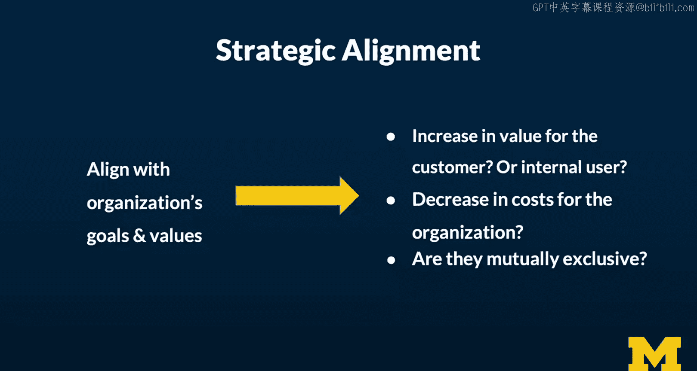
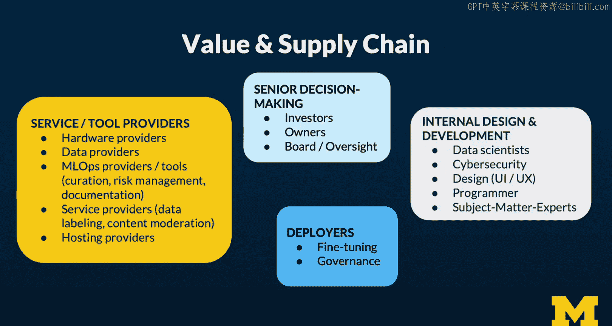
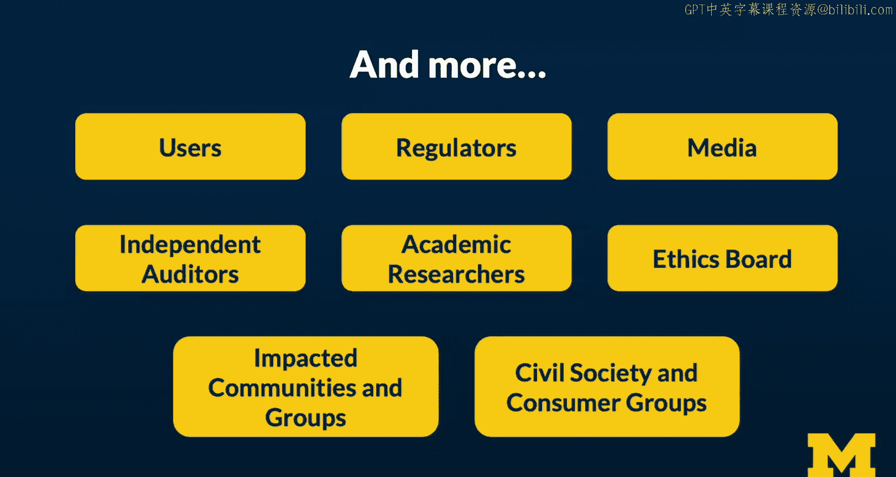
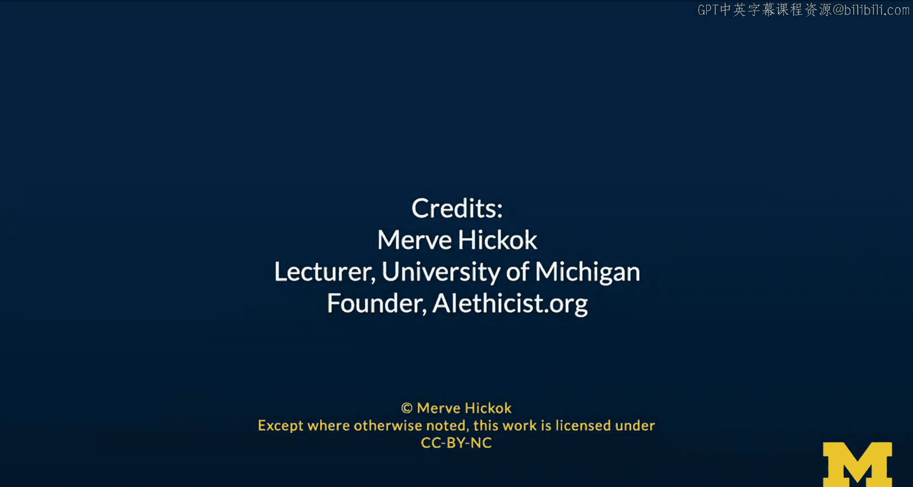

# 密歇根大学《负责任生成式AI简介（基础、对商业和社会的影响、政策、对未来的影响）｜Responsible Generative AI》中英字幕 p35 5_战略协同利益相关方.zh_en -BV1Uf421B7sR_p35-

So with these global governance discussions in mind。

 let's move to business considerations related to strategic alignment， stakeholders and costs。

The Generative AI Snapshot Research series survey conducted by Salforce with over 4000 full time workers across the industries。

And an additional survey of more than 4000 general population adults across US， UK。

 Australia and India。Show that businesses in these countries may have passed a threshold for current or plant use of generative eye。

3 out of five workers surveyed。Have responded that they either currently use or plan to use gen earth Ai。

Leaders responding to this survey expect gene AI to soon play a prominent role in their organizations。

And agree almost unanimously that their business must take measures to use gener I responsibly。

The same survey shows that when employees are asked。

 what would be necessary to establish generative AI is a trusted technology in general。

They respond with human oversight， and hand security measures。

Trusted customer data and ethical use guidelines as top responses。

These results highlight the importance of trust， as well as the need for responsible eye practices When deciding whether to deploy a generative eye system for an organization。

The questions should not focus on the hype of this emerging approach。Or a fear of Misselle。

In other words， the questions should not start with we should use generative AI find a use case。

Instead， the stakeholders within organization may identify the need to improve a certain process or an approach internally or externally。

And then ask if generative eye can be utilized for that purpose， similarly。

Instead of focusing on what a competitor may or may not be doing。The question is。

 what use case would create a competitive advantage for the organization or the brand。

Along those lines， strategic value alignment is crucial。

Really can be discussed along multiple layers in this context。

Will the use of generative AI align with our organizational values and goals。

Would increase value for our external stakeholders。Customers， citizens， etca。

Or if deployed internally， we help our employees。Will it decrease the overall cost for the organization。

 Can we achieve both the reduction of cost and value add for stakeholders。If not。

 which one do you prioritize。

One of the major complications in answering these questions。

And ensuring alignment has to do with the valian supply chain for AI and generative AI products。

No one entity has control over the entirety of development。😔。

Whether it is the data creation or labeling， hosting or computing architecture or model training decisions。

Different incentives， motivations， trade offs build layers of complexity with these systems。

Each of the actors have different levels of contribution and control over the final product。

They act from a different state of power。From a governance or legal perspective。

 the assignment of liability and responsibility is also hard。Naturally， the vendor。

 which eventually makes the decision to deploy the commercial product。

And any other entity which may build further applications over these general purpose products。

 hold the final responsibility。However， even then， there might be an imbalance。In other words。

The organization deploying the system may be too dependent on the one that developed the general purpose AI system in the first place。

In addition to all these parties in the supply chain。

 an organization may also need to work with many other external parties across the life cycle of AI models。

The long list of stakeholders underscore the fact that governance cannot be an afterthough。

And that it needs to be a multidisciplinary， to be effective。

External stakeholder engagement is most beneficial when it is a cooperative and co creative process。

In such approach， the parties work together for design that prioritizes the need of end users。

Such engagement can help not only with impact on risk discovery。But also improving the functionality。

 the representativeness and usability of the data enhance the products。

It goes without saying that participation of stakeholders from impacted communities must be meaningful and equitable。

To establish the strategic alignment and governanceness mechanisms for generative AI。

A whole organization approach is needed。Where multiple functions from across the organization are engaged to address the critical issues。

Geneatory eye systems require a commitment to maintain。They come in ongoing costs。

 It is a long term investment。Wishness to take into account investment in talent。

 technology infrastructure。Data acquisition and ensuring model quality。

 model training and maintenance， incident response， including possible PRcos。Cberse and compliance。

 in general。Additionally， by deploying generative AI。

 there will be an impact on the existing internal business or decision making processes。

In other words， it is important to assess whether the cost or time efficiencies we generate to AI in one area of the business。

Increasase cost and time for others in organization。

