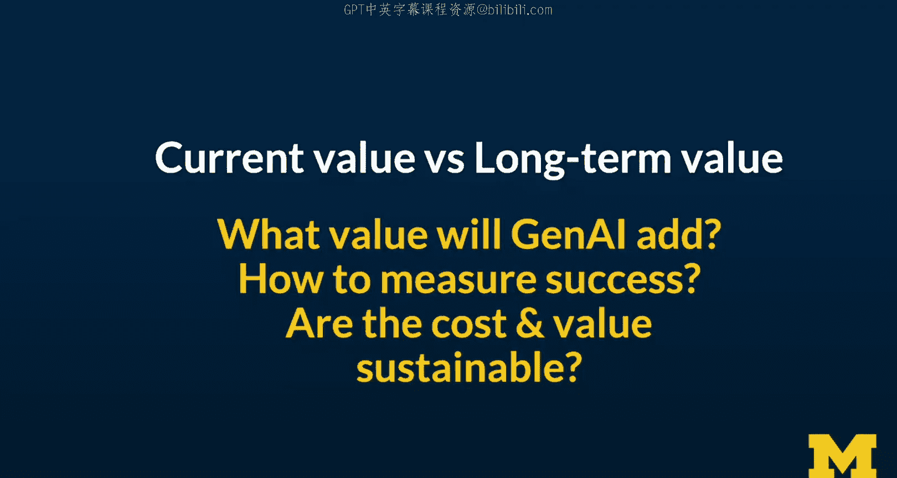
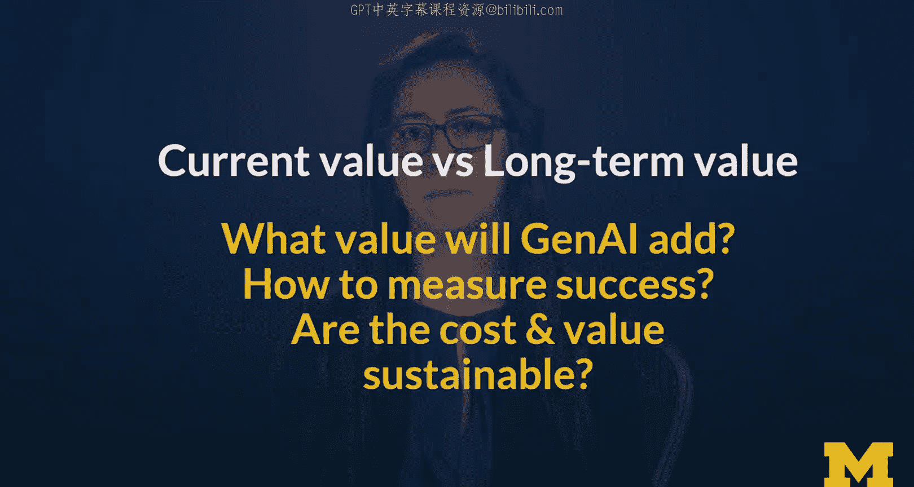

# 密歇根大学《负责任生成式AI简介（基础、对商业和社会的影响、政策、对未来的影响）｜Responsible Generative AI》中英字幕 p36 6_价值与成本平衡模型.zh_en -BV1Uf421B7sR_p36-

Once the use case for generator AI is agreed upon。The governance should ideally ask questions along the lines of。

What risks are foreseen with deployment of Gen AI。Do we have controls in place。

What policies and processes need to be implemented further。

What existing regulatory obligations we have applicable to generate AI。

What warnings or guidelines are regulators providing for this technology。

 How do we protect our own and client I P when using generative AI。

Do we need any contractual amendments or agreements with mono providers with our own customers。

How will generative AI impact the internal decision making process。

How should we prepare our internal stakeholders and workforce。

How can our workforce share their ideas for generative AI。

Whether for use cases for adoption or risks for or concerns they may have。

What mechanisms and plans do we have for misuse or malicious activities。

 which may impact organization。These are only the initial questions which may help organizations construct their own governance and help them in responsible deployment and use of AI。

 while also investing internally in their employees' capacity， learning and adapt。😔，Externally。

 the organization may first consider the upstream dependency created by deploying a commercially available geneve product or connecting with APIpis to existing foundation models。

 Additionally， how the deployment will impact its own customers downstream。

And whether the impact on customer experience， trust and brand loyalty will be positive or negative。

 As mentioned before， the cost of generative AI systems are incurred during model development and training and fine tuning stages。

As well as during the operational phrase， when user prompts create inferences。In fact。

 in the long run。Inference costs may be significantly higher than the initial training costs。

 In addition to the financial cost， businesses may also consider the environmental impact as well。

The amount of emission may be impacted by different factors， such as the hardware used。

 the amount of time and duration it takes to execute a code or run an inference。

Or even the type of energy grid you're connected to。When comparing different vendors。

 businesses may need to have an idea of the environmental impact。 However。

 current lack of transparency and energy use makes this comparison extremely hard or even impossible。

😔，After considering all the different alignment and cost factors。

The determination of value becomes the final question。

Decisions on whether to adopt the generative eye system would need to take into account the ongoing value add to the organization。

And an agreement on how to measure success。

The value equation must hold over time。😔。

In other words， the value of deploying generative AI must either stay the same or go up in the long term。

