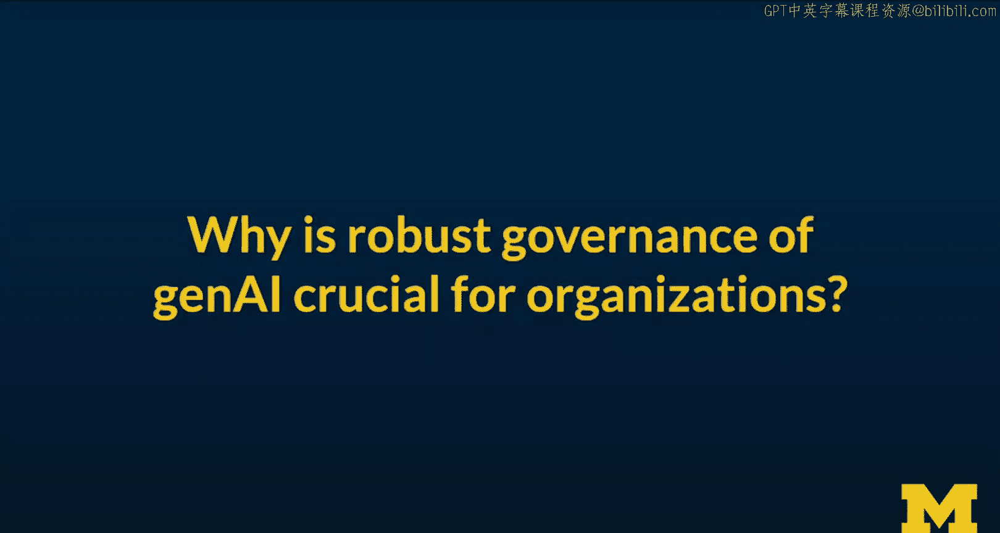
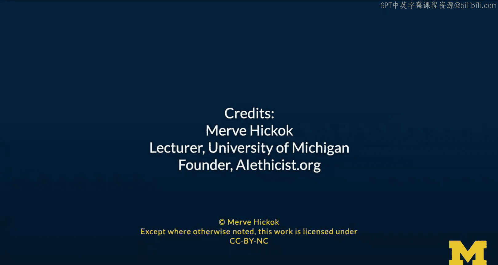

# 密歇根大学《负责任生成式AI简介（基础、对商业和社会的影响、政策、对未来的影响）｜Responsible Generative AI》中英字幕 p37 7_Susannah Shattuck访谈：生成式AI治理重要性.zh_en -BV1Uf421B7sR_p37-

AI governments really is important to me and I actually got into this work because I was part of the very early IBM Watson implementations team back in 2016 and of course this isn't that many years ago but from a technology perspective this feels like lifetimes ago multiple lifetimes ago there was a lot that we didn't know about deploying AI systems and of course back then it was narrow AI predictive machine learningbased systems。

 there was so much that we didn't know about deploying these systems into production and so therefore there was so much that went wrong you know a sort of statistic that I share sometimes is that a lot of our deployments that we were building for large traditional enterprises that didn't have you know deep data science expertise or understanding we would build deployments for them and then within six months。

These deployments would no longer be functional in production because monitoring your AI system for data drift and performance was not something that was really well or deeply understood compared to of course building and deploying programmatic software which you don't need to sort of care for in the same way and so I saw a lot of things happen with these AI systems that really opened my eyes to the novel and critical risks of AI deployed into the real world and so I had the opportunity after working on this Watson implementations team for a couple of years to join a team that was focused on building something completely new the first model monitoring platform for machine learning systems。

And I was actually incredibly fortunate to get assigned to own the bias detection and mitigation feature set for this model monitoring platform。

And you know， the last thing I'll share is that something that really galvanized my understanding of the importance of responsible AI and responsible technology and the challenges that we face in trying to get organizations to really deploy AI responsibly。

 I was actually in a couple of meetings with large banks where I was you know brought in to talk about my product and to talk about bias detection and mitigation。

 and I was asked to leave the room。Because there was this understanding or this belief that if an organization didn't know about bias in their models。

 they weren't going to be liable for it， but as soon as you had anything written down on paper that indicated that they had any kind of understanding of bias they were opening themselves up to legal liability and so lawyers would actually ask me to leave and that was an incredibly galvanizing experience that made me really wanted to devote my career to understanding how we can shift incentive structures and actually you know convince organizations to really take ownership over an accountability for the ways in which their AI systems might cause harm or invite new risks into the world both societal risks as well as organizational risks so I spent the rest of my career focused on that。

Robust governance of generative AI is critical because generative AI， like any emerging technology。

 is still something that's being understood by not only organizations that are thinking about deploying it。

 but even by expert technologists who are at the front lines of developing large language models。

 foundation models and。Without a clear understanding。

 I mean I think back to my early career where there was so much that we didn't know about how to actually manage and safely and responsibly deploy predictive machine learning systems in the real world those unknowns are even greater for these incredibly large models complex models where truly the top experts in the world。

 don't even know how to fully explain exactly how these systems work and aren't fully aware of all of the possible ways that they can fail。

 you know the fact that we're continuing to discover new failure modes。

 new ways to jailbreak or attack these systems almost daily I think just indicates the extent to which we are still trying to understand these systems so again。

 you know seeing this firsthand with predictive machine learning I know just how critical it is for an organization if you're using tech。

hn that is new that is not well understood to have the proper guardrails in place that ensure that you're not learning in the real world that you're not you know discovering failure modes and discovering risks in real time on real data making decisions with real humans involved because that is one of the fastest ways for your organization to get in the headlines and for really bad things to happen and so I think you know there there is absolutely a need for us to experiment with test and better understand this technology I certainly don't want to discourage people or organizations from trying to use generative AI systems to improve their lives and their work I think that's critical but you need to do so in a safe environment where even if something unexpected goes wrong you're not going to end up in the headlines。

 you're not going to end up harming somebody you're not going to end up。

losing your job right because something terrible happened to your organization and I've seen those things happen firsthand。

I think governance of generative AI right now is really about ensuring that you have again。

 a safe space， a safe environment to test probe and honestly try to break these systems to really better understand what kinds of guardrails you actually need to put in place if you want to put a generative AI system into production so one of the things that I always advise an organization that's thinking about experimenting with or testing generative AI is to set up a sandbox think about this as a rubber lined room right a safe space where even if things go wrong that system isn't touching real worldor sensitive data that system isn't interacting with you know uninformed people who might not understand exactly how risky or sort of experimental that system is。

Set up a sandbox environment where you can have a core team that is really focused on understanding the hard edges and failure modes of this system。

Can test the heck out of that system and can try all kinds of different things and the way that practically speaking we've seen this happen within the enterprise is that an organization will set up a sort of data clean environment where they're able to deploy a model into an environment where it isn't touching any sensitive company data where the people who are interacting with it are trained to know not to input a real worldor sensitive data into it and use that as a way to understand what might be possible with these systems so that's the first thing you know setting up the right experimental sandbox environment。

The second thing I would say， I think chat GT really caught the world's imagination and you know I think in many ways that that was great in making abundantly clear the potential power of these systems。

 but I think the real harm that chat GT did was that it made everybody immediately think that chat is the best possible interface for a large language model or you know it's the first interface that people think of。

And I actually think chat is the worst possible interface for an enterprise organization to start with because there are way too many failure modes to tackle there are sort of infinite ways that an individual can interact with a chat system and so you need to put up an incredibly high number of guardrails to prevent users from inputting you know harmful topics or jailbreaking prompts that are going to cause the model to output harmful things there there's just too many failure modes for you to tackle with chat so I actually encourage organizations to think first about embedding a large language model into an existing workflow where there's some kind of language understanding or unstructured data understanding component of that workflow that can be automated with a large language model put the large language model in a very narrow box don't give it a lot of freedom。

 don't give your users any freedom and interacting with it。

And it's going to be a lot easier to put you know a narrow set of guardrails in place to protect that narrow use case of course。

 as an organization becomes more skilled in understanding all of the failure modes of LLMs understanding all of the different ways that users might jailbreak or interact with these systems that ultimately results in harmful behaviors。

 you can expand the aperture of how you're allowing people to interact with these systems。

 but start really narrow because it's going to be much easier for you to set up you know a narrow set of guardrails。

This is such a good question， how do we manage responsibility。

 accountability and safety across the supply chain of generative AI and this is actually I think one of the biggest differences between governance of predictive machine learning systems versus governance of generative AI systems。

 predictive machine learning systems generally are built either inhouse or they're built and embedded in a very specific application because predictive machine learning systems are narrow you train them on a certain type of data they can't interact with other types of data and do anything meaningful。

Grative AI systems， large language models are fundamentally different where you know there's an organization like OpenAI that's trained a large language model that can now be used by hundreds。

 thousands of different applications for wildly different purposes and many of the customers that I work with Cto AI are not building their own large language models。

 they don't have the resources or the expertise and quite frankly they don't need to。

 because the reality is even fine tuning isn't delivering you know significantly better returns on investment in terms of performance compared to just the right prompting and you getting a generic large language model into an application where they're sort of the right user interaction in place and so a lot more organizations are using these models that were trained by somebody else out of box and one of the biggest challenges that we see in managing that supply chain management。

responsibility and accountability is the lack of transparency that large language model providers are giving to the rest of the market in terms of what data was used to train these systems。

 how specifically these systems were trained how they were tested and any sort of internal model development guardrails or safety measures that might have been taken there is very little transparency particularly related to the data that's going into training these systems because large language model providers say that's their special sauce right that that's what gives them their competitive edge but that is really dangerous or the rest of the market to be able to make decisions about where and how they are going to be willing to deploy these models and so actually I think one of the most important things that I'm excited for regulation to help with is enforcing transparency requirements across the AI value chain and you know speaking on March 14 the day after the fine。

the UAI Act has effectively passed I'm really excited about the transparency requirements that the UAI Act is putting on model providers to be explicit and transparent about certain aspects of the model that I do believe we're going to help people further up the supply chain building applications or deploying those applications make informed decisions about whether or not they're willing to use a particular model or whether it's safe to use a particular model so i'm excited about those transparency requirements I think the other piece that's really important when we think about the supply chain is testing at every point along the supply chain it's not sufficient for the model provider to do the testing and then the application builder to just take what the model provider gave them and take it as truth and this is because of this incredibly flexible nature of large language models you know the testing that a model provider does。

Is not going to be specific enough to really deeply understand the failure modes of the model in a particular context and so application providers need to do their own testing and deploys also should be doing their own testing to really deeply understand exactly how that model is behaving and performing in the specific context in which it will be deployed and that's another big difference between predictive machine learning and large language models you know in the past it was totally okay for your data scientist who both the model to say I ran all these tests you take that as truth。

 you deploy into your application you're good to go that's no longer the case so I'm excited also about the new testing tools and approaches the sort of expertise that's growing in red teaming that is starting to suffuse the entire supply chain and I think this is going to be a really important point of education for companies that are even just buying an application off the shelf that includes a large language model they need to be trained。

In the ways to test that model to ensure that it's going to work for their risk appetite。

 for their particular environment。

