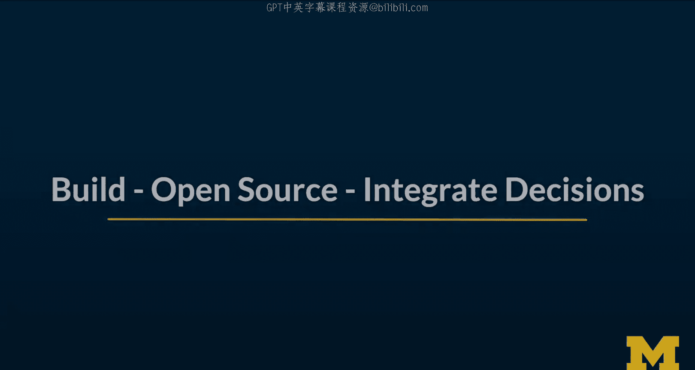
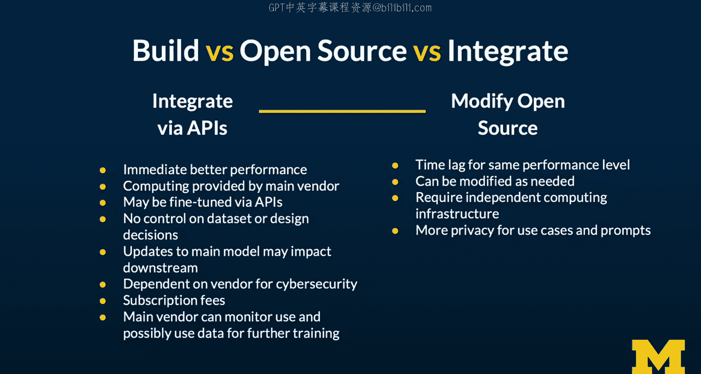
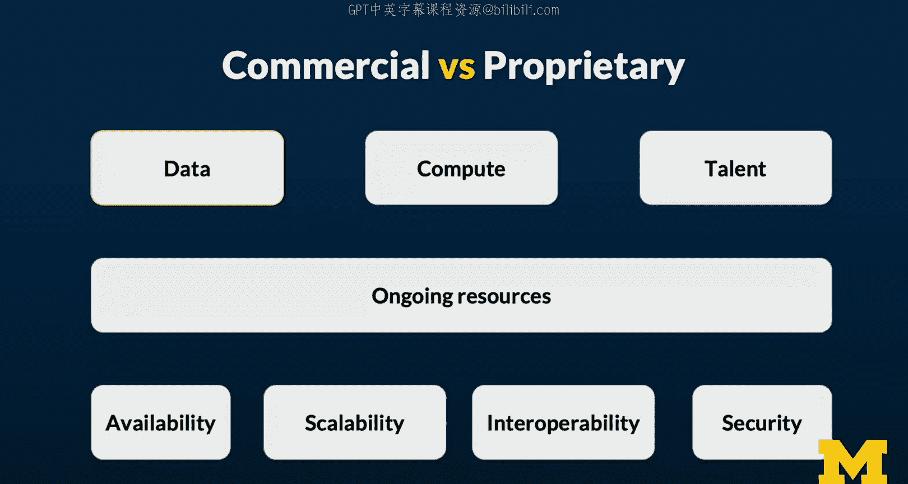
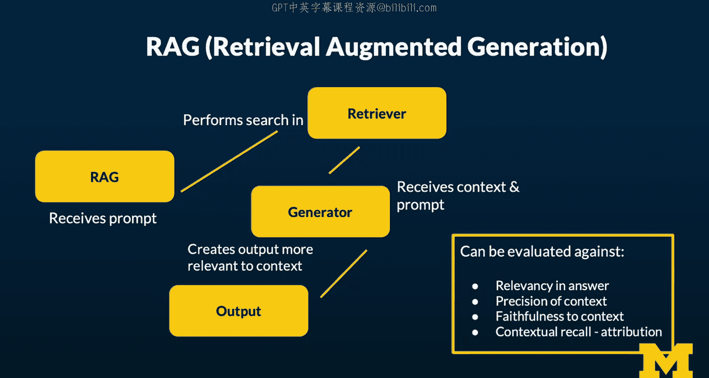
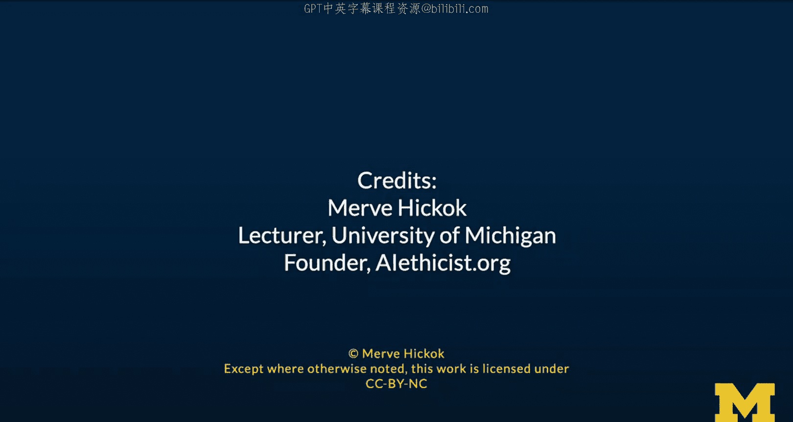

# 密歇根大学《负责任生成式AI简介（基础、对商业和社会的影响、政策、对未来的影响）｜Responsible Generative AI》中英字幕 p38 8_构建开源集成决策体系.zh_en -BV1Uf421B7sR_p38-

When making a decision about using generative AI。One of the first decisions will be built versus modify versus integrate。

Building your model from scratch allows you to have more control over the dataset Prominence and quality。

 The overall infrastructure and architecture， the tokenizer， cybersecurity and ongoing maintenance。

Training a generative eye system from scratch may not be an option for many small and midsized companies due to the significant cost incurred。

Many enterprises are instead considering whether to use commercial model via API。

Or use one of the few open source models to modify for their own purposes。

Each of these options come with their own benefits and risks。

Whereas commercially available foundation models may provide better performance。

And come ready in terms of computing required for training。

They may create dependencies to the vendor for areas such as model updates。

 cybersecurity or even subscription fees。Furthermore。

 the main vendor can monitor the use and depending on the settings or agreement。

 may possible use your data to train the models further。

Open source model performance levels tend to lag behind the commercially available ones by a few months。

😔，They require the organization to have its own competing resources。On the other hand。

 they allow for more control， both in terms of fine updates and privacy。

 further considerations will be whether the needed resources， Ie data， compute and talent。

Are available on an ongoing basis。And whether the business can manage the scalability。

 interoperability and the security of the product。

When considering to use an L alarm for business purposes。

You may note that these general models are great at high level information， retrieval and generation。

But perform words in domain specific areas。Or you may be considering that these systems for internal use。

Applying them to the organization's knowledge base。Inither case。

 the general models may need further fine trainingning or methods to supplement them with additional contextual or domain specific data。

This is where fine tuning or retrieal augmented generation AKI res come into the picture。

Regs allow the models to be connected to an additional dataset set。

 which may contain more domain relevant or organizational information。

When the user prompts the system。Rg perform a search within the domain data set。

That contextual information is then used to create an output。

When connecting to general purpose models， which may have a knowledge cut of data。

Rgs may also provide more recent and up to date information。With such database integration。

 the accuracy and relevance of the outputs can be improved。But not sold 00 per cent。

Even with the use of rags， the models are still based on statistical relationships and not reasoning or awareness。

Findine training， on the other hand， is using either human feedback。

 technicalical garrails or other AI model to adjust the outputs of an LLM。

Or to provide additional context。Fine tuning can be used to evaluate or reduce the harmful。

 offensive， toxic bias or inaccurate results。Or to program technical gutrails。In the previous course。

 focusing on the fundamentals of generative AI systems。

We have already talked about reinforcement learning from human feedback and other fine activities。

 In essence， the pretrained general model is provided with label data points。

 which include both the examples and the correct outcomes。

 Laed data must be of high quality so that the model can learn the patterns and connections more clearly。

And that its outputs are improved。It is less costly than training the model from scratch。

Fine tuning can also reduce the frequency of retraining necessary for all in terms of the technical right ills and evaluation。

 Or can also consider programming additional controls。

 same word of caution mentioned for regs applies to fine tuning as well。

These are methods to improve performance and outputs， but are not error free augments。

