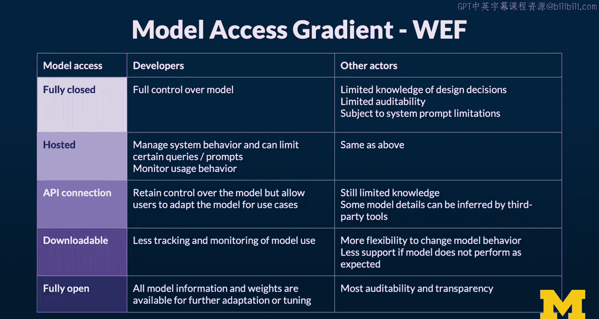
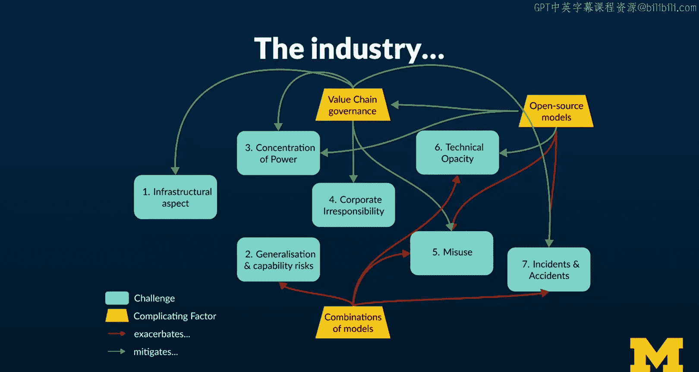
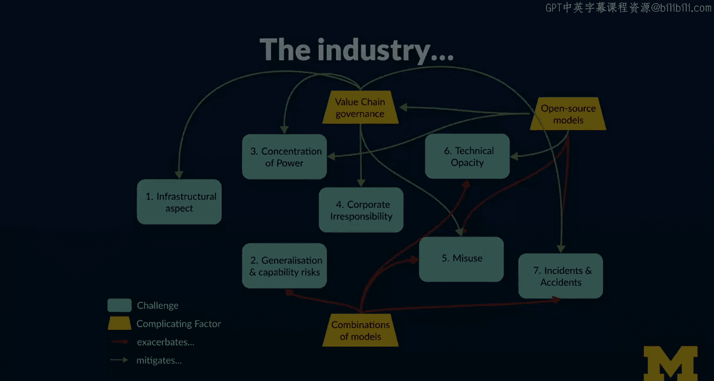

# 密歇根大学《负责任生成式AI简介（基础、对商业和社会的影响、政策、对未来的影响）｜Responsible Generative AI》中英字幕 p39 9_模型访问控制要素.zh_en -BV1Uf421B7sR_p39-

Another decision point is about model excess。If you' are a developer。

 this question is about how much access and control to provide to others。

If you are an entity comparing available models to make decision for your organization's use。

 the question shifts to how much information you need to make an informed decision。

Whether you need any flexibility to change the model behavior。

And whether you want your use to be tracked and monitored。😔。

Wd Economic Forum framework providess suggestions about further considerations regarding different access and control levels between developers and other actors。

In asking these questions about access and control。

We also need to be aware of the black boxs design of these systems。

Many of the current generate AI products or are paid by choice。😔。

The vendors choose not to disclose certain information， even when they technically can。

This creates issues with transparency and impacts the customers and users ability to make informed decisions。

Due to the size of these models， they are also complex by design。

It is not easy to understand why the model might have performed the weight that or exhibit certain behaviors。

Genenerate AI systems are probabilistic by nature。The model may provide different outputs。

 even though the prompts remain the same。😔，Is machine learning systems。

 the model behavior may also change over time due to the ways that users are interacting with these systems。

Black box systems， whether predictor or generative AI， create another major risk for developers。😔。

When model behavioural outcomes change， it is hard to determine whether that change is due to provos signature of the systems。

Or due to data and model drift， or due to malicious attacks。

As an emerging technology and industrial landscape。

 there are further complicating factors for decision making。

Many of these are driven by the fact that significant amount of investment is necessary for the infrastructure to build these models from scratch。

😔，Which， in turn， creates concentration of power， opity and issues of accountability and control。

Challenges related to the decision of corporate actors are also compound by the possibility of misuses。

 incidents and accidents。

