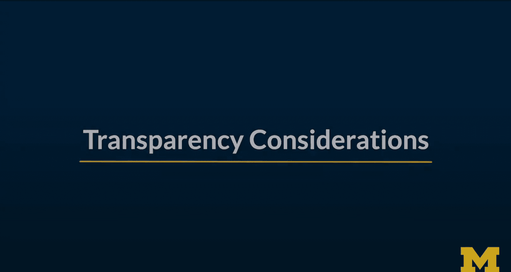
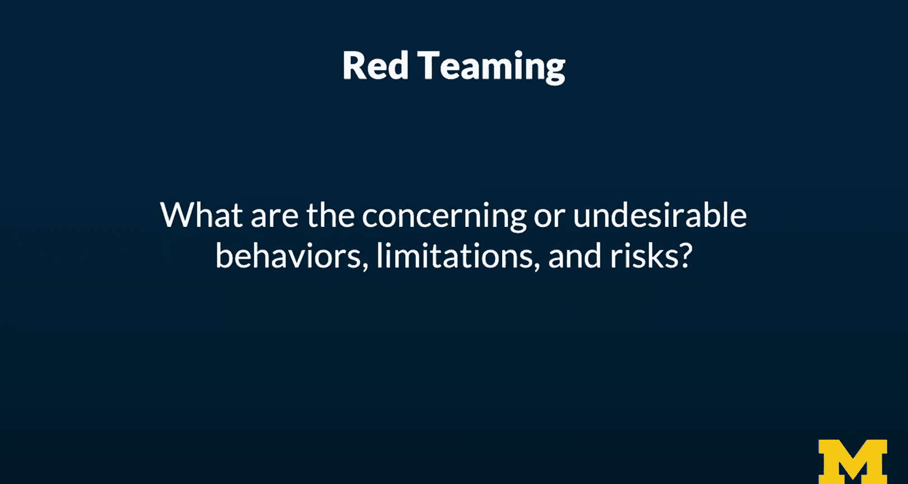
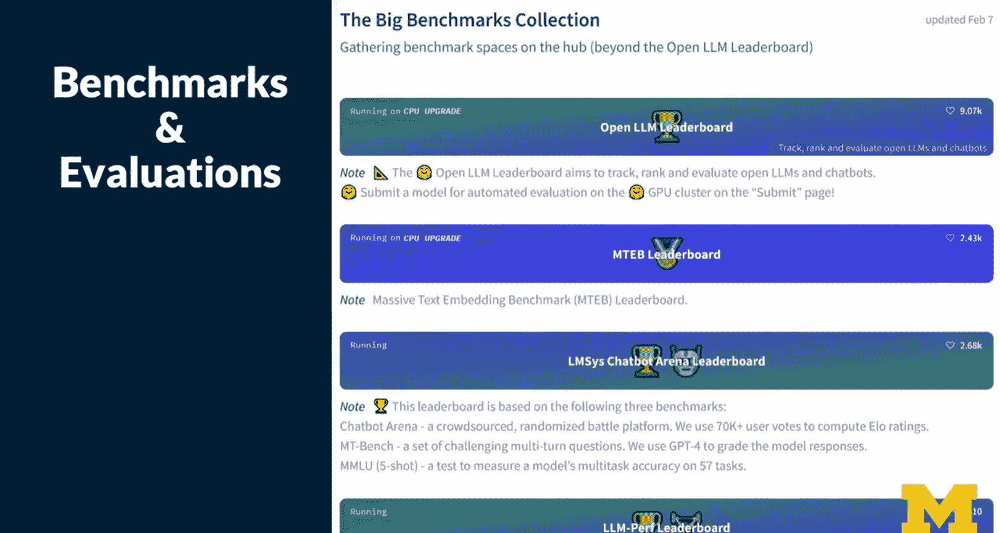
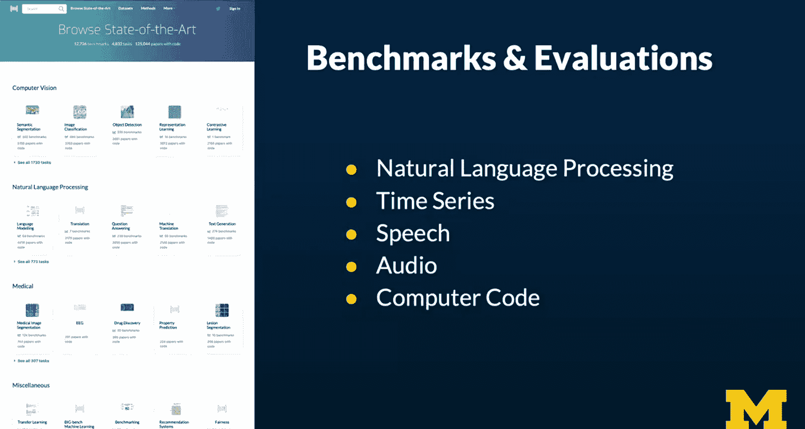
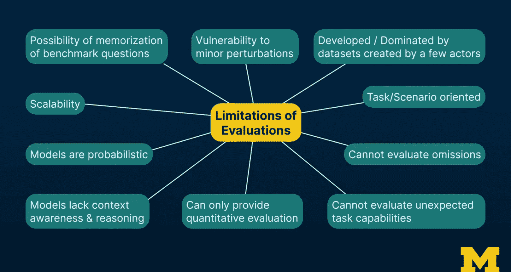
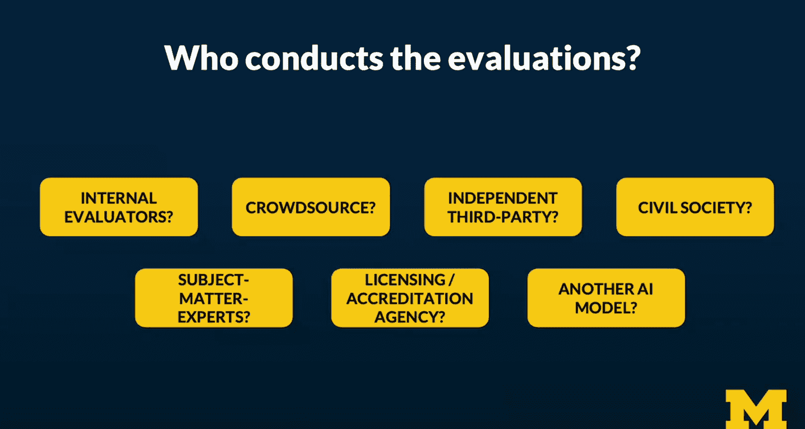
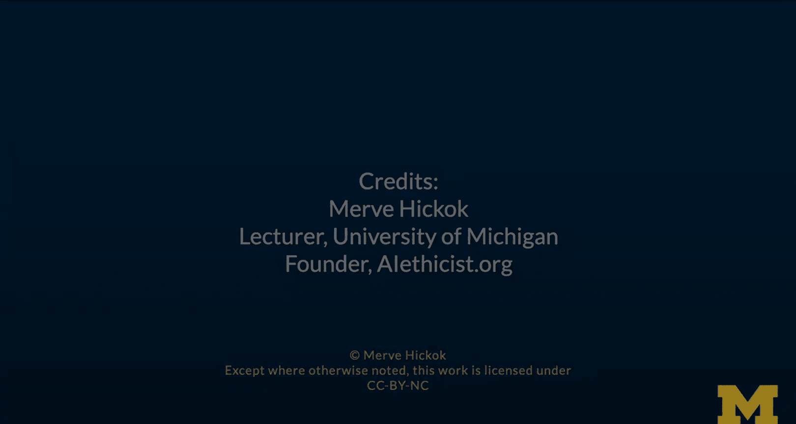

# 密歇根大学《负责任生成式AI简介（基础、对商业和社会的影响、政策、对未来的影响）｜Responsible Generative AI》中英字幕 p40 10_透明度考量维度.zh_en -BV1Uf421B7sR_p40-

Yeah。So if you're an organization which considered these factors and made a decision to develop。

 deploy or use gene AI system。What other governance mechanism would you need to consider。Earlier。

 we discussed the governance and the continuum of legal a binding to voluntary activities。

Organizations can also think of governance across the life cycle of Gene AI model。

Across this life cycle， activities relevant to stakeholder engagement， risk management。

 explainability and documentation apply to every phase。Furthermore。

 in each phase from development through operational monitoring。

One should also think of the quality of training dataset sets。Performance and resiliency。

Disclosures and markings regarding the generated or synthetic nature of the outputs。

Before a system is deployed， organizations also need to ensure monitoringing mechanisms are in place。

Will the performance of the system hold once it is deployed into a real world context。

If the system is connected to Internet， will there be changes in the data and response quality。

Are there any unintended or unforeseen or malicious use cases emerging。

All these governance garras ensured the responsible development。

 deployment and use of Gen AI systems。They also happen to be best practices for data and AI development。

In other words， these should not be thought of as additional， Nice to have activities。

 but actually reflect the quality and best practices of innovation。So far。

 we discussed several of these guardrails。Another method is red teaming generative AI models。

Red timingming is an evaluation process conducted by probing a model for concerning or unwanted behavior after the model is trained。

Red Diming has its origins in the military exercises and planning。

 where some are instructed to think like the enemy side。

The approach was then abducted by cyberse professionals to find vulnerabilities。

 R Timming has attracted more media attention than other safety and governance methods。

It is definitely a critical component of evolution， for sure。

It allows people from different expertise and backgrounds to assess the system。However。

 it should be considered only as a single tool within the wider governance toolkit range。😔。

Red teamming currently shares some of the limitations of evaluation benchmarks。

This just being resource intensive。Not having a standard or robust process。

Or possibly giving a wrong sense of assurance。 Red timingming is an exposed intervention。

Still needs to be formalized and structured。Definitions of what counts as concerning behavior should be agreed upon。

And the issues of access to AI models should also be addressed。

One redteing methodology may also not be applicable to all risk domains or contacts。Nevertheless。

 knowing the benefits and limitation of reing can help determine what other goness mechanisms can complement these efforts。

😔，Before deployment or through the user operational lifecycle。

 you may also want to compare the performance of the system。😔。

Benchmarks and performance evaluations for generate eye systems are still evolving。Private vendors。

 academic institutions and measurement and metterology institutions all work towards developing different evaluation methodologies。

For transformer models， comparisons include calculations for memory usage and required time to conduct both training and inferences。

In terms of the outputs， there are some areas with an objective ground truth。

 such as physics or chemistry。Against which accuracy re your contextual precision of responses can be evaluated。

However， it is a lot harder to evaluate quality of language or image responses due to the subjective or aesthetic nature of the evolution。

 In many cases， If you' are a business trying to assess commercial products to make a decision。😔。

You may end up in a situation where you are forced to compare apples to oranges。

 Another added complication in evaluation is that most of the currently available benchmarks are created for specific tasks or scenarios。

😔，And not to aate a system holistically。For example， you can evaluate a model for an arimetic task。

 its ability to solve coding problems， or on its accuracy for summarizing a given text。

You can evaluate for a combination of tasks。However。

 given the different architecture or training approaches。

 comparison from one system to another is harder。😔。

Currently， there are several limitations of evaluations which need to be overcome in time with more research。

😔，For example， some evaluation frameworks focus on the statistical elements of responses。

Such as calculated similar to between word embeddings。However。

 they may be less effective to recognize or evaluate omissions or unexpected task capabilities。😔。

These benchmark evaluations currently do not scale easily， either。😔。

Requiring efforts to ensure they can be implemented correctly to your model。

Branchmarks can have leakage where models memorize the answers， though so the results look higher。

Similarly， benchmarks may be vulnerable to perturbrations。

In short， benchmark evaluation should not be taken lightly。😔。

A final important consideration on evaluations is about who conducts evaluations for a generative AI product。

There are many actors， as I mentioned， or a combination of actors。

 which may be enrolled in the process。😔，In the absence of standard and comprehensive revolution methodologies and mandated disclosures。

 there is already an element of subjectivity and opacity。

This issue is further compound by the fact that human subjectivity can easily seep into the process。

 as well。

For example， when comparing results from models and selecting less harmful choices to feed back into the training。

The choices by human invaluators may be impacted by their culture。Their educational。

 professional backgrounds。Some evaluators may not have full access to the training dataset set and models。

Some internal ailators may not necessarily have diverse backgrounds to be able to consider and assess most of the societal impacts。

