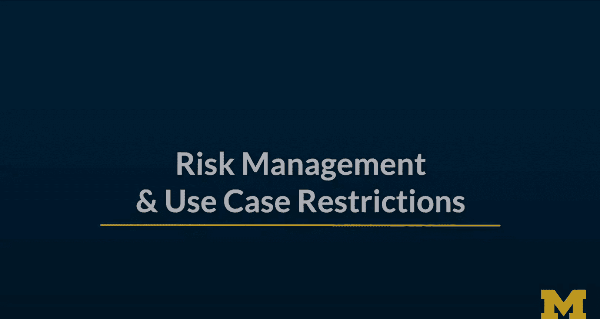
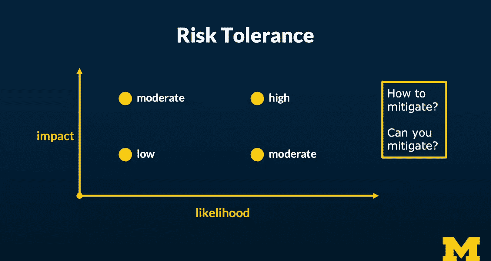
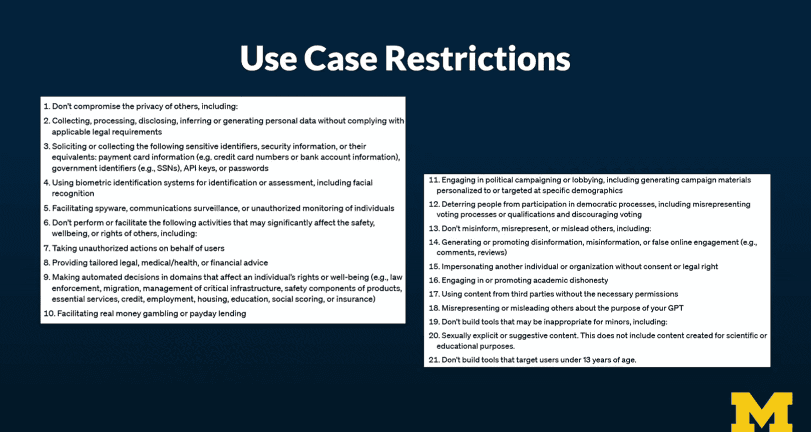
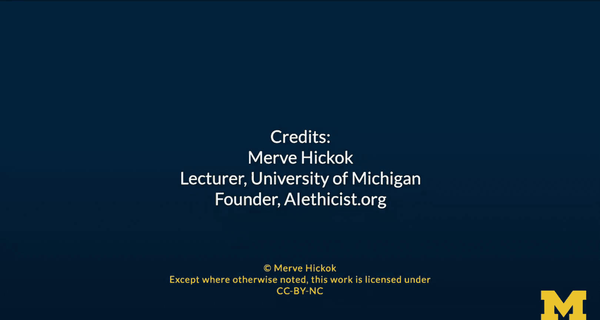

# 密歇根大学《负责任生成式AI简介（基础、对商业和社会的影响、政策、对未来的影响）｜Responsible Generative AI》中英字幕 p41 11_风险管理场景限制机制.zh_en -BV1Uf421B7sR_p41-

As the organization moves through design， development or deployment phases。

 there will be continuous assessment of risks， which were already covered extensively。😔。

Performance metrics and thinking through and examining all these risks gives an organization a better assessment of its risk tolerance。

Some risks may have a lower likelihood of happening。But the impact may be higher if they do， in fact。

 happen。Situating each risk at a certain likelihood and impact probability。

Helps organizations prioritize mitigation of these risks。

Upon the stress tolerance assessment。Or due to existing laws， some risks may become unacceptable。

All geneative AI products come with terms and conditions for use。

Some of these tools also have a list of unallowed use cases or restrictions associated with them。

Although these systems may create significant opportunities for business and individual users。

They can also be used to generate harmful content or misus by malicious purposes。

These systems lower the cost and technical knowledge threshold for adversarial actors to benefit from the technology。

Inknowledging such risks when restrict the use of model beyond intended use。

Naturally， just noting that some of the use cases are not allowed does not stop many actors from actual trying。

Therefore， a hood of deployment of a geneative air product。

Certain use case tracking may be necessary。This should be accompanied by clear violence。

Establishing the boundaries so that unintentional cases can be avoided as much as possible。

Additional mechanisms can include providing the users with feedback mechanisms。

Customer or discussion forums。As well as robust incident reporting tools。 Therefore。

 if you are looking to develop a generative AI system or deploy one that individuals may use for different purposes。

You may need to think about what your organization is comfortable and is not。

And how to monitor and enforce your decisions。If you' are an individual impacted by the use of generative eyes in these cases。

You may also inquire about the monitoring and response mechanisms。On the other hand。

 as mentioned in numerous cases earlier in the course series。

Some of the large models currently available in the market can themselves breach these content guidelines。

Posmakers and courts are trying to determine whether or how to hold some of these major companies accountable。

When large language models or image models themselves create toxic， deceptive。

 misleading or harmful content， data protection， privacy and corporate regulators are making decisions about the use of personal information and training these systems。

Another business decision is to whether to deploy a model internally or externally， or a combination。

And also whether to do a phase deployment versus a full one。Naturally。

 the internal versus external deployments are very much use case dependent。

The value proposition identified at the very beginning of the process may have already driven this decision。

However， the organizations may pilot deployment with a few departments first before rolling out in full capacity。

😔，Similarly， even if a generative AI system is meant to be for an external use case。

The organization may also opt for a phase deployment where the system is used internally first。

Working with stakeholders to re the system and then decide on the methods for full external deployment。

 Responsibility means we should be intentional about how we develop and deploy systems。

An avoid falling into a technical solution strap。In other words。

 just because we can doesn't mean that we should deploy them。

Sometimes the findings from the organization's risk assessment may result in a need for critical action。

Responsible generative AI means that。If risks to safety。

 security and human rights cannot be mitigated。The systems should not be deployed。

And if new risks to safety， security and human rights emerge with the systems that we deployed。

And that this risk cannot not be mitigated。Then responsibility also means terminating the system。

