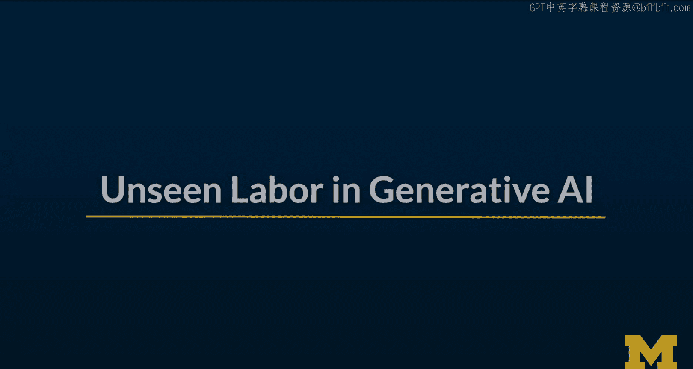
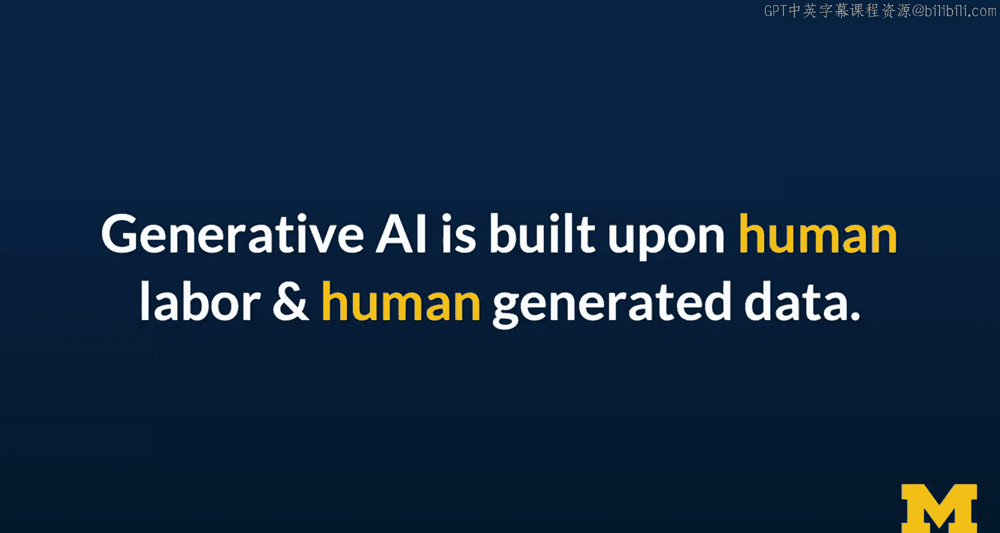
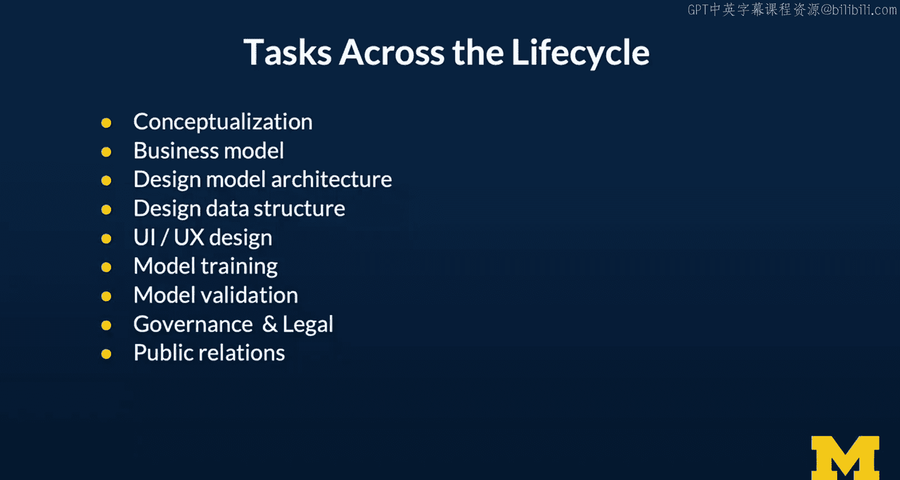
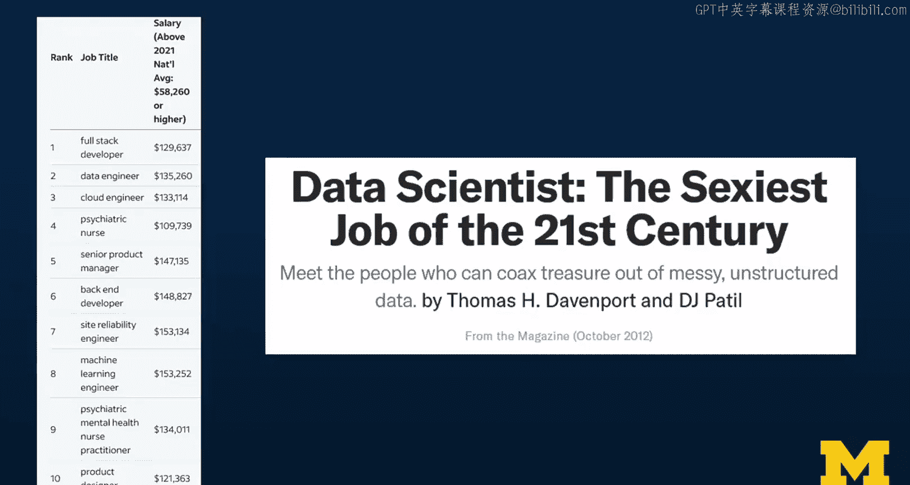
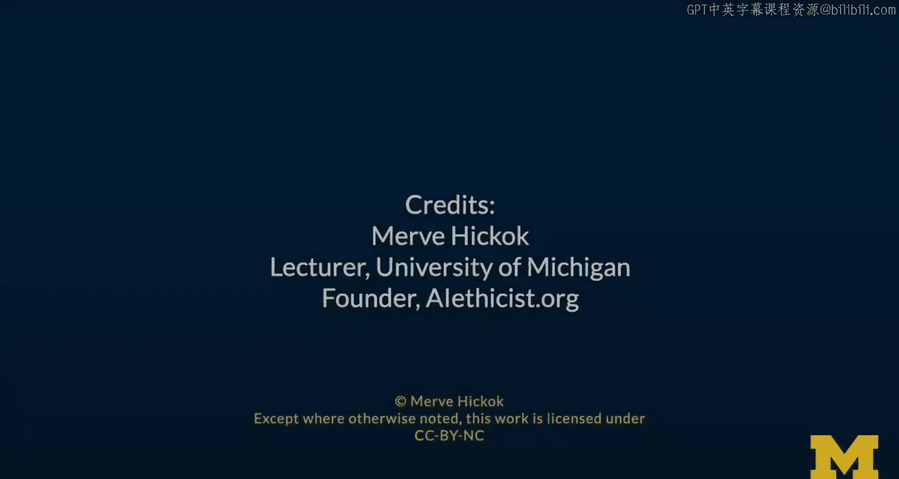

# 密歇根大学《负责任生成式AI简介（基础、对商业和社会的影响、政策、对未来的影响）｜Responsible Generative AI》中英字幕 p42 0_生成式AI隐性劳动力.zh_en -BV1Uf421B7sR_p42-

Generative AI is an exciting emerging technology which creates many opportunities and possibilities for a variety of use cases。

 just like any other algorithmic system， Gen AI is also dependent on data for its capability and performance。

However， one can argue that generative AI is even more dependent on human labor and human generated data than predictive AI systems。

Even before a new generative AI system is conceptualized and developed。

 the data is created by millions of people， the labor of authors， patent holders。

 individual bloggers and content creators， journalists， academics， artists。

 and even the social media posts of millions are all scraped to power these systems。

In the previous courses， we talked about the copyright considerations。

The interpretation of existing regulations and new policy making will define the future of copyright and intellectual property。

We will also see more synthetically generated data to include in the training data sets。However。

 human generated data will always stay as the ground root of these systems with its diversity。

 adaptability and edge cases。Once an idea is born to develop and deploy a generous AI system。

There is， of course， a significant amount of human labor， which goes into the process。

From conceptualizing the system to designing the model architecture。

Creating the data structures and interfaces。Evaluation， monitor and management of these systems。

These are the tasks which attract more attention and compensation in today's labor market。

 Slightly over a decade ago， Howard Business Review had called data scientists the sexiest job of the 21st century。

😔。

Fast forward to now， job titles related to data and AI。

Make up the majority of what is deemeded as best jobs in recruitment reports。

All the while， US Bureau of Labor Statistics forecast that the growth for such jobs will be much faster than for all other occupations。

However， this is not where the human labor stops。 Someone one still needs to aggregate data sets。

 conductduct quality enhancement， label data， Test and moderate the products and provide feedback and support both to developer teams。

 as well as customers。😔，These are the tasks that we really talk about。

As the people who work on these task are， for the most part， invisible。

 dispersed and underappreciated。In a recent IBM survey of more than 3000 CEOes in Tutepl countries and across three industries。

Concerns around data lineage or proness is noted as the biggest barriers to geneative A adoption。

Followed by concerns on security of data。Without data， AI does not exist。

Without quality data and robust data quality controls。

 gener our systems will be more prone to creating biased， harmful or toxic results。

Another report this time by AWS Chief Data Officer agendanda Survey similarly ranks data quality as biggest challenge to adapting generative AI systems。

However， we do not treat the data labourers the same way or anywhere close to the way that we treat the others in the supply chain。

😔，These tasks are usually repetitive， manual and labor intensive。

E the laborers might be tagging a video with keywords， capturing an image。

 analyzing sentiments in a text。Or transcribe an audiophile。 The work may involve monitoring toxic。

 violent or illegal content already in the script dataset set。Or though submitted by users。

These data labelers also help flag such content before model training。

They contribute significantly towards data quality that the CEOs are worried about。

This is essential work。 for example， accurately labeled data helps machine learning models learn from the dataset set more precisely。

Qualityality labeling helps reduce bias， and similarly。

Call to human feedback contributes towards a alignment of these models。Yet。😔，The work is outsourced。

 and underpaid。The labor market classifies the first set of tasks。

 such as developing the architecture and structure of data and models as knowledge work。

Whereas these essential tasks are considered a counterfactory work in literature。

 they are also called clickwork。The linguistic knowledge。

 cultural and local know how of these data workers are needed， yet not awarded。 In fact。

 while generative AI promises to create task efficiencies and to reduce under wordording work。

 there is actual significant amounts of such human labor that is poured into the development and maintenance of systems。

😔，The term ghoststwork， first coined by anthropologist Mary Al Gray and computer scientist Siidar Surri。

 High the West invisible and yet under appreciated and under compensated Labour that these systems depend on。

 Similarlyly， Professor Saty Roberts extensive ethnographic study of the commercial content moderation industry。

Explains the work of anonymous and unknown workers behind the screen。

Professor Roberts asks similar questions we asked in the previous course。Such as the need to code。

 address the processes by which certain content created by users。Is allowed to remain visible。

And other content is removed。Who makes these decisions， How are they made and whom they benefit。

 by annotating or labeling a video， image or text with keywords。

 these laborers process raw information。

And increase the accuracy of AI systems。

