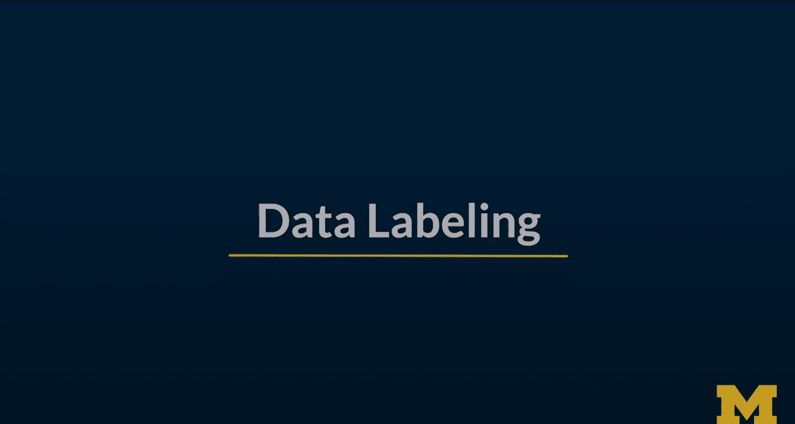
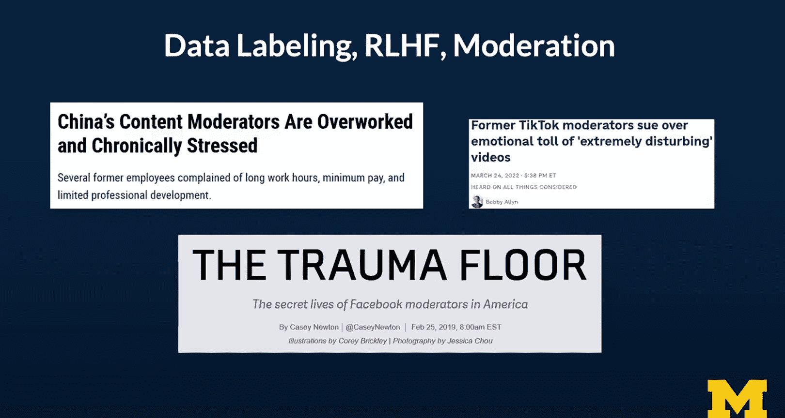
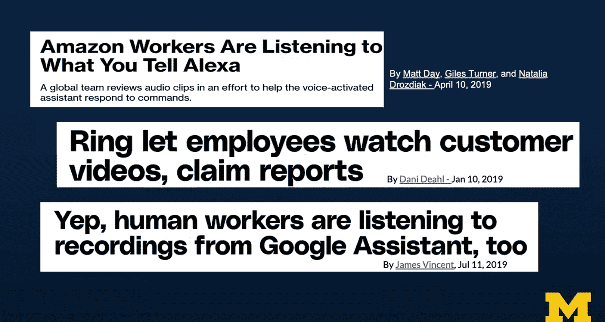
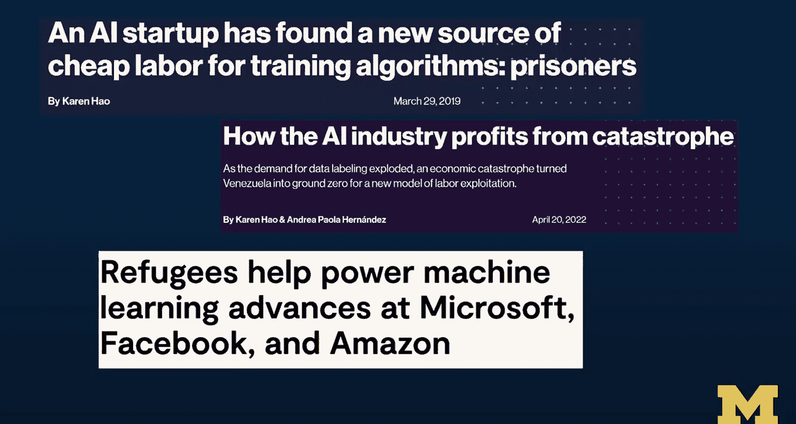
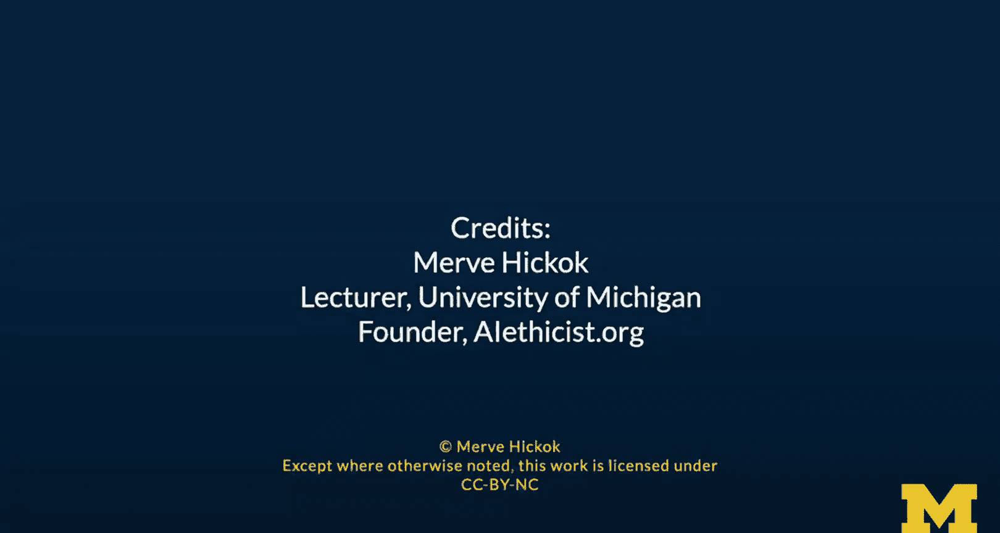

# 密歇根大学《负责任生成式AI简介（基础、对商业和社会的影响、政策、对未来的影响）｜Responsible Generative AI》中英字幕 p43 1_数据标注流程.zh_en -BV1Uf421B7sR_p43-

Unsupervised machine learning models， such as the ones used in generative AI systems discover patterns and relationships from the unlabeled data and without any explicit guidance or coding instruction。

However， this doesn't mean that human labeling， feedback or moderation fully goes away。😔。

There are still thousands of workers behind each of the major products that make the products safer and more usable。

😔，This may range from labeling videos for self driving cars and tagging cyclists， humans。

 mobility device， vehicles or obstacles。Labelling may also mean annotating data for violent content。

 hate speech or acts or traumatic content。It may even be an attaining sentiment in a piece of audio conversation。

Today， we know more about the less than ideal working conditions and the trauma of the labelers and content moderators。

Because of the work of investigative journalists and whistleblowers。😔。

Across the world， these workers are most often overworked。

 underpaid and chronically stressed due to their ongoing exposure to disturbing material。

 The essential but unglomerorous human labor is also needed due to the brittleness of AI systems。😔。

Mostly language based applications。As large as their training dataset sets are。

 these models may still encounter data or words not represented in their dataset sets。

In the previous course， we discussed about the limitations with the linguistic diversity of generative AI systems。

😔，When models cannot generalize well to queries or words that they haven't trained on。

Humans may have to step in。A few years ago， we saw the first public instances of such interventions with voice activated assistance。

Significant amount of workers were involved in listening to the devices you might have been using at home at school or work。

At the time， companies defended their actionss as needing to sign audioclyse to humans to be transcribed and in model training。

One company noted that its contractors listened to a 0。2 percentage of all recordings。😔。

Which makes for significant amounts of labor when you extrapolate to daily global usage。

All the privacy and data protection issues aside。Such actions show the brittleness of the system。

And inability to rely on fully automated means to label data or moderate content。

 Clickwork platforms and vendors provide AI companies with all workers。

Some argue that these companies provide work possibilities to people。

 where there are few or no opportunities。😔，The source of these workers extend to prisons。

 refugee camps or countries in economic catastrophe。😔。

Others argue that these practices are labor and data exploitation。

In majority of the cases， these jumps come with no labor rights。

 job security or even resemble minimum wage in terms of data labeling or moderation。

The job may require reviewing hate speech or even depictions of child abuse abuse， rape。

 murder or other violent activities， which cause significant trauma for these laborers。😔，However。

 more often than not， the work does not come with meaningful health support。😔。

