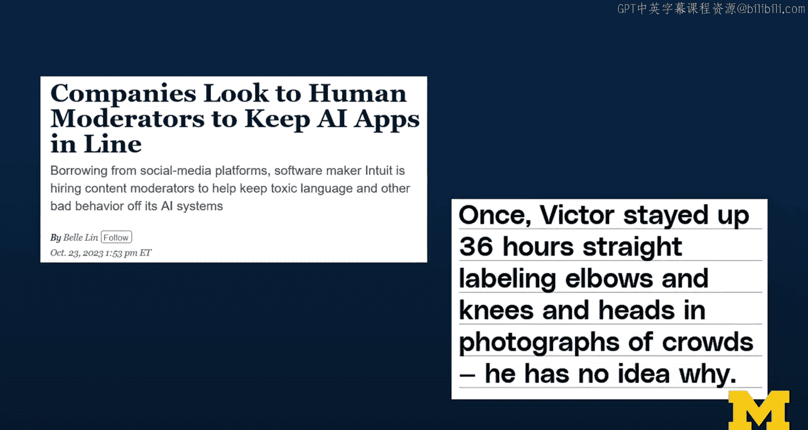
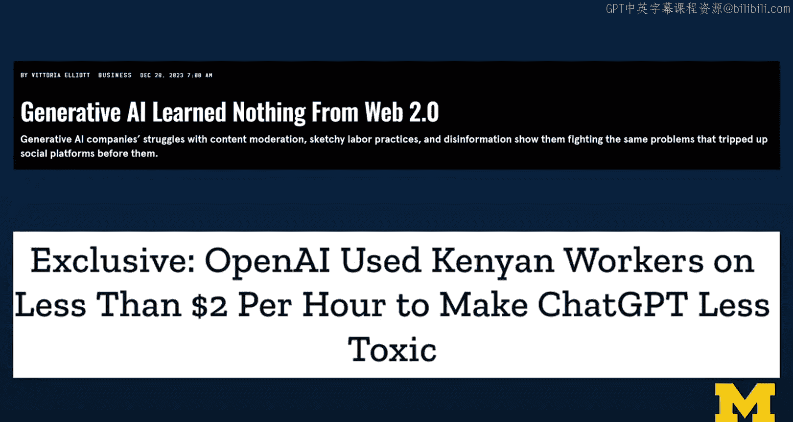
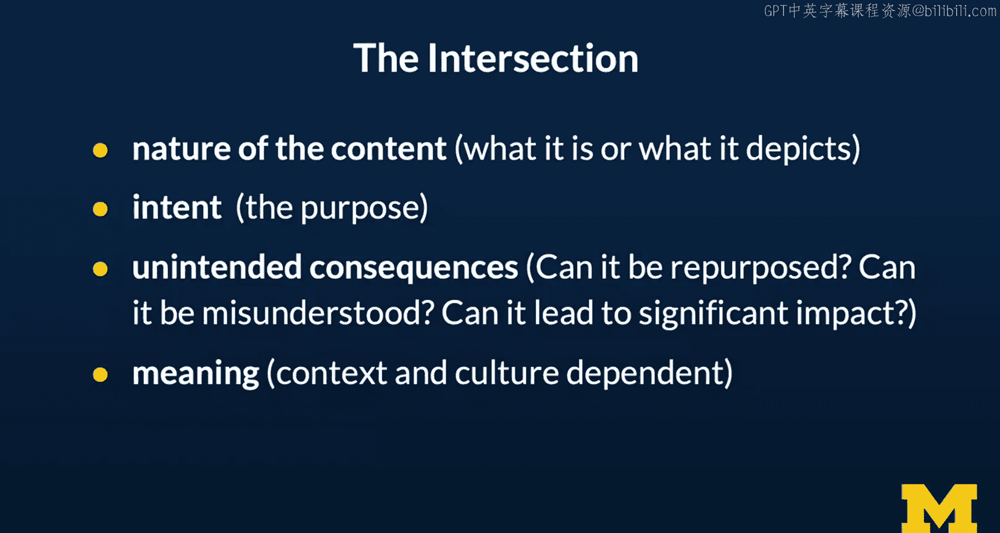
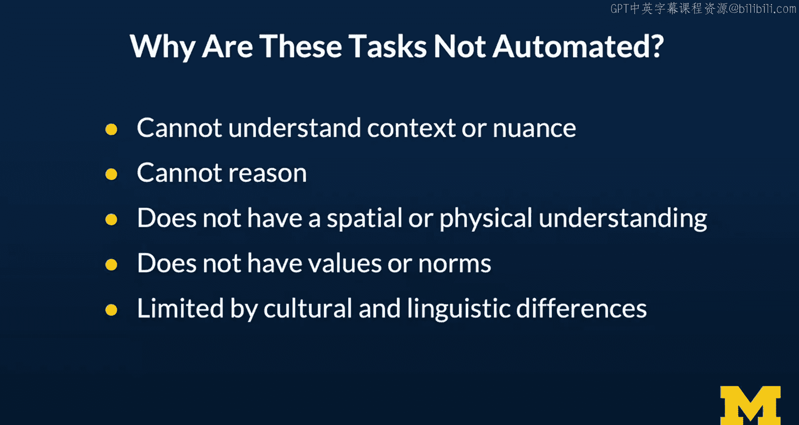
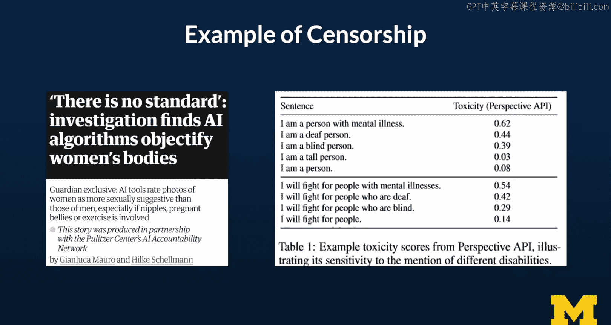
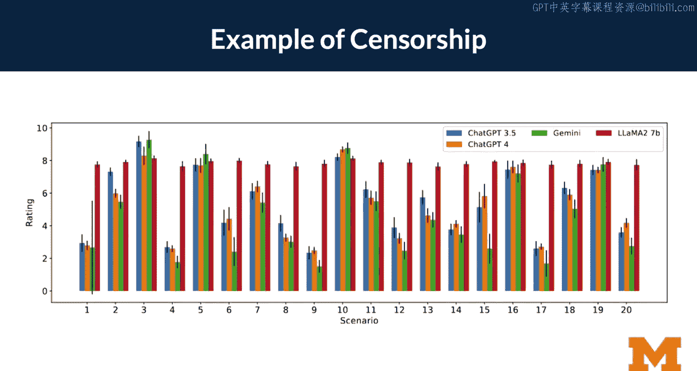
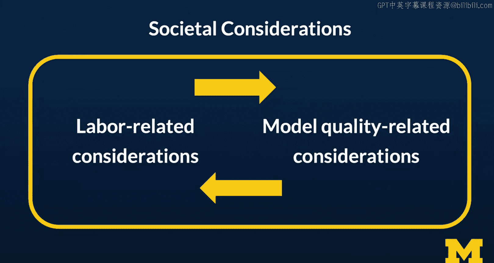
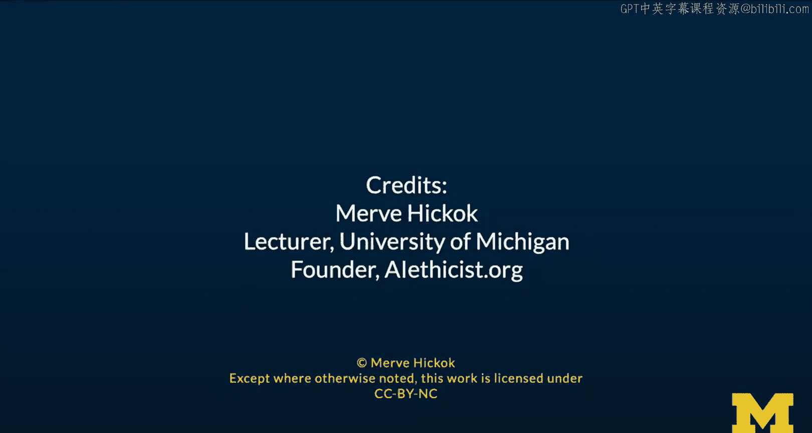

# 密歇根大学《负责任生成式AI简介（基础、对商业和社会的影响、政策、对未来的影响）｜Responsible Generative AI》中英字幕 p44 2_内容审核与人工反馈机制.zh_en -BV1Uf421B7sR_p44-

By providing easier means to create defects， generative AI systems will make the jobs of social media companies and moderators more complex。

 Social media moderation is still an unsold area with opaque management practices and the impact of such business decisions being felt by many communities around the world。

 Although companies also utilize AI systems to auto label auto detect autofil。

The need for human Labour and oversight is always there。

And such female labor can be outsourced for $1 to $2 per hour。 In many cases。

 the data laborers and content moderators have non disclosure agreements and are warned not to talk about their jobs。

😔，They work remotely， so geographically and physically， apart from their coworkers。

And their shared experiences。These workers are also not provided details of the product they contribute to。

So stay in the dark regarding whether their work helps to make a surveillance or weapon system more accurate。

😔，Or if it is about making a language model respond better to humans。

Or if it is about improving an autonomous vehicle system to avoid crashes and fatalities。😔。

Geneneary Air companies also face the same challenges of social media in terms of diversity of content and scale。

These are technical problems that currently do not have easy answers。However。

 labor practices are business choices。😔，Currently， Generative VI data labor choices are not different than that of social media companies。

As noted， there is also a significant need to provide human feedback to the models so the system can differentiate between relevant and irrelevant responses。

Genenetry eye models still need humans to help compare。

 correct and tune their responses for better alignment。And， of course。

 there is the need for continued moderation and the prompt responses for restricted use cases。😔。

What Professor Roberts use as an explanation of content moderation。

We can extrapolate the tasks of data labeling， feedback and moderation in geneative AI lifecycle。

In other words。These are the tasks where nature， intent。

 consequence and meaning of a language content intersects。

Whether it is understanding a user's prompt correctly。Or providing the user with a relevant response。

Geneneer AI has limitations when it comes to performing reliably at this intersection。

Gnai systems have contact windows up to thousands of tokens。😔，In other words， at any given time。

 they can take into account the equivalent of tens of pages of text when responding to a prompt。

 Ji systems may interpret the context of a prompt correctly due to this wider context。😔。

Or the frequency of relevant content present in the training dataset set。

 Why cannot we use AI to automate the human labor heavy tasks you might ask。

That is because the technical and fundamental limitations of generative AI systems are all reflected in these tasks。

As a statistical system， gener AI models cannot understand context or neuronsance or independently reason an experience。

Even with their long context windows as the conversation moves。

 the modeltto may also forget its initial instructions。Instead。

 start focusing on the later parts of the conversation。The responses may， for the most part。

 sound coherent and contextually appropriate。 However， if you wanted to use satire。

 figurative language， such as sarcasm， rhetoric or symbolic reference。😔。

The language model may also not understand the underlying meaning or intention。

 Or if you shifted the conversation along those lines。

The model may not capture the switch in the conversation。With more prompting。

 the model may correct its following responses。But the initial inaccuracies AkaA hallucinations may cause issues if not detected。

Due to cultural and linguistic differences。Automated means may not be fully useful to correctly detect。

 identify and label data。

This issue， in return， lowers the performance。😔，In the case of content moderation。

 it may also result in unintended censorship and discrimination。

 Automated content moderation is conducted through hash matching。

 A eye classifiers and filter mechanisms。Such mechanisms allow companies to conduct this work at scale and efficiency。

However， as noted previously， these methods are not error free。😔，Image models， for example。

 can classify photos of medical examination or pregnant bellies as explicitly sexual in nature or explicit nudity。

While language models can flag a person as using hate speech。

 if they used words like blind or deaf to express their own identity or toxic if a person was using certain LGBTQ lexicon to narrate their own experiences。

In other words， these algorithms can equate a person expressing themselves to those engaging in high speech and refuse to respond to their prompts or even censor their engagement。

 Auto sentiment analysis and censorship with LLms may also be inconsistent across different languages。

😔，Researchers identified differences in how current models differ in assessing the same prompt。

This research also shows how a single model may evaluate the same text differently across different languages。

 In this particular study， the researchers provided these four models with 20 different texts describing a variety of scenarios。

😔，Reflecting a diversity of sentiments。The models were prompted with the same text。

 in 10 different languages。😔，While the models often fail to recognize irony or sarcasm。

Some assess the same scenario in a more positive perspective， if in German， Polish and Russian。

And conversely， in more negative perspective， if in French， Italian and Japanese。

The models will be updated， and the training data will change over time。However。

 it is important to acknowledge the possibility for such inconsistency to continue。

And understand the reasons behind these differences。To wrap up。

 it is important to understand that the labor issues and the model quality related issues are intertwined。

Whether we are talking about developing the systems or go on the systems deployed。

 labor and model quality issues impact each other。At the macro level。

 this can also lead to further questions about societal and labor market implications。

One may think of outsourcing data work to click workers simply as a cost decision within an organization。

However， at scale， this may actually have a snowball effect over time。😔。

