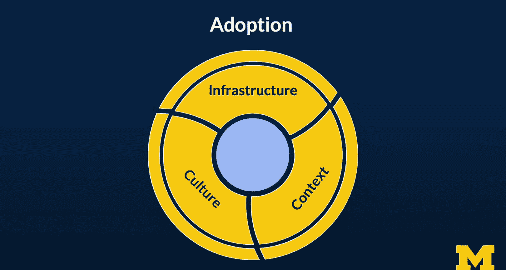
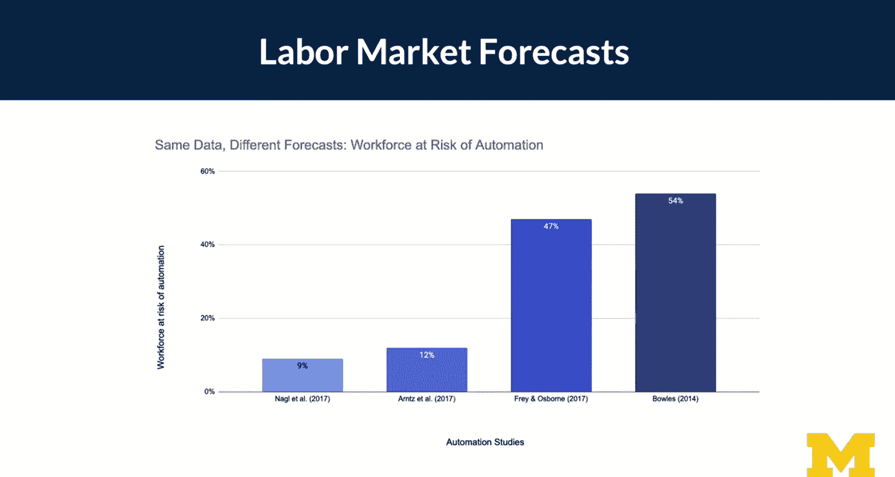
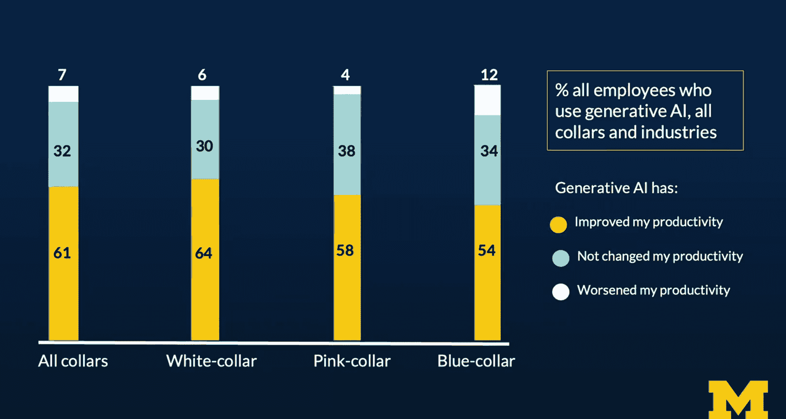
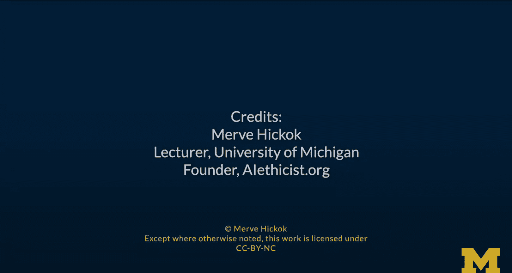

# 密歇根大学《负责任生成式AI简介（基础、对商业和社会的影响、政策、对未来的影响）｜Responsible Generative AI》中英字幕 p45 3_劳动力市场预测模型.zh_en -BV1Uf421B7sR_p45-

We know that as AI and gene I tools mature further and the business add up these products。

 emerging technologies will have lasting impact on the future of work。

It is also important to note that the response to generative AI in each country will be dependent on the infrastructure。

 culture and context， too， in terms of the infrastructure。

 different industries and countries adopt these technologies at different rates and for different use cases。

😔，Both the public and private sectors need to invest in infrastructure and talent to adapt AI。

The necessary capital investment reorganization and maturity will take time。

Given the differences in income levels， adoption may be faster in some countries。

Cultural differences will also impact the future possibilities。

Each society and knowledges and values labor differently。One culture's really expertise and quality。

 whereas another may prioritize volume and efficiency。

The type of work deemed more valuable can have impact on what tasks are more exposed to geneative AI in each culture。

Similarly， demographics will drive the trajectory of adoption of emerging technologies。

In aging societies， generative AI may be adopted to make up for labor shortages。

 or due to the higher percentage of ageging population， AI may not be adopted as quickly。Similarly。

 the attitude and trust towards technology in a specific culture。

May prevent organizations from delegating certain tasks to generative AI。

Contexacts such as high risk domains or professions requiring human interaction may also have different levels of adaption。

For example， we may not be comfortable with generative AI taking over risky tasks from doctors。

 architects， judges。Or alternatively， you may not want a feature where education is fully conducted by AI tutors。

Short story。 impactmpact will be felt at different ways and paces across the globe。

Over the last decade， we have seen many future of labor market analysis。😔。

Forecasting the impact of robotics， business process automation， AI， and more recently geneative AI。

Despite using similar or sometimes the same data， these forecasts vary significantly in terms of their estimates for unemployment。

An Oxford Internet study， in fact， shows that the estimates range from almost 1 tenth0 to more than half of the workforce population。

As being at risk of technological unemployment。

This shows us that it is notoriously difficult to assess the impact of technology。😔。

Given the short period of time since their emergence， difficulties in predicting impact， of course。

 doesn't mean that the predictions are not out there。

 Although generative AI is a relatively technology where we do not have enough data to make conclusive predictions。

😔。

There are several labor market and economic value forecasts available。😔，At the higher end。

 forecasts suggest more than 40% of occupations might be affected by generative AI in the next three years。

😔，Or that estimated 300 million jobs are exposed to automation。And yet。

 some other forecasts show percentage of jobs lost to gene AI in the US will be less than those influenced by General Fai。

😔，Accenture estimates GenAI will create $10。3 trillion in additional economic value by 2038。

MackKinsey estimates that Gene A I could add the equivalent of 2。6 trillion to 4。

4 trillion annually across the use cases they analyzed in customer operations， marketing and sales。

 software engineering and Randy。Goldman Sachs forecasts 7 or almost $7 trillion increase in global GDP and lift productivity up by 1。

5 percentage points over a10 year period。😔，Economic value is forecasted at such high figures because general purpose generative AI is considered as providing the tools and methods to create new business opportunities。

 too。Whether you use it to create your own content or whether you build a product on the available generative AI models。

 which you can then sell。There are certainly many new possibilities。

 in contrast to previous technologies， which had higher impact on blue color and manufacturing jobs。

😔，Genative AI has the potential to be implemented in every industry。

And across almost every job category。This means that white and pink color workers are now in the picture。

 too。Adoption rates are higher for white color workers for generative AI。

Which also means that the impact of automation or augmentation may be felt more by these workers in the future。

While tasks such as reasoning， team management， crisis response。Complex decision- making。

 emotional intelligence。Or any task requiring ethical human judgment or outside the scope of gen A I。

The technology promised the potential to increase productivity in more quantifiable tasks across different industries。

😔。

All Wyman， an organization which conducts regular surveys across 20 countries collects data about attitudes regarding generative AI。

 Surve results show that while the impact of generative AI on productivity is not 100% positive。

 it is a promising start。😔。

