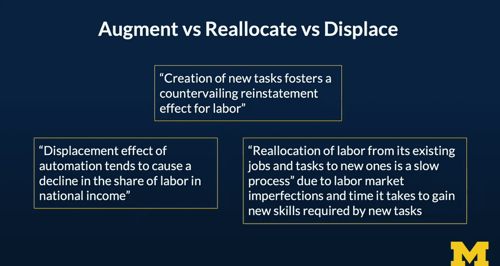
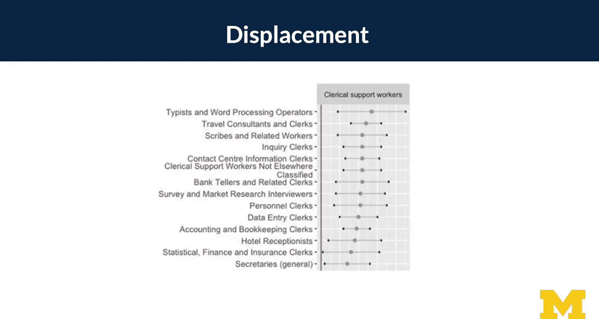
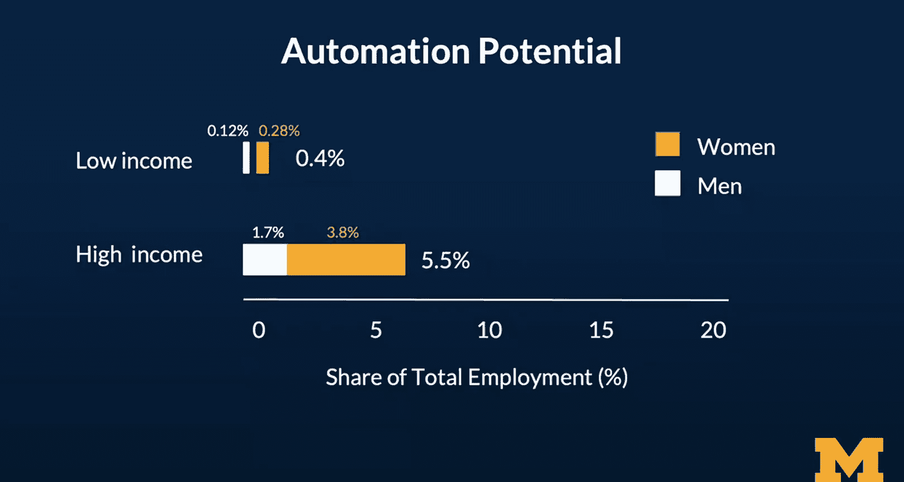
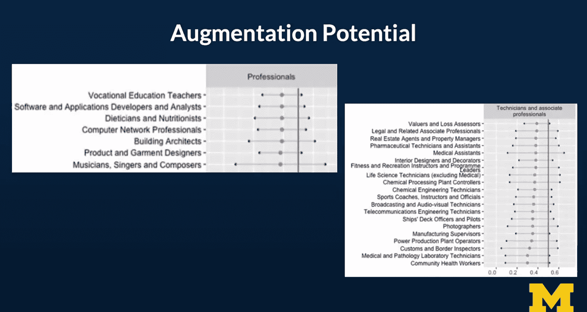
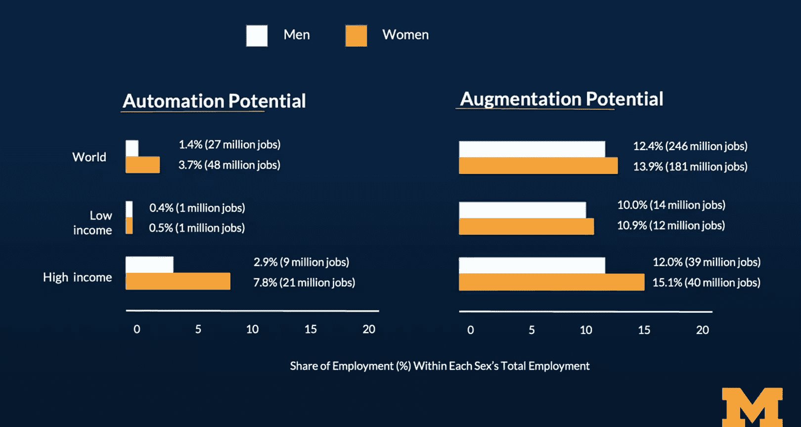
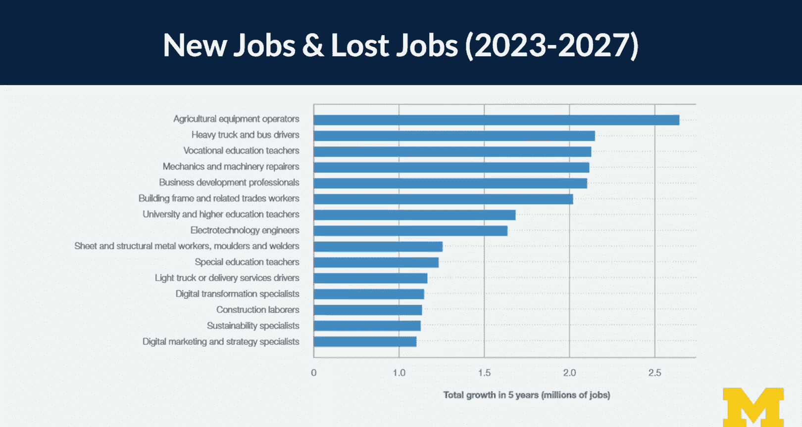
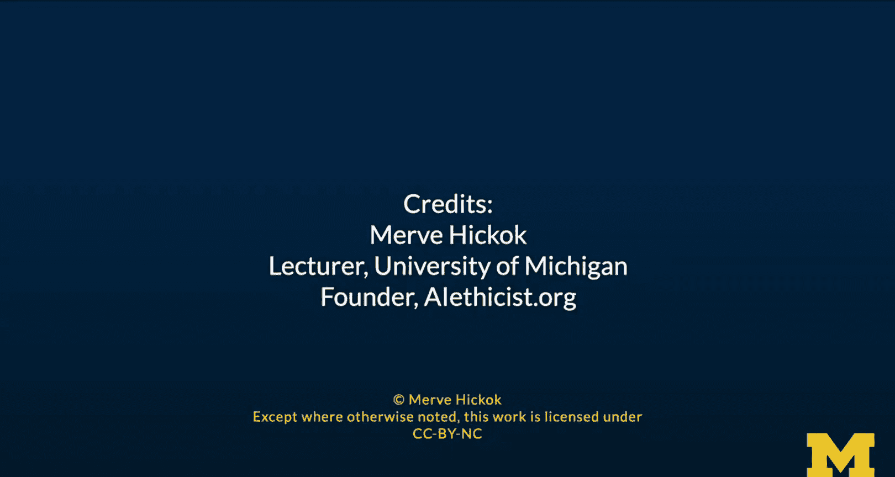

# 密歇根大学《负责任生成式AI简介（基础、对商业和社会的影响、政策、对未来的影响）｜Responsible Generative AI》中英字幕 p46 4_增强与重组替代战略.zh_en -BV1Uf421B7sR_p46-

When Gene AI's impact on jobs is evaluated。It is considered more effective to analyze at a test level。

And understand the exposure or sensitivity of a task to generative AI。

 rather than looking at a particular job title。A person's job may involve dozens of tasks。

 requiring different skill set。Some tasks may be conducted more easily with generative AI。

While for others， this technology will be irrelevant in the first course of the series。

 we spoke at length about the different tasks generated I can be used for。😔，Whether language， audio。

 video， image or coding tasks。A recent international Labour organization， Iola report。

Reviews tasks across hundreds of occupations and identifies tasks with medium and high generate A exposure by occupational category。

😔，In this analysis， clerkerical support， service and sale positions have tasks which have higher exposure。

 Prominent economist are Ajamolo and Pacal Rerepo argue that displacement due to automation tends to cause a general decline in share of labor in generating national income。

😔，This is counter well to certain extents by creation of new tasks， however。

Such relocation may be slow and painful due to the complexities of Labour market。😔。

The time it takes to gain new skills required by new tasks。😔，Time， it takes to search and find a job。

And the general time like that educational institutions respond to changes in labor markets。

A full displacement of the human element of a particular job。

 Nius states that the technology has full capability and capacity to replace the existing mode。😔。

And that an organization can deploy to the full extent。 Let's set the technological capability aside。

 for a moment。Let's also set aside the fact that， in some cases。

The risks and business considerations may still require business to continue to have human oversight over regenerative outputs。

 There are still elements of affordability， local Labour conditions and social determinants。

 which impact Labour displacement。 In this sense， you may see very few full displacement of a job title。

😔。

But rather， businesses conducting certain tasks with generatedative AI。

And reallocating the time to other work。International labor organizations analysis also shows that clerical shops are more exposed to automation and displacement。

 task automation and displacement due to generative AI。

Is expected to impact women workers significantly more than men。

This is due to high representation of women in such jobs。😔。

Regardless of the income level of a country。Women are expected to be impacted almost more than double than that of men。

In contrast， tasks with professional occupations or for technicians。

 machine operators are more exposed to augmentation with generative AI。

These occupations have a higher number of tasks where the worker can use GenI to help with a test to inform the substance of their work。

😔，Or to provide them access to information in a more efficient way。 Similarlyly。

 share of jobs with high augmentation potential is higher among women than men。😔。

At a macro level， high income countries are expected to be significantly more impacted by the automation potential of Geni。

😔，Regardless if the job is in low or high income country。

Or with high automation versus augmentation potential。

The woman workforce is estimated to be impacted significantly more than males。😔。

Such differences are important since the gender divide and access to work。

 as well as gender wage gap are already serious issues impacting almost all countries。😔。

In terms of worker perceptions。Pink color workers are less concerned about geneative AI。

 making their job redundant。😔，Or their tasks being completely automated。😔，Similarly。

 jobs which necesstate human interaction， nuanced judgment。

 emotional intelligence and crisis management， such as healthcare， education， aviation。

 law enforcement。😔，Are all considered to be less prone to displacement of the human worker。😔，However。

 as if technologies augment to replace some tasks。😔，They also create new tasks， and new jobster。

Although the transitional periods may be stressful in some labor markets。😔，In the long run。

 new jobs may offset the changes。Economist David Otter found that 60% workers employed today are in jobs。

 which did not exist in 1940。😔，Labor market changes are impacted by a variety of factors。😔。

Ranging from environmental reasons to investments。Population growth， supply chain， efficiency， etc。

However， as new technologies emerge， societies find new ways to utilize them and or demand change in distribution of power and wealth。

😔，Hence， the important questions are whether socioeconomic inequities and divides are narrowed or widened by technological changes。

And whether the quality of work will be improved or worsened for workers in general。😔，In other words。

 as technology takes over tasks in certain sectors。

Will it push human workers toward jobs requiring lower skills in worse wages。😔。

Since the deployment of AI and generative AI technologies。

 one of the most frequently asked questions is which jobs will be created and which jobs will be displaced。

😔，It is a question， with no definite answer。However， through 2027。

 significant amount of jobsbs marked in blue in the chart。Our project had to be created。

And some displaced， Mark and purple。The top and bottom of the list shows changes in both direction as a fraction of current employment for the global employee data。

😔，Some jobs are forecasted to grow at higher fractions compared to current size of the employment。

AI undd related jobs currently do not employ as many people in other categories。Therefore。

 the fraction growth is expected to be larger。However， in the same report。

 World Economic Forum actually predicts the absolute number growth to be focused on vocational jobs and education。

These jobs also happen to be the ones， which can be augmented。😔。

But are rather harder to automate regenerative A systems。

