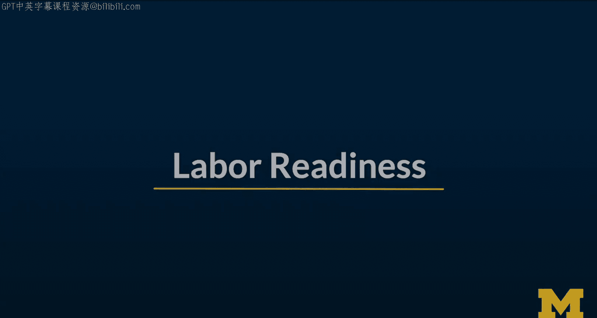
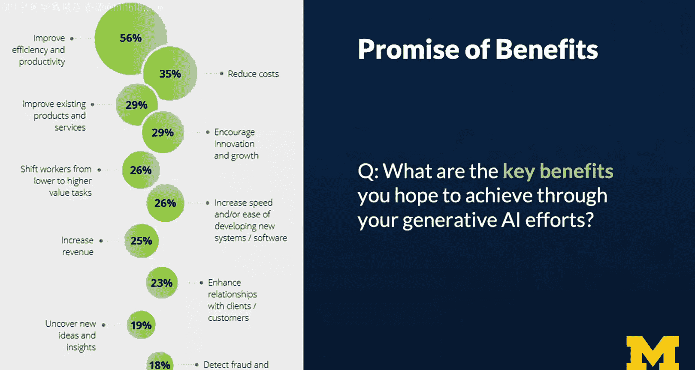
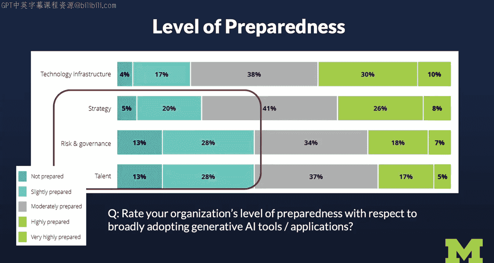
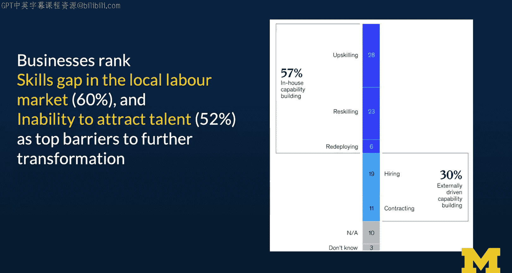
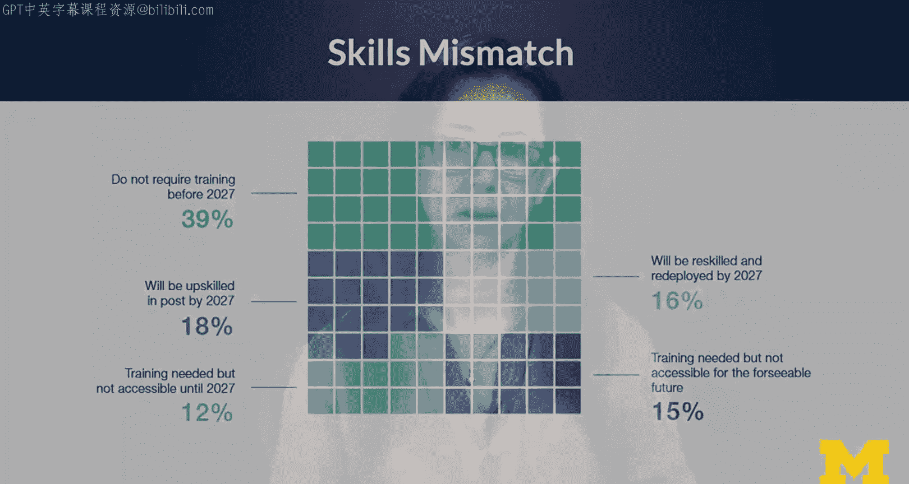
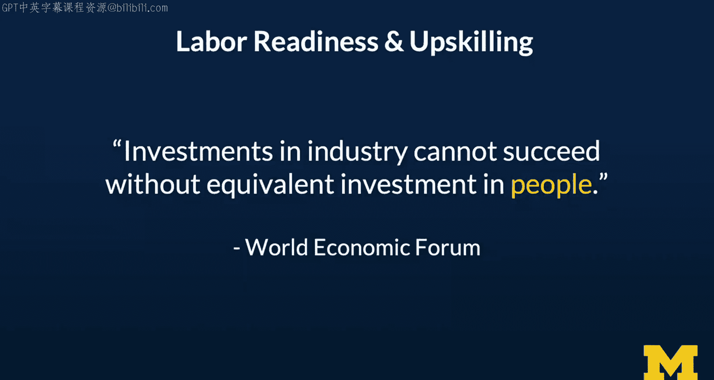
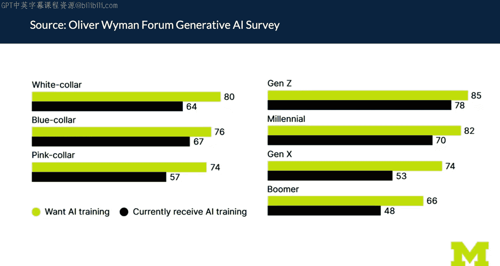
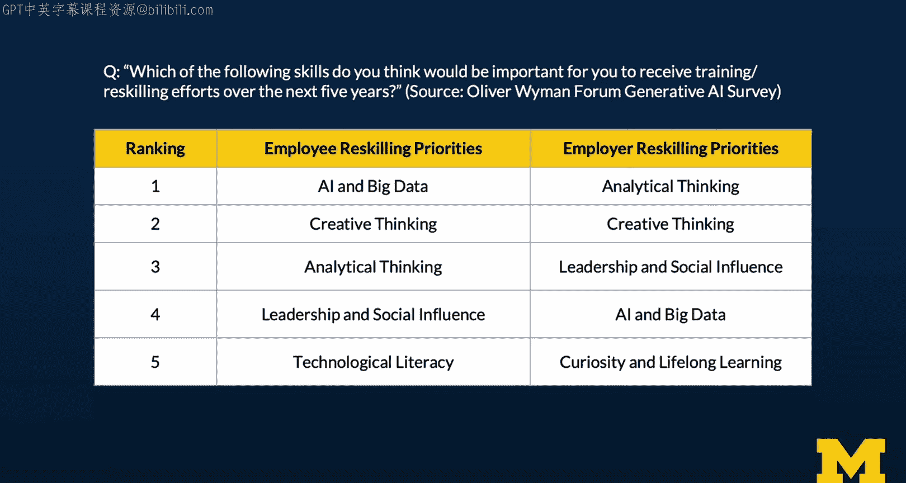
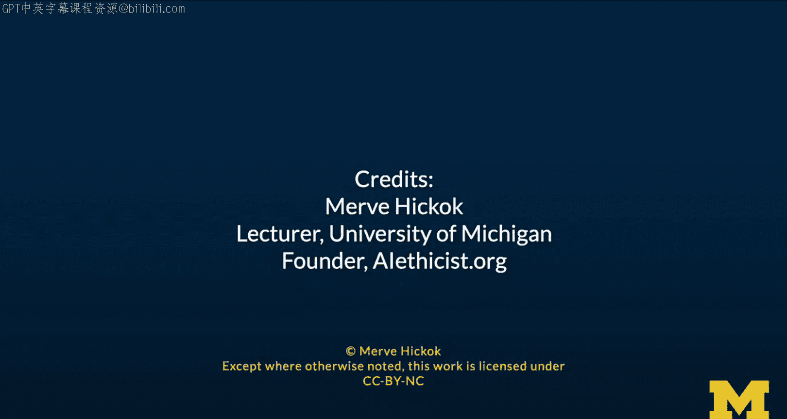

# 密歇根大学《负责任生成式AI简介（基础、对商业和社会的影响、政策、对未来的影响）｜Responsible Generative AI》中英字幕 p47 5_劳动力准备度评估.zh_en -BV1Uf421B7sR_p47-

We had noted previously that the benefits business expect from generative AI。

Rangnge from increasing efficiency and productivity to reducing overall costs and enhancing relationships with clients。

We had also note that the main enabler for any major deployment will be the human factors。

And that investment in human capital is a necessity for any business。

 considering developing or deploying gen eye systems。 However。

 surveys show that employees are not able to meet the skills gap in the local labor market。😔。

Or attract the amount of talent they need。

In other words， the existing labor market have not kept up with the technological changes and the skills necessary for these technologies。

😔，And that the businesses are having a very hard time to meet their talent demandends with the current short supply。

 This is necessitating the employers to turn to internal skills building activities to close the skills and talent gap。

 The bigger question is if the changes will be in place。

 reducing the pain and duration of the transition。😔。

Employers expect almost half of the worker skills will be disrupted within five years。😔。

And they also forecast 6 and 10 workers will require training before 2027。

 while some may be rekilled and be ready to meet the challenges of the evolving labor landscape。

 forecastcasts also show that more than a quarter of the workforce will not have access to the training needed。

😔。

Such a gap means that the supply of the workforce does not overlap with the demand of the businesses。

 This can also have cascading societal impacts。 Sll gap in labor market will not be sold by itself。

 which means that without investment， businesses will keep continuing to compete for the same talent pool。

😔，This might be an attractive proposition for the small portion of workers with necessary skills。

 as it would drive their income higher。However， it is neither attractive nor preferable for the industries or the society at large。

 For example， Covid pandemic has shown us the precarious situation many countries found themselves in with health care and education workforce。

😔，A key message from world economic forum leaders regarding impact of AI and generative AI is that。

Investments in industry cannot succeed without equivalent investment in people。😔。

Instead of trying to attract the same small talent of workers with necessary skills。

Public and private organizations need to invest in their employees to expand the labor market。

 In fact， companies leading AI demonstrate a significant lead in how they approach rescaling and investment in workforce。

They tend to invest to expand the pool of AI talent。

 build employees AI related skills across both technical and non technical jobs。

Skills mismatch can be narrowed down by both educational system and by employers。

 While education system slowly transforms itself。Employers can create more agile responses to skill mismatch and needs。

😔，Surveys show that the interest in AI training is similar across the industries。

Whereas there is difference in age levels。Junior employees seem to show more demand in AI training。😔。

I they may be more excited about opportunities and also more concern about AI automation。

However， reskiing needs to be a co effort， too。😔，While almost everyone agree on the need for labor readiness and the need for resing。

😔，There may be some mismatch between what the employees prioritize versus what the employers think are the most important risk killing areas。

This is not to say that the differences are incompatible。

 but to showcase that when organizations are thinking of educational programs。

There is to be a wider and holistic discussion to envo employee dissatisfaction and discontent。

