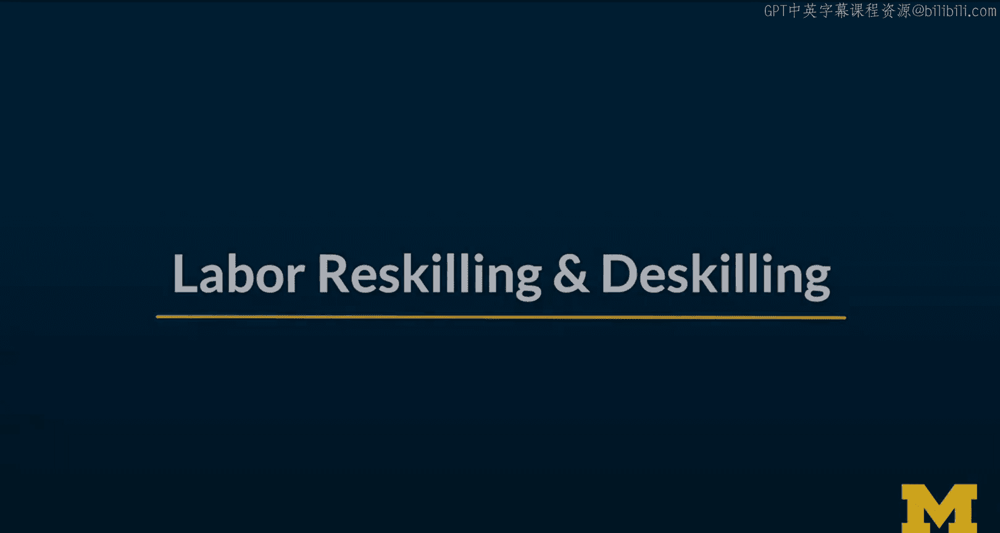
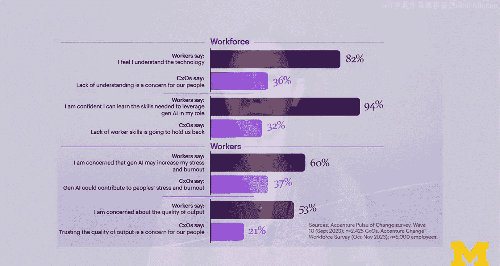
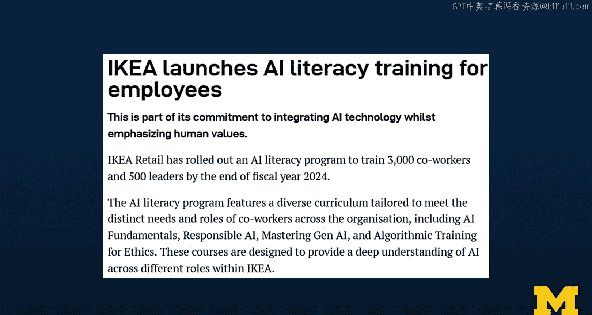
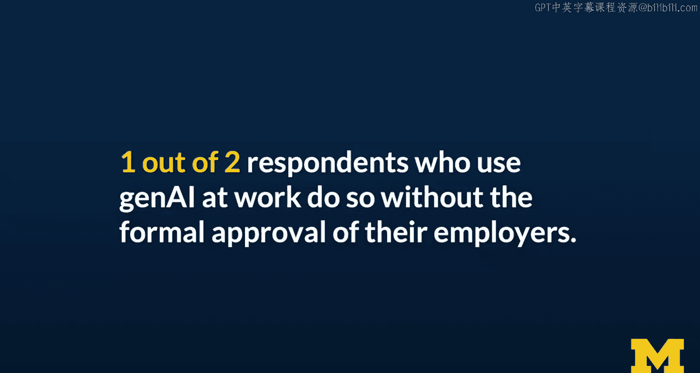
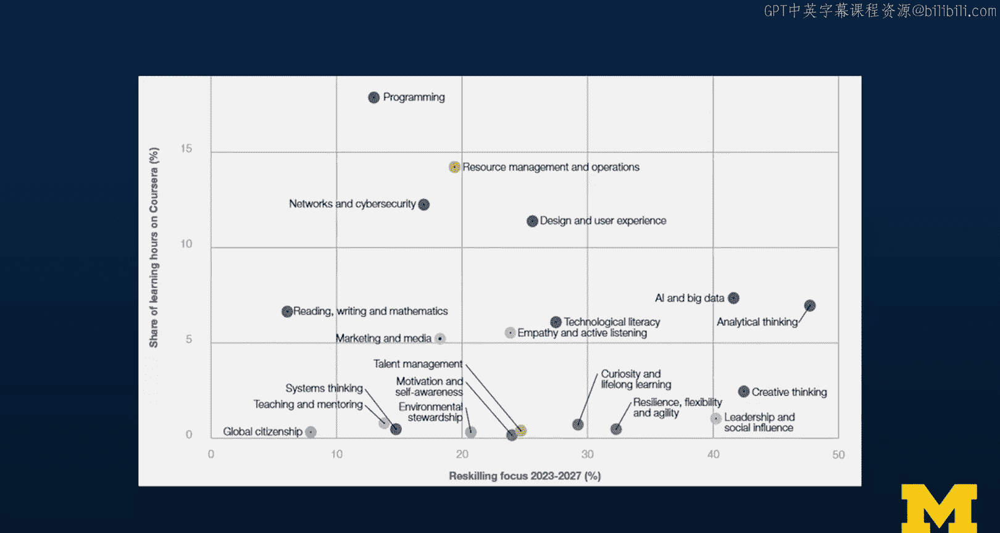
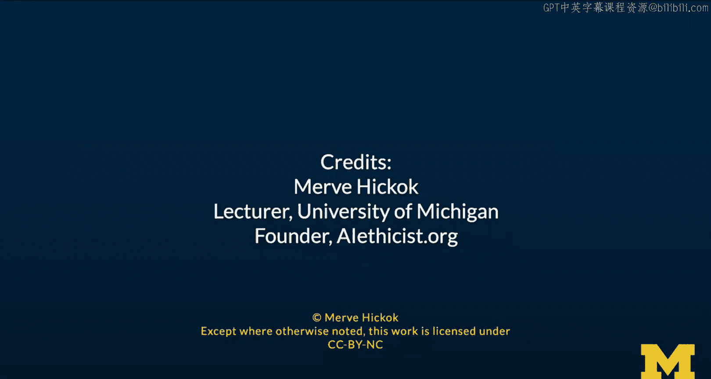

# 密歇根大学《负责任生成式AI简介（基础、对商业和社会的影响、政策、对未来的影响）｜Responsible Generative AI》中英字幕 p48 6_技能重塑与降维效应.zh_en -BV1Uf421B7sR_p48-

Expectations from employers regarding which skills and attitude are on the rise stay consistent across different surveys。

Analytical and creative thinking， followed by general technological literacy。

 top of mind for employers。Whereas AI and big data tops the lists for reskiing needs。

 when the question is asked workers。If perceptions are misaligned between workers and executives regarding strategy and initiatives。

Then this friction will also erode trust and make it even harder to increase technological adoption at large。

An ideal scenario is render theres an employee employer collaboration for generative AI adoption。

 In other words， workers are given a voice to come up with ideas on where they think the adoption would or could be most impactful。

😔，As well as the mechanisms to express their concerns when they arise。

 public and private organizations need to ensure that both the benefits and the burdens of geni adoption and integration are equitable。

And do not fold disproportionately on certain groups of workers。

Responsible AI prioritizes inclusive growth and sustainable development。😔，Where human well being。

 dignity and fairness are core drivers of policy and investment decisions。

 While generative AI may have significant impact on improving productivity。

This also will not be realized automatically。Determining the most impactful organizational use cases。

 together with the employees。And investing in their education and capacity building is necessary for the long term success at enterprise。

Accessible and continuous learning opportunities can provide the means for workers to contribute to their own career progress and chart their development。

Instead of a top down， approach the generate VI adoption。Enterprises need to first invest time。

 in increasing literacy。😔，And then identifying those tasks and business processes where generative AI capabilities can contribute the most。

😔，One example on investing in worker education and capability building is from a major retail company。

Rolling out AI literature a program across thousands of its workforce first to build a fundamental understanding of AI and generative AI tools。

 as well as responsible AI approach。

The focus is upskill and reki the workers and strengthen their long term employability。

 whether it is inside or outside of the retail company。😔。

These workers are then expected to come out with ne use cases。And also do so。

 in a responsible manner。Surveys consistently show that all organizations are trying to decide on enterprise adoption or integration。

Or lag behind on establishing organizational policies on AI。

Employees are already using generous VI individually。😔。

Some surveys note that two out of three workers are using Gene AI on the job。😔。

Compared to a quarter of respondents saying their organization has a gene AI policy in place。😔。

Other global surveys， such as from Salesforce， show that employees highlight the lack of training and generative AI policies at work。

 They gene AI outputs are inaccurate and biased， and that gene AI introduces new security risks。😔。

Nevertheless， a majority of time currently use or plan to use gene A I。😔，In other words。

 worries or concerns about GenI does not necessarily prevent workers from using GI at work。😔，In fact。

 one out of two respondents who used Jennai at work。Also。

 note that they do so without the formal approval of their employers。

Gennai's bottom up adoption is mainly due to individuals testing out their own activities and tasks。

 even if the organization may have no intention to adapt。

 and while the organizational level AI literacy and skill programs are being discussed and adopted。

Individual learners are also investing in themselves。

Although reskiing and training are seen more as something that employers should be responsible for。

Online educational opportunities are also increasingly becoming a source of free skilling。

 Coursera surveys show that analyticalethical thinking。

 creative thinking and AI and big data skills are driving the highest focus areas for self learning。

As we discuss the future of work and impact of generative AI on upskilling， reskilling。

 we also need to discuss this skilling and overance technology over time。😔。

What happens when more importance is given to genuinei skills。

Versus a human's expertise or creativity in the domain。

 given the inherent risks with Jen Ai with regards to reproducibility。

 health nations and adversarial attacks。Human expertise is still necessary。

 We discussed at length in previous courses how generative AI models can provide outcomes which are inaccurate。

 yet the model insists it is correct。😔，We also discuss lack of reasoning with these systems。

We still need human in creativity and domain knowledge to create the complex gennai prompts。😔。

We still need human knowledge and expertise to understand the shortcomings of generated outputs。

And to validate and verify the responses of these products。😔。

So how do we find the right balance of using the technology to complement and augment human skills。

 Another concern AI systems is automation bias。This because a human is in the loop doesn't mean that the risks go away automatically。

 There is always a risk that the workers themselves become too reliant on the AI generated outcomes。

😔，Or that that workers become disempowered over time。

 go to the way that AI is deployed in their organizations。That they stop caring or flagging concerns。

😔，The workers must be empowered to voice their concerns。😔，Overrite the systems where necessary。

And also feel comfortable to come up with new ideas and use cases of AI。Where it is beneficial。

