# 密歇根大学《负责任生成式AI简介（基础、对商业和社会的影响、政策、对未来的影响）｜Responsible Generative AI》中英字幕 p49 7_数字鸿沟挑战.zh_en -BV1Uf421B7sR_p49-

We know Generative AI will impact labor market and business with different degrees and magnitudes over time。

😔，Were not starting in a level field。😔，Across the world or within our communities。

 we already have digital divides。😔，Do we all get the benefit equally from generative AI and narrow the gaps。

 There are different ways at looking at this question。 One would be looking back into the forecasts。

 In this case， chief economicconomist outlook。😔，With the earlier caveat that it is hard to predict the feature。

 and we should always read the forecast with a healthy dose of sceptism。😔。

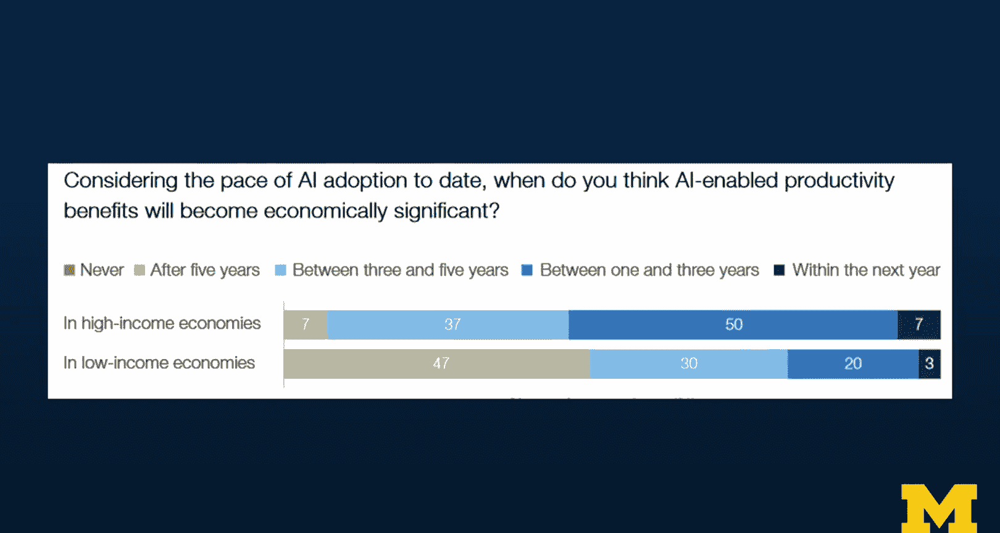

While economists remain ambiguous about the trajectory of generative AI adoption in business。😔。

They expect the most impactful improvements in Nor heavy industries。😔，Such as I T and communication。

 financial and professional services， healthcare services。And then in retail， manufacturing。

 engineering， energy and logistics。😔，The same respondents are more in agreement that the efficiency in production due to generative AI will be felt significantly more in high income countries。

 and that 73% of these chief economists do not foresee and add positive impact on employment in low income economies。

😔，These forecasts are driven by differences in infrastructure readiness across countries。

Which can manifest itself in digital infrastructure， human capital and labor market policies。

 innovation capacity and regulations。 So it is worth diving deeper into what might be some of the factors contributing to these differences across the digital divide。

😔，One might look at digital divide along different lines， for example。We can look across geographies。

 and compare countries。Or even within the same country， across gender， age。

 race and socioeconomic conditions， we can ask how much access there is to the underlying infrastructure of emerging technologies or what level is the digital literacy in a given category。

 One might also look at the different types of digital access， such as physical， financial。

 cognitive， institutional， cultural political。😔。

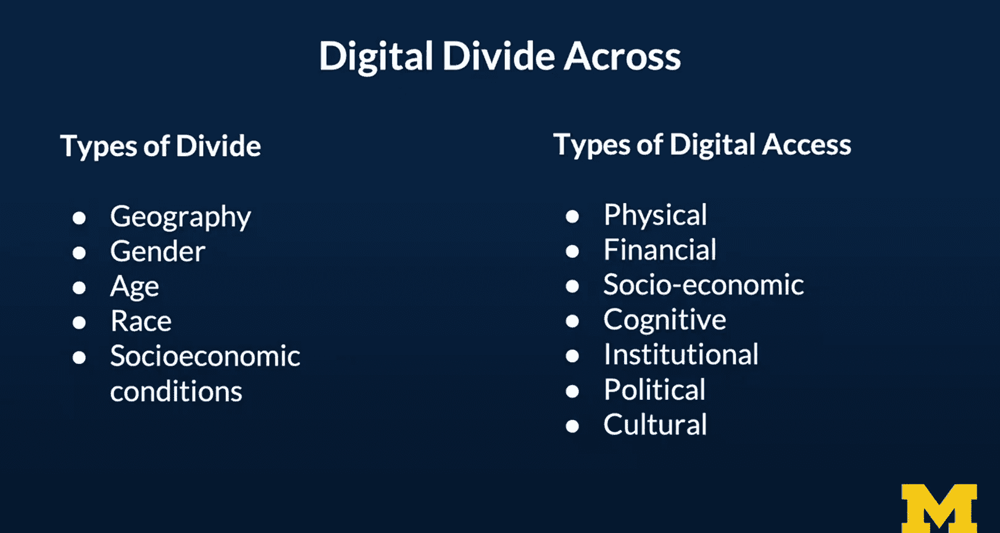

Benefits from generative AI， whether at individual or organizational level。

 requires that there is access to the basic infrastructure in the first place。 In other words。

 broadband。

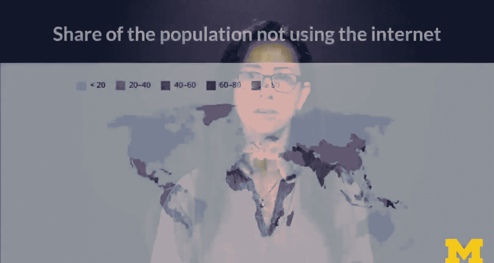

Globally， African and South Asian countries had the lowest share of population access to Internet。

And therefore， lower possibilities for any promises of emerging technology adoption。In fact。

 Internet penetration in Africa is roughly around 40% cent versus Europe's almost 90%。

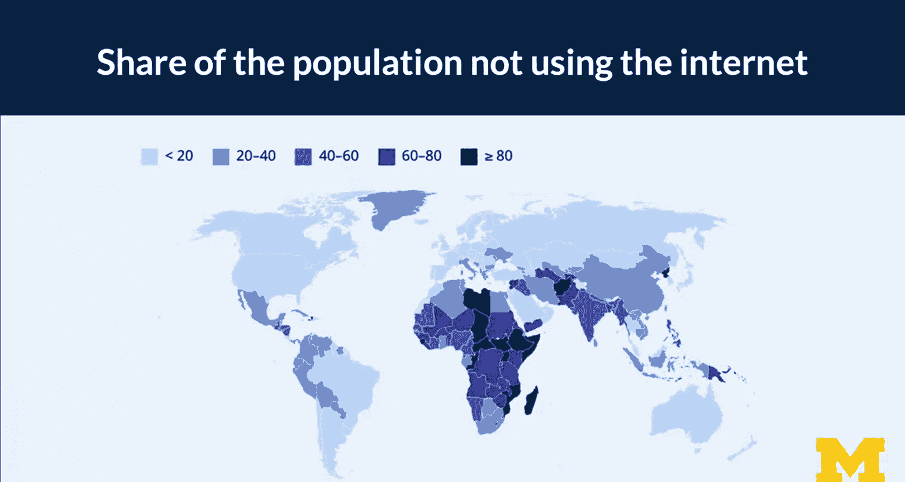

This disparity significantly impacts organizations from adapting or integrating generative AI systems into their businesses。

As well as individuals' ability to experiment with these technologies or even access to skill building opportunities。

Poor critical infrastructure and low internet penetration rates across the low income countries。😔。

Also， push broadband connection expenses higher。 While some in the high income countries may not even blink an eye on the amount of data they use individually or for their organizations。

The coast may be significant in different parts of the world。😔。

Individuals may not be able to use these emerging technologies in ways to create entrepreneurship for themselves。

 One might also assume that the digital divides could narrow over time and meet new generations。

 Global labor surveys， not that the younger people have higher flexibility for employment transition。

😔，While older workers may have to overcome several challenges in reemploment， such as reskiing。

 mobility and adapting to new technologies。 However。

 such line of to assumes that the basic infrastructure is accessible in the first place。😔。

In terms of ability to narrow the digital divide in future generations。

It is also worth noting that the International Telecommunication Union and Uni report and warnings。

Ttors of the world's school age children and youth or 2。1 billion people aged 3 to 24 years old。😔。

Have no Internet access at home。And that urgent investment are needed to bridge the divide。

 currently preventing children and young people from accessing coal to digital learning online。😔。

Former UNICEef executive director calls this digital canyon and not a gap in terms of gender close to half of the global female population。

 roughly 43%。😔，Is still not able to use Internet compared to 38% of all men。

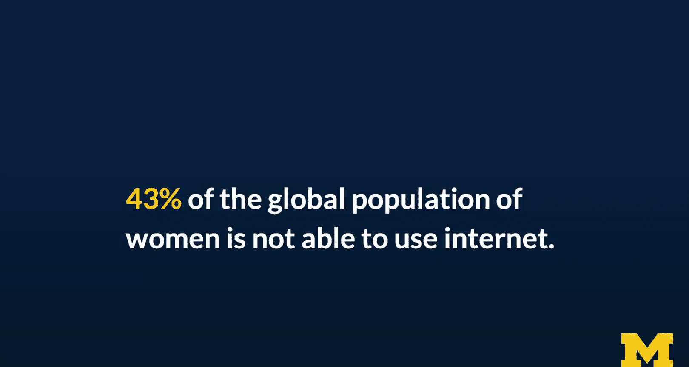

The differences in excess means that without structural interventions， the canyon will widen。

 You might also ask what the situation looks like in the AI industry itself。

When it comes to the gaps within the workforce and more specifically， AI。

 the situation doesn't get any better。😔，While women have higher share of jobs。

 which are exposed to generate AI displacement， they are also underrepresented in jobs developing AI solutions。

 women represents only 30% of AI talent globally。 This number drops significantly down to 10 to 15% range for women in machine learning jobs and even further for the AI research publication numbers across different countries。

😔。

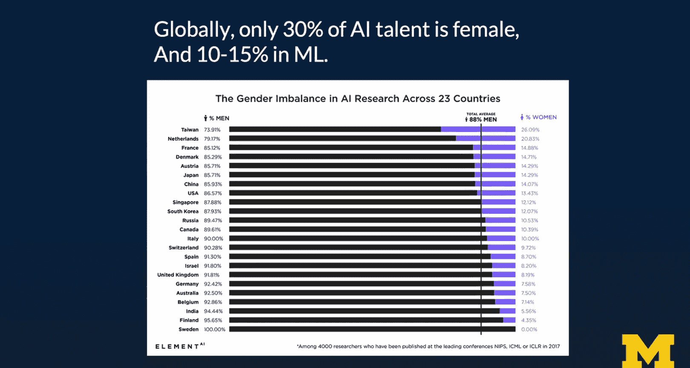

We need AR products to reflect the diversity of its possible users。😔。

For these products to perform better for everyone。😔。

Gender G has wider business and societal implications， too。

AI and geneative AI impacts all industries， however。😔，The solutions created in these industries。

 the knowledge work， the employment practices may be significantly skewed with such gender disparities in the workforce。

 What solutions we imagine， prioritize， invest in and deploy， for example， in health， education。

 critical infrastructure。😔，May look significantly different。

Situation gets even worse when numbers are dissected from a racial or ethnic representation for those developing AI at a low 25% average proportion。

😔，While， some companies have zero minority employees working on their AI solutions。

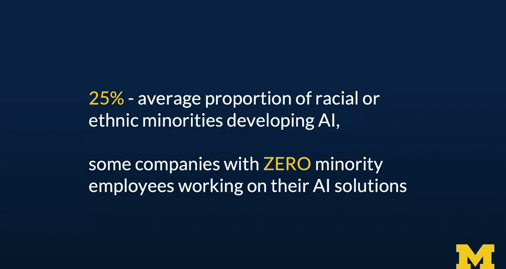

Although based on precovid mandated disclosures， the comp by the Center for Investigative reportinging of Silicon ValleyEmploy numbers。

Continue to be striking for who is represented in the leading AI companies。😔。

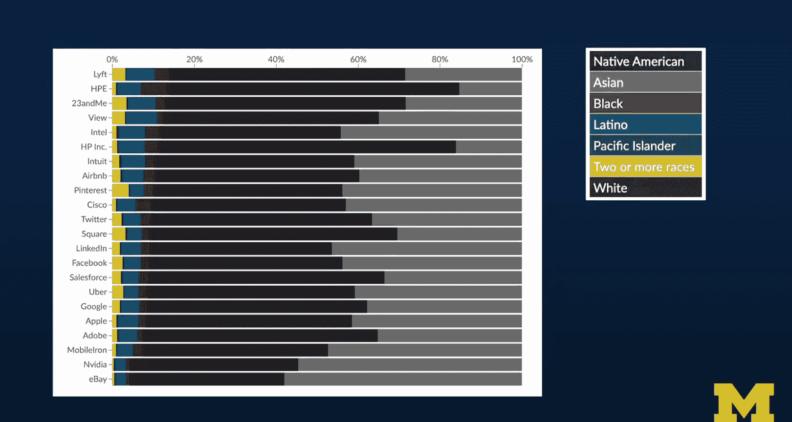

Or who is rather not represented。 Projections also show that if current structural issues and long standing patterns and melt generation and distribution are not corrected。

Generative AI can significantly increase the racial wealth gap。 For example， in the US。

 the projections show that by 2045， racially disparate distribution of Geni wealth creation could widen the wealth gap between black and white households in the US by 43 billion annually。

😔。

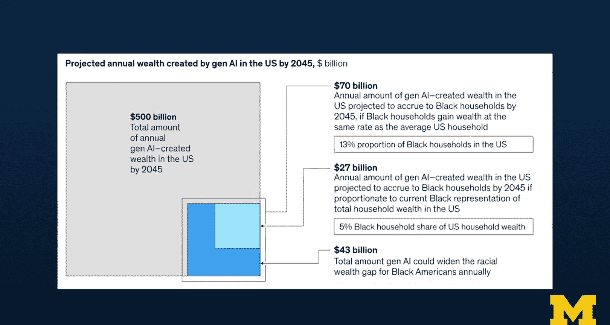

Such a projection can be simulated across different demographics or countries where there is existing socioeconomic inequality。

😔，Social inequality leading to lower or less access to these technologies。

 leading to lower access to meigance of inequality can become a vicious cycle。

 which is harder to break。😔。

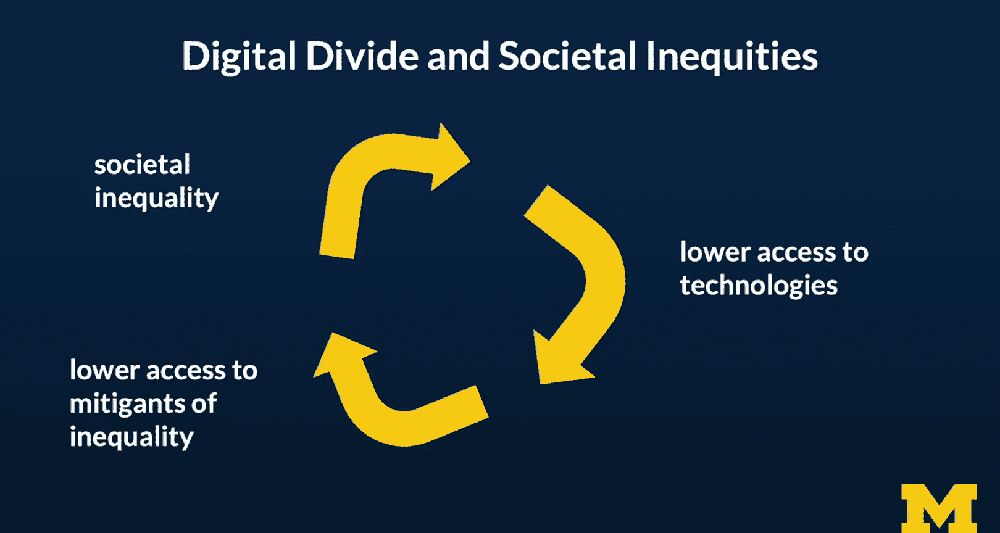

Gener to AI could change work for the better。However， without necessary investments。

 the uneven participation and benefits can result in cumulative disadvantages to wrap up。

 I want to refer back to how I started this module。😔。

It is notoriously difficult to assess the impact of generative AI and its impact on work and workplace。

 given the short period of time that passing since technology had become mainstream。😔，No。

 one factor will determine the impact of this technology， but a whole suite of factors。😔。

These range from task exposure to automation augmentation to the existing divides across our societies。

 the government policies， the speed of organizational investments and reskiing。

 how we value labor at large， just to name a few。😔，Similarly， industry decisions。

 govern policies and requirements， copyright decisions， open signs。

 public data and compute infrastructure， as well as redistributive policies will all determine how quickly and widely genely I will be adopted in economy。

 regardless of the geography。😔。

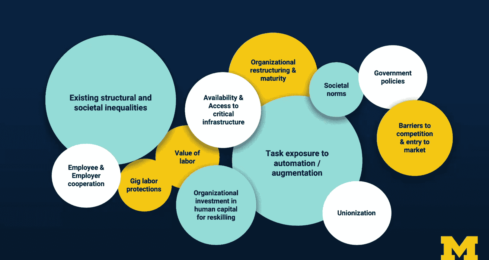

It is important to run different analyses and simulations for both augmentation and automation scenarios to create better corporate and government policies。

However， it is also important to remind ourselves that future of work does not need to be predetermined。

😔，And does not need to be a doomed scenario。Advances and generative AI and digital technologies hold a promise which we can achieve。

😔，Peture of work depends on what we value in each society。😔，How we invest in people。

 people's dignity and fundamental rights， future of work should be shaped by intentional decisions of humans。

😔。

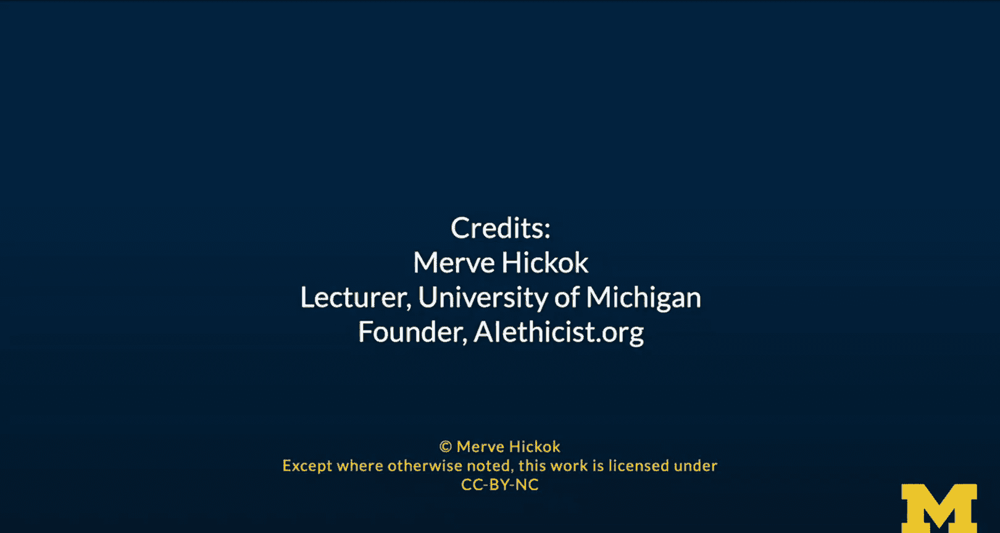