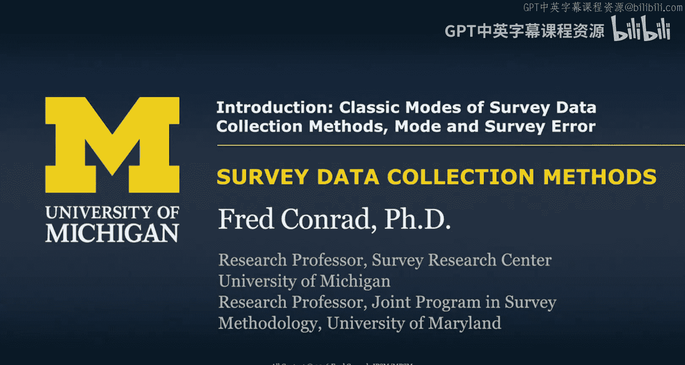
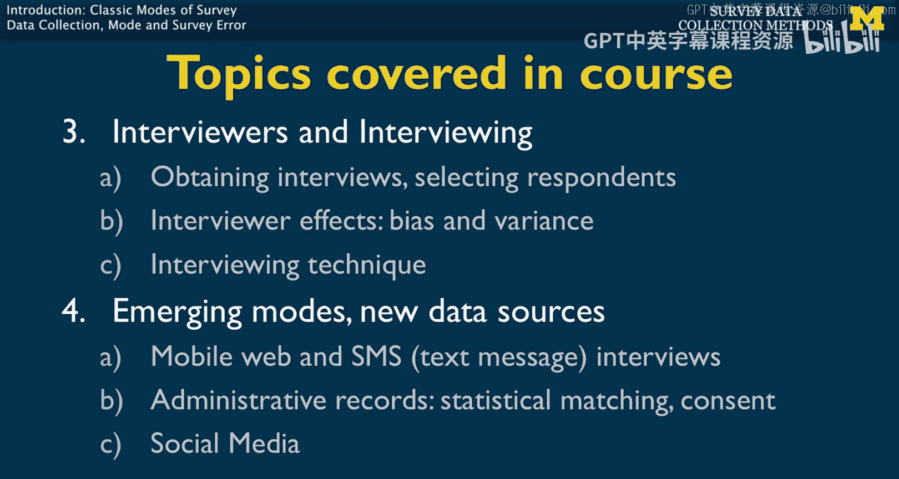

#  001：课程定位说明 📚

在本课程中，我们将学习调查数据收集的核心方法、不同模式的特点，以及它们如何影响调查的整体质量与误差。我们将从经典的数据收集模式开始，逐步探讨新兴技术和方法。

---

我是弗雷德·康拉德，密歇根大学的社会研究方法学家和心理学家，隶属于社会研究所的调查方法论项目，同时也是马里兰大学联合调查方法论项目的研究教授。

欢迎来到《数据收集方法》课程，这是专项课程中的一门。我们当前所处的第一课是导论，随后将讨论经典的调查数据收集模式，特别是电话、面对面和邮寄问卷。接着，我们会探讨数据收集模式的含义、不同概念，并确保我们对此有共同的理解。同时，我们将介绍调查误差的概念，以及模式与调查误差之间的关系。例如，某些模式可能会增加无应答率及无应答误差的风险。

那么，这门课程是什么？它旨在审视所有数据收集决策中固有的成本与误差权衡。通常，你可以通过投入更多资源来减少误差。我们将讨论不同类型的误差。作为研究者，增加成本通常可以减少误差。或者，如果你能容忍一定程度的误差，那么你或许能够以更低的成本收集数据。

这门课程是对调查数据收集的科学性审视，这意味着它基于科学文献中的发现，主要是经过同行评审的已发表文献。它并非关于个人经验和轶事，尽管这些在设计调查，特别是数据收集流程时，也是信息的合法来源。但我们的重点在于科学文献。

它提供了一个关于调查设计的全面视角，旨在提升整体质量。这意味着我们将审视调查过程中不同阶段可能出现的各种误差来源，并观察它们如何相互影响。因此，这是对数据收集设计的整体性视角。

这门课程不是关于如何具体操作一门课程。它并非为你出去自行开展调查提供资格认证，你将在专项课程的其他部分获得相关实践知识。本课程更侧重于概念性内容，并再次强调科学文献中的发现。当然，我们希望这能为实践活动提供基础，但这并非本课程的核心焦点。

它不是一门关于如何设计问卷的课程。专项课程中包含问卷设计课程，我们会在本课程中提及相关概念，但这不是本课程的主题。

它并非对整个调查过程的全面回顾。例如，我们在本课程中很少讨论抽样或加权。

如前所述，它不是基于对主题的意见或感受的课程，而是真正关于已发表的文献。

它也不是一门统计学课程，尽管统计概念和符号会在课程中有所使用。

---

那么，本课程涵盖哪些内容？在当前部分，即导论中，我们将讨论数据收集模式、模式的含义，以及模式与调查误差的关系，特别是经典的面对面、电话和邮寄模式。我们将比其他误差来源更详细地讨论一个特定的误差来源——无应答误差。它确实经常出现，虽然所有误差来源都需考虑，但我们将在导论中聚焦于无应答误差。

在第二课中，我们将讨论自填式与在线数据收集，特别是自动化的自填式。我们将讨论访谈中的自动化，例如，面对面访谈中的访员通常使用计算机设备（笔记本电脑或平板电脑），这被称为计算机辅助访谈。访员读出问题并将答案直接输入设备。我们还将讨论自填式，即访员将设备交给受访者，由其输入通常被视为敏感问题的答案。其理念是这为受访者提供了一定程度的隐私。其中一种模式称为音频计算机辅助自填式访谈，受访者通过耳机听到问题，可能在屏幕上看到问题，然后选择并输入答案到设备中。

我们将讨论在线或网络数据收集，其中不涉及访员，完全由受访者自填。这里存在一系列涉及不同误差来源的问题，如覆盖误差、无应答误差和测量误差。

接着，我们将讨论混合模式调查，即在特定研究的数据收集过程中结合使用不同模式。这引出了在某些混合模式设计中，给予受访者选择如何完成问卷的自主权问题，因此我们将讨论受访者模式选择的问题。

然后，我们将转向讨论访员与访谈，这实际上可分解为几个部分。访员除了进行访谈（即提问和记录答案）外，还承担许多任务。除了访谈外，最重要的任务可能是获取访谈，即招募样本成员成为受访者并参与调查。在家庭调查中，一旦被抽样的家庭成员同意参与，通常还有一个家庭内选择过程，通过随机过程选择一名家庭成员（不一定是与访员交谈的那位）作为受访者。我们将讨论招募过程和家庭内受访者选择。

我们将讨论所谓的访员效应，即访员可能引入两种误差：偏差和方差。这里的要点是，访员在许多方面增加了价值，但同时也存在成本。例如，不同访员可能以不同方式执行问卷，这会引入一定与访员相关的方差，这通常不是好事。因此，我们将讨论这些类型的访员效应，以及可能由访员持久特征（如种族、性别、年龄等）引起的访员效应。

第四讲，也是最后一讲，将重点讨论新兴的数据收集模式和新数据源。我们将讨论的新模式主要是移动网络。我们将讨论更传统的、通常在台式机或笔记本电脑上完成的网络调查。在智能手机上（通过浏览器或专用应用程序）作答已变得越来越普遍。调查行业正在努力跟上公众通过使用移动设备所展现的需求，因此我们将讨论移动网络，以及使用短信进行访谈。这与移动网络略有不同，实际上不一定非要在智能手机上进行，但通常如此，并且其结构比在智能手机上自填的网络问卷更具轮转性、更偏向于来回互动。

我们还将讨论行政记录作为一种替代数据源。使用行政记录通常需要将调查受访者或公众成员的数据与记录中的个人标识进行匹配。这并非易事，需要一定的统计推测和知情推测，以及受访者同意将其调查回答与行政记录关联。但行政记录的巨大前景在于，它可以通过避免询问公众那些答案已存在于行政记录中的问题，来减轻公众负担，并为政府机构等调查研究者节省大量资金。

我们将讨论的另一个新数据源或潜在数据源是社交媒体。目前尚不完全清楚如何以及何时能以类似调查的方式使用这一数据源，但我们将讨论社交媒体作为调查数据收集的可能补充甚至替代方案。如前所述，我们还不完全了解社交媒体何时以及如何扮演这一角色，但已有一些有希望的证据表明，社交媒体或多或少能复现某些调查中特定问题的结果。因此，我们将探讨社交媒体在何种情况下更可能或更不可能讲述与调查数据相同的故事。

---

除了讲座之外，本课程另一类重要内容是我与调查数据收集领域的专家和领导者进行的一系列访谈。这些访谈涉及混合模式数据收集和在线数据收集等主题，它们补充并实际上超越了讲座内容。我个人发现这些访谈中的讨论非常令人兴奋和投入，希望你们也会有同感。

我期待与你们分享这些材料，并了解你们的反馈。希望你们能充分利用课程中的讨论板，以便我们了解你们的进展。

考虑到这一点，我期待与你们一起学习，让我们继续本课程的其他部分。

非常感谢。