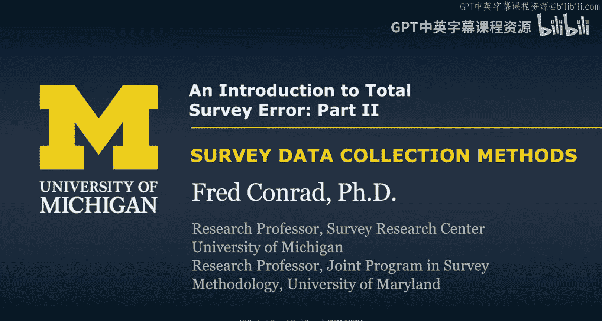
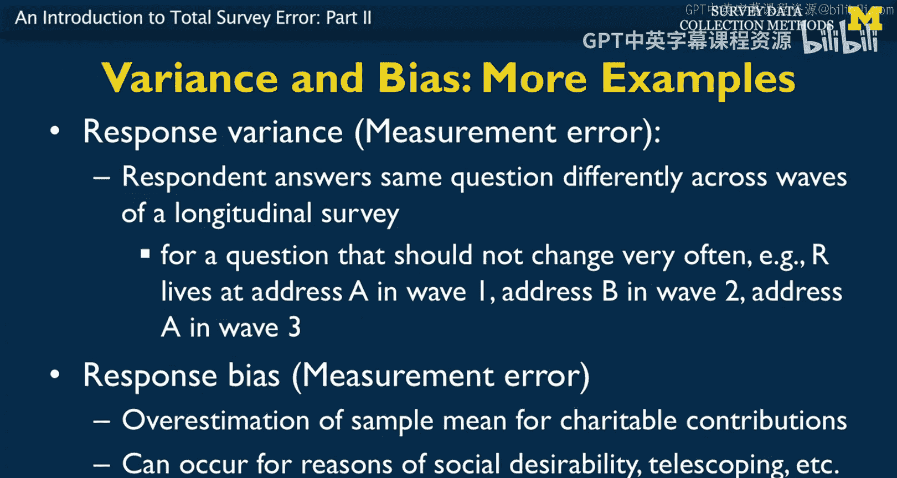

#  003：变量误差与偏倚 📊

在本节课中，我们将要学习调查研究中两个核心概念：变量误差与偏倚。我们将了解它们的定义、区别，以及它们如何影响调查数据的质量。

调查研究者假设，从调查中得出的估计值存在一个实际或真实值。一个相关的、对于理解偏倚尤为重要的概念是**真实值**。这是调查中所测量事物的实际值。有时它是可知的，例如，通过行政记录，我们可以获得所调查问题的客观指标。但通常它并不可知，这很合理，因为如果它可知，就没有太多理由去进行这项调查或询问这个特定问题了。在这种情况下，真实值变得更概念化，或者至少我们必须通过间接方式去获取。

有时，真实值是根据测量过程本身来定义的。例如，智商就是智商测试的分数，它在某种程度上是自我定义的，并且具有预测效度，即智商测试能较好地预测某些结果，即使我们并不确切知道智商意味着什么。

**测量误差**是观察值（即问题的答案）与真实值之间的差异。同样，真实值通常并不可知，我们必须推断测量误差是什么。

---

我已经多次区分了**变量误差**和**偏倚**。

变量误差的产生，是因为答案会随着设计中的不同单元（如访员、样本人员、受访者）以及我们所问的问题而变化。我们测量一个统计量（即对某个问题的回答）的方差。例如，当我们谈论访员相关方差时，是针对某个特定问题，而不是访员询问的所有问题。变量误差可能发生在参与者之间或参与者内部。为了最小化它，我们会将受访者随机分配给访员，并努力保持所谓的**基本调查条件**一致，这主要指数据收集的模式、时间以及操作流程的各个方面。

---

这与调查研究者所称的**偏倚**形成对比，偏倚指的是方向性误差，即回答或估计值可能系统地大于或小于真实值。但这要求我们知道真实值是什么，而这正是测量偏倚的关键。如果我们对真实值有所了解，就可以量化偏倚。但通常，我们会测量方差，这几乎可以作为偏倚的一种替代或代理指标，因为方差更容易测量，并且数据本身就会提供方差信息。

一个我们可以在没有真实值的情况下探究偏倚的例子是：比较一个敏感问题（例如，一生中性伴侣的数量或吸毒史）在两种不同数据收集模式下的回答。一种模式涉及访员（如面对面访谈），另一种是自填模式（如网络调查），后者可能因较少污名感而更可能获得真实回答。如果我们看到差异，通常会假设自填模式（如网络）的结果更接近真实值。因此，我们可以说受访者在访员主导的模式下低估了这些社会不期望的行为（如吸毒）。

---

这张图明确展示了偏倚与方差的含义。

*   左侧的图代表了问题回答中的**偏倚**。我们假设靶心的红点是真实值，黑点或圆圈是回答。可以看到它们都聚集在一个方向上，大部分在靶心的上方和右侧，这意味着它们系统地偏离了真实值。这就是我之前举例说明的“高估”情况。
*   右侧的图代表了**方差**。同样，红圈是真实值，黑圈是各个回答。它们分布在真实值周围，虽然也不完全准确，但这种不准确性是通过回答相对于真实值的离散程度来体现的，而不是系统性的偏移。

在实践中，我们通常只有一个测量值。那么，如何测量方差和偏倚呢？我们可以使用基于**复制的方法**从样本本身测量方差，即选择若干子样本并计算这些子样本间的方差。但如前所述，要估计偏倚，需要外部数据或证据、真实值，或者关于效应方向的假设（如上述敏感问题在不同模式下的例子）。

---

接下来，我们看一些关于方差和偏倚的更多例子。

访员相关误差同时包含这两种类型，都被视为测量误差。

以下是访员相关误差的具体表现：

*   **访员相关方差**：可能表现为，对于像自评健康这样的测量指标，某些访员获得的平均回答较高，而另一些访员获得的较低。即使随机分配受访者给访员并采取其他保障措施，这种情况也可能发生。这通常归因于访员在提问或进行访谈时的差异，例如，他们可能以不同方式追问，或在其他行为上（如提问的语调）存在差异，尽管他们接受了相似的培训。所有这些都可能促成访员方差。如果不同访员对同一问题引出了不同的答案分布，而受访者是随机分配给访员的，那么这里就存在测量误差，方差在这种情况下可以告诉我们这一点。
*   **访员偏倚**：这指的是持续性的高估或低估。例如，对于“沮丧工人”数量的系统性低估，可能是因为所有访员在询问“你是否在找工作”这类问题时，都系统性地未能进行充分追问。关键在于，它必须是系统性的，即所有访员都以相同的方式不追问或过度追问。此外，访员的持久性特征（如种族、性别、年龄）也可能系统性地影响对特定主题（如种族态度、性别平等）问题的回答。可能出现低访员方差但高偏倚的情况，也可能所有访员收集的数据都很相似（低方差），但数据本身是不正确的。我们将在第三课详细讨论访员相关话题。

---

其他类型的方差和偏倚包括：

*   **回答方差**：例如，在纵向调查（即受访者在较长时间内每月接受访谈）中，受访者对同一个问题在不同波次给出不同答案。这可能发生在问题的答案本不应频繁变化的情况下，比如受访者的居住地址。当然，受访者会搬家，但不会那么频繁。如果地址变化的频率超出预期，就会表现为回答方差的增加，这表明可能存在误差。这可能源于受访者的不专注、问题措辞模糊，或问题措辞发生了变化。
*   **回答偏倚**：例如，对样本均值的系统性高估，这次与访员本身无关。像慈善捐款这样的问题就可能发生高估，原因包括社会期望偏差（人们通常认为报告捐款或捐更多款比不捐或捐得少更符合社会期望），以及**时间错位**现象——即受访者主观上将实际发生在参考期（问题所问的时间段）之前的事件，错误地记入该时期内，从而导致高报。

---

在下一节中，我们将讨论总调查误差框架在做出关于数据收集过程的设计决策时的意义。

本节课中，我们一起学习了变量误差与偏倚的核心概念。我们明确了**真实值**是测量的基准，**测量误差**是观察值与真实值的差异。**变量误差**反映了回答的无序波动，而**偏倚**则代表了系统性的方向错误。理解这两者的区别和来源，对于评估和改进调查数据的质量至关重要。