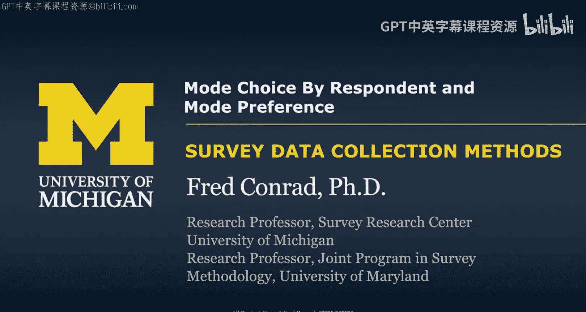
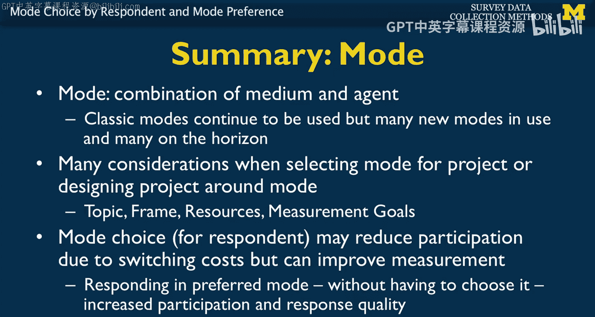

#  006：受访者模式选择 📊

在本节课中，我们将要学习调查数据收集中的一个重要概念：受访者的模式选择。我们将探讨在混合模式研究中，让受访者自行选择回答方式可能带来的影响，包括对回答率和数据质量的双重作用。

上一节我们介绍了调查模式的基本概念，本节中我们来看看当受访者被赋予选择权时会发生什么。

## 模式选择对回答率的影响

在混合模式研究中，有时让受访者自行选择提供答案的方式是合理的。但一个值得关注的问题是，给予他们这种选择可能会降低参与度。方法学家最初并未必然预见到这一点，但在多项提供或要求此类选择的研究中，观察到了这种现象。

梅德韦和富尔顿进行了一项很好的元分析，专门研究了一种特定类型的模式选择设计。在这种设计中，样本成员会收到邮寄的邀请函，其中包含纸质问卷。而随机一部分样本成员则被额外提供了一个网络回答的选项。

以下是该设计的关键点：
*   样本成员收到包含纸质问卷的邮寄邀请。
*   一个随机子集的样本成员被提供网络回答的选项（即模式选择）。
*   邀请函中会提供一个网址，并说明如果他们更倾向于在网上完成问卷，可以手动输入该网址。

梅德韦和富尔顿回顾了19项采用这种形式的研究。他们发现，在这19项研究中，总体而言，当样本成员被给予选择时，回答率可靠地低于仅提供邮寄问卷的条件。在19项研究中的17项里，回答率都较低，其中8项显著较低。

他们提出这可能由多种原因导致。以下是可能的解释：

*   **选择悖论**：社会心理学家巴里·施瓦茨提出的概念。其观点是，当决策者被给予选择时，特别是大量选择时，这实际上可能会使他们陷入瘫痪，更难做出决定，并对最终做出的决定感到不满。梅德韦和富尔顿认为，这可能是回答率下降的一个解释。
*   **转换成本**：从纸质问卷转换到计算设备并手动输入网址的行为，可能导致参与度下降。因为人们可能会分心，或者尝试输入网址时受挫，尽管初衷良好，但最终未能完成转换。
*   **技术要求**：转向网络回答有不同的技术要求。如果网络连接中断或存在可用性问题（例如，受访者使用计算机或在线应用的能力不如填写纸质问卷），这也会导致回答率降低。

因此，给予选择可能伴随着回答率降低的特定成本。

## 模式选择对数据质量的影响

尽管回答率可能下降，但让受访者选择回答方式实际上有可能提高他们答案的质量。

康拉德及其同事的一项研究测试了这个想法。他们的思路是，如果受访者选择了他们提供答案的方式，他们可能会更投入、更专注于任务。

在他们的研究中，样本成员被邀请通过智能手机（该研究中恰好是iPhone）以四种访谈模式之一参与。这四种模式是：
1.  **人工语音**：访问员通过电话读出问题并记录答案。
2.  **自动语音**：相当于之前讨论过的语音交互式语音应答系统。由录音播放问题，受访者说出答案，系统尽力识别并自动记录。
3.  **人工文本**：人工访问员通过短信发送问题，受访者短信回复答案。
4.  **自动文本**：计算机发送短信问题，受访者短信回复答案。

受访者被以这四种模式之一联系，然后其中一半被要求必须从这四种模式中选择一种。他们可以选择最初联系他们的模式，也可以选择其他任何一种。因此，可以在被要求做出选择的组和未被给予选择的组之间进行比较。

他们发现，被要求选择模式的组，其数据质量在几项指标上更高：
*   **更少的取整数值答案**：当问题需要数值答案时，回答“10”相对于“97”而言，通常被认为反映了更粗略的思考。“10”这个答案似乎是取整过程的结果，而不是对构成答案的因素进行更仔细的枚举。取整数值减少是质量提高的一个指标。
*   **更少的直线回答**：直线回答是指在多个使用相同回答量表或选项的问题中，选择相同答案的倾向。当受访者直线回答时，通常意味着他们没有如期望的那样深入思考问题，有时甚至是不加思考地选择一个固定答案。研究发现选择模式后直线回答减少。
*   **更高的完成率**：当受访者被给予选择时，中断率更低，即完成率更高。
*   **更高的满意度**：在访谈后的满意度评估中，选择自己模式的受访者满意度更高。在该研究中，受访者最常选择的模式是自动文本。

这表明，尽管模式选择似乎固有地伴随着回答率的降低（至少在当前已进行的研究中如此），但要求受访者选择其模式在数据质量或回答质量方面是有益的。

值得注意的是，在康拉德等人的这项专注于数据质量的研究中，被要求选择回答模式的组，其回答率也有所下降，这与涉及不同模式组合的富尔顿和梅德韦元分析结果一致。但回答率的下降集中在某些特定的模式转换上，特别是那些涉及从自动模式（自动文本或自动语音）的邀请转换到人工执行模式（人工文本、人工语音）的情况。这些方向的转换很可能导致延迟，因为人工访问员可能无法立即开始访谈（无论是语音还是文本），而这种延迟可能是回答率下降的原因。

无论如何，在单一设备上选择模式（如康拉德的研究），相对于收到带有网址的纸质邀请、要求受访者 physically 转换到计算机并手动输入网址，前者确实最大限度地降低了转换模式的成本。

## 模式偏好的影响

模式偏好与模式选择略有不同。模式偏好指的是受访者对参与特定模式的倾向性，但在模式偏好研究中，他们并未被给予选择。不过，就像模式选择一样，我们可以考察模式偏好对回答率和回答质量的影响。

奥尔森及其同事在一项电话调查中询问了受访者的模式偏好。即在电话调查中，他们问：“如果您收到参与另一项类似调查的请求，您通常更喜欢哪种调查模式？”选项包括：在您家中进行面对面访谈、家庭电话访谈、手机访谈、邮寄纸质调查或互联网调查。

大约一年后，他们邀请同一批受访者参与另一项调查，并随机将他们分配到邮寄或网络模式（实际上是邮寄-网络或网络-邮寄的顺序）。一些受访者恰好被分配到了他们一年前表示偏好的模式，而另一些则没有。

他们发现，如果数据收集发生在受访者偏好的模式中，回答率会更高（至少在部分模式中如此）。这表明，在受访者偏好的模式中进行访谈或数据收集，会增加他们参与的可能性。

关于模式偏好对回答质量的影响，史密斯等人进行了一项研究，考察了受访者表现出的“走捷径”或心理捷径的数量。该研究使用了奥尔森等人研究生成的数据集。受访者被分配到两种问卷形式之一，其中项目格式不同：
*   他们要么收到“勾选所有适用项”的题目（本质上是复选框，可以勾选任意多项）。
*   要么收到“强制选择”的题目（必须对列表中的每一项回答“是”或“否”）。
*   他们还收到一个开放性问题，需要用他们自己的话回答，但回答框要么很大，要么很小。其思路是，大的回答框暗示期望更长的答案，至少受访者似乎是这么理解的。

问题是：他们是否在走捷径？在“勾选所有适用项”的形式中，他们勾选的选项是否比在必须为每个选项提供答案的“强制选择”形式中更少？当回答框很大时，他们是否更不愿意提供开放式回答？这些都是“走捷径”的证据。问题是，模式偏好如何影响这种走捷径的倾向？

他们发现，如果受访者不是在偏好的模式中回答问题（即他们正在以之前表示并非首选的模式作答），那么与强制选择形式相比，他们在“勾选所有适用项”形式中认可的选项更少；并且，当开放式问题包含一个暗示期望更长答案的大框时，他们跳过该问题的次数比包含小框时更多。但是，当受访者在偏好的模式中回答时，格式对他们的答案没有影响。

因此，模式偏好似乎与模式选择类似，虽然可能降低回答率，但也提高了回答质量。

## 总结

本节课中我们一起学习了调查模式选择的相关知识。

总结我们关于模式及其含义的讨论，可以将模式视为媒介和代理的组合。经典模式（电话访谈、面对面访谈和邮寄纸质问卷）仍在继续使用，但同时许多新模式既在使用中，也即将出现。

研究者在为一个项目选择模式或围绕一个模式设计项目时，需要考虑许多因素，包括主题、抽样框、可用资源和测量目标。

让受访者进行模式选择可能会因转换成本而降低参与度，但可以提高测量质量。类似地，在不要求选择的情况下，让受访者以其偏好的模式作答，可能既增加参与度，也提高回答质量。

在下一节中，我们将更具体地讨论混合模式调查。存在几种不同的设计，每种都有其优缺点，我们接下来将转向这个话题。