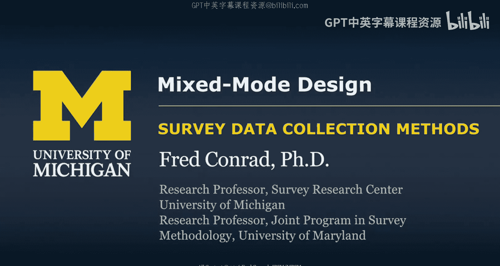
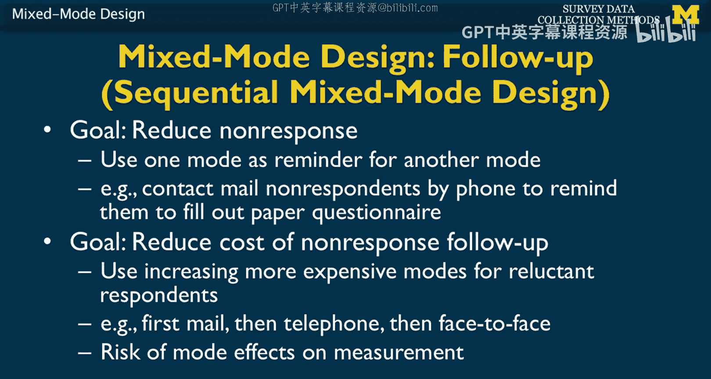
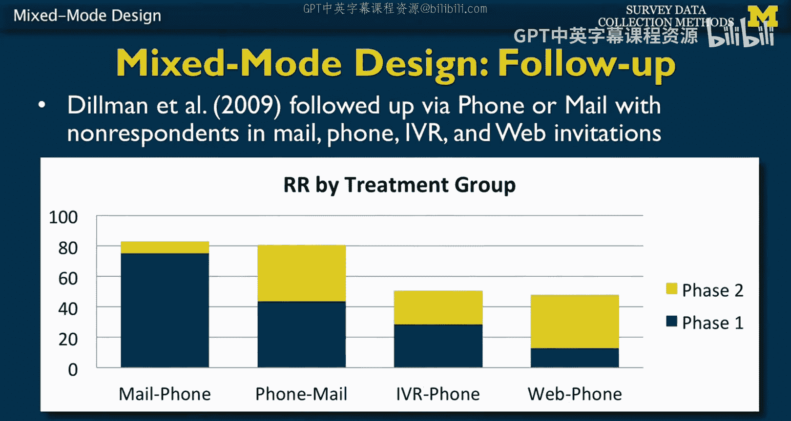
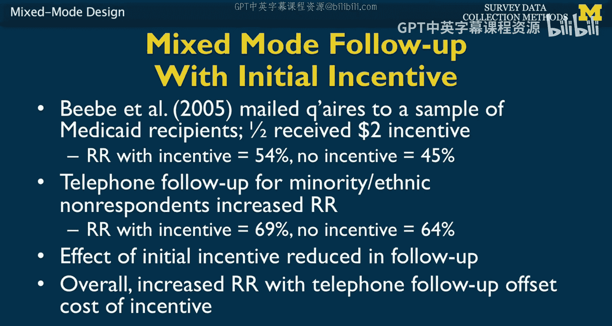
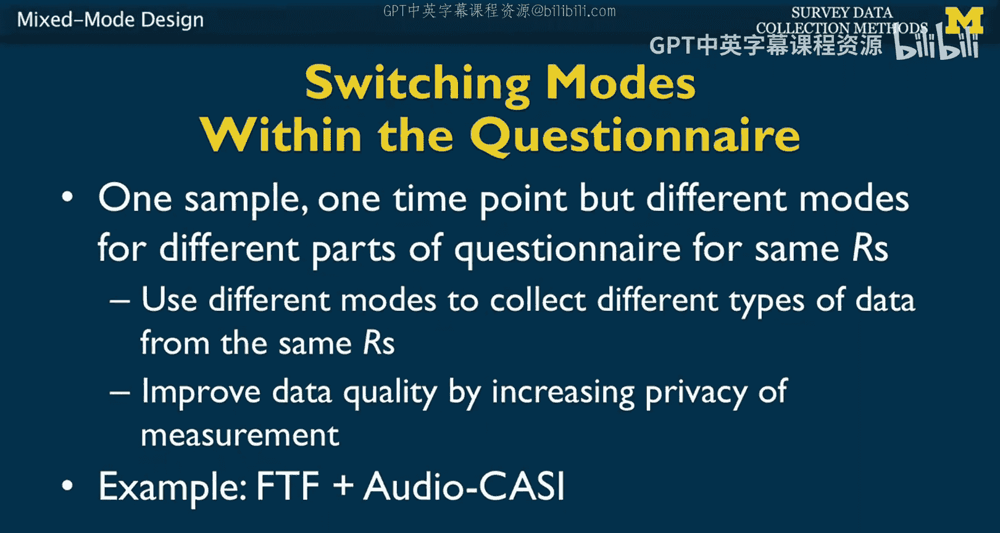
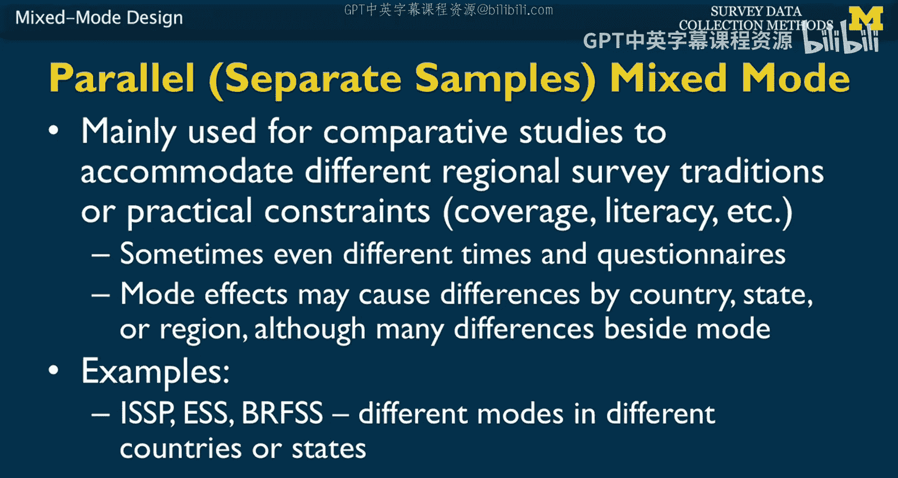

#  009：方法、社调问卷设计、抽样、缺失数据、分析：p09 8_1.4.3 序贯追踪混合模式 📞➡️📧

在本节课程中，我们将详细探讨**序贯追踪混合模式设计**。这种设计旨在通过结合多种数据收集模式来提高调查的响应率，并可能降低调查成本。我们将通过具体的研究案例来理解其运作方式、效果以及潜在的挑战。

序贯追踪混合模式设计，也称为混合模式追踪，其核心目标是**减少无应答**。具体做法是，先用一种模式邀请受访者参与调查，然后对未回应者使用另一种模式进行追踪提醒。这种设计背后的理念是，通过模式的切换，可以强化受访者对研究重要性的感知。

以下是序贯追踪混合模式设计的两个主要目标：

*   **提高响应率**：通过使用一种模式作为另一种模式的提醒，促使更多受访者参与。
*   **控制追踪成本**：首先使用成本最低的模式进行初次接触，然后对无应答者依次使用成本更高的模式。这样，最昂贵的模式仅用于最难接触到的样本成员。

然而，这种设计也存在一个明显的缺点：**模式效应风险**。由于受访者在不同阶段接触了不同模式，很难将模式本身对回答的影响与受访者真实的态度变化区分开来。

为了更直观地理解序贯追踪混合模式的效果，我们来看一个由Dillman等人进行的研究。该研究比较了不同初次邀请模式（邮件、电话、交互式语音应答、网络）与后续追踪模式（电话或邮件）的组合效果。

研究结果显示，对于初次邀请未回应者，使用另一种模式进行追踪，普遍提高了总体响应率。例如：
*   初次邮件邀请的响应率约为75%，对未回应者进行电话追踪后，响应率提升至略高于80%。
*   初次电话邀请的响应率约为45%，对未回应者进行邮件追踪后，响应率也提升至约80%。

一个值得注意的发现是，邮件邀请的初始响应率高于电话。研究者将此归因于激励方式的不同：邮件中包含了**预先支付的2美元现金激励**，而电话访谈承诺的是完成后支付，后者对受访者的吸引力较弱。

尽管序贯追踪提高了响应率，但研究者也指出了几个关键问题：
1.  **未能解决人口统计偏差**：不同模式下不回应的人群特征相似，因此无应答误差并未减少。
2.  **引入了模式效应**：在电话和交互式语音应答等“听觉模式”中，受访者在两极量表上倾向于给出更积极的回答，这与“视觉模式”（邮件、网络）下的回答存在差异。

因此，序贯追踪混合模式的主要结果是：**响应率提高，但无应答偏差可能并未减少，同时还引入了模式效应**。

另一个相关研究由Millar和Dillman进行，他们试图将网络调查的响应率提升至与邮件调查相当的水平。他们比较了多种设计，发现：
*   提供“邮件或网络”的选择并未提高响应率，甚至可能降低了响应率。
*   但是，如果**先邀请受访者参与网络调查，然后对未回应者发送包含网络调查链接的电子邮件进行追踪**，最终网络调查的响应率可以与邮件调查的响应率相当。

这个案例展示了如何通过“网络邀请 + 邮件追踪”的序贯混合模式，有效提高特定模式（此处为网络）的响应率。

激励措施在混合模式设计中扮演着重要角色。Bieber等人的一项研究调查了激励对医疗补助（Medicaid）受助人样本的影响：
*   在初次邮件问卷中，**附有2美元现金激励**的小组响应率为54%，**无激励**的小组为45%。
*   随后，他们对少数族裔无应答者进行电话追踪。结果显示，**初始激励的效果在追踪阶段被削弱了**。对于初始收到激励的小组，追踪后响应率从54%升至69%（提升15%）；对于初始未收到激励的小组，响应率从45%升至64%（提升19%）。电话追踪带来的响应率提升，在一定程度上抵消了提供激励的成本。

除了序贯追踪设计，还有其他几种混合模式设计值得简要了解：

*   **问卷内模式切换**：在同一时间点对同一样本，针对问卷的不同部分使用不同模式。最佳例子是面对面访谈中，访问员将计算设备交给受访者，让其通过屏幕或耳机自行回答敏感问题（即**音频计算机辅助自访**）。
*   **纵向混合模式调查**：对同一样本在多个时间点进行测量，但在不同时间点使用不同模式。例如，在纵向研究中，初期使用成本高的面对面访谈建立联系，后续波次则转为成本较低的电话访谈。这能**降低成本**，但会**混淆时间效应和模式效应**。美国收入动态追踪研究（PSID）和当前人口调查（CPS）都采用了此类设计。
*   **平行样本不同模式**：主要用于跨国或跨地区比较研究，以适应不同地区的调查传统、实际限制、覆盖率或识字率差异。例如，在互联网普及率差异大的国家，可能分别采用网络和面对面模式。国际社会调查项目（ISSP）、欧洲社会调查（ESS）等都采用了此类设计。但同样，**难以区分地区差异是源于模式效应还是真实的人口差异**。

本节课中，我们一起学习了序贯追踪混合模式设计。我们了解到，这种设计通过模式切换来提醒和追踪受访者，能有效**提高调查响应率**并**优化成本控制**。然而，它也带来了**模式效应风险**，并且可能无法减少无应答偏差。我们还简要了解了问卷内切换、纵向调查和平行样本等其他混合模式设计及其应用场景。

在下一节中，我们将转向**无应答与无应答误差**的专题讨论，这是我们多次提及的一个重要调查误差来源，更深入的了解将为我们后续课程的学习奠定基础。