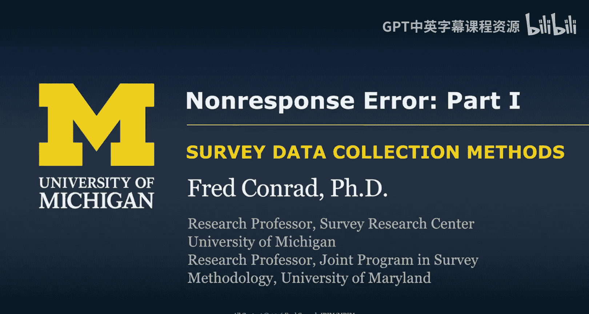
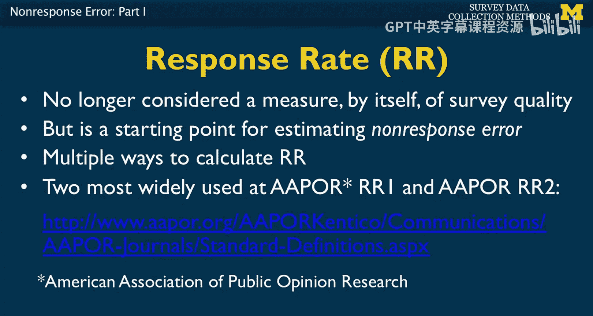
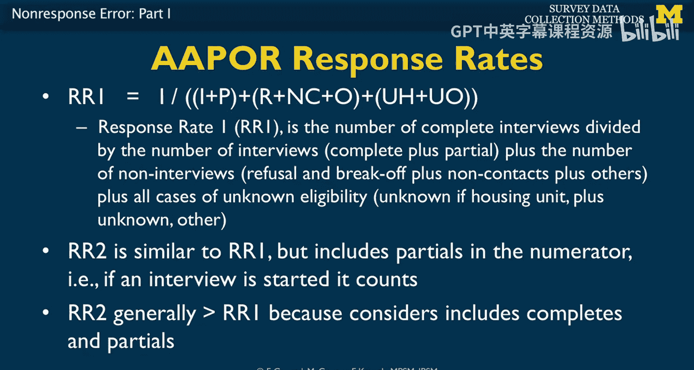

#  011：应答率 📊

在本节课中，我们将学习调查数据收集中的一个核心概念——应答率。这是评估调查质量的重要起点，但我们需要理解它具体衡量什么，以及如何计算。

---

## 课程概述

在第一课的最后一个主题中，我们将介绍非应答问题。这包括应答率（或其反面——无应答率）以及无应答误差。需要明确的是，这两者并非完全等同的概念。

---

## 应答率与调查模式

上一节我们介绍了调查的不同模式。本节中我们来看看不同模式下的应答率差异。

关键点在于，应答率因调查模式而异。通常，面对面访谈的应答率最高，其次是电话访谈，再次是邮寄纸质问卷，而网络调查的应答率通常最低。但这并非绝对规律，许多因素可以改变这一模式。例如，我们之前看到，在不同模式下提供预付激励或承诺激励可以颠覆这种模式。然而，这通常是实践和文献中观察到的普遍模式。

需要记住的关键点是：**应答率不等于无应答误差**。在下一节中，我们将更详细地讨论这一区别。现在，我们只讨论应答率。

---

## 理解调查数据文件

为了理解应答率，我们可以想象一个调查数据文件。在这个文件中：
*   **行** 对应个案或个体受访者。
*   左侧区域包含所谓的 **框数据**，即从抽样框中已知的受访者信息。
*   右侧标记为“访谈数据”的区域包含受访者的答案。

请注意，在访谈数据中存在一些空白或黑框，表示数据缺失。这被称为 **项目无应答数据**。即使受访者没有回答每一个问题，只要提供了部分数据，通常仍被视为应答者。

然而，我们还会看到一些行（个案）完全没有数据。这些就是 **无应答者**。当我们谈论“无应答”时，除非特别指明是“项目无应答”，否则通常指的就是这些完全没有提供任何数据的个案。这也被称为 **单元无应答**，即样本单元（如家庭、个人）未提供任何数据。

---

## 应答率作为质量指标

应答率无疑是特定调查中最知名的统计量之一，通常被视为调查质量的衡量标准。但如今，应答率本身不再被视为决定性的质量指标。不过，它确实是估计无应答误差的起点，我们将在下一节深入讨论。

目前，重要的是要注意，计算应答率有多种不同的方法。

---

## AAPOR标准应答率

美国民意研究协会定义了一系列标准应答率，相关文件可在其官网找到。以下是计算前需要了解的一些个案处置结果（即调查结果分类）：

*   **I**：完成访谈
*   **P**：部分访谈
*   **R**：拒访与中断
    *   **拒访**：样本成员被联系后拒绝参与。
    *   **中断**：样本成员同意参与并开始了访谈，但在某个点之后终止，后续没有数据。
*   **NC**：未能联系。样本成员通过可用模式无法联系到。
*   **O**：其他。
*   **UH**：未知，住户是否有人居住未知。
*   **UO**：未知，其他。

其中最广泛使用的两个AAPOR应答率是 **AAPOR应答率1** 和 **AAPOR应答率2**。

以下是它们的定义：

### AAPOR应答率1 (RR1)

**公式**：
`RR1 = I / (I + P) + (R + NC + O) + (UH + UO)`

这个公式用完成的访谈数 `I` 作为分子，分母则大得多，包括：完成的访谈、部分访谈、所有非访谈个案（拒访/中断、未能联系、其他），以及所有未知合格性的个案。

### AAPOR应答率2 (RR2)

**公式**：
`RR2 = (I + P) / (I + P) + (R + NC + O) + (UH + UO)`

应答率2与应答率1相似，但它在分子中包含了部分访谈 `P`。这意味着部分访谈被视同完成访谈一样对待。因此，**应答率2通常大于应答率1**，因为其对“应答”的定义更宽泛，既包括完成的访谈，也包括已开始但未必要完成的访谈。

---

## 总结

本节课中我们一起学习了调查中的应答率。我们了解到：
1.  应答率因调查模式不同而有差异。
2.  应答率衡量的是提供数据的样本单元比例，是评估调查质量的起点。
3.  需要区分“单元无应答”（完全没有数据）和“项目无应答”（部分问题无答案）。
4.  AAPOR定义了标准化的应答率计算公式，最常用的是RR1和RR2，其中RR2因将部分访谈计入分子，通常数值更高。

在下一节中，我们将聚焦于应答率（或无应答率）与无应答误差之间的关键区别。