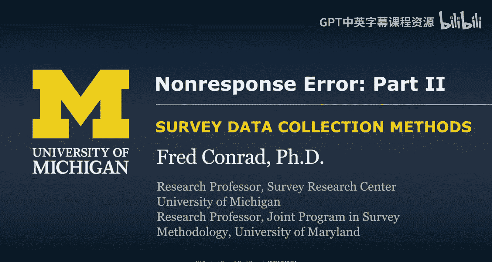
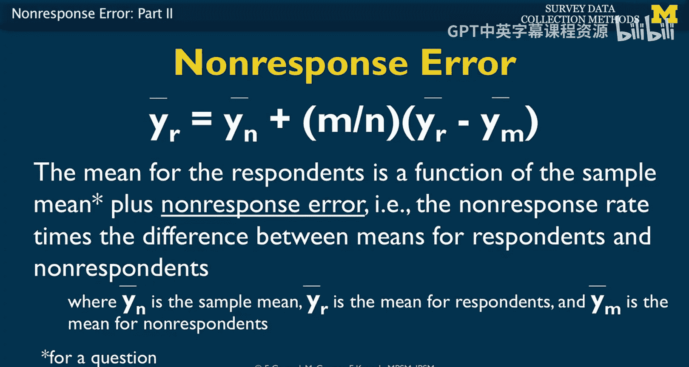
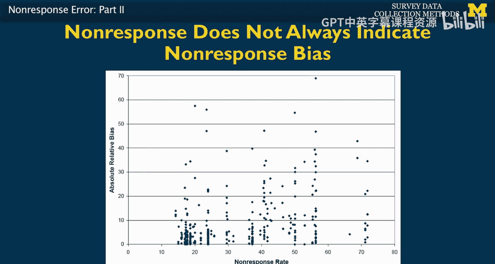
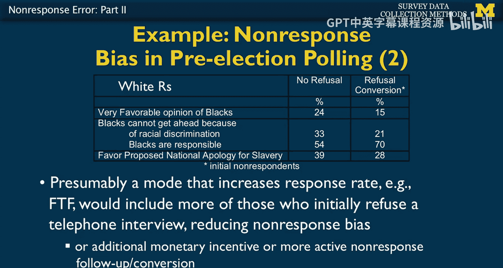

#  012：无应答误差 📊

在本节中，我们将结束关于无应答的讨论，重点聚焦于**无应答误差**，并将其与应答率或其补数——无应答率——区分开来。

## 无应答误差的构成

上一节我们介绍了无应答的概念，本节中我们来看看如何量化无应答带来的误差。无应答误差可以这样理解：如果我们有一个仅基于**应答者**（即同意参与调查的样本成员）计算的样本均值，它可以被视为整个样本（包括应答者和无应答者）均值的函数，再加上无应答误差。

具体而言，无应答误差包含两个部分：
1.  **无应答率**：即无应答者数量 `M` 除以总样本量 `n`。
2.  **应答者与无应答者之间的均值差异**。

这可以用以下公式表示：

**样本应答者均值 = 整体样本均值 + (M/n) × (应答者均值 - 无应答者均值)**

这个公式揭示了无应答误差的本质。它表明，误差的大小不仅取决于两组人答案的差异，还取决于无应答者的比例。

## 误差的两个驱动因素

以下是理解无应答误差的两个关键点：

*   **差异大但无应答率低**：如果应答者和无应答者的答案存在巨大差异，但只要无应答率（`M/n`）很低，这个巨大差异对我们的估计造成的危害就相对较小。
*   **差异小但无应答率高**：反之，如果两组人的答案差异很小，但无应答率很高（即 `M` 很大），那么这个微小的差异会被放大，从而对估计造成显著危害。

正因如此，调查研究者致力于尽可能提高应答率，因为这能**降低**无应答误差的风险。但必须明确，**高应答率并不等同于低无应答误差**，它们是相关但不同的概念。

## 无应答误差与应答率的区别

需要特别注意，无应答误差和应答率的计算层面不同：
*   **无应答误差**是在**单个问题**的层面上计算的。对于不同的问题，无应答误差可能差异很大。
*   **应答率/无应答率**是在**调查单元**（如家庭、组织、一次完整的访谈）层面上计算的，正如美国民意研究协会标准公式所示。

因此，我们在讨论时，是在结合不同分析层面的指标。

## 应答率与误差的非必然关联

正如前文所述，应答率和无应答误差（或称无应答偏差）并非必然相关。这一认识在21世纪初的一系列研究中得到强化。

例如，罗伯特·格罗夫斯的研究表明，无应答率与他所称的“绝对相对偏差”（一种无应答误差的度量）之间，并不存在系统性的关联。观察其研究图表可以发现：
*   有些案例中，无应答率低（应答率高），误差也低，这符合传统预期。
*   但同样存在无应答率低、误差却高的案例。
*   反之，也存在无应答率高、误差却低的案例。

这项研究以及其他在2000年至2010年间进行的研究，彻底改变了调查研究者对应答率的看法。虽然100%的应答率能完全消除无应答误差，但通常情况下，两者可以相当独立。因此，**仅考虑应答率不足以全面评估调查估计值的质量**。

## 何时会产生偏差？

那么，无应答何时会产生偏差，何时又不会呢？关键在于无应答行为是否与调查主题相关。
*   如果被联系或同意参与调查的可能性，与问卷所涉及的主题**相关**，则很可能产生无应答偏差。
*   如果两者**不相关**，则可能不会产生显著偏差。

例如，凯瑟琳·亚伯拉罕及其同事的研究发现，关于**志愿服务**的估计值存在偏差，因为**更愿意参与调查**的样本成员，本身在调查之外也更可能从事志愿服务。这里，被测量的内容（志愿服务）与参与调查的决定过程直接相关，从而导致了偏差。

## 调查方式的影响与一个实例

选择调查方式时，需要考虑其对应答率和潜在无应答偏差的影响。通常：
*   **面对面访谈**能获得最高的应答率，因为当面拒绝访员在社交上更为困难。
*   **电话调查**较容易被挂断。
*   **纸质问卷**则最容易因被搁置而无法完成。

然而，正如格罗夫斯等人的研究指出的，低应答率并不保证高误差，但**低应答率确实会增加估计值受无应答误差影响的脆弱性**。

以下是一个可能与调查方式相关的无应答偏差实例：历史上，美国一些选举前的民意调查曾多次高估黑人候选人的得票率。

皮尤研究中心在1997年的一项研究探讨了这种偏差。他们比较了电话调查中两类白人受访者的种族态度：
1.  **初始应答者**：未经过特别努力就同意参与的人。
2.  **转化应答者**：最初拒绝，但经过多次跟进电话后被说服参与的人。

研究发现，这两组人的种族态度存在根本差异：
*   对黑人持有“非常积极”看法的人，在初始应答者中占24%，在转化应答者中仅占15%。
*   认为黑人因种族歧视而难以取得进步的人，在初始应答者中比例更高。
*   支持就奴隶制进行全国道歉的人，在初始应答者中占39%，在转化应答者中占28%。

这个发现说明：
1.  **偏差来源**：那些最初拒绝电话访问的人，可能持有更明显的种族主义观点。将他们排除在调查之外（即视作无应答者），导致了选举民调的偏差。
2.  **方式的影响**：如果采用应答率更高的方式（如面对面访谈），可能会纳入更多初始拒绝者，从而**减少**这种无应答偏差。
3.  **其他对策**：额外的金钱激励、更积极的跟进转化努力，也能帮助将这些群体纳入已完成案例中。

**请注意**：这种现象不同于所谓的“布拉德利效应”。布拉德利效应被认为是**测量误差**，即白人受访者出于社会期望，向访员谎称会投票给黑人候选人，但实际投票时却投给了白人候选人。而我们讨论的实例是无应答者与应答者**持有不同态度**导致的**无应答偏差**，两者有本质区别。

## 本节总结

本节课中，我们一起学习了无应答的核心概念——**无应答误差**。
*   我们明确了无应答误差由**无应答率**和**组间差异**共同决定，并将其与**应答率**这一相关但不同的概念区分开来。
*   我们了解到，高应答率不一定意味着低误差，评估调查质量需更全面的视角。
*   通过实例，我们看到了无应答偏差如何产生，以及调查方式选择如何影响它。

这结束了我们关于无应答及其误差的讨论，也完成了本课程的引言部分。在下一课中，我们将更详细地探讨网络调查和自动化自填式调查这些在本引言中未深入讨论的现代调查方式。