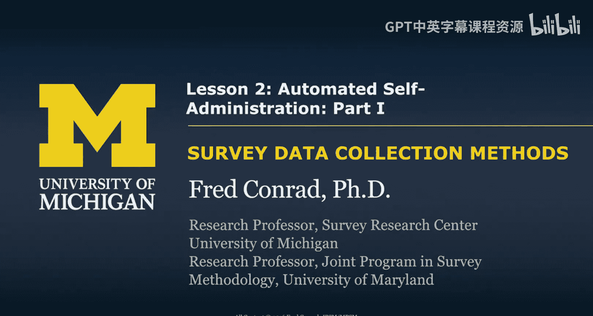
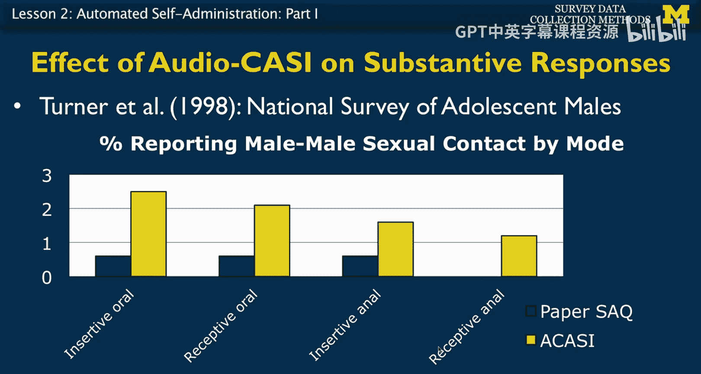

#  013：方法、社调问卷设计、抽样、缺失数据、分析：2.1.1 调查模式：访员与自填式CASI-ACASI 📊

欢迎回来，这是我们四节课中的第二课，专注于自动化自填式调查，包括网络或在线数据收集。在本节课中，我们将首先讨论作为访谈一部分的自动化自填式模式，即由人类访员询问非敏感问题，然后将笔记本电脑或其他计算机交给受访者，让他们自行填写并直接输入对敏感问题的答案。课程剩余部分将专注于网络问卷，即在线数据收集。这部分内容主要分为两个部分：一是网络调查的误差特性，如覆盖误差、无应答误差和测量误差的影响；二是我们将审视常用的不同抽样程序，以及这些程序如何影响网络调查中的各类误差。最后，在课程的结尾部分，我们将深入探讨测量误差，并关注网络调查的一个特定特性——交互性。这种特性在其他类型的自填式调查（特别是纸质自填式调查）中并不具备。我们将探讨网络调查的交互功能如何能够提升（或未能提升）在该模式下收集的数据质量。

现在，我们将转向CASI和ACASI，看看它们如何帮助提高对敏感信息的披露率。

## 常用调查模式回顾 🔄

首先，作为提醒，最常用的调查模式确实是自填式邮寄纸质问卷、网络调查、电话访谈以及涉及人类访员的面对面访谈。当然，也存在用于敏感问题的混合模式，这正是我们现在要关注的重点。在这种模式下，访员负责询问非敏感问题，而受访者则自行填写敏感问题。此外，移动网络调查的使用也日益增多。

再次提醒，当我们说CASI时，指的是**计算机辅助自填式访谈**。而`ACASI`指的是**音频计算机辅助自填式访谈**。

## CASI如何影响敏感问题回答 📈

首先，我们来看计算机辅助自填式访谈及其如何影响受访者对敏感问题的回答。评估CASI时，最初或主要的比较对象是自填式（即使用CASI）下的答案与访员询问问题时的答案（例如，电话或面对面访谈）之间的差异。

多项研究表明，与访员提问相比，在CASI模式下，受访者似乎更愿意披露敏感信息。早期的论证之一来自Tourangeau和Smith。他们观察到，在CASI模式下，对敏感信息的披露更多。这里的“披露”指的是更多报告社会不期望发生的行为。

与访员提问相比，CASI能带来更多披露。我们稍后会再与其他类型的自填式模式进行比较。Tourangeau和Smith的研究显示，在询问过去一年、五年和一生中的性伴侣数量时，通常CASI（浅蓝色柱）的报告数量高于电话访谈（深蓝色柱）。在一生这个时间跨度上，电话访谈和CASI之间几乎没有差异。有人提出，关于一生的问题敏感性较低，或者人们可以更坦然地回答。这里的假设是，至少对女性而言，拥有多个性伴侣是不被期望的，因此较少的性伴侣数量更符合社会期望。但似乎在一生的时间跨度上，调查模式的影响不大，这可能是因为问题本身敏感性降低了。然而，对于过去一年和过去五年这两个时间段，CASI在披露不期望行为方面具有明显优势，即比电话访谈（访员管理）报告了更多的不期望行为。

Tourangeau和Smith还证明，特别是音频CASI，相对于访员管理的电话访谈，增加了对在不同时间段内使用非法药物的报告。

这张表格包含了在过去一个月、过去一年和一生中，可卡因和大麻使用报告流行率的比率。这些比率是ACASI下的报告与访员管理下的报告之比。关键在于，如果比率大于1，则意味着在ACASI下的报告多于访员提问时，这被解释为披露更多。可以看到，所有这些比率都大于1，有些甚至远大于1。这表明，特别是在过去一年里，当受访者自行填写问题并直接输入答案时，他们更愿意、也能够更多地披露大麻使用情况，尤其是可卡因使用情况。

回到性伴侣领域，针对异性性伴侣，Tourangeau和Smith的研究表明，男性和女性在自填式（无论是音频CASI还是文本CASI或传统CASI）下，似乎都比访员提问时更坦率，提供了更多不符合社会期望的答案，但方向相反。他们的建议（其他人也提出过）是，对男性而言不期望的行为与对女性而言不期望的行为是不同的。因此，在电话访谈下，男性倾向于**高报**异性性伴侣的数量，而女性在访员提问时则倾向于**低报**异性性伴侣的数量。当然，从统计意义上说，这不可能同时成立，因为从某种程度上说，他们是彼此的伴侣（如果你认同样本能代表总体的话）。可以看到，音频CASI和文本CASI缩小了男性和女性报告数量之间的差距。它并没有消除差距，但确实缩小了差距，这表明即使是不同类型的社会期望偏差，在自填式条件下也会减少。

显然，在这些例子中，自填式相比访员管理，增加了披露。

## 自动化自填式 vs. 纸质自填式 📄

人们可能还会问，计算机化、自动化的自填式是否比纸质自填式更有效、能带来更多披露？以及CASI和音频CASI在披露率上是否有任何差异？

实际上，有证据表明，在自动化模式下，对敏感信息的披露多于纸质模式。像之前描述的纸质自填式问卷，确实比访谈增加了对不期望行为的报告。但是，在Gnambs和Kaspar的一项元分析中，比较了计算机化自填式与纸质自填式，发现自动化自填式比纸质自填式能更可靠地报告更多敏感信息，而且对于最敏感的项目，这种效应更大。

因此，自动化似乎有某种特性，相对于单纯的自填式，能增加隐私感。

## ACASI的优势与局限 🎧

现在，谈到ACASI。当它被引入时，其支持者认为，通过让受访者听到问题而不是在屏幕上看到问题，相对于在屏幕上显示问题的CASI，给受访者带来的隐私感增加了。

但是，Cooper及其同事在为数不多的直接比较CASI和ACASI的研究中发现，ACASI并没有优势。这部分归因于在音频CASI中，受访者实际上并没有使用耳机，他们只是从屏幕上阅读问题。在这个实施中，问题既以文本形式呈现在屏幕上，也通过耳机播放。但他们发现，即使受访者使用了耳机并以听觉方式接收问题，ACASI也没有比CASI更具优势。

这并不是说这些模式在增加披露方面不如访员管理的问题有效，但至少在Cooper及其同事的研究中，它们彼此之间没有差异。

关于ACASI，有一点是肯定的，即使它没有增加披露，但与CASI或纸质自填式问卷相比，它**降低了低识字率的影响**，因为阅读能力不高的受访者能够听到问题，从而消除了这方面的顾虑。

Charles Turner等人早期进行的一项比较音频CASI与纸质问卷的研究发现，在一些相当敏感的同性性行为披露方面，音频CASI具有很大优势。这再次表明，自动化相比自填式本身具有一些额外优势。

当我们回来时，我们将更详细地探讨为什么自填式，特别是音频CASI，可能比访员管理带来更多披露。

---

**本节课总结**：在本节课中，我们一起学习了自动化自填式调查模式，特别是CASI和ACASI。我们了解到，与访员管理相比，这些模式能显著提高受访者对敏感信息的披露率。我们还比较了自动化自填式与纸质自填式，发现自动化通常能带来更多披露。此外，我们探讨了ACASI在降低识字率要求方面的优势，尽管在直接增加披露方面，其相对于CASI的优势证据不一。这些知识对于设计能有效收集敏感数据的调查至关重要。