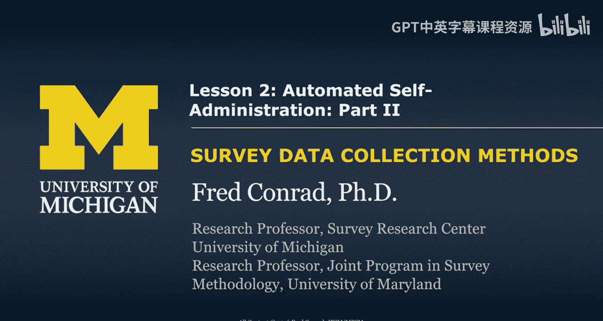
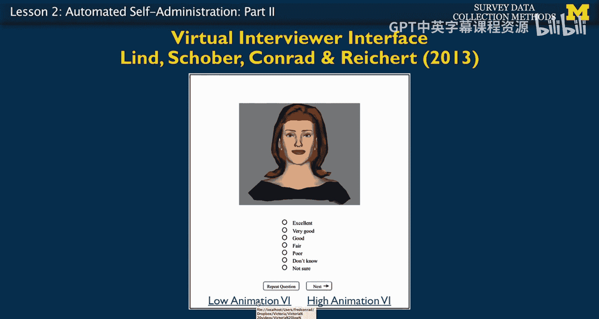
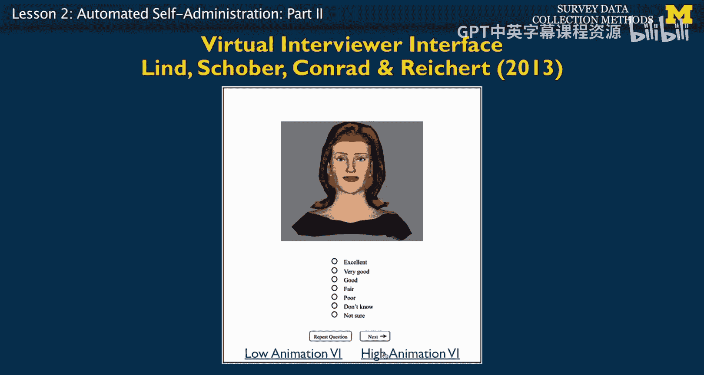
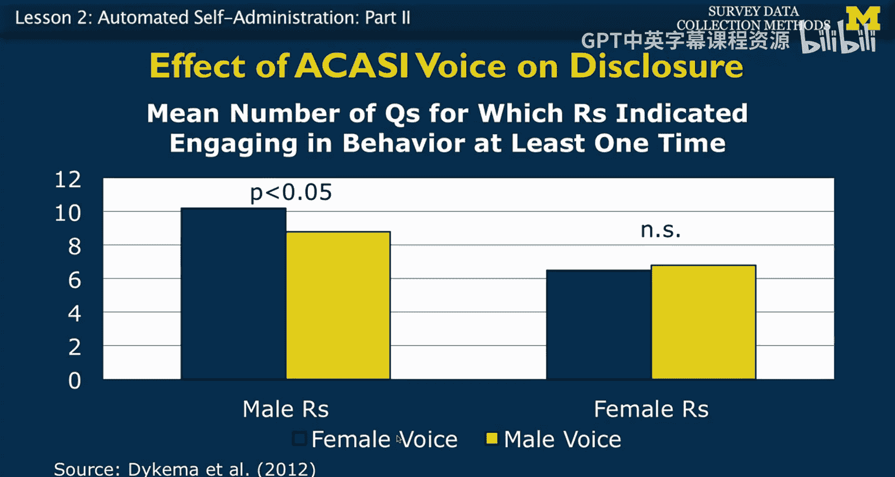
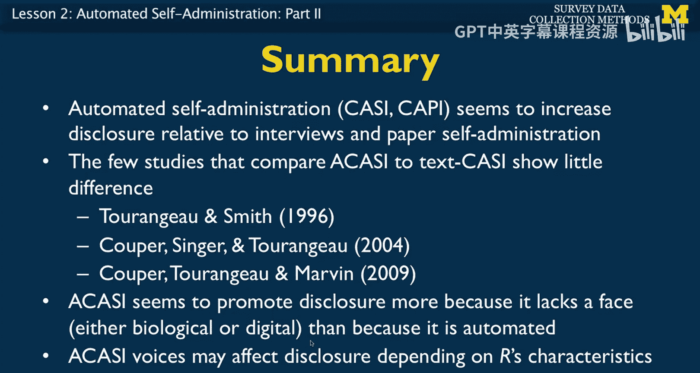

#  014：ACASI系统深入探究 🎧

## 概述
在本节课程中，我们将深入探讨音频计算机辅助自访系统（ACASI）如何以及为何能比传统的访员面访或纸质自填问卷，更能促进受访者对敏感问题的自我披露。我们将通过具体的实验研究，分析影响披露率的关键因素，例如“面孔”的存在与否以及受访者的主观状态。

## 从证据到问题
上一节我们回顾了证据，表明自填方式，特别是ACASI，比访员面访甚至纸质自填问卷更能提高敏感信息的披露率。

但核心问题是：**ACASI究竟为何能促进披露？** 尤其是在与访员面访差异最大的方面。Lynn及其同事通过一项实验探讨了这个问题。

## 实验设计：四种访问模式对比
该实验比较了四种模式下“不良答案”（即社会不赞许的敏感答案）的披露率：

1.  **面对面访员面访**
2.  **虚拟访员模式（高动画）**：一个动画程度较高的计算机生成虚拟访员提问。
3.  **虚拟访员模式（低动画）**：一个动画程度较低的计算机生成虚拟访员提问。
4.  **ACASI模式**：仅播放上述虚拟访员的录音，不提供任何视觉信息。

选择这四种模式的目的，是为了检验究竟是“人类访员的存在”还是“面孔的存在”对披露率产生了抑制作用。

## 虚拟访员示例
以下是实验中虚拟访员“Victoria”的示例，帮助理解实验设置：

*   **低动画版本**：Victoria的头部、眼睛和嘴巴动作幅度很小。
    > “你好，我是Victoria。感谢你今天同意参与我们的调查。我将询问你关于生活的各种问题，你可以通过点击鼠标或键盘输入来回答。你今天提供的所有答案都将严格保密，所以请放心如实回答。你准备好开始了吗？”

*   **高动画版本**：Victoria有更多的动作，且嘴唇动作与发出的声音更同步。
    > “你好，我是Victoria。感谢你今天同意参与我们的调查。我将询问你关于生活的各种问题，你可以通过点击鼠标或键盘输入来回答。你今天提供的所有答案都将严格保密，所以请放心如实回答。你准备好开始了吗？”

## 核心研究发现
实验针对10个在面对面访员面访和ACASI间存在披露差异的问题进行了分析。主要发现如下：

*   **面孔效应**：最常见的模式是，**有面孔的模式比没有面孔的模式披露更少**。在10个问题中的8个里，两种虚拟访员条件（有面孔）产生的结果更接近面对面访员面访，而非ACASI。这表明，**面孔的存在（无论是真人还是虚拟形象）会抑制披露**，而不仅仅是人类访员的存在。
*   **自动化模式 vs. 面对面**：受访者在面对面模式下的披露率低于三种自动化模式（两种虚拟访员+ACASI）的情况，只出现在10个问题中的4个。这进一步支持了“面孔效应”而非“人类效应”是主要抑制因素的观点。

## 受访者主观状态的影响
研究还考察了受访者在访问开始时的主观状态（如舒适度）如何影响披露。

以下是关键发现：
受访者的舒适度与不同访问模式相互作用，影响了他们给出“不良答案”的概率。例如，在一项关于“过去一年是否曾在公交或地铁上为陌生人让座”的问题中，回答“从未”被视为社会不赞许行为。

*   当受访者在访问开始时表示**感到舒适**时，出现了经典的披露模式：自填模式（包括虚拟访员和ACASI）下的披露率高于面对面模式。
*   当受访者在访问开始时表示**不舒适**时，**不同访问模式之间几乎没有差异**，披露率都很低。

这表明，促进披露的原因不仅仅是隐私增加，还与**受访者在访问开始和进行过程中的主观感受**密切相关。

## ACASI中声音特性的影响
ACASI的另一个特点是它包含录音语音。一个令人惊讶的发现是，尽管ACASI具有“声音”这一强烈的社会线索，但它仍比访员提问更能促进披露。

那么，**声音的具体特性（如性别）是否会影响披露？** 对此问题的系统性研究不多，但一项由Dickson及其同事进行的研究表明：

*   对于**男性受访者**，当敏感问题由**录制好的女性声音**提问时，他们比由男性声音提问时更可能披露敏感信息。
*   对于**女性受访者**，录制声音的**性别没有任何影响**。

## 总结
本节课我们一起学习了关于自动化自填系统（特别是CAPI和ACASI）的深入讨论。

以下是核心要点总结：
*   与访员面访和纸质自填相比，ACASI似乎能**提高敏感信息的披露率**。
*   少数比较ACASI和纯文本CAPI的研究显示两者差异很小。
*   ACASI促进披露的主要原因似乎是**缺乏面孔（无论是真人面孔还是数字面孔）**，而不仅仅是因为它是自动化的。
*   最后，ACASI中使用的**录音声音可能会影响披露**，这种影响取决于受访者的个人特征（如性别）。

## 过渡到下一主题
在接下来的部分，我们将转向**网络调查**，这是本课剩余部分将重点讨论的主题。我们将首先审视网络调查的误差属性，特别是覆盖误差，以及覆盖范围、抽样、无应答和测量误差如何影响网络调查所得估计值的质量。