#  015：网络数据收集的覆盖与抽样误差 📊

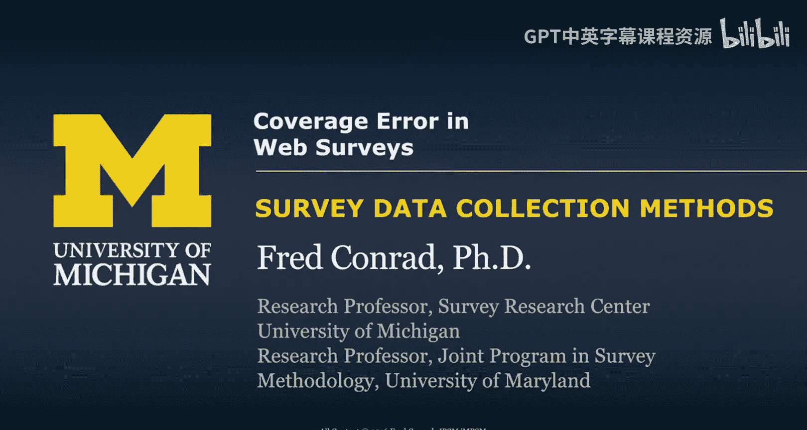

在本节课中，我们将学习网络或在线数据收集方法。我们将从之前讨论的、主要在面对面访谈背景下进行的“自填式”调查，过渡到受访者在没有任何访员参与的情况下自行完成问卷的情境。首先，我们将探讨网络调查如何影响不同类型的调查误差，包括我们一直在讨论的标准类型：无应答误差、抽样误差、覆盖误差和测量误差。我们还将介绍几种不同类型的网络调查，因为它们对误差有不同的影响。随后，我们会讨论网络调查中的交互性对数据质量的影响，这是其他类型的自填式调查（特别是纸质问卷）所不具备的特性。

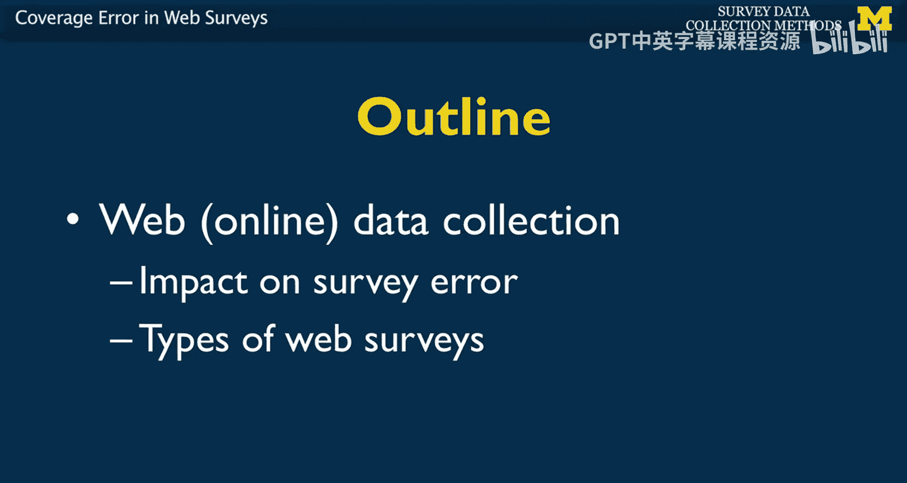

## 覆盖误差

上一节我们介绍了网络调查的概况，本节中我们来看看覆盖误差。根据之前的讨论，覆盖误差主要取决于两个因素：**未覆盖率**以及**被覆盖人群**与**未被覆盖人群**之间的差异。必须将这两个指标结合起来，才能确定覆盖误差的大小。如果被覆盖者与未被覆盖者之间存在巨大差异，并且未被覆盖率很高（即更多人口未被包含在抽样框中），那么覆盖误差就会非常严重。

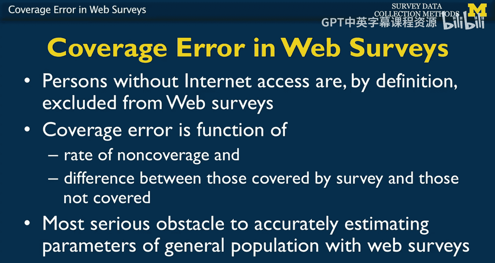

网络调查的覆盖误差是一个特别值得关注的问题，因为无法访问互联网的人，根据定义，就是未被覆盖的。没有互联网接入的人根本无法提供数据，因为他们永远不会被邀请参与这类调查。当然，我们稍后会讨论一些其他类型的网络调查，它们可能因为不需要明确的邀请而较少受此问题影响。

### 谁不在线？

在覆盖问题上，核心问题是：谁不在线？因为如果他们不在线，就无法在网络调查中提供数据。

以下是皮尤研究中心提供的数据，说明了某些群体存在较高的未上网率，因此任何基于互联网用户的抽样框都会对这些群体产生较高的未覆盖率：
*   **老年人**
*   **低收入人群**
*   **仅拥有高中或以下学历的人群**
*   **居住在美国农村地区的人群**

举例来说，如果你想通过网络调查来测量人们对农业问题（例如农业补贴）的态度，那么农村地区居民在网络上的代表性不足，就可能导致你无法准确测量在农业问题更重要的地区（即农村地区）的态度。由于这种对农村地区人口的覆盖不足，如果你想将结果推广到总体，这将是一个非常严重的问题，因为并非所有人口成员都平等地拥有互联网接入。

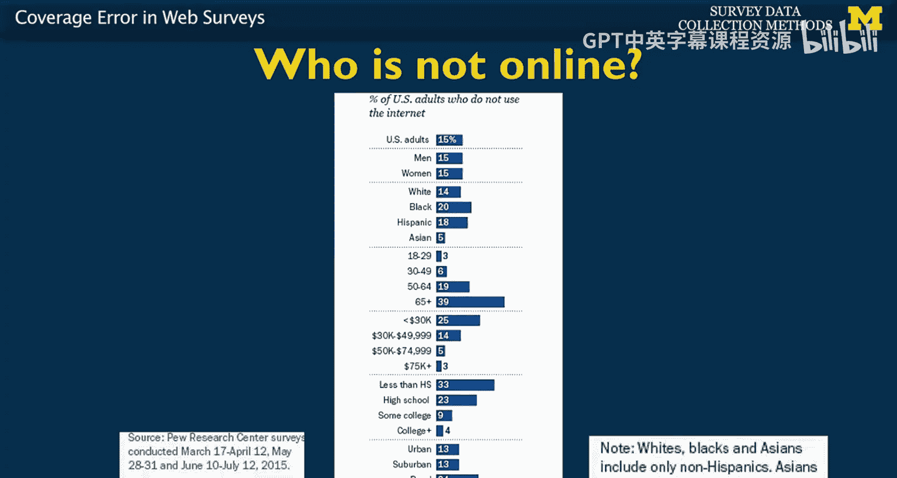

### 人们不在线的原因

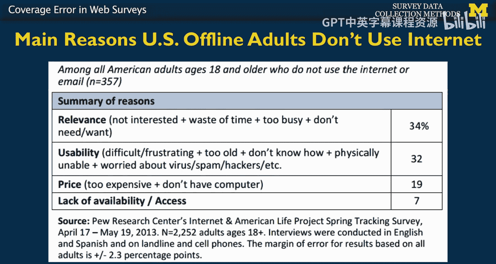

以下是公众成员不在线的一些常见原因（同样来自皮尤研究中心）：
*   **不相关/无兴趣**：认为上网无关紧要、浪费时间。
*   **太忙**：没有时间上网。
*   **不需要/不想**：没有上网的需求或意愿。
*   **使用困难**：觉得上网操作困难、令人沮丧，或者不知道如何使用。
*   **身体障碍**：有残疾阻碍他们上网。
*   **安全顾虑**：担心病毒、黑客等安全问题。

关键点在于，并非所有人都在线。一个旨在将结果推广到总体的网络调查必须解决这个问题。

## 网络调查的抽样

网络调查的抽样带来了一些有趣的问题。有多种不同的网络调查抽样方法。

以下是几种主要的抽样方法：
*   **不抽样**：我们将看到一些类型的网络调查实际上根本不进行抽样。
*   **基于列表的抽样**：在这种方法中，总体中的所有成员都被列出并附有联系信息。
*   **固定样本组**：这是预先招募的大型参与者列表，有时包含数百万成员。它们主要分为两种类型：**非概率固定样本组**和**概率固定样本组**，我们稍后会详细讨论。
*   **基于交易或拦截的抽样**：例如，可以邀请访问某个网站的第N个用户参与调查。

目前，没有一个包含所有互联网用户（特别是包含电子邮件联系地址）的通用抽样框。这意味着，如果要邀请公众成员参与网络调查，很难通过电子邮件进行，但又非常希望这样做，因为电子邮件中可以直接包含调查链接，这大大降低了开始调查的障碍。作为替代，可以从手机号码库中抽样，并通过短信发送链接来联系公众成员，但这比较复杂。目前更常见的做法是通过邮寄纸质邀请函，其中包含一个网址（URL），样本成员需要手动输入该网址，这可能构成一个障碍。

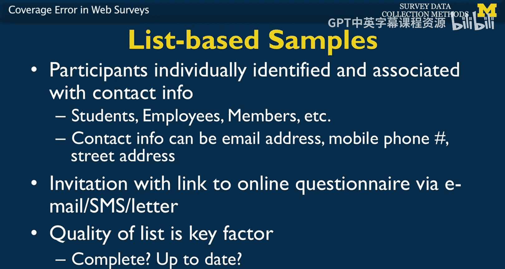

### 基于列表的抽样

基于列表的抽样是可取的，它类似于其他调查模式中的抽样框。例如，我们之前讨论过的电话抽样框就是基于列表的（如通过随机数字拨号技术生成电话号码列表）。对于一些特定总体（非全国性总体），存在基于列表的抽样框。例如，拥有成员名单的组织（如大学的学生、公司的员工）就是一个很好的例子，他们都有电子邮件地址，可以通过这种方式联系。关键问题是列表的质量：它是否完整且最新？例如，在一个本科院校的学生名单中，一年后可能有25%的条目已经不准确（学生已毕业离校）。

### 在线固定样本组

在线固定样本组是基于列表抽样的另一种选择，可能更常用。一个定义是：一个预先招募的、已注册并愿意偶尔参与网络调查的人员库。这被称为在线访问样本组或访问池。注意，不要将其与纵向调查研究中使用的“固定样本组”混淆。纵向固定样本组指的是一组被招募来进行重复测量的参与者，而在线固定样本组的成员通常被邀请参与一次性或横截面调查，他们可能每天或每周收到多次邀请，但不一定是为了进行重复测量。

在线访问样本组的成员可能会频繁收到参与各种主题问卷的邀请，他们可以自行选择参与，通常应答率相当低。调查公司发现有效的激励措施包括积分、抽奖机会或通过PayPal等服务的在线转账。

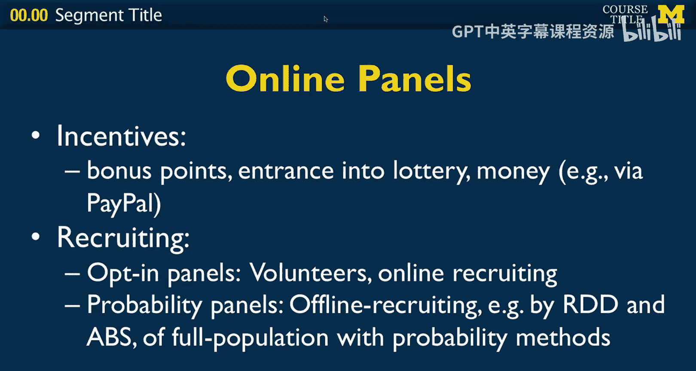

对于所谓的“自愿加入样本组”，招募通常在线进行。这些志愿者可能在网站上看到横幅广告并点击，从而被纳入在线样本组，然后被要求提供联系信息。这与**概率固定样本组**的招募方式截然不同。概率固定样本组旨在支持对全国性总体的推断，因此其招募方式类似于其他模式中代表性样本的招募。事实上，它使用了其他模式的技术，即在线下进行。例如，通过随机数字拨号（随机生成电话号码并呼叫，邀请相关家庭或个人加入样本组），或某种基于地址的抽样方法（面对面招募）。这样做是因为没有互联网用户（特别是带有电子邮件地址的）的抽样框。但结果可以得到一个非常接近全国人口特征的参与者样本组。

### 不同类型样本组的准确性比较

一项由耶格及其同事报告的比较研究，将同一份问卷通过电话（使用随机数字拨号招募的样本）和通过GFK知识面板（一个概率固定样本组）进行施测的结果进行了对比。他们还比较了六个非概率固定样本组（即我们描述的那种访问样本组）的结果。研究者能够通过将电话调查结果（视为一种“金标准”）和行政记录（作为基准）进行比较，得出一个误差度量。如图所示，概率固定样本组的误差率非常接近电话调查，并且低于所有非概率固定样本组。从这个比较来看，非概率样本似乎比概率网络样本具有更高的误差率。

## 其他在线数据收集方法

除了样本组，组织和个人还使用其他一些方法来在线收集数据。

### 娱乐性投票

例如，“娱乐性投票”，如“今日问题”类型的投票。用户如果恰好访问某个媒体网站，可能会点击按钮进行“投票”（通常意味着回答一些投票问题）。这种方式根本无法定义参与者的总体，因此很难从这些数据中进行推断。但当它们用于娱乐目的时，实际上也不需要推广到总体。

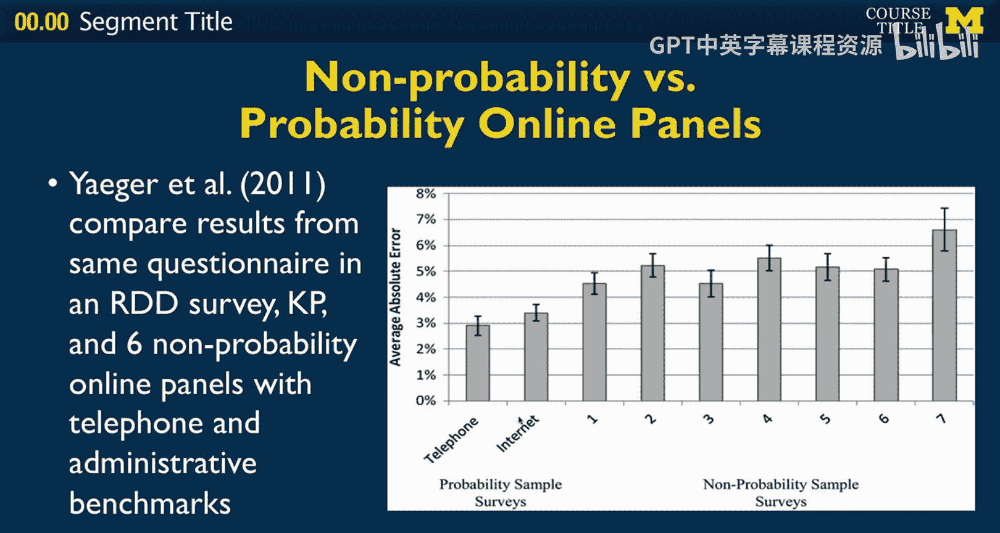

### 无限制的自选调查

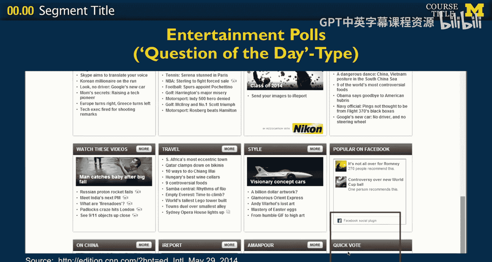

然而，这类无限制的自选调查由于上述原因是有问题的。我们对参与者一无所知，他们是自我选择的（例如，通过点击社交媒体上的链接或广告，或收到电子邮件邀请）。我们不了解总体，因此无法进行推断。同一个用户或参与者可能多次提供数据。这实际上就是“不抽样”的设计。

### 拦截调查

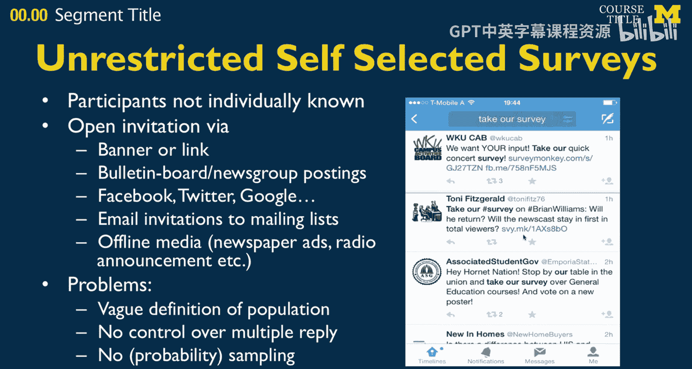

最后，在线拦截调查也很常见。从某种意义上说，它们是基于概率的（例如，邀请访问网站的第N个用户）。但是，与基于列表的抽样或固定样本组相比，同样对个体一无所知。这种方法适用于评估网站、网站用户满意度等任务，但不适用于对一般人群进行估计。

## 总结

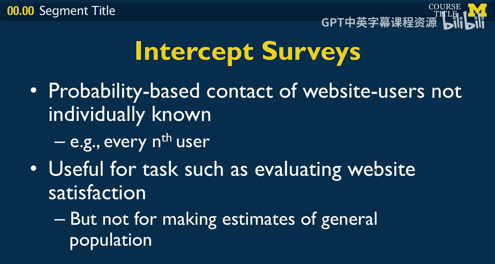

本节课中，我们一起学习了网络数据收集中的覆盖误差和抽样问题。我们了解到，覆盖误差源于无法上网的人群被排除在外，而抽样则面临缺乏通用互联网用户抽样框的挑战。我们探讨了基于列表的抽样、概率与非概率固定样本组以及其他如娱乐投票和拦截调查等方法。关键点在于，概率方法（如概率固定样本组）在支持总体推断方面通常比非概率方法更可靠。接下来，我们将转向讨论网络调查中的另外两个重要误差来源：无应答误差和测量误差，并在讨论测量误差时重点关注问卷视觉设计方面的影响。