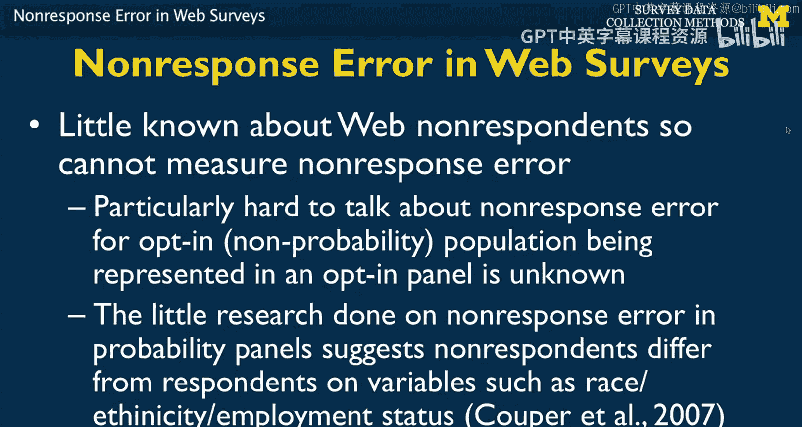
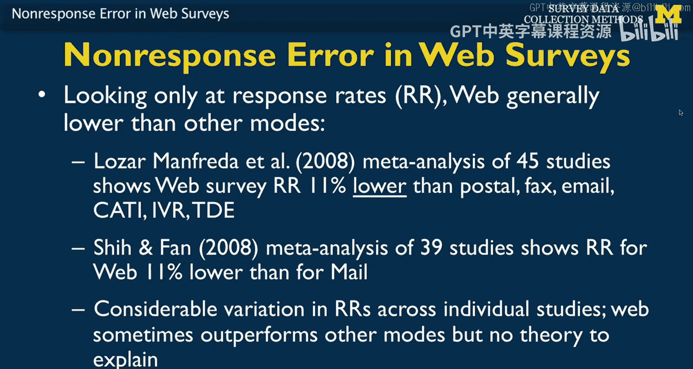
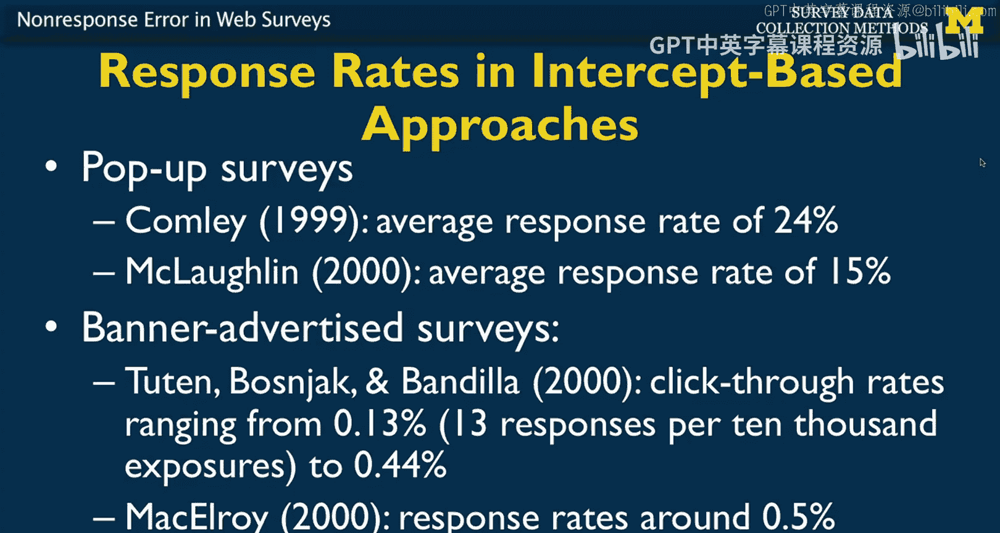
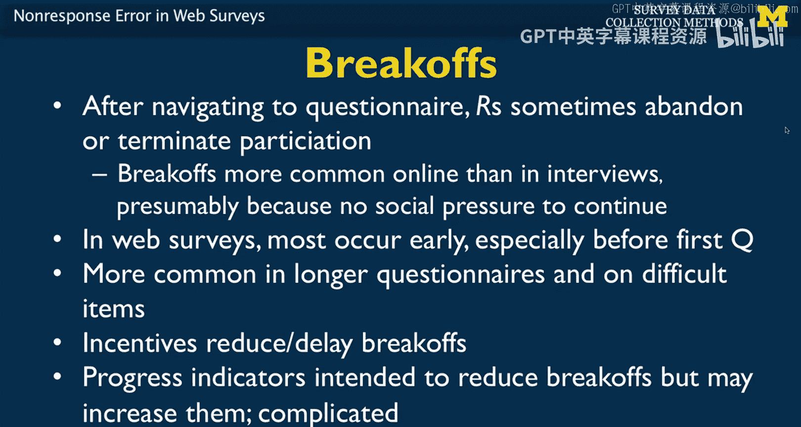

#  016：无应答处理 📊

在本节中，我们将探讨网络调查中的无应答问题。我们将了解无应答误差的概念、网络调查的应答率特点、影响无应答的因素，以及问卷填写过程中的“中断”现象。

---

## 网络调查中的无应答误差

上一节我们讨论了无应答的一般概念。本节中，我们来看看网络调查中的无应答问题。

对于网络调查，我们实际上对无应答者知之甚少，而这恰恰是量化无应答误差所必需的。因此，对于选择性加入或非概率样本组，几乎不可能讨论无应答误差，因为我们根本不知道其所代表的总体情况，也不知道是谁选择不点击横幅广告或参与调查。

相比之下，针对概率样本组中无应答误差的有限研究表明，无应答者与应答者在种族、民族、就业状况等变量上存在差异。因此，由于招募过程的原因，概率样本组中很可能存在无应答误差。

---

## 网络调查的应答率

如果我们只关注应答率，而非无应答误差，那么网络调查的应答率通常低于其他调查模式。从某种意义上说，这使得网络调查更容易受到无应答误差的影响。但正如我们讨论过的，这实际上取决于应答者与无应答者之间的差异，以及无应答者的数量。

多项元分析提供了应答率较低的证据。例如，Lozar-Man Freedda及其同事分析了45项研究，发现网络调查的应答率比邮寄问卷、传真问卷、电子邮件等更传统的模式低11%。另一项对39项研究的元分析也显示，网络调查的应答率比邮寄调查低约11%。不过，不同研究间的应答率存在很大差异。在某些情况下，网络调查的应答率实际上高于其他模式的同类研究。目前这尚无明确的理论解释，但总体趋势是，在线数据收集的应答率低于其他模式。

---

## 概率样本组的累积无应答率

对于概率样本组，存在一种累积应答率或无应答率，这与调查过程中存在多次可能不参与的机会有关。正如之前讨论的，样本组最初通过随机数字拨号和基于地址的抽样混合方式招募，这会产生一个初始应答率。数据显示，在尝试联系的家庭中，最终有36%被成功招募进入样本组。

然后，为没有网络接入的样本组成员提供设备（在收集这些数据时，设备是网络电视）。只有约67%的样本成员通过该设备成功连接到互联网。可以看到，随着流程的推进，应答者的比例在不断下降。

接着，样本成员需要完成个人资料填写，几乎所有人都完成了。但在此之后，只有47%的人保持活跃并留在样本组中。当进行第一次调查时，完成率为57.4%。这个57.4%是相对于之前所有步骤后剩余样本的比例。因此，最终的应答率仅为5.5%。如果无应答者在各种属性上与应答者相似，并且会像应答者一样回答问题，这就不是问题。但只有初始抽样框的5.5%最终提供了调查数据，无应答误差确实是一个值得关注的问题。

---

## 其他类型网络调查的应答率

其他类型的网络调查的应答率包括：
*   **弹出式调查**：至少在早期，其应答率高于其他类型的非概率调查，早期评估显示在24%到15%之间。这种调查的邀请会出现在用户正在浏览的主浏览器窗口之外的独立窗口中。
*   **横幅广告调查**：通常在网页顶部有一个横幅广告来宣传调查。这种方法产生的点击率非常低，在两项该方式盛行时期的研究中，点击率不到1%。

---

## 影响网络调查无应答的因素

影响网络调查无应答的因素实际上与其他调查模式相似。

以下是主要影响因素：
*   **调查设计**：例如，预先通知（如信件或电子邮件，假设有电子邮件地址）有帮助。
*   **发送方或赞助方的权威性**：如果发送方熟悉、显得权威，会提高参与度。
*   **提醒**：在初次邀请后发送提醒也有帮助，这在许多模式中都适用。
*   **激励**：激励措施有帮助。预付费激励（在线研究中更难实现）比承诺性激励更有效，这与其他模式相同。
*   **问卷长度**：问卷长度通常会在邀请中提及，一般来说，问卷越长，应答率越低。
*   **样本成员属性**：性别、个性、是否对该主题感兴趣、对调查研究的态度、参与调查的经验等都会影响参与度，正如在其他模式的调查中一样。

---

## 问卷填写中断

关于网络调查无应答的最后一个主题是“中断”或“放弃”。这指的是样本成员开始填写问卷，但在结束前的某个地方终止的情况。

实际上，这种情况在网络问卷的第一页最为常见。样本成员到达该页面后，决定不继续参与。一旦样本成员开始填写问卷，可以将中断视为介于项目无应答（提供缺失数据）和单元无应答（不提供任何数据）之间的情况。如果应答者回答了前10个问题，之后没有提供任何数据，这与在整个问卷中间歇性缺失数据不完全相同，这是一种放弃行为，通常被同时视为项目无应答和单元无应答。

中断在较长的问卷中更为常见，这并不奇怪，在难度较大、更费脑力的题目上也更容易发生。激励措施可以减少中断或延迟中断，即促使完成更多题目。进度指示器的主要设计目的是减少中断，其理念是向应答者提供关于已完成任务量和剩余任务量的信息。但事实上，进度指示器可能会增加中断，这是一个复杂的问题。目前的证据（并且仍在积累）表明，尽管进度指示器在直觉上似乎合理，但实际上会损害完成率，增加中断。

---

## 本节总结

本节课中，我们一起学习了网络调查中的无应答问题。我们了解到量化网络调查的无应答误差存在困难，网络调查的应答率通常较低，特别是在概率样本组中存在累积无应答效应。我们还探讨了影响无应答的各种因素，以及问卷填写过程中的中断现象及其影响因素。接下来，我们将转向测量误差的问题，并重点关注问卷视觉设计特征如何影响数据质量。