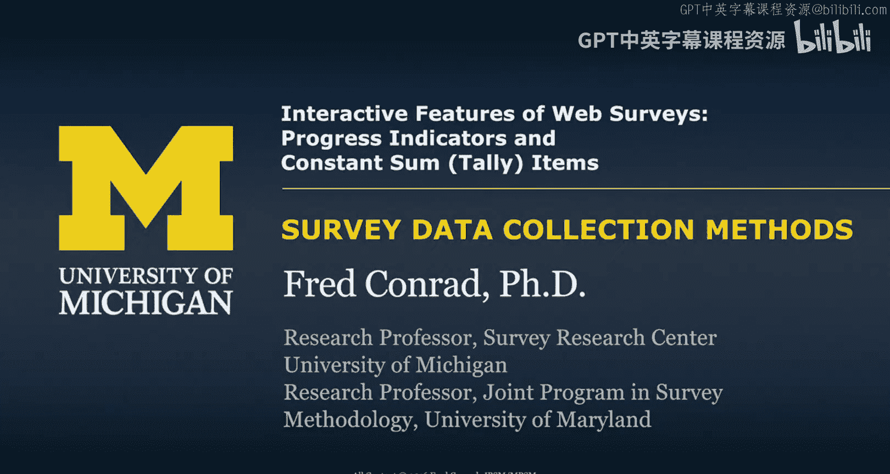
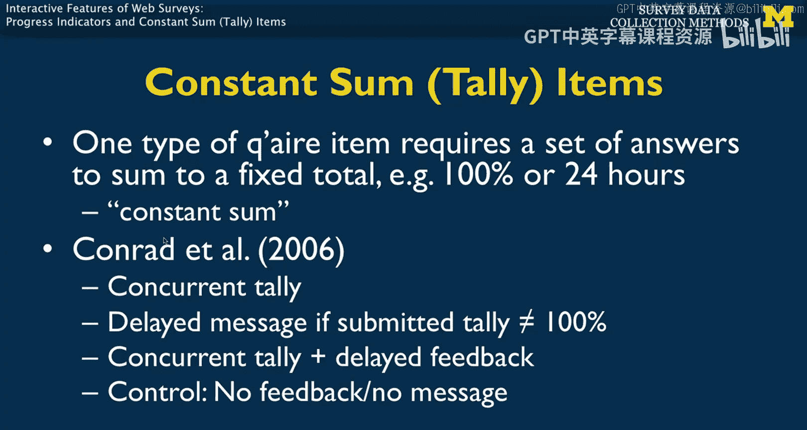
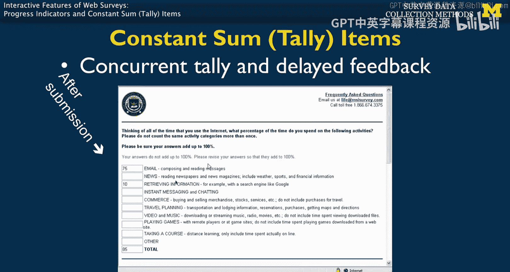
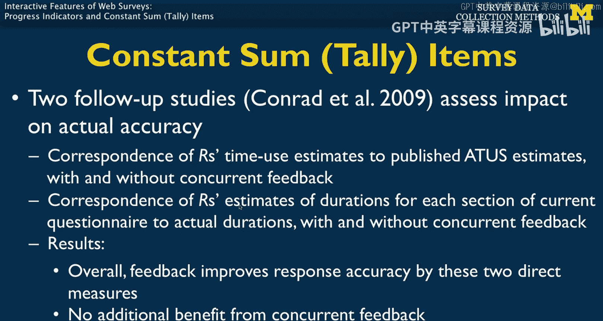

#  018：方法、社调问卷设计、抽样、缺失数据、分析：2.3.1 进度指示器与实时统计 📊




在本节课中，我们将要学习网络调查中的交互性功能，特别是进度指示器和实时统计反馈。我们将探讨这些功能的理论优势、实际效果以及它们对问卷完成率和数据质量的影响。

上一节我们讨论了网络调查的视觉设计，本节中我们来看看如何通过交互性功能来增强调查体验。交互性功能允许问卷工具向受访者提供反馈，例如显示完成进度、标记不一致的答案或检测算术错误。理论上，这些功能可以提升受访者的参与度和答案的准确性。

## 交互性的潜在优势与劣势

交互性功能在概念上既有优点也有缺点。

**潜在优势包括：**
*   **提供反馈**：问卷可以像人工访员一样，提供进度指示、标记逻辑矛盾或计算错误。
*   **辅助计算**：工具可以为受访者执行计算，加快答题速度。
*   **检测快速答题**：系统可以识别出答题过快的行为，并向受访者提供反馈。
*   **模拟人工访员**：通过定制化的鼓励和帮助，使计算机化工具更像由人类管理。
*   **提供辅助工具**：例如，可以按需提供定义解释，帮助受访者理解问题。

**潜在劣势包括：**
*   **技术要求**：某些工具需要插件或特定软件，可能降低可访问性。
*   **社会临场感效应**：设计得过于人性化的问卷，可能会像面对真人访员一样，抑制受访者对敏感问题的诚实回答。

## 进度指示器的效果分析

正如前面提到的，提供进度反馈似乎是一个积极的交互功能。其理念是，如果受访者知道自己的完成情况，会更有动力完成任务，避免因感觉“永无止境”而放弃。

然而，多项关于进度指示器的实验研究得出的总体结论是：**进度指示器并不能如预期般减少中途退出率，反而可能增加退出**。一项元分析综述了大量研究，证实了这一普遍结论，尤其是在较长的问卷中，进度指示器更可能产生负面影响。

进度指示器降低完成率的原因在于：**反馈内容本身至关重要**。如果反馈信息告诉受访者“还有很长的路要走”，这实际上会成为一种阻碍。受访者会关注反馈内容，而令人沮丧的反馈会促使他们放弃任务。

康拉德等人的一项研究清晰地证明了这一点。他们设计了三种不同的进度显示方式：
1.  **线性进度指示器**：完成进度匀速增长。
2.  **先快后慢进度指示器**：前期进度显示很快，后期变慢。
3.  **先慢后快进度指示器**：前期进度显示很慢，后期加快。

研究结果显示：
*   **先慢后快进度指示器**导致的中途退出率，比**先快后慢进度指示器**高出近11%。
*   **先慢后快进度指示器**让受访者感觉调查耗时更长，尽管实际时间并无差异。
*   **先快后慢进度指示器**让受访者认为调查更有趣。
*   普通的**线性进度指示器**在减少退出率方面，与**不提供任何进度指示**相比并无可靠优势。

因此，关于进度指示器的结论是：**鼓励性的反馈信息有助于提高完成率，而令人沮丧的反馈则会促进中途退出。对于长问卷，可能完全不提供进度指示器会更好。**

严（Yan）和同事发现了一种特殊情况：当调查邀请函承诺任务很短（仅5分钟），且问卷确实很短时，进度指示器能提高完成率。但这属于非典型条件，且在这种最不需要额外动力的情境下，进度指示器的作用才显现出来。

## 实时统计反馈（常数和项目）

现在，我们转向另一个被称为“常数和”或“实时统计”项目的交互功能。在这种情况下，交互性似乎总体是有益的。

这类项目要求一组答案的总和等于一个固定值，例如100%或24小时。康拉德等人研究了在答案累积过程中提供反馈的效果。他们向完成常数和项目的受访者提供了四种反馈类型之一：
1.  **实时统计**：每输入一个答案，总和实时更新。
2.  **延迟消息**：仅在提交的答案总和未达到100%时给出提示。
3.  **组合反馈**：实时统计加延迟消息。
4.  **控制组**：无任何反馈。

以下是实时统计的示例，底部总和栏会随着上方答案的输入而更新：
```
答案1: [20] %
答案2: [30] %
答案3: [50] %
当前总和: 100%
```



研究结果发现：
*   这种反馈提高了答案的“准确性”（即答案总和符合目标100%）。
*   **延迟反馈**（提交错误答案后才收到提示）导致答题速度比**实时反馈**或**无反馈**更慢。这是合理的，因为受访者需要重新修正已提交的错误答案。



在后续的两项研究中，作者评估了反馈对**真实准确性**（而非仅格式正确性）的影响。他们将受访者对各类活动的时间估计与美国时间使用调查的公布数据进行比较，并对比了受访者对问卷各部分耗时的估计与实际时长。

他们发现，**反馈确实通过更直接的测量提高了准确性**，但实时反馈并未带来额外益处，仅延迟反馈本身就足以产生这种积极效果。

## 总结与下节预告

本节课中我们一起学习了网络调查中两种关键的交互性功能。我们发现，**进度指示器**的实际效果往往与直觉相反，可能增加受访者的退出意愿，尤其是在长问卷中。而**实时统计反馈**对于需要总和固定的问题（如常数和项目）则被证明是有效的，能显著提高答案的准确性和格式正确率。



在下一节中，我们将讨论如何交互式地向受访者**提供定义解释**，以帮助他们更好地理解问题。这种方式可以模拟人工访员的行为，并非所有受访者都会看到定义，我们将在第三课中详细探讨。稍后见。