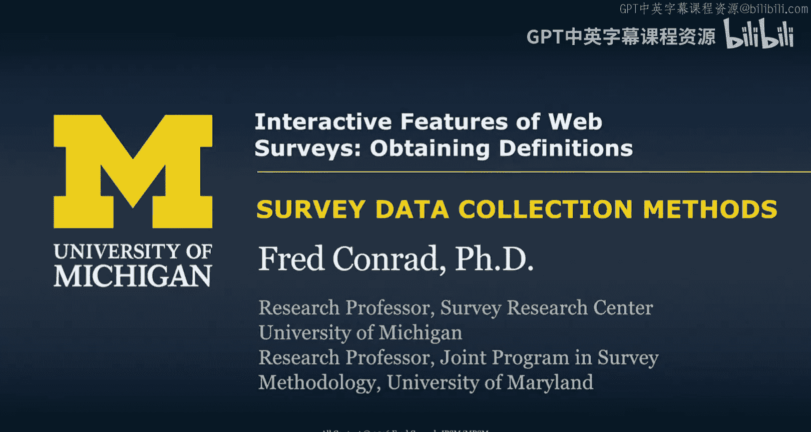
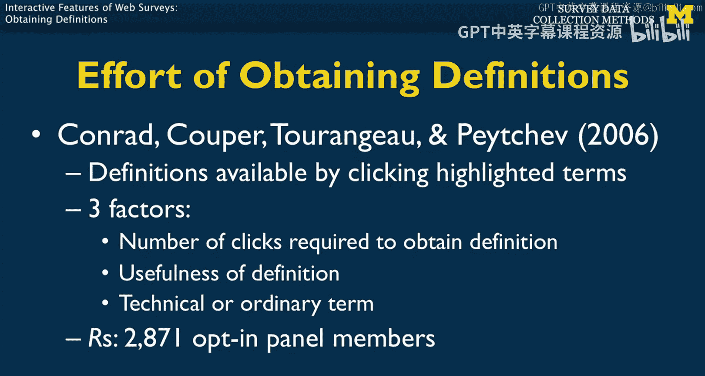
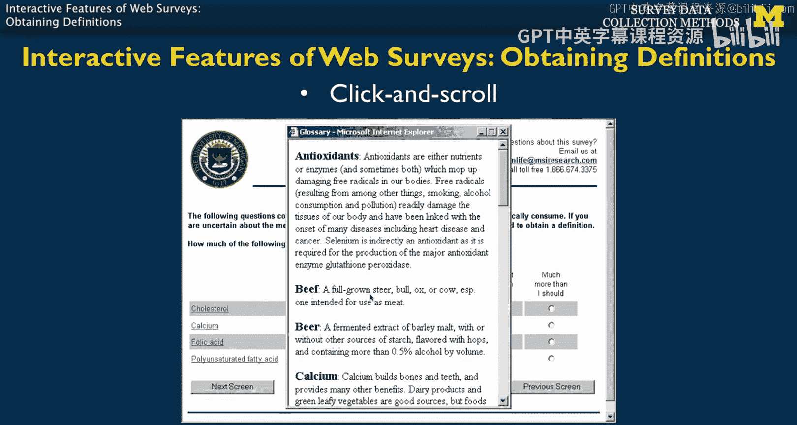
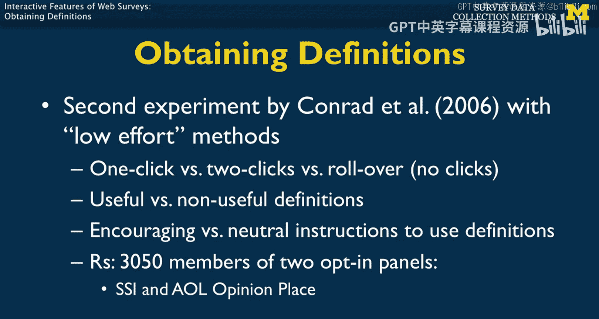
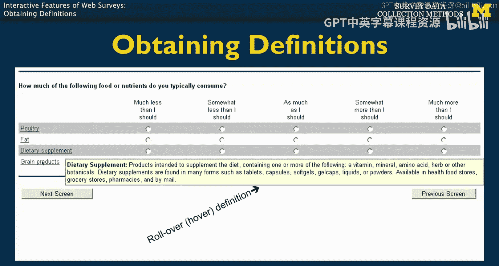
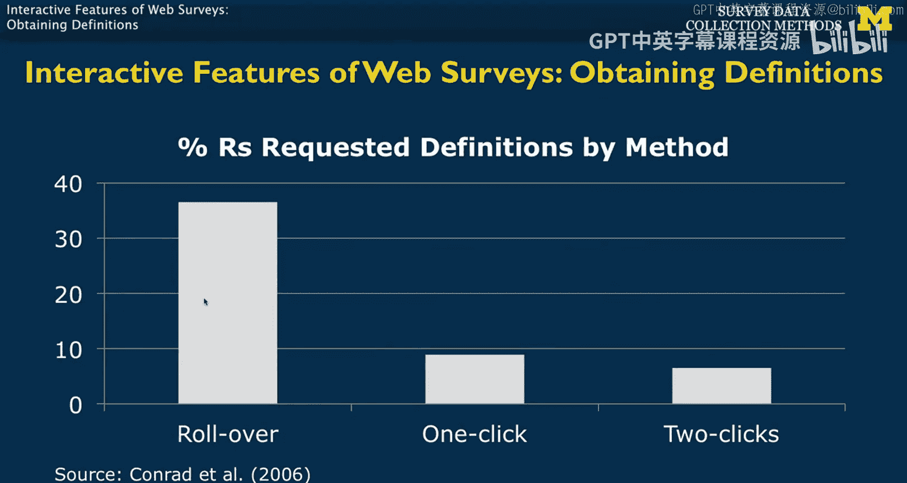

#  019：在线调查中的交互功能——定义获取 📖

在本节中，我们将探讨在线调查中一个关键的交互功能：如何让受访者按需获取问题中术语的定义。我们将分析影响受访者获取定义意愿的关键因素，并通过实验数据来理解设计选择的重要性。

---

上一节我们讨论了在线调查中交互功能的概述，本节中我们来看看一个具体的应用：如何帮助受访者理解问题中的术语。

受访者可能无法完全按照设计者预期的方式理解问题中的所有术语。当受访者意识到自己存在误解或感到困惑时，他们可能需要获取定义。交互功能使得受访者能够**按需**获取定义，即只在需要时才展示，而不是向所有受访者（包括那些已经正确理解问题的人）展示定义。

除了意识到需要定义外，关键问题在于受访者获取定义需要付出多少**努力**。在一项研究中，康拉德及其同事通过改变三个实验因素对此进行了测试：

以下是实验中的三个变量：
1.  **获取定义所需的点击次数**：这是操控努力程度的一种方式。尽管点击是低努力行为，但受访者可能会注意到点击次数的差异。
2.  **定义的有用性**：如果定义提供了反直觉或出乎意料的信息，可能会鼓励受访者获取更多定义。
3.  **术语的性质**：技术术语容易被识别为“未知”，而普通术语可能被特殊使用，受访者可能意识不到这一点。

---

这是受访者看到的界面。他们被要求对一系列营养项目进行评分，判断摄入量是否足够。这些项目（如“多不饱和脂肪酸”）是相对专业的术语。

在**一键点击**界面中，受访者点击术语即可弹出定义，这是最简单的设计。为了实验目的，研究者也设计了需要更多努力的界面：

以下是不同努力程度的界面设计：
*   **两键点击界面**：受访者点击术语后，会看到一个所有可定义术语的列表，他们需要从中找到并点击目标术语才能看到定义。这需要两次点击和浏览列表的额外努力。
*   **点击并滚动界面**：受访者点击术语后，会看到一个包含所有术语定义的词汇表，他们需要滚动页面才能找到所需的定义。这需要的努力程度是可变的，但总是多于一次点击。

研究发现，总体上只有**13.8%** 的受访者曾请求过定义。这可能是因为受访者不愿投入额外努力，或者没有意识到定义能帮助他们理解问题。

然而，如果深入分析，会发现**获取定义所需的努力程度**确实影响了定义的请求频率。一键点击定义（努力最小）的使用频率显著高于两键点击或点击并滚动的方式，**尤其对于普通术语**，以及当**定义内容有用时**（例如，定义“蔬菜”时包含“炸薯条”这种出乎意料的例子）。

---

点击的努力看似微不足道，但实验发现，如果使用**无需移动食指**的交互方式，受访者获取定义的可能性会更高。在第二个实验中，研究者比较了一键、两键和**悬停**（即鼠标指针移动到热区即弹出定义）三种方式的请求频率。

结果发现，使用悬停界面的受访者中，请求定义的比例高于其他两种界面。虽然部分悬停可能是无意的，但证据表明，即使是无意触发，受访者也会阅读定义并将其信息纳入回答考量。当然，其中很大一部分悬停很可能是有意寻求澄清的行为。

---

因此，**努力程度**和**对定义必要性的认知**是影响定义请求的关键因素。通过提供定义，我们是在鼓励“良好行为”——我们希望尽可能降低受访者获取理解问题所需信息的努力。

然而，交互功能还有另一类用途，即**阻止不良行为**，例如受访者答题速度过快（“ speeding ”），没有经过认真思考。在下一个主题中，我们将探讨一种用于减少过快答题的交互方法。

---

**本节总结**
本节课中，我们一起学习了在线调查中“按需获取定义”这一交互功能。我们了解到，受访者主动请求定义的比例通常不高，但通过**最小化获取定义所需的努力**（如使用一键点击或悬停）和提供**有用、反直觉的定义内容**，可以有效提升其使用率。这有助于确保受访者按照设计者的意图理解问题，从而收集到更高质量的数据。