#  022：访员角色与任务概述 🎤

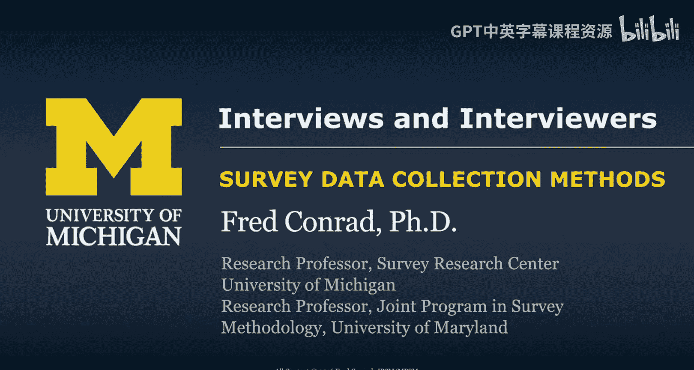

在本节课中，我们将学习访员在数据收集过程中扮演的多重角色。访员的工作远不止于进行访谈本身，他们还需要完成招募样本成员、进行户内抽样等前期任务。这些活动直接影响调查的覆盖范围、抽样误差和无应答率。同时，访员在访谈中的具体行为，如提问和追问方式，也会对测量误差产生重要影响。我们将逐一探讨这些任务及其对数据质量的作用。

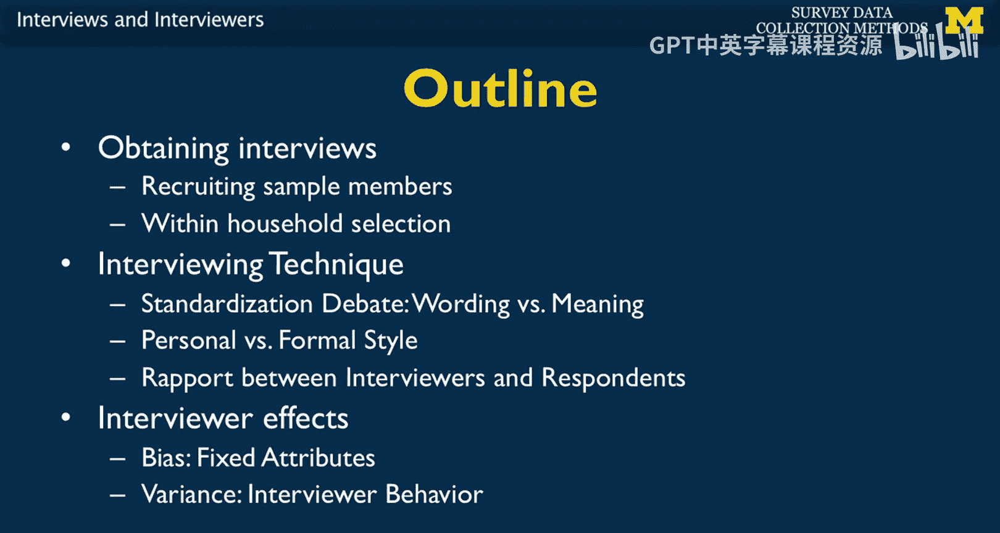

## 访员的核心任务与误差来源 🔍

上一节我们介绍了访员角色的概览，本节中我们来看看访员具体承担哪些任务，以及这些任务如何与调查中的各类误差相关联。

访员除了提问和记录答案，还执行多项任务，每一项都可能影响我们讨论过的不同误差来源。

*   **关于抽样与覆盖误差**：访员通过定位、联系样本家庭并确定哪些单元符合条件来影响覆盖范围。例如，在要求包含住宅结构的调查中，某些建筑并非住宅，因此不符合条件。此外，访员还执行户内抽样。这项任务的成功与否会影响抽样误差。
*   **关于无应答误差或应答率**：访员承担着联系家庭并获得合作的任务，可能需要说服不情愿的家庭成员成为受访者。不同访员在这方面的有效性存在差异，从而影响最终的应答率。
*   **关于测量误差**：在传统的以自我报告为主要测量方式的调查中，访员与测量误差关系最为密切，因为他们负责提问（即测量）。他们提问、对不完整的答案进行追问、澄清问题并记录答案。这个过程中可能出现多种问题：访员可能以不同的方式提问；他们追问的方式可能不同；问题可能被误解，而访员可能没有意识到，或者由于他们接受的培训或被要求使用的访谈技巧（例如，必须严格遵循脚本）而无法澄清误解。

因此，访员或多或少会对这些不同的误差来源产生影响。实际上，他们也能减少这些误差。例如，有访员参与的调查通常比自填式问卷的应答率更高。所以，访员既能为调查增值，也可能引入误差。无论好坏，他们对调查的成本和及时性都有巨大影响。在涉及访员的研究中，访员通常是最大的单项开支。因此，是否采用涉及访员的调查模式是一个非常重要的决策，研究人员应谨慎做出。

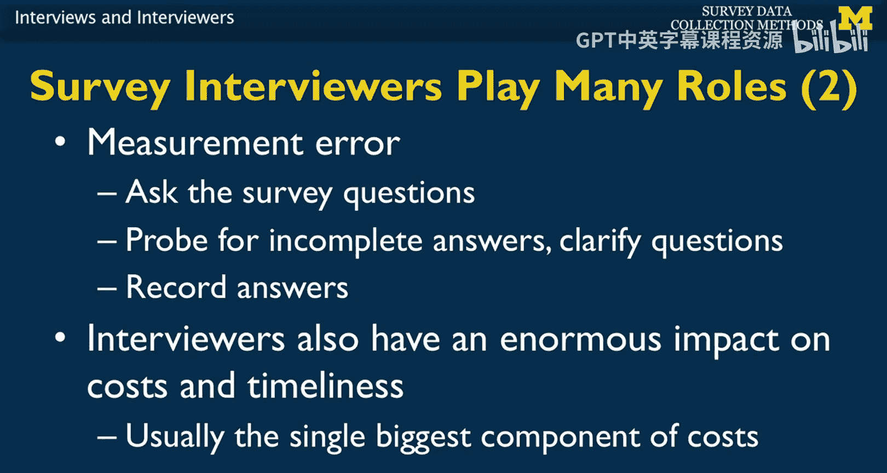

## 招募样本成员：访员的初步任务 📞

在讨论了访员任务与误差的广泛联系后，我们现在聚焦于一项具体的非访谈任务：招募样本成员。这指的是访员通过拨打电话或上门拜访，说服样本成员成为受访者的活动。

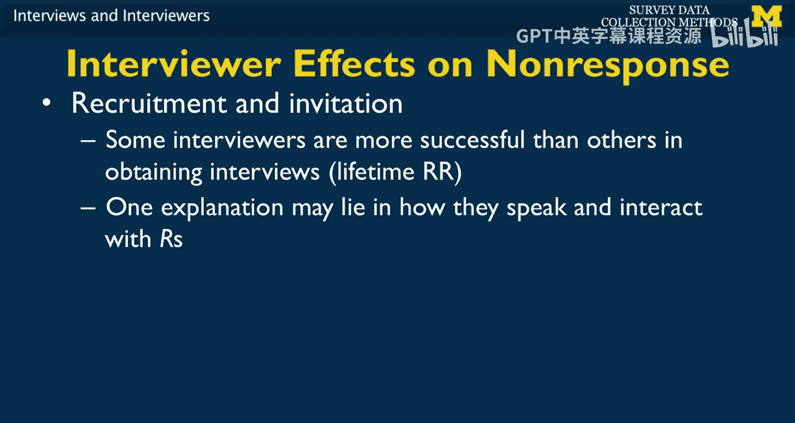

一些访员在获得访谈机会方面比其他访员更成功（这被称为“终身应答率”）。造成这种差异的原因可能包括：某些访员更擅长招募，或许因为他们更外向，或其个性本身就善于说服陌生人参与研究。另一种可能性（尤其对于电话访谈）是，这可能与他们和受访者交谈及互动的方式有关。

在电话招募中，样本成员对试图说服他们参与研究的访员的唯一了解，就是访员的声音和说话方式。电话访谈可能使样本成员更关注访员的语音特质和互动方式。

### 语音行为与招募结果的研究发现

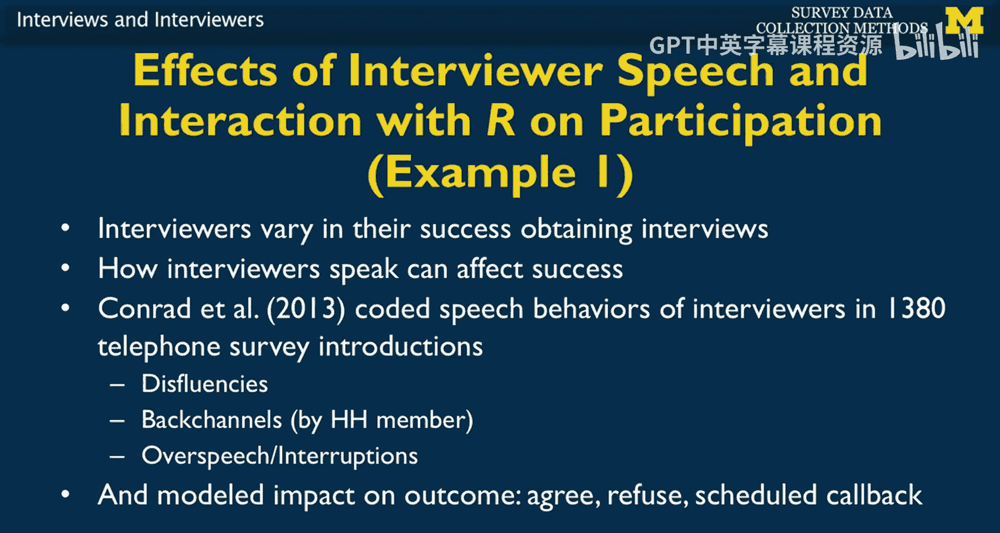

以下是一些关于访员语音行为、他们与家庭成员的互动方式以及家庭成员如何回应会影响招募结果的研究发现。

在一项研究中，康拉德及其同事对1300个电话调查介绍中的访员行为属性进行了编码。这些行为包括：
*   **不流利现象**：如“嗯”、“啊”等填充词。
*   **反馈性回应**：由样本成员（而非访员）发出，例如“嗯嗯”、“好的”，表示在倾听并鼓励对方继续。
*   **重叠发言或打断**：即同时说话，通常表明互动存在一些问题。

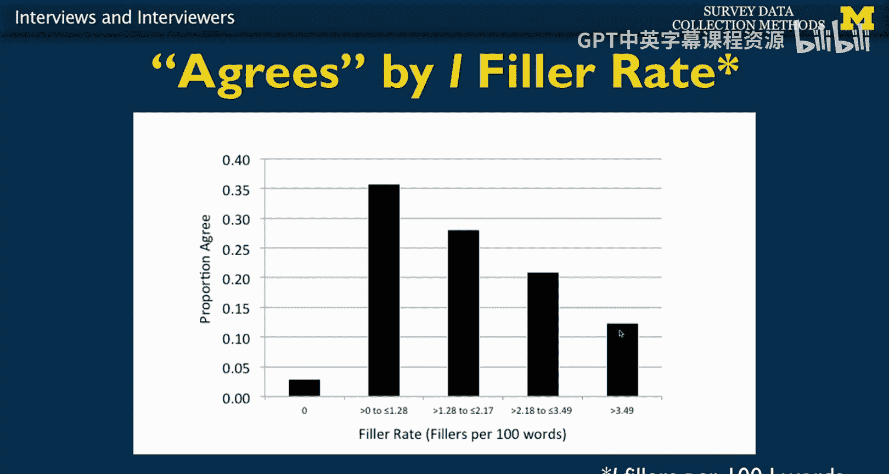

他们建模分析了这些不同行为对三种结果的影响：同意参与研究、拒绝参与、以及预约回电（即推迟决定，约定未来再联系讨论参与的可能性）。

1.  **不流利现象（填充词）的影响**：研究发现，完全流利（零不流利）的访员在招募家庭成员时实际上最不成功，同意率最低。当访员出现少量不流利时，同意率大幅上升。随着不流利程度增加，同意率会下降，但即使在不流利程度最高时，其成功率仍高于完全流利的访员。一种解释是，当访员完全流利时，听起来像机器人，似乎没有为特定的家庭成员量身定制邀请说辞，这成为参与的一大阻碍。
2.  **样本成员反馈性回应的影响**：当样本成员发出更多如“嗯嗯”、“好的”等反馈性回应时，他们最终同意的可能性更高。这表明当他们发出正在倾听并授权访员继续的信号时，最有可能同意。
3.  **重叠发言（打断）的影响**：总体而言，当邀请最终以拒绝告终时，重叠发言最多；预约回电的情况次之；而同意的情形下重叠发言最少。然而，并非所有重叠发言的作用相同。研究者特别关注的“打断”（即样本成员还在说话时访员就开始说话）似乎被访员策略性地用于阻止拒绝。数据显示，在最终结果为“预约回电”的互动中，访员打断样本成员的频率最高。研究者认为，访员通过打断来阻止可能导致直接拒绝的表述。

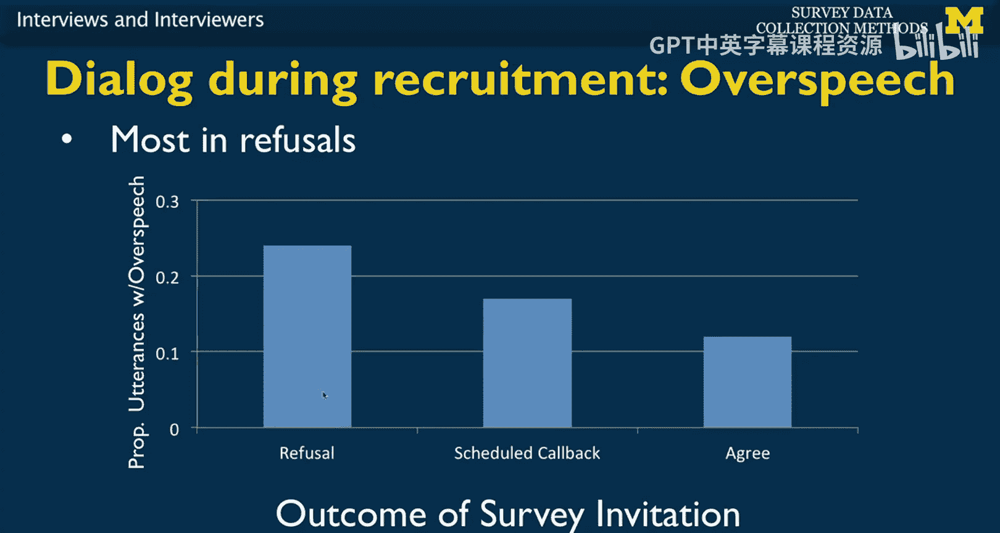

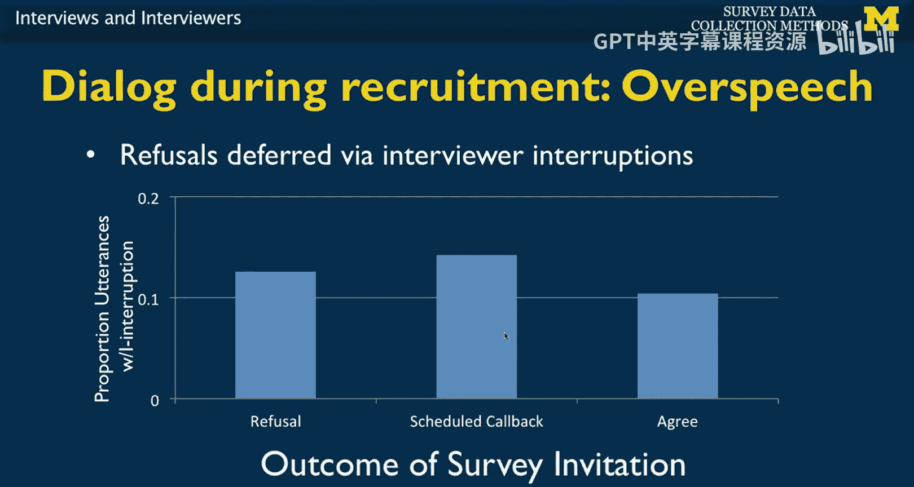

另一项由诺拉·凯德·谢弗及其同事进行的研究，考察了具有相同参与倾向的样本成员对。他们发现，即使两个人参与研究的可能性相同，结果也可能一人接受、一人拒绝。通过对话分析技术，他们揭示了造成这种差异的一些原因：

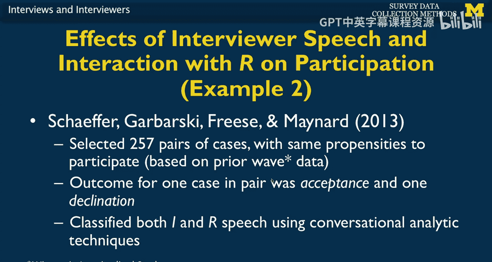

*   **拒绝与同意发生的时机**：拒绝可能发生在邀请过程中的任何时点（开场、研究描述后、参与请求后）。而同意只发生在明确的参与请求之后。这表明，获得同意需要明确的请求。
*   **特定访员行为的影响**：例如，访员在对方接电话后说“你好”比说“喂”更能提高同意几率；以非常礼貌的方式请求与样本成员通话也能提高几率；先自我介绍再提出请求同样能显著提高同意几率。
*   **样本成员行为的影响**：如果样本成员至少问了一个问题，他们更可能参与；如果询问访谈时长，则参与的可能性大得多（这暗示他们只有在考虑参与时才会关心时长）；然而，如果样本成员在访员提出参与请求**之前**就询问“这是什么关于？”之类的WH问题（是什么、为什么等），则表明一种怀疑或不愿参与的态度，会降低同意几率。如果在请求**之后**才问，则没有显著差异，因为此时其决定已基本做出。

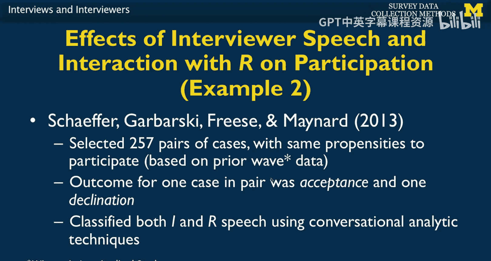

这些例子说明了在电话招募中，访员的言语及其与家庭成员的互动方式如何影响招募结果。

## 户内抽样：确保样本设计的实施 🏠

在访员成功获得家庭成员同意参与后，接下来的任务可能是户内抽样或受访者选择。这确保了家庭中任何符合条件的成员都有可能被选为受访者，这对于实施样本设计至关重要。

最初同意参与的人（“守门人”）不一定会成为受访者。如果该人同意，仍可能选择另一名家庭成员作为受访者，并且可能需要说服该成员参与。这个户内抽样过程是访员在同意获得后进行的另一项关键活动。

---
**本节课总结**

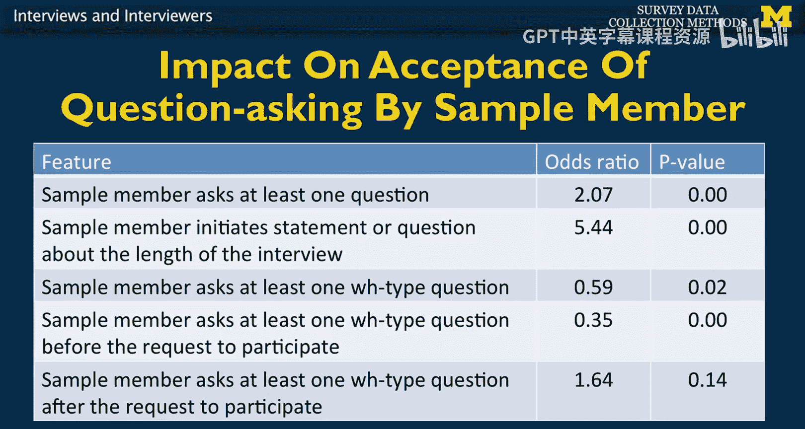

本节课中，我们一起学习了访员在调查数据收集中扮演的多重核心角色。我们了解到，访员的工作不仅限于进行访谈，还包括招募样本成员和进行户内抽样等关键前期任务，这些任务直接影响覆盖误差、抽样误差和无应答率。我们深入探讨了在电话招募中，访员的语音行为（如流利度、打断策略）和互动方式如何显著影响样本成员的参与决定。最后，我们介绍了户内抽样这一步骤，它确保了样本设计的正确实施。理解这些角色和任务，是评估和管理访员对调查数据质量影响的基础。