#  023：户内受访者抽样 🏠

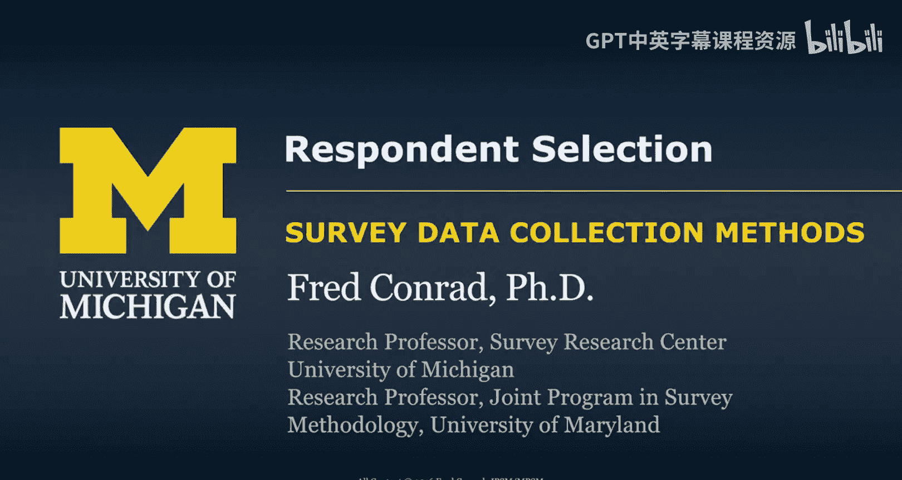

在本节课中，我们将要学习在家庭户调查中的一个关键步骤：户内受访者抽样。当抽样框中的单位（如家庭住址）与研究分析的单位（如个人）不匹配时，就需要这一额外步骤来从家庭中随机选择一名成员作为受访者。

## 概述

上一节我们介绍了抽样框与目标分析单位不匹配的问题。本节中，我们来看看如何在一个家庭户内选择具体的受访者。这被称为“户内受访者抽样”，是确保样本随机性的重要环节。

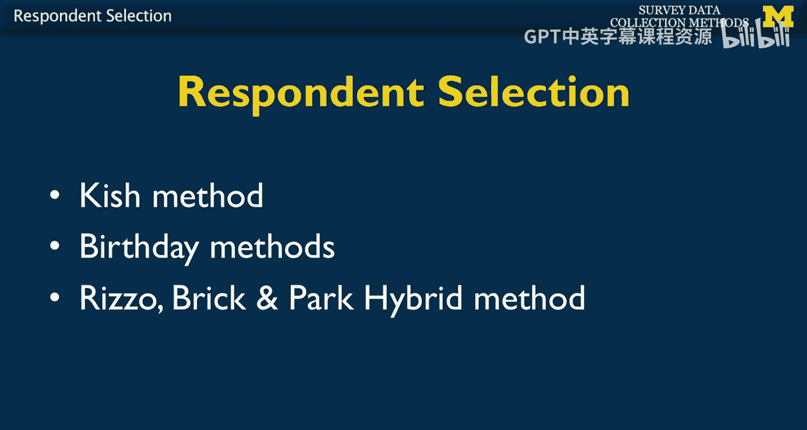

## 主要抽样方法简介

以下是几种常用的户内受访者抽样方法，我们将逐一介绍其原理和特点。

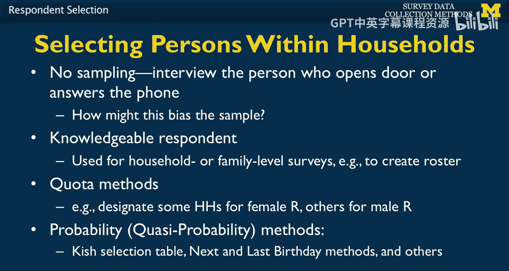

1.  **Kish方法**：被视为“黄金标准”，能产生最随机的样本，并确保每个家庭成员有**已知且相等的被选概率**。但该方法较为复杂和侵入式。
2.  **生日方法**：包括“最近生日法”和“下一个生日法”。方法简单，侵入性低，但属于**准概率方法**，因为确切的被选概率未知。
3.  **混合模型**：一种折中方案，结合了简单询问与随机选择，旨在减少侵入性的同时，尽可能明确选择概率。
4.  **非概率方法**：例如直接采访开门或接电话的人，或指定“最了解情况的人”。这些方法会引入明显的**选择偏差**。

## Kish方法详解

现在，让我们深入了解被视为黄金标准的Kish方法。它的核心是使用预制的**选择表**来随机指定受访者。

**操作流程如下：**
1.  访问员请家庭成员列出所有符合条件的家庭成员（如所有18岁以上者），形成名册。
2.  将名册中的合格男性按年龄从大到小排序，合格女性也按年龄从大到小排序。
3.  访问员根据家庭中合格人数，查阅随机分配的选择表，确定应采访名册上的第几人。

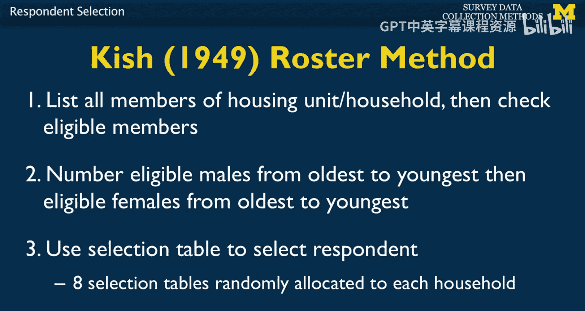

**例如，一个选择表可能这样规定：**
*   如果家庭有1位合格成员 → 选择 **第1人**
*   如果家庭有2位合格成员 → 选择 **第2人**
*   如果家庭有3位合格成员 → 选择 **第2人**
*   如果家庭有4位及以上合格成员 → 选择 **第3人**

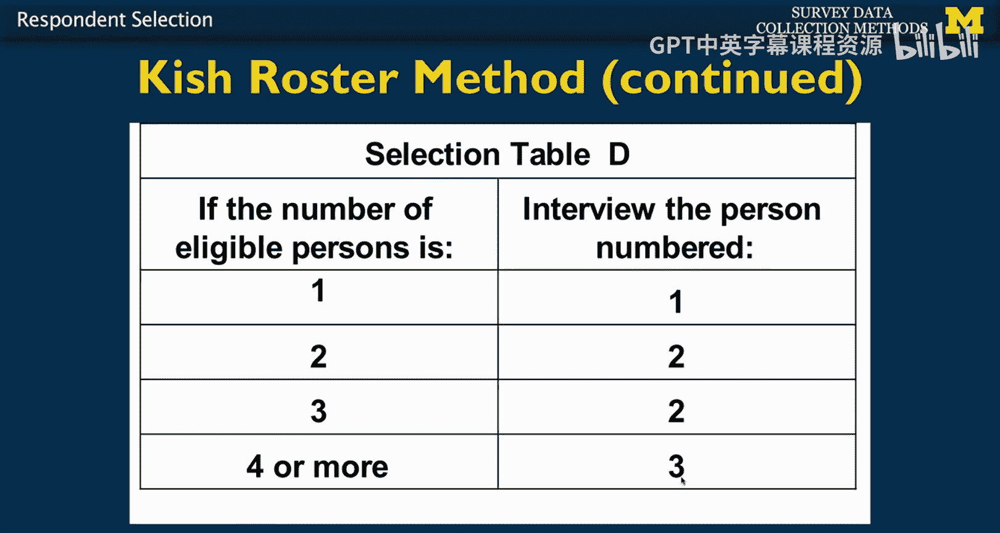

通过使用多张不同的选择表并随机分配给各家庭，可以确保**每个家庭成员无论家庭规模大小，都有相等的被选概率**。

**优点**：选择精确，概率已知且相等。
**缺点**：过程繁琐、耗时，需要收集所有成员的性别和年龄信息，侵入性强，且访问员容易出错。

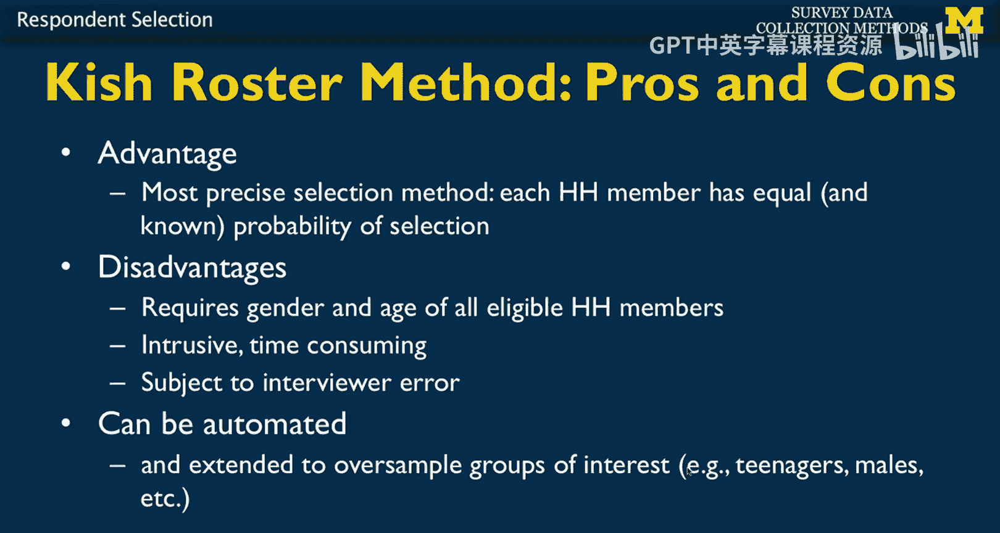

## 生日方法分析

接下来，我们分析更简单的生日方法。它通过询问生日信息来选择受访者。

**典型问法如下（最近生日法）：**
> “我可以和您家里那位刚过完生日（最近一次生日）、年满18岁的家庭成员通话吗？”

**优点**：操作简单快捷，侵入性远低于Kish方法，且在户内能实现**相等的被选概率**（因为每个人拥有最近或下一个生日的几率相同）。
**缺点**：属于**准概率抽样**，因为确切的被选概率无法计算。此外，受访者可能故意谎报生日以避免被选中，且难以核实。

正因如此，一些学者不建议在严谨的科学调查中使用生日方法。

## 方法比较与混合模型

不同的方法在实际应用中表现如何？一项电话调查比较了Kish方法和生日方法的“中途拒访率”。

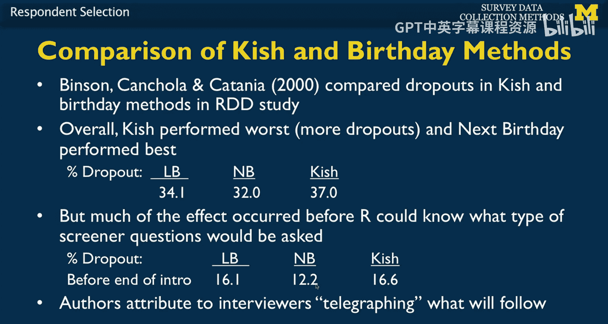

**结果发现：**
*   Kish方法的中途拒访率 **最高**。
*   “下一个生日法”的拒访率 **最低**。
*   许多拒访甚至发生在访问员开始正式提问之前，这可能意味着访问员的开场方式无形中暗示了后续程序的繁简程度。

基于这些权衡，研究者提出了一个**混合模型**，旨在减少侵入性。

**其运作逻辑如下：**
1.  首先询问接听者：“您家中有几位成年人？”
2.  **如果只有1位**，直接选择此人。
3.  **如果有2位**，则进行类似抛硬币的随机选择（若接听者未被选中，则选另一人）。
4.  **只有在家庭有3位及以上成年人，且接听者未被随机选中时**，才启用“最近生日法”进行选择。仅在极少数生日信息未知的情况下，才使用Kish方法。

这种策略**大幅减少了需要使用复杂抽样方法的情况**。一项测试表明，仅有约12%的家庭需要进入“额外抽样”步骤，显著节约了成本并可能降低拒访率。

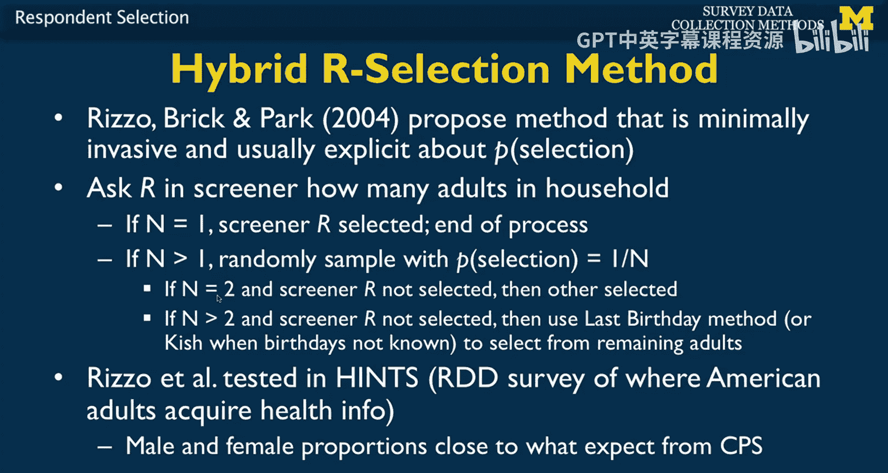

## 选择方法时的考量

在选择户内抽样方法时，需要考虑以下几点：

*   **回答误差**：所有方法都可能存在。Kish方法要求完整列出家庭成员，受访者可能隐瞒；生日方法则容易被有意操纵。
*   **回答率影响**：如比较研究所示，复杂的列举程序（如Kish方法）可能导致更高的中途拒访率。
*   **组织文化与客户偏好**：不同的调查机构或项目委托方可能有其惯用或偏好的方法。

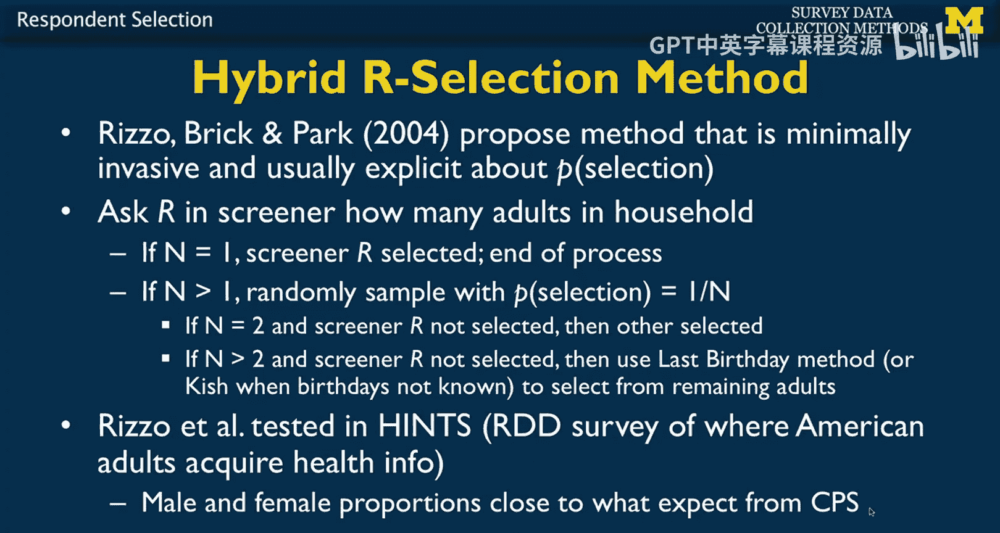

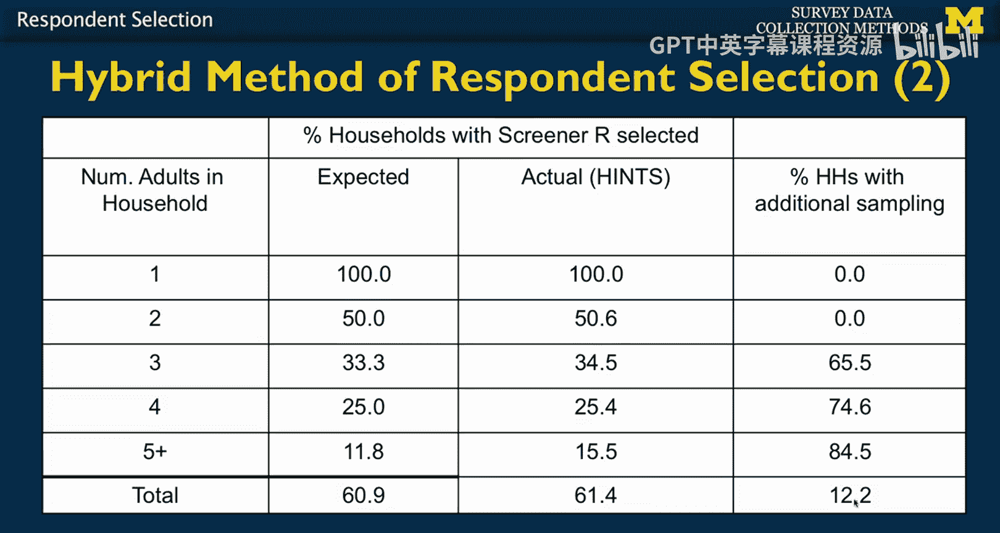

## 代理回答

最后，一个相关的问题是：如果被选中的受访者暂时无法接受采访，是否可以让其他家庭成员**代理回答**？

这在实践中确实存在，可以节省二次联系或访问的成本。但代理回答对数据质量的影响因调查主题而异，是需要谨慎评估的议题。

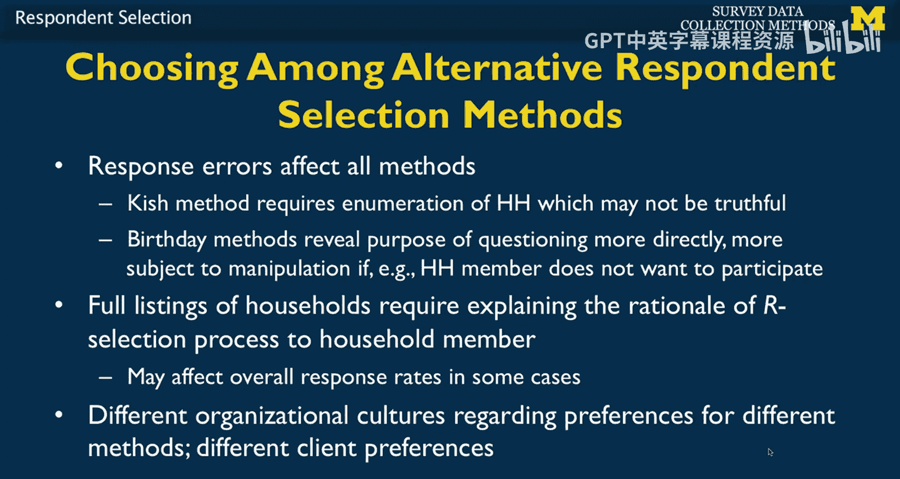

## 总结

本节课中，我们一起学习了户内受访者抽样的必要性及主要方法。我们详细探讨了精确但繁琐的Kish方法、简单但概率未知的生日方法，以及折中的混合模型。每种方法都在**随机性、精确度、操作复杂度和受访者负担**之间进行权衡。理解这些方法的原理和优缺点，对于设计科学、可行的调查方案至关重要。