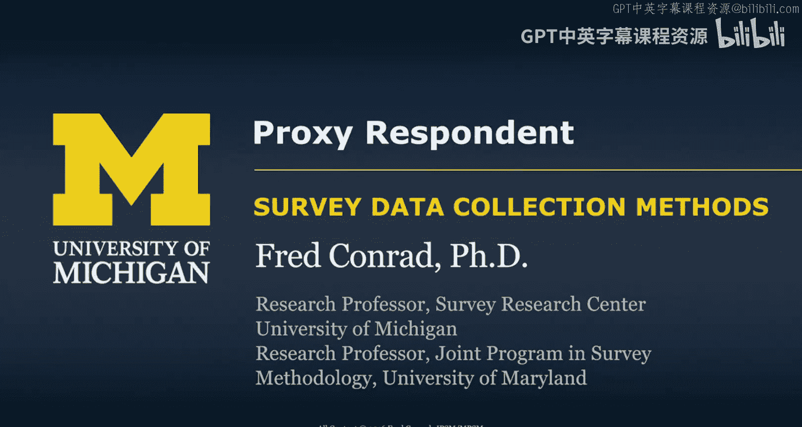
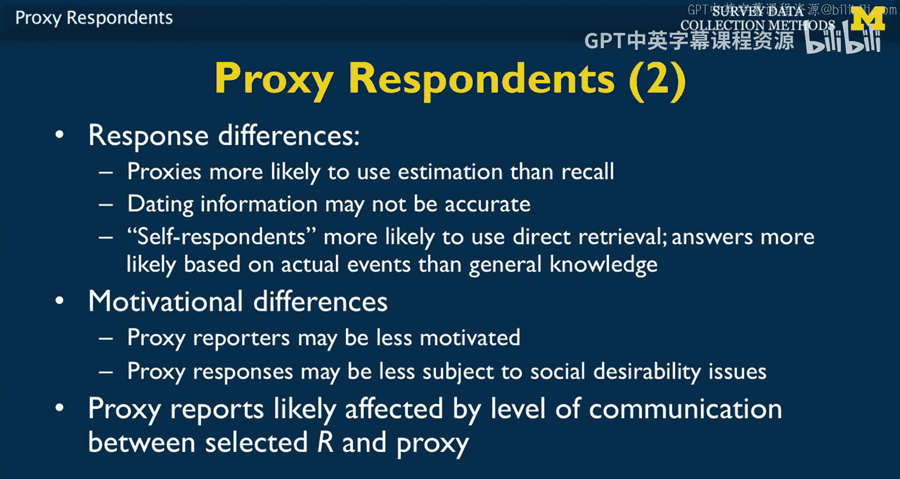
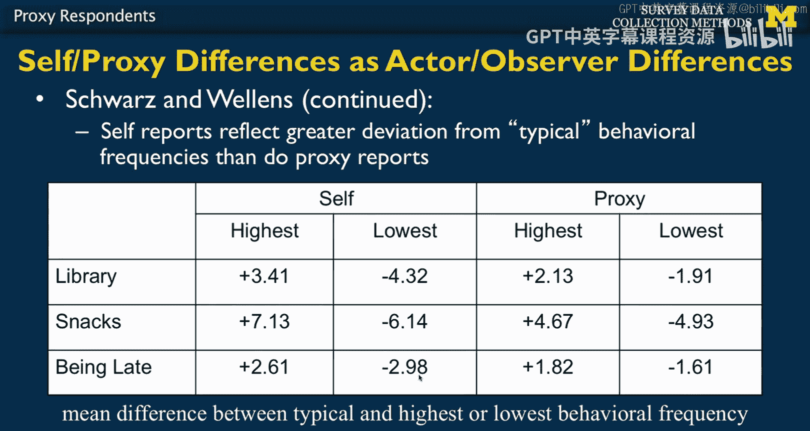
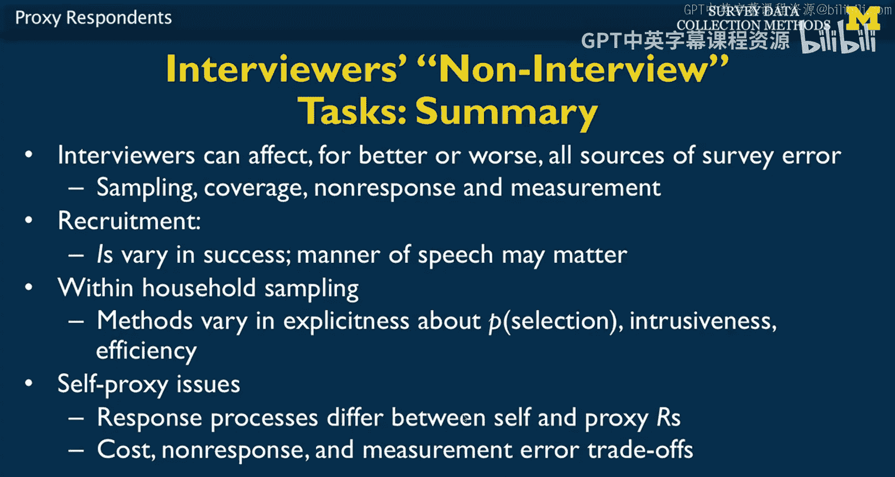

#  024：代理应答

## 概述
在本节中，我们将探讨调查数据收集中的一个重要环节：代理应答。我们将了解什么是代理应答，分析其潜在的优势与劣势，并讨论代理应答与自我报告在数据质量上的差异。核心概念将通过**定义**和**研究结论**进行阐述。

---

## 什么是代理应答？👥
上一节我们讨论了访问员在访谈前的任务，包括选择受访者。一个相关的选择问题是代理受访者的使用。

当选择程序确定的受访者当时无法接受访问时，一些调查或调查机构会允许访问员与另一位在场的家庭成员进行访谈，此人将作为代理受访者，代表选定的受访者回答问题。而其他一些调查或机构则不允许代理应答。

---

## 代理应答的优缺点 ⚖️
普遍观点认为，代理应答的数据质量可能较差。然而，许多知名机构确实使用代理。以下是代理应答的一些主要优缺点。

### 优点
*   **降低成本与时间**：当选定受访者无法联系时，使用代理可以减少时间和费用。例如，美国主要的政府劳动力调查《当前人口调查》通过使用代理，成本降低了约12%。
*   **提高回答率**：如果选定受访者不在，但有代理可用，这不会降低调查的回答率。

### 缺点与数据质量考量
普遍观点认为，受访者关于自身的报告优于代理报告。代理与受访者本人的回答过程可能存在差异。

*   **依赖知识类型不同**：代理更可能依赖对选定受访者的**一般性知识**，而非基于具体事件。人们在回答关于自身实际行为的问题时，比回答关于他人的问题更准确。代理倾向于使用关于目标受访者的**语义知识**或**倾向性知识**，而非基于自身生活事件来回答。
*   **回答策略不同**：代理更可能使用**估计**而非**回忆**。他们基于所回答对象的普遍特征来估算问题的答案，而不是回忆具体行为，因为他们不了解实际情况。
*   **时间信息准确性**：对于事件发生日期的信息，代理在思考他人参与事件的日期时，可能不如思考自己参与的事件时准确。
*   **动机差异**：为自己回答与为其他家庭成员回答，可能影响提供最准确答案的努力动机。代理报告者可能因为不是回答关于自己的问题而动机不足。
*   **社会期望偏差**：代理可能较少受到社会期望偏差的影响。例如，对于吸烟等 stigmatized 行为，本人可能倾向于美化事实，而配偶回答关于丈夫的问题时可能更真实。
*   **沟通程度的影响**：代理报告的准确性可能受代理人与目标受访者之间沟通程度的影响。家庭成员之间可能更了解彼此，因此家庭成员作为代理可能比室友等沟通较少的居住安排更为准确。

---

## 研究证据与实验设计 🔬
Jeffrey Moore 在1980年代的一篇综述论文研究了“自我报告数据质量优于代理报告”这一假设，他发现文献中支持此假设的证据很少。

他指出，当时许多比较代理与自我报告质量的研究是观察性的，而非实验性的。受访者没有被随机分配为自我报告者或代理报告者，而这正是评估数据质量所需要的。他观察到，表面上的数据质量差异，可能实际上是事实差异。例如，在健康研究中，代理报告的家庭成员健康事件（如看医生）少于他们为自己报告的事件。但这可能是因为在家的、可担任代理的人，本身可能因健康原因更常在家，而不在家的选定受访者可能更健康（如在上班）。因此，差异可能源于健康状况的真实不同，而非报告质量。

Moore 强调需要进行**控制实验**，即随机分配家庭成员作为代理或自我报告者。

---

## 近期实验研究示例
近期，一些 Moore 所呼吁的实验研究已经开展。Schwartz 和 Wellins 的研究是一个很好的例子。

该研究基于社会心理学中观察者与行动者的区别。他们预测，如果参与者被随机分配为代理或自我报告者，那么：
*   **自我报告**应反映出行为的不一致性和对常规的偏离，因为回答者了解自己生活中的这些例外情况。
*   **代理报告**则更可能基于对他人**常规行为**的了解进行回答。

为了验证自我报告者比代理报告者答案变异性更大的假设，他们让24对伴侣报告自己或伴侣的典型行为频率（例如，从大学图书馆借书的次数），并评估在前一个月中该行为的最高和最低周频率。

**研究结果**表明，对于所有测试的行为，自我报告者的最高与最低频率之间的**范围**都大于代理报告者。这支持了代理可能无法像自我报告者那样意识到常规例外的观点。

---

## 总结 📝
在本节中，我们一起学习了代理应答的相关知识。

访问员的非访谈任务会影响调查误差的所有来源。在招募环节，访问员的成功率和说话方式可能影响回答率和无回答误差。在户内抽样环节，不同方法在选择概率的明确性、侵入性和效率上各有不同。

关于自我报告与代理报告：
*   自我报告者和代理报告者使用的回答过程似乎不同。
*   在决定是否使用代理代替自我报告者时，需要综合考虑**成本**、**无回答误差**和**测量误差**。

接下来，我们将转向访问员实际使用的访谈技巧。在完成所有这些访谈前的准备工作后，就是时候进行正式访谈了。我们接下来将探讨不同的访谈技巧及其对数据质量的影响。