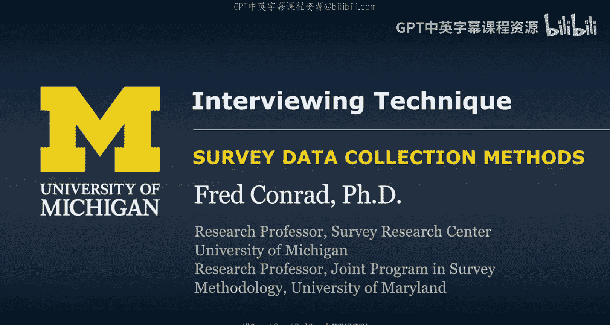
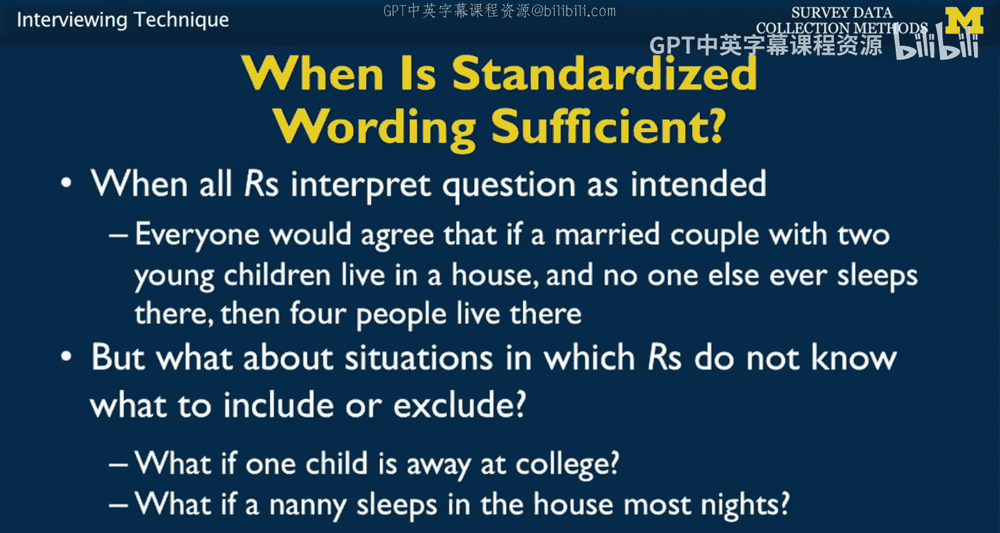

#  025：方法、社调问卷设计、抽样、缺失数据、分析：3.2.1 标准化辩论：措辞与语义 📝

在本节中，我们将探讨调查访谈中的一个核心议题：标准化访谈。我们将了解什么是标准化访谈，它为何被广泛使用，以及围绕其利弊的辩论焦点。特别是，我们将对比“标准化措辞”与“标准化语义”这两种不同的理念。

## 标准化访谈的定义与原理

上一节我们介绍了访问员在正式访谈前需要进行的活动。本节中，我们来看看访谈本身。目前，在科学调查机构中最常见的访谈方法被称为**标准化访谈**。

其基本理念是控制访问员使用的措辞，确保他们从一个访谈到下一个访谈都以完全相同的形式提出问题。如果受访者的回答不属于预设的答案类别，访问员会使用所谓的**中立或非引导性追问**，以避免向某些受访者提供额外的实质性信息，而其他受访者则没有获得这些信息。

采用标准化措辞有充分的理由，但有时也可能需要允许访问员在某些场合选择自己的措辞。

## 关于标准化的辩论

围绕标准化一直存在一场辩论：是确保访问员在访谈中使用的**措辞**完全相同更好，还是确保受访者对问题的**理解**相同更好？这就是辩论的核心。

另一个区别在于**正式**与**个人化**的访谈风格。个人化风格旨在通过允许访问员更人性化、与受访者建立联系，来增进访问员与受访者之间的融洽关系。

首先，我们来探讨标准化辩论。什么是标准化访谈？它为何被如此广泛地使用？

至少一个关键的理论依据是统计学的：为了**最小化与访问员相关的误差**。我们将在下一个主题中讨论与访问员相关的误差。其理念是，如果所有访问员的行为彼此一致，那么除了回答本身固有的误差外，他们不会引入额外的误差或方差。这就是标准化访谈背后的基本原理。

## 标准化访谈的实施方式

访问员行为在不同访谈间保持一致，是通过以下方式实现的：

以下是标准化访谈的具体操作规范：

*   **以相同语速提问**：建议语速为每秒两个词。
*   **使用中立追问**：当受访者的回答不符合预设答案时，使用如“让我重复一遍问题”这样的中立追问，以减少向不同受访者提供不一致的额外信息。
*   **按顺序提问**：必须按照问卷上的顺序提问，以确保不同受访者面对的问题背景相同，从而使回答具有可比性。
*   **询问每一个问题**：即使受访者之前已经主动提供了相关信息，访问员仍需提问，因为受访者可能不会按访问员预期的方式回答。
*   **保持专业姿态**：避免做出可能被受访者解读为批评、惊讶、赞同或不赞同的陈述。

然而，标准化访谈最核心的方面是：**问题必须用完全相同的词语来传达**。

## 标准化措辞的重要性示例

这里有一个例子说明为何这是关键做法。假设一个问题最初是这样写的：“您主要通过以下哪种方式了解本国时事新闻：广播、报纸、电视，还是与人交谈？”

*   访问员可能会省略这些答案选项，将其变成一个开放式问题：“您主要通过什么方式了解时事新闻？” 这从根本上改变了问题。如果不一致地这样做，首先这很可能不是设计者的本意，其次回答结果将不可比。
*   或者，访问员可能会加入自己对问题的理解：“您主要通过以下哪种方式了解本国时事新闻：广播、报纸、电视，还是与人交谈？也就是说，您最依赖哪一种？” 原始问题并没有问“最依赖哪一种”，它问的是“主要通过什么方式”。访问员通过添加词语，实际上改变了问题的意图。

## 中立追问的使用

如前所述，当受访者对封闭式问题的回答不符合预设答案类别时，访问员被指示从一组非引导性或中立的追问中选择使用。

以下是访问员可能使用的中立追问示例：

*   “还有其他吗？”
*   “是的。”、“我明白了。”或“嗯。”（以期待的语气，然后停顿）
*   “我可以把我记下的内容读给您听，以确保我准确记录了您的意思吗？”
*   “您这么说是指什么？”
*   “您能说得更具体一点吗？”
*   “哪一种最接近您的感受？”

此外，还有另一组通常用于受访者表示不理解或需要澄清时的中立追问。当然，具体的追问方式和实践因调查机构而异。

以下是另一组用于澄清的中立追问示例：

*   “抱歉，我没有这方面的信息。”
*   “重要的是，请尽可能按照问题的表述来回答。”
*   “也许我可以再读一遍给您听。”（即重复问题）
*   “就按您理解的意思回答。”

仔细思考，这些不同的中立追问实际上并不一定是完全中性的，它们可能向受访者传达了某种指令。特别是，“就按您理解的意思回答”这句话可能向受访者传递了其他追问所没有的信息。请思考这一点，并将您的想法发布在讨论板上。

## 对标准化措辞的主要批评

这种方法的主要批评是，它阻止或阻碍了所谓的**对话基础**，这是赫伯特·克拉克及其同事提出的概念。

基础的理念是，在日常对话中，说话者和听者会进行多轮交流，直到他们就当前任务、当前目的达成足够相互理解为止。这是一种常见情况：你可能不理解说话者刚刚说的话，你可能会问“您这么说是指什么？”，然后说话者通常会告诉你她的意思。

如果这在标准化访谈中被允许，将导致不同访谈间的措辞出现差异。一些受访者会要求澄清，访问员会提供解释，而另一些则不会。这样，一些受访者获得了额外的信息，而另一些没有，确切的刺激因素就不再是恒定的。因此，其理念是回答将不再具有可比性。

## 另一种方法：标准化语义

另一种方法是**标准化语义**，即促进统一的理解，而不仅仅是标准化的措辞。这应该成为目标。其理念是，对话基础使之成为可能。如果这成为实践，它应该促进**有效**的而不仅仅是**可靠**的回答。也就是说，它应确保受访者理解问题背后的意图，而不仅仅是在不同场合以相同方式解释问题。后者是标准化措辞倾向于实现的目标——在不同场合产生相同的解释，但它并没有真正解决“这种解释是否是设计者所意图的、是否有效”的问题。

允许对话基础引入访谈，应该能促进**有效**的理解，即对问题的预期解释，因为它允许访问员解释问题背后的意图和概念的定义。

## 标准化访谈与日常对话的冲突

这些批评在文献中存在已久。例如，萨奇曼、乔丹和谢弗等人指出，调查访谈，特别是标准化访谈，由于多种原因与正常的对话实践相冲突。

以下是标准化访谈与日常对话的主要冲突点：

*   **话题由一方决定**：访问员决定了对话的主题，这在日常对话中很少见。
*   **无法进行基础对话**：访问员不能像我们刚才讨论的那样进行如“基础”这样的对话过程。
*   **对话范围受限**：受访者不能自由询问问卷之外的内容，对话的范围由访问员决定。
*   **对话结束由一方决定**：访问员决定对话何时结束（例如说“非常感谢，我们完成了”）。这些在日常对话中都不会发生。

因此，问题的核心在于：即使正常对话有时可能促进对问题更准确的理解，从而获得更准确的答案，但这能否抵消它可能引入的措辞差异增加所带来的影响？

## 何时需要标准化？何时不需要？

在思考是否应在调查访谈中模拟日常对话时，一个需要考虑的问题是：我们何时需要这样做？标准化措辞何时能真正导向预期的解释，何时又不能？

当然，如果所有受访者都以预期的方式解释问题，那就没问题。例如，如果一对已婚夫妇带着两个年幼的孩子住在房子里，没有其他人常住，那么“这所房子里住了多少人？”这个问题就很直接。

但在受访者不知道应该包括或排除什么的情况下呢？如果一个孩子在外地上大学怎么办？如果一个保姆大多数晚上都睡在房子里怎么办？在外地上学的孩子应该被计算在内吗？保姆应该被计算在内吗？这很难确定，并且在严格的标准化访谈中也很难澄清这一点，因为访问员有义务使用非引导性或中立的追问，例如“让我重复一遍问题”。

## 本节总结

本节课中，我们一起学习了标准化访谈的核心概念与辩论。我们了解到，标准化访谈旨在通过统一措辞来最小化访问员引入的误差，但其批评者认为这阻碍了自然的对话基础，可能影响问题的有效理解。辩论的焦点在于，是应该优先保证**措辞的完全一致**，还是应该追求**语义理解的统一**。下一节，我们将转向一系列实证比较，看看当访问员能够或不能够澄清问题意图时，这两种访谈方法对回答准确性的影响。