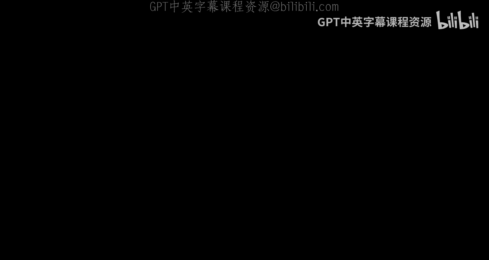
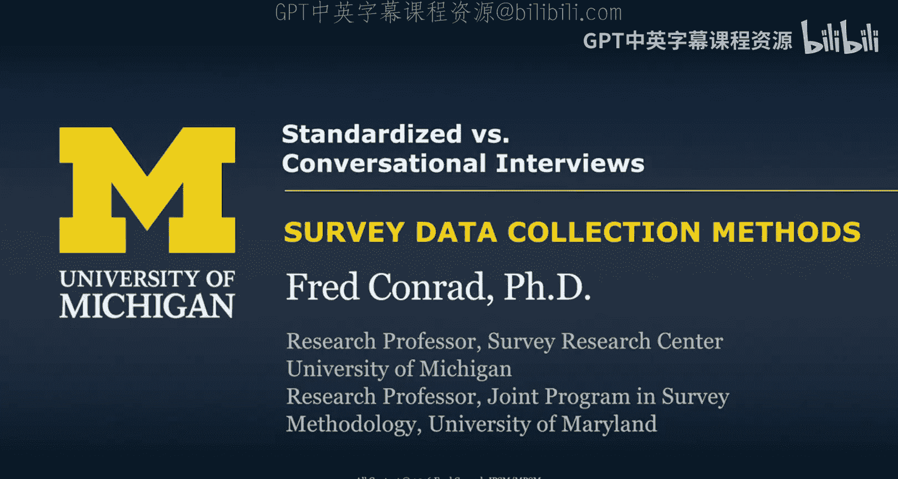
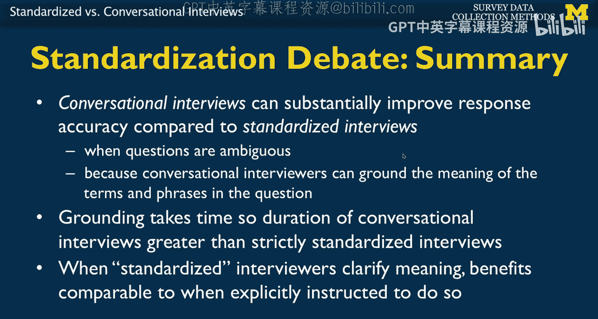

#  026：标准化访谈的不同路径 📊

在本节中，我们将探讨标准化访谈的替代方法，特别是被称为“对话式访谈”的技术。我们将通过实证研究，比较严格标准化访谈与对话式访谈在准确性、时长和实际应用方面的差异。

---

## 概述

访谈是收集调查数据的关键环节。传统上，标准化访谈要求访员严格按照问卷措辞提问，并使用中性追问。然而，当问题对受访者而言含义模糊时，这种方法可能导致回答错误。本节将介绍一种替代方法——对话式访谈，它允许访员澄清问题的含义，并分析其利弊。

---

## 实证比较：标准化与对话式访谈

已有许多实证研究比较了严格标准化访谈与替代方法。其中一种重要的替代方法是“对话式访谈”，访员可以在访谈中澄清问题中词语的具体含义。

### 早期实验室研究

Schober和Conrad于1997年进行了一项开创性研究。他们让访员使用两种访谈技术之一，向实验室中的受访者提问12个来自美国政府调查的问题：
*   **标准化程序**：访员严格按问卷措辞朗读问题，只能使用中性追问，实质上不能偏离脚本。
*   **灵活访谈（后称对话式访谈）**：访员最初按措辞朗读问题，但鼓励受访者就问题含义提问。如果受访者提问，访员可以澄清词语和问题的含义。

**研究设计**：受访者基于虚构情境而非自身生活来回答问题。这样设计是因为研究者知道每个情境基于调查机构的定义所对应的“正确答案”。
*   **复杂情境**：一半的情境使问题变得模糊不清（例如，“购买落地灯”是否算作“购买家具”？），在没有定义的情况下，答案不明确。
*   **直接情境**：另一半情境则清晰明了（例如，“购买桌子”显然属于家具），无需定义。

**研究发现**：
1.  **对于直接情境**：无论使用哪种访谈技术，回答准确率都接近100%。标准化访谈足以产生高质量的回答。
2.  **对于复杂情境**：
    *   标准化访谈的回答准确率很低，仅为**27%**。
    *   对话式访谈（允许澄清含义）的回答准确率则高达近**90%**。

这表明，在访谈中进行对话式“意义 grounding”（即澄清含义）能显著提高受访者的理解和回答准确性。

### 权衡：准确性与时长

然而，对话式访谈也有代价：**更长的访谈时间**。
在该实验室研究中，对话式访谈的中位时长是标准化访谈的**约三倍**。这是因为澄清过程需要时间，访员需要向受访者解释问题的意图、定义及相关部分。

需要注意的是，该研究中有一半问题需要澄清。在真实的非实验室访谈中，这类情况可能较少，因此时长的增加可能不会如此显著。但这揭示了一个核心权衡：
*   **对话式访谈**能产生更高的回答准确性。
*   **标准化访谈**则更省时，在固定成本下可能完成更多案例。

研究者需要根据具体情况决定：真实世界中需要澄清的复杂情况有多频繁？可容忍的误差是多少？如果误差影响不大，那么使用更耗时、更昂贵的对话式技术可能不值得。

---

## 后续研究：真实世界的频率与访员行为

### 全国样本的再访研究

Conrad和Schober进行了一项后续研究，探讨在真实世界中，需要非脚本澄清的情况发生的频率。
他们对一个全国样本的受访者进行了再访（首次访谈均为标准化访谈）。约一周后：
*   一半受访者再次接受**标准化访谈**。
*   另一半受访者接受**对话式访谈**。

**研究逻辑**：如果对话式再访纠正了首次标准化访谈中未被纠正的误解，那么受访者在第二次访谈中会更多地改变答案。如果两次都是标准化访谈，误解将持续存在，答案改变会更少。

**研究发现**：
*   首次标准化访谈与后续标准化访谈之间的回答改变率为 **11%**。
*   首次标准化访谈与后续对话式访谈之间的回答改变率为 **22%**。

这**11%的差异**被作者视为能从澄清中受益的“复杂情况”的发生频率（至少对于该样本的这些项目而言）。研究者需要判断，这个频率是否高到值得投入对话式访谈可能带来的额外时间。在此研究中，对话式访谈时长增加了约**80%**（低于实验室研究中的3倍），这显然与需要澄清的情况数量（11% vs 50%）有关。

### 访员的实际行为：标准化程度如何？

一个关键问题是：标准化访谈在实际中到底有多“标准化”？访员是否真的只使用中性追问？
Schober, Conrad和Fricker进行了一项实验室研究，指示访员按“平常的做法”进行（称为“自然条件”），并使用与1997年研究相同的问题和情境。

**研究发现**：
*   总体而言，“自然条件”下的回答准确性与原始研究中的**标准化访谈条件非常相似**。
*   但是，当单独分析访员**偏离脚本**（推测是为了解释问题意图）的互动时，其回答准确性则与原始研究中的**对话式访谈条件非常相似**。

具体数据对比显示：
*   对于直接情境，准确率接近100%。
*   对于复杂情境：
    *   当访员严格遵守脚本时，准确率很低，与原始标准化访谈结果一致。
    *   当访员偏离脚本时，准确率大幅提升至**80%**，更接近原始对话式访谈的结果。

这表明，即使受过标准化训练，访员在可能的情况下，几乎会**自然而自发地提供澄清**，尽管他们的训练要求他们只使用中性追问。

---

## 总结

关于标准化的辩论可以总结如下：

1.  **准确性提升**：与标准化访谈相比，对话式访谈能**显著提高回答准确性**（在原始研究中差异近60个百分点）。这在问题含义模糊时尤其有效，因为对话式访员可以澄清问题中术语的含义。
2.  **时间成本**：澄清含义需要时间，涉及额外的对话轮次，因此对话式访谈的**时长几乎总是比严格标准化访谈更长**。
3.  **实际行为**：即使被要求只使用中性追问，当标准化访员**自发澄清含义时**，所带来的益处与明确指示他们这样做时**是相当的**。

---

## 过渡到下一主题

在下一个也是关于访谈技术的最后一个小节中，我们将讨论一个不同的区分：**正式与个人化访谈风格**的区别。这种区别与我们本节讨论的标准化程度问题实际上是相互独立的，其核心在于访员是试图与受访者建立个人联系，还是保持一种专业距离。