#  028：访员行为变异 📊

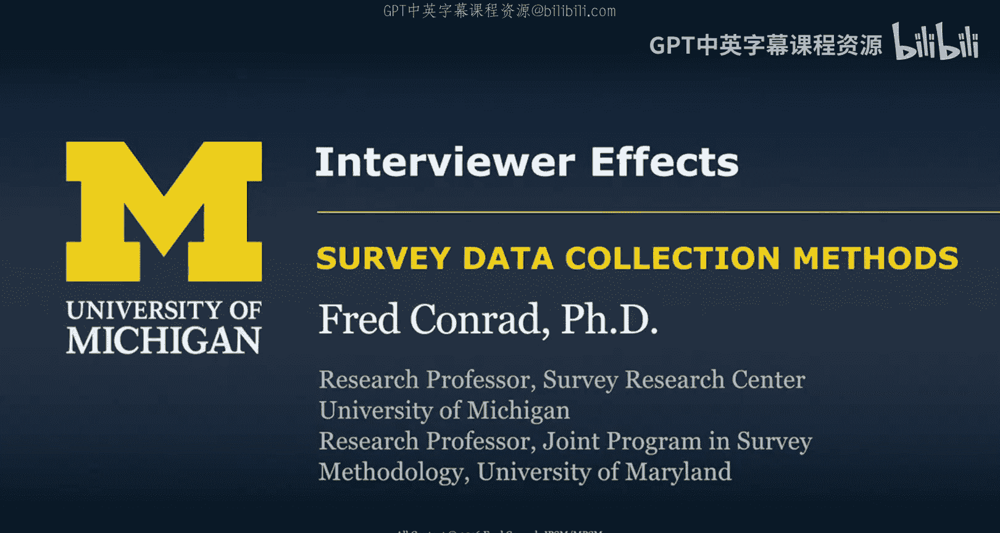

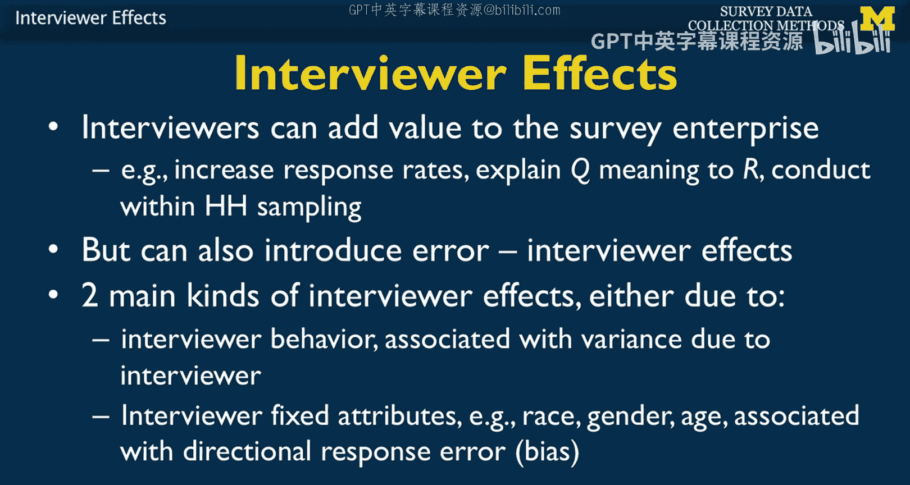

在本节中，我们将探讨访员在调查中可能引入的一种特定误差——访员效应。具体来说，我们将重点关注由访员行为差异导致的效应，这种效应会体现在调查数据的方差增加上。

---

## 访员的价值与潜在误差

上一节我们讨论了访员在提升调查质量方面的多种价值。访员能够提高相对于自填式问卷的应答率，可以在允许的情况下解释问题含义，并执行诸如户内抽样等自填式调查难以完成的任务。因此，访员是一项良好的投资，长期来看有助于产生更高质量的数据。

然而，访员也可能引入自填式调查中不存在的误差，这些误差被称为**访员效应**。访员效应主要分为两类，每一类都有其专门的研究文献。第一类似乎源于访员的行为差异，表现为由访员引起的方差增加。第二类则源于访员的固有属性（如种族、性别、年龄），表现为方向性误差或偏差，例如，受访者在回答与性别相关的问题时，对女性访员可能给出更多支持女权主义的回答。我们关于访员讨论的最后一个主题就是访员效应，首先我们将关注由访员行为引起、并反映在访员方差上的效应。

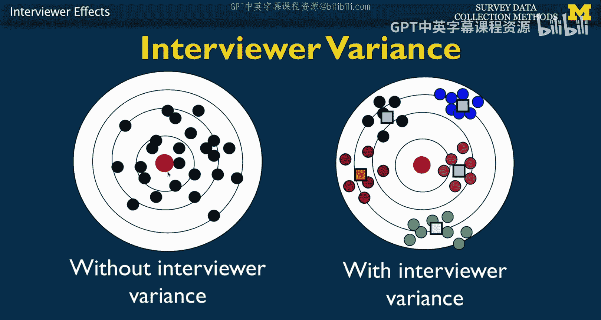

---

## 访员行为变异的概念

当在调查数据分析中将访员作为一个因素或项纳入时，访员对总方差的贡献通常归因于不同访员之间的行为差异，即他们如何实施问卷调查。例如，一位访员可能比另一位访员引发出更多“强烈反对”的回答，而另一位访员可能引发出更多“强烈赞同”的回答。

为了更直观地理解，请看下图。左侧图表描绘了真实值（红色靶心）和由多位访员提问得到的个体回答（黑色小圆点）。这里没有明显的聚集，黑色圆点似乎以随机方式分布在真实值周围。但在右侧图表中，同样以红色靶心代表真实值，可以清楚地看到回答的聚集现象。不同颜色代表不同访员，你可以看到，不同访员从他们恰好访问的受访者那里引出了不同范围的答案。这通常不是我们希望发生的情况。理想状态下，由谁提问不应该影响答案。因此，如果不同访员引出了不同范围或分布的答案，这通常不是数据质量良好的表现。

---

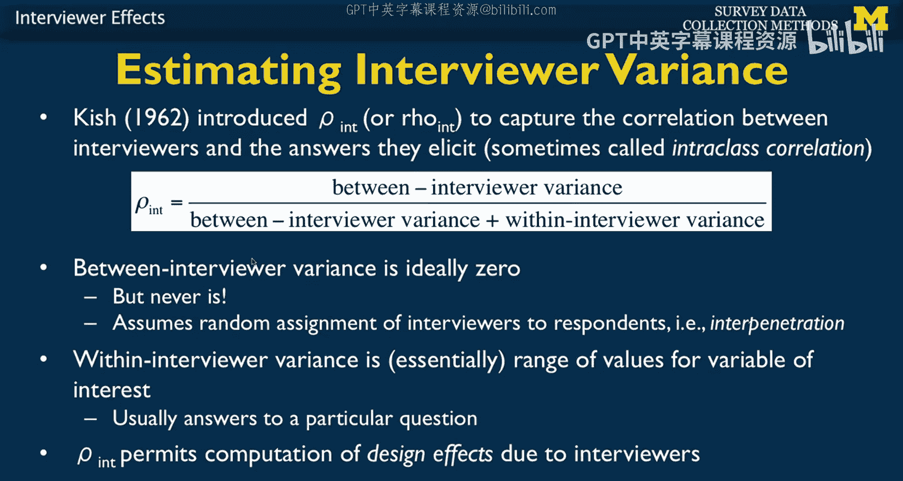

## 量化访员效应：ρ_int

那么，如何量化这种聚集现象呢？多年前，Leslie Kish引入了一个度量指标 **ρ_int**，用于捕捉访员与他们引出答案之间的相关性。这有时被称为**组内相关系数**，其概念相对直接。

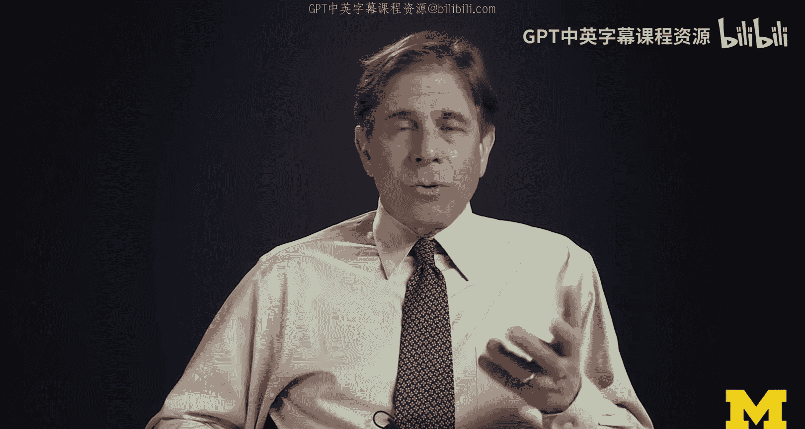

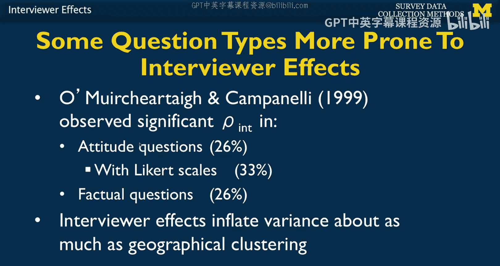

这里需要区分**访员间方差**和**访员内方差**：
*   **访员间方差**：你希望它尽可能小，因为理想情况下，你希望所有访员对同一问题引出的答案分布非常相似。
*   **访员内方差**：这通常是可接受的。你希望一个问题设计得足够好，能够引出一系列答案，因为如果一个问题从所有受访者那里都得到相同的答案，通常认为它的区分度不高。

**ρ_int** 的计算公式如下：
`ρ_int = （访员间方差） / （总方差）`
其中，总方差 = 访员间方差 + 访员内方差。

你希望访员间方差为零，但这从未实现。无论经过何种培训，访员总会对总方差有所贡献。这种分析或计算 ρ_int 的前提是受访者被**随机分配**给访员，这种方法称为**交叉渗透设计**。如果不是这种情况，那么不同访员引出答案的方差差异，实际上可能源于他们访问的受访者之间的真实差异。但如果实现了随机分配，我们就可以假设所有访员访问的受访者的真实值分布大致相同。

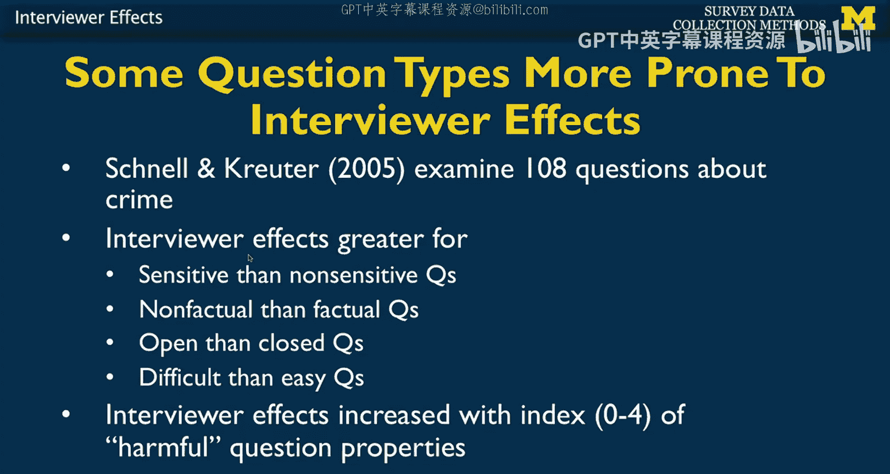

除了量化聚集程度外，测量 ρ_int 的另一个原因是它允许我们计算所谓的**由访员引起的设计效应**，这有助于我们把握访员在多大程度上夸大了总体方差，从而降低了我们对估计值的置信度。

---

## 影响 ρ_int 的因素

由于计算 ρ_int 需要交叉渗透设计（即受访者被随机分配给访员），因此并非每项调查都能计算。但在一项由 O`Muircheartaigh 和 Campanelli 进行的研究中，他们计算了多种问题的 ρ_int，发现：
*   26% 的态度问题具有显著的 ρ_int 值。
*   使用李克特量表的态度问题中，33% 具有显著的 ρ_int 值。
*   研究中 26% 的事实性问题也产生了显著的 ρ_int 值。
他们实际上能够证明，由访员引起的方差膨胀（即聚集效应）与地理聚集效应大致相同。在地理聚集发生在面对面访谈中，当访员被分配或在特定小地理区域内访问受访者时，一位访员引出的答案可能与其他访员引出的不同，但这种效应与 O`Muircheartaigh 和 Campanelli 发现的访员贡献的效应大致相当。

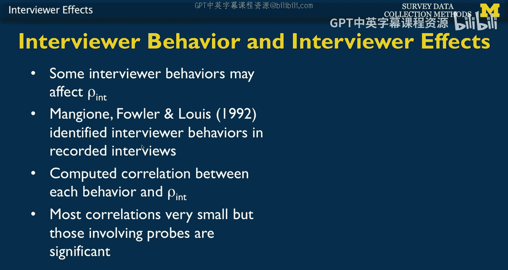

另一项由 Chan 和 Krosnick 进行的研究专门关注犯罪相关问题，他们也考察了不同类型问题的访员效应。他们发现：
*   对于敏感问题，访员效应大于非敏感问题。
*   对于非事实性（即态度或意见）问题，访员效应大于事实性或行为性问题。
*   对于开放式问题，访员效应大于封闭式问题。
*   对于他们认为困难的问题，访员效应大于简单问题。

他们实际上计算了一个“有害问题属性”指数，这些属性会导致问题变得困难或存在其他问题。他们发现，随着这个有害指数的增加，访员效应也随之增加。这从直觉上是合理的：敏感问题可能更容易受到访员行为的影响；受访者尚未形成明确观点的态度问题，可能对访员提问方式更敏感；开放式问题中，访员提示补充信息的方式可能因人而异；困难问题可能因访员是否以及如何帮助受访者而受到影响。

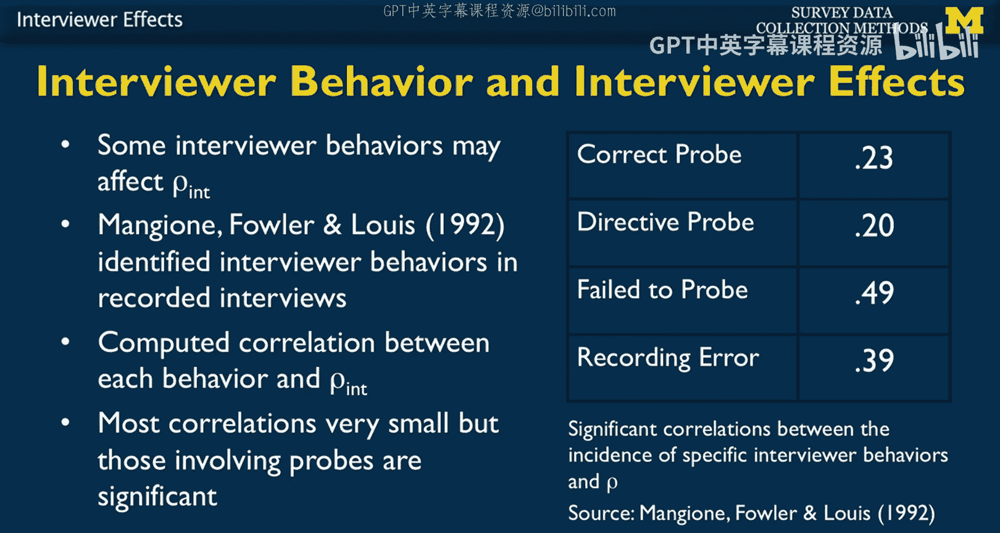

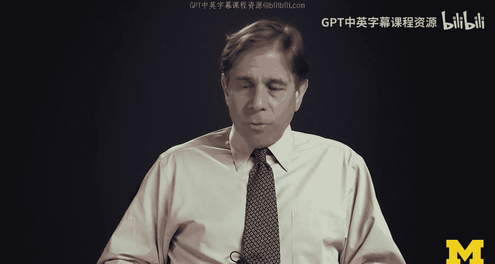

---

## 访员行为与 ρ_int 的关联

那么，是否有具体访员行为与 ρ_int 相关呢？一项由 Mangione、Fowler 和 Lewis 进行的研究发现，**访员追问的方式**与 ρ_int 密切相关。回想我们关于标准化访谈的讨论，非引导性或中性追问是该技术中允许访员运用自由裁量权的部分，访员可以决定是否追问或使用哪种可用的中性追问方式。很可能正是这种自由裁量权导致了访员方差。

他们通过行为编码分析了访谈录音，发现以下四种行为与 ρ_int 显著相关：
1.  访员正确追问的问题。
2.  访员错误追问（即使用了引导性追问）的问题。
3.  访员未能追问的问题。
4.  访员错误记录答案的问题（这与追问无关）。

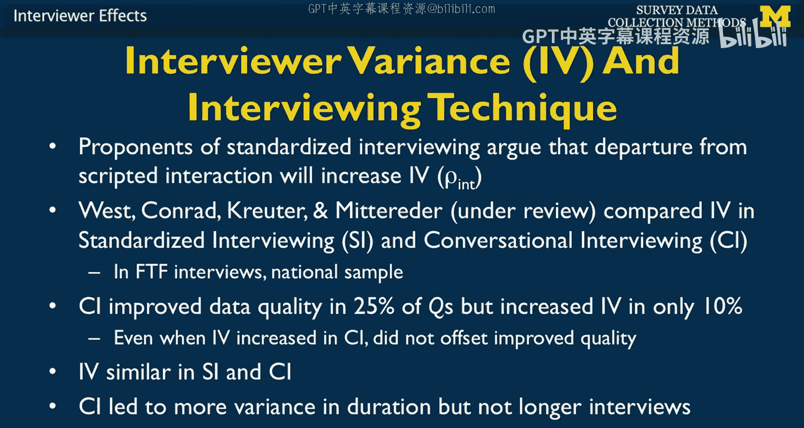

其核心思想是，需要更多追问的问题需要访员运用更多自由裁量权，因此不同访员的追问方式会不同，这会放大他们对答案的影响。这与标准化访谈的理念一致，即通过严格限制访员可能的行为范围，可以减少访员对答案的影响（至少以访员方差衡量）。

---

## 不同访谈技术的比较

但这并不意味着赋予访员其他类型自由裁量权的替代技术就一定会增加他们对答案的影响或访员方差。标准化访谈的支持者曾认为，偏离脚本会增加访员方差。然而，在 West 及其同事最近的一项研究中，他们比较了标准化访谈和会话式访谈在德国一项全国性面对面调查中的访员方差。他们发现：
*   会话式访谈在 25% 的问题上提高了数据质量（与我们之前讨论的关于会话式访谈对回答准确性益处的研究结果相似）。
*   但会话式访谈仅在 10% 的问题上增加了访员方差。
*   即使访员方差增加，其幅度也未能抵消会话式访谈（通过解释问题含义）带来的质量提升。
*   此外，他们发现两种访谈技术之间的访员方差相似。
*   最后，他们发现会话式访谈导致了访谈时长的**方差更大**（注意：并非总时长更长，而是不同访员之间的时长差异更大）。

这表明，会话式访谈可能在访员间的实施方式差异更大（或许因为涉及更多自由裁量权），但这并未像标准化访谈支持者所担忧的那样增加访员方差。

---

## 无应答误差对 ρ_int 的影响

到目前为止，我们讨论的几乎都是访员对答案准确性或质量的影响，这主要是一个测量误差问题。然而，由 ρ 度量的访员效应也可能受到访员招募受访者能力的影响，这实际上是一种由无应答引起的访员效应。也就是说，看似由测量引起的效应，实际上可能反映了不同访员招募了不同类型的受访者，而这些受访者的真实值本就不同。即使在交叉渗透设计（受访者被随机分配给访员）中，如果不同访员从分配给他们的名单中成功招募了不同类型的受访者，也可能发生这种情况。这通常与由提问方式引起的访员效应难以区分。

West 和 Olson 利用行政记录（作为真实值）证实了这种可能性。他们发现：
*   对于“结婚年龄”这个问题，显著的 ρ_int 源于测量误差（经典的访员效应）。
*   但对于“离婚年龄”这个问题，显著的 ρ_int 源于显著的无应答误差。不同访员招募的受访者的真实值确实存在差异，这实质上破坏了交叉渗透设计的随机分配前提。

---

## 访员效应的设计效应与有效样本量

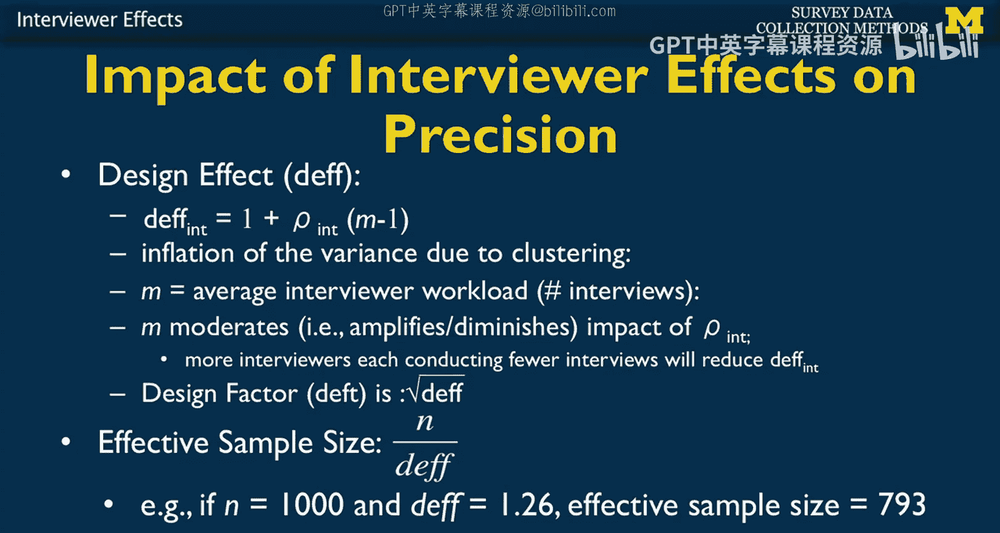

如前所述，计算 ρ_int 的另一个原因是为了量化访员对整个研究方差的影响。有一个度量指标可以做到这一点，称为**由访员引起的设计效应**。

由访员引起的设计效应公式如下：
`设计效应 = 1 + (ρ_int * (m - 1))`
其中，`m` 是平均访员工作量（即每位访员完成的平均访谈数）。

这个公式表明，访员对总误差的增加程度取决于两个部分：ρ_int 和平均工作量 `m`。`m` 越大，任何一位访员的独特行为方式产生的影响就越大。因此，从降低访员影响的角度看，在固定预算下，让更多访员每人完成更少的访谈会更有利。

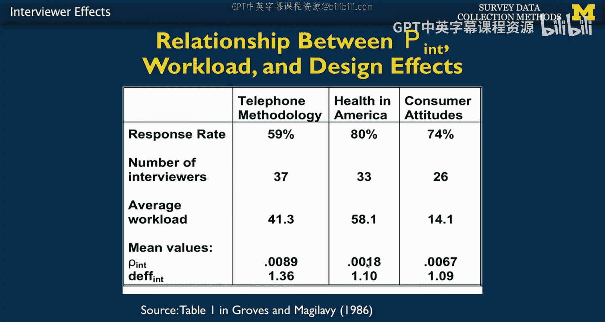

设计效应的平方根称为**设计因子**，通常用于讨论标准误。

计算出由访员引起的设计效应后，我们可以计算**有效样本量**：
`有效样本量 = 实际样本量 / 设计效应`

这告诉我们，考虑到访员引起的聚类，我们对结果的置信度相当于进行了一个更小样本量的调查。例如，如果实际完成了 1000 次访谈，设计效应为 1.26，那么有效样本量约为 793。这意味着我们的置信度仅相当于进行了 793 次独立访谈。

Groves 和 Magilavy 的一项研究展示了这一点。在他们的表格中，虽然一项调查的 ρ_int 值（0.0067）是另一项调查（0.0018）的三倍多，但由于前者的平均访员工作量更小，最终两者由访员引起的设计效应却大致相同（约1.09 vs 1.10）。这说明，通过控制每位访员的工作量，可以稀释较大的 ρ_int 值对总体精度的影响。

---

## 总结与反思

本节课中，我们一起学习了由访员行为引起、并反映在访员方差上的效应。

*   **访员相关误差**本质上是访员与他们引出答案之间的相关性。理想情况下，由谁提问不应有影响，因此任何大于零的 ρ_int 值都是不理想的，它表明答案质量存在变异。
*   **ρ_int 是一个有用的间接质量指标**，但它衡量的是方差，而非准确性。ρ_int 值低是好事，意味着访员对方差的影响较小。然而，即使 ρ_int 很低，如果所有访员都系统地收集了错误答案，数据质量也可能很低。
*   **访员行为的影响**：证据表明，像追问这种脚本化程度较低的行为可能与 ρ_int 相关。但会话式访谈（赋予访员一定自由裁量权）并未被证明比标准化访谈产生更高的访员方差，反而能在许多问题上提高数据质量。
*   **无应答的干扰**：ρ_int 可能因无应答误差而膨胀。如果访员招募的受访者真实值不同，即使有随机分配，也可能产生显著的 ρ_int。
*   **控制影响**：通过保持较小的访员工作量（即每位访员负责更少的访谈），可以稀释 ρ_int 对总体设计效应的影响。
*   **直接测量的重要性**：ρ_int 是数据质量的间接度量。要更直接地了解访员如何影响数据质量，需要考察回答准确性，这通常需要借助记录或其他外部真实值度量，虽然难度更大。

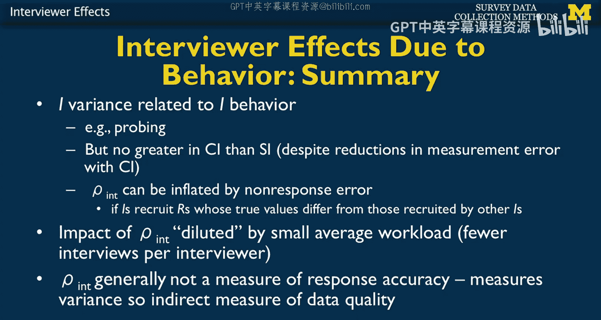

本节我们深入探讨了第一类访员效应——由行为引起、反映在方差上的效应。接下来，我们将转向第二类访员效应，即由访员的固有特征（如种族、性别、年龄）引起的效应。