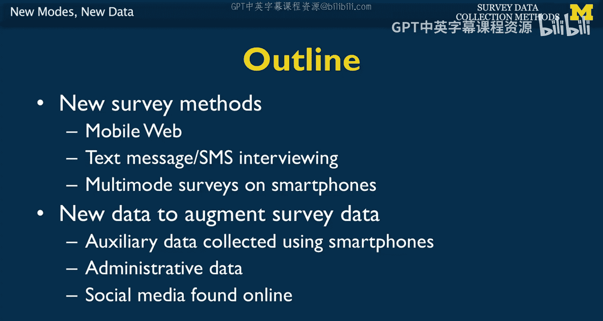
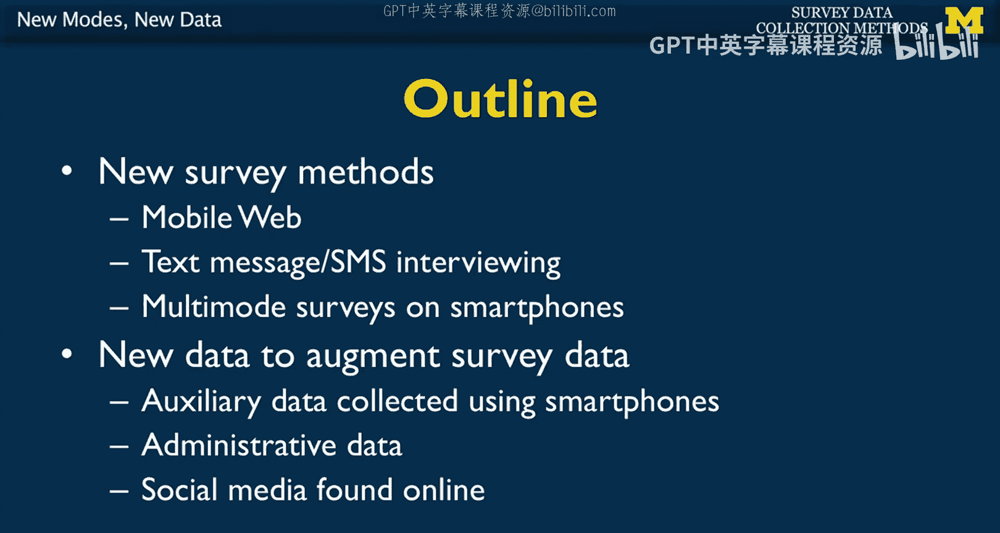
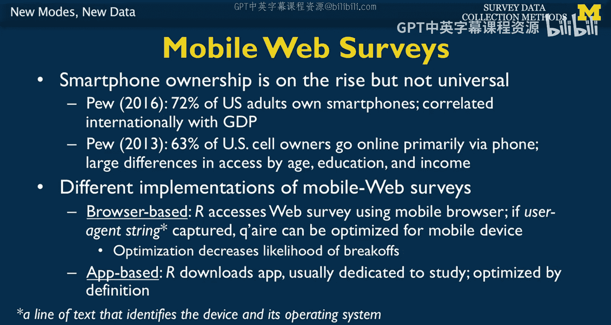
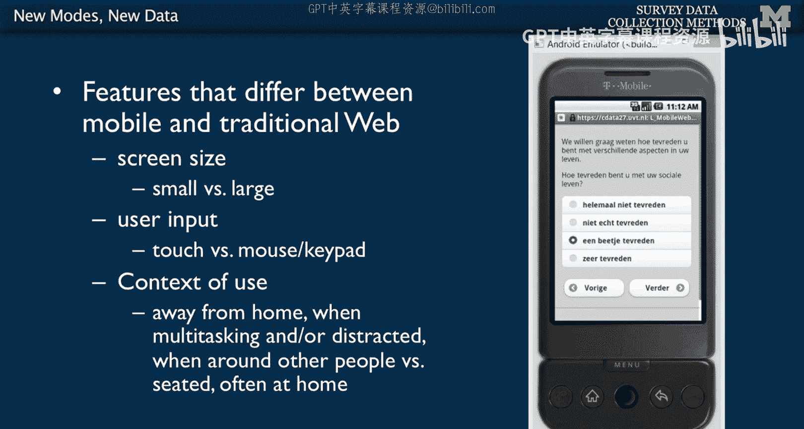
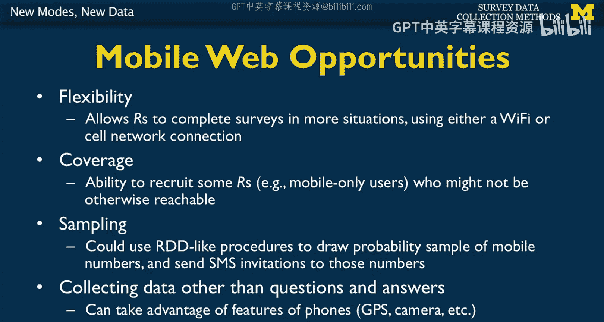
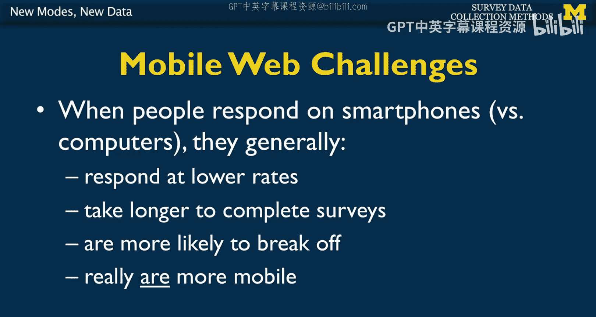
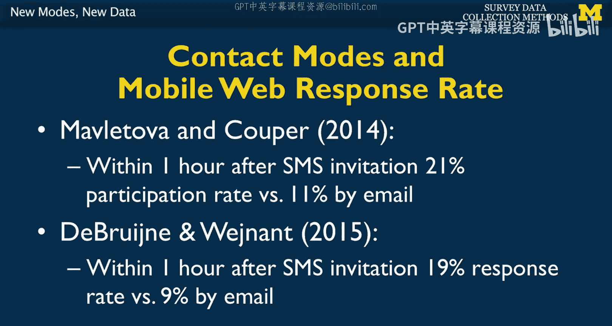
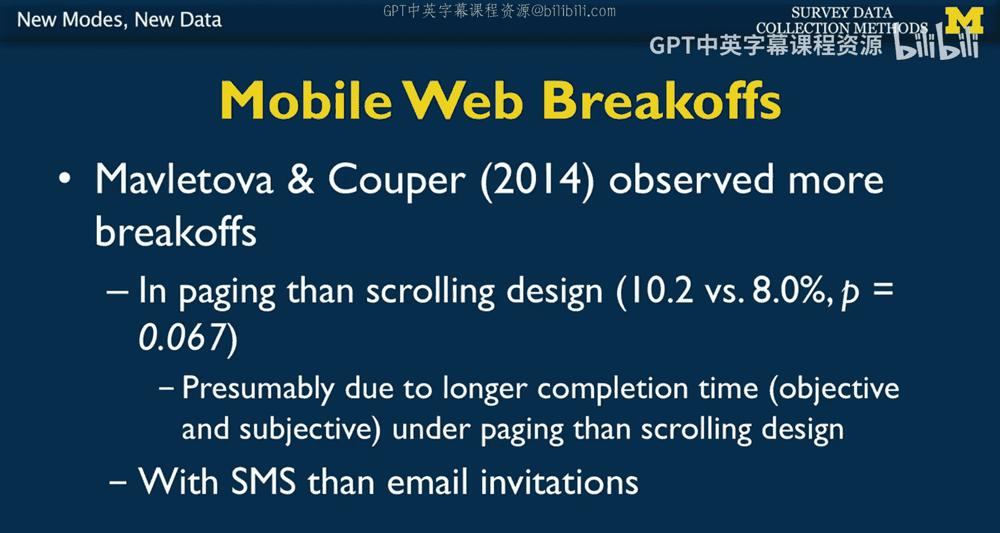
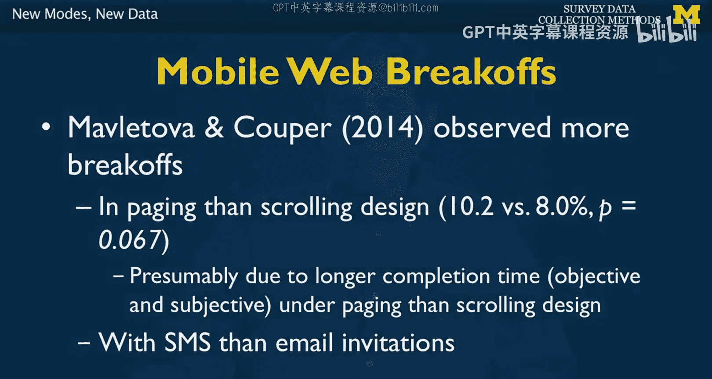

#  031：新模式与新数据 📱📊

在本节课中，我们将学习新兴的数据收集方法以及新的数据来源。我们将探讨移动网络调查、短信访谈、智能手机上的多模式调查，以及如何利用智能手机辅助数据、行政记录和社交媒体数据来补充甚至替代传统的问卷调查数据。

---

上一节我们介绍了课程的整体框架，本节中我们首先来看看移动网络调查。

移动网络调查本质上是在智能手机等移动设备上完成的传统在线问卷调查。随着智能手机的普及，这种方法变得日益重要。例如，皮尤研究中心的数据显示，72%的美国成年人拥有智能手机。

移动网络调查的实现主要有两种方式：基于浏览器和基于应用程序。

*   **基于浏览器**：受访者使用智能手机自带的浏览器访问在线问卷。如果系统能捕获**用户代理字符串**（一段标识设备和操作系统的文本），问卷界面就可以针对移动设备进行优化，从而提升用户体验和数据质量。
*   **基于应用程序**：受访者需要下载一个专门用于研究的应用程序。这类应用天生为移动设备优化，但要求用户预先安装。

移动网络调查与传统网络调查在几个关键方面存在差异：

*   **屏幕尺寸**：移动设备的屏幕通常更小。
*   **用户输入**：移动设备主要通过手指触屏，而传统电脑使用鼠标或键盘。
*   **使用情境**：移动网络调查的受访者可能不在家，处于多任务处理或受环境干扰的状态，甚至周围可能有他人，这可能影响其对敏感问题的回答。

移动网络为调查设计带来了新的机遇和挑战。

**机遇包括：**
*   **灵活性**：受访者可以在更多场景下完成调查。
*   **覆盖范围**：可以接触到“仅使用手机”的用户群体。
*   **抽样**：可以利用随机数字拨号等方法，通过手机号码进行概率抽样。
*   **额外数据收集**：可以利用手机的GPS、摄像头等功能收集除自我报告以外的数据。

**挑战包括：**
*   **应答率**：研究表明，通过智能手机参与调查的应答率通常低于通过个人电脑。
*   **中断率**：在移动设备上，受访者更可能中途放弃调查。
*   **情境影响**：受访者可能在移动中、被干扰或处于公共场合，这可能影响测量质量。

---

接下来，我们看看如何邀请受访者参与移动网络调查，以及这对参与度的影响。

邀请方式主要分为短信邀请和电子邮件邀请。研究发现，短信邀请能带来更快的初始响应。例如，在一项研究中，短信邀请发出后一小时内参与率达到21%，而电子邮件邀请仅为11%。短信的即时性和私密性可能是其优势。

然而，关于调查完成度，情况可能更复杂。有研究表明，虽然短信邀请能带来更高的初始参与率，但通过短信开始的受访者，其完成全部调查的可能性可能低于通过电子邮件开始的受访者。此外，调查设计也影响中断率。例如，**分页设计**（一页一题）可能因为服务器传输时间导致完成时间更长，从而比**滚动设计**（单页多题，需滚动）带来更高的中断率。

---

以上我们讨论了移动网络调查在应答和完成度方面的议题。下一节中，我们将转向测量相关问题，包括受访者所处环境、是否多任务处理以及其他设计问题的影响。

---

本节课中，我们一起学习了移动网络调查的基本概念、实现方式、与传统调查的差异，以及它在覆盖范围、抽样和数据收集方面带来的新机遇。同时，我们也认识到其在应答率、完成度和测量情境方面面临的挑战。理解这些特点对于设计有效的移动端数据收集方案至关重要。