#  032：移动网络调查 📱

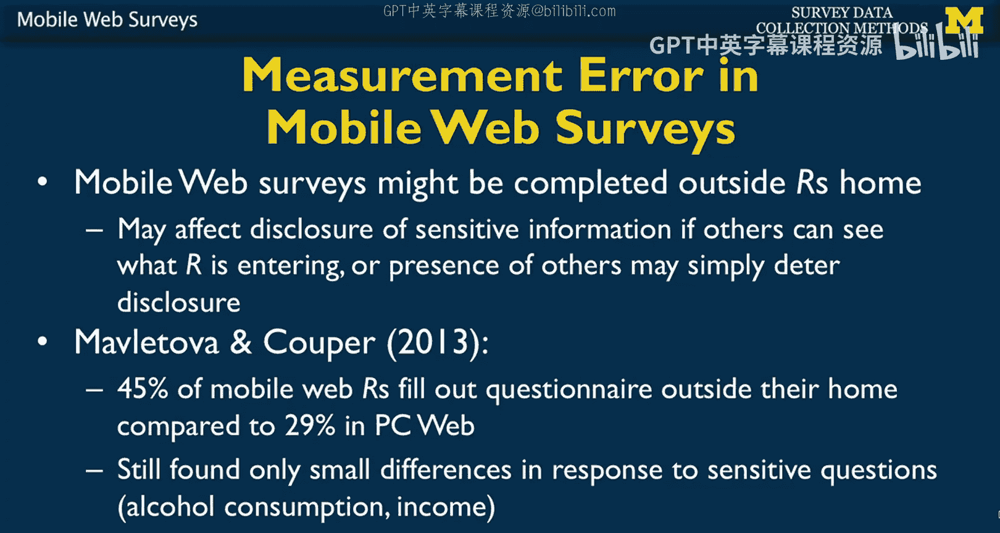

在本节课中，我们将要学习移动网络调查中的测量误差问题。我们将探讨移动设备的移动性、问卷设计（如分页与滚动）如何影响数据质量，并回顾相关研究的主要发现。

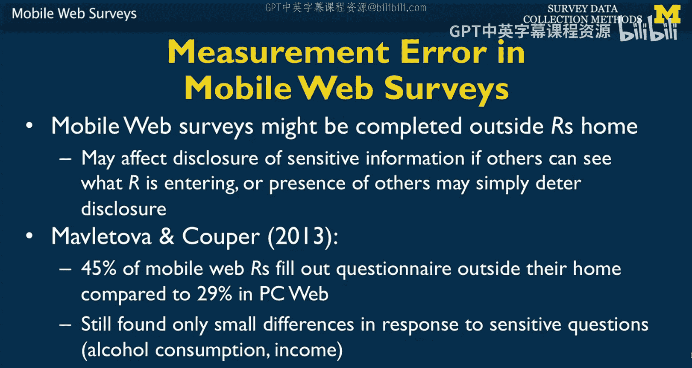

---

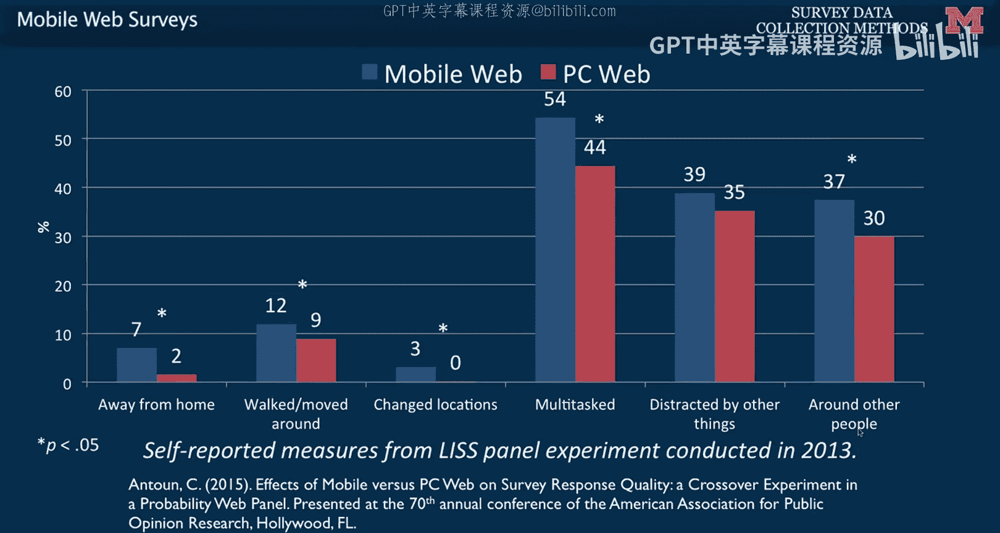

## 移动性与隐私顾虑

上一节我们介绍了移动网络调查的概况，本节中我们来看看移动性可能带来的测量误差问题。移动网络调查意味着受访者可以在任何地点完成问卷，包括户外、旅途中等。这虽然提供了便利，但也可能是一把双刃剑。受访者可能身处非私密的环境，这可能会增加他人看到其对敏感问题回答的风险，从而可能抑制其提供真实、不受欢迎的答案。

## 研究证据：移动性是否影响回答？

为了探究移动性对回答敏感问题的影响，学者们进行了研究。

以下是相关研究的发现：
*   Movletova和Cooper的研究发现，45%的移动网络受访者在家庭以外地点完成问卷，而使用传统电脑或笔记本电脑的受访者中这一比例为29%。尽管如此，他们并未发现回答敏感问题时有显著差异。
*   Antoun的实验也得出了类似结论。他发现，使用移动设备的受访者更常在户外、移动中、切换地点以及进行多任务处理。虽然移动受访者周围有其他人的情况更常见，但这并未影响他们对敏感问题的诚实回答。

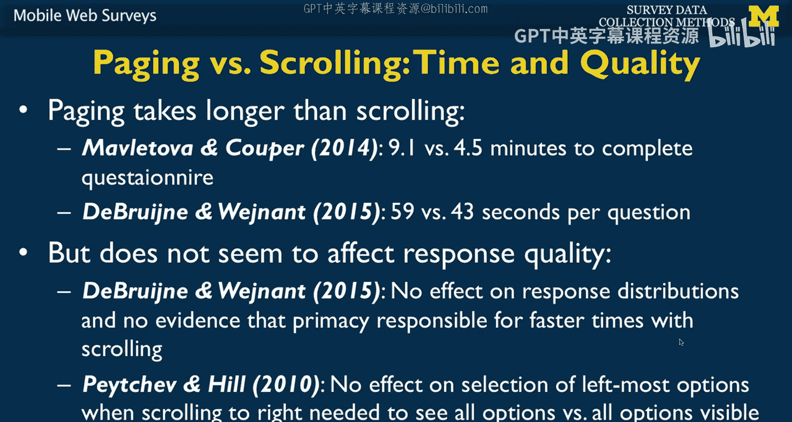

## 问卷设计：分页与滚动 📄

一个被广泛研究的移动网络问卷设计特征是分页与滚动设计。

以下是两种设计的核心区别：
*   **分页设计**：通常每屏（页）只显示一个或少数几个问题。公式可表示为：`屏幕数量 ≈ 问题数量`。
*   **滚动设计**：整个问卷或大量问题呈现在一个长页面上，受访者需要（通常是垂直）滚动来查看所有问题。公式可表示为：`屏幕数量 = 1（或很少）`。

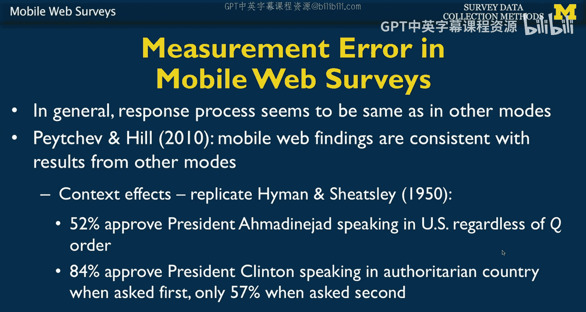

## 设计对完成时间的影响

研究表明，设计选择显著影响问卷完成时间。

以下是具体的研究数据：
*   Movletova和Cooper发现，分页设计平均耗时9.1分钟，而滚动设计仅需约4.5分钟，时间缩短了近一半。
*   Toepoel和Lugtig的研究也发现了类似效应，分页设计下每个问题耗时59秒，而滚动设计为43秒。因此，滚动设计通常速度更快。

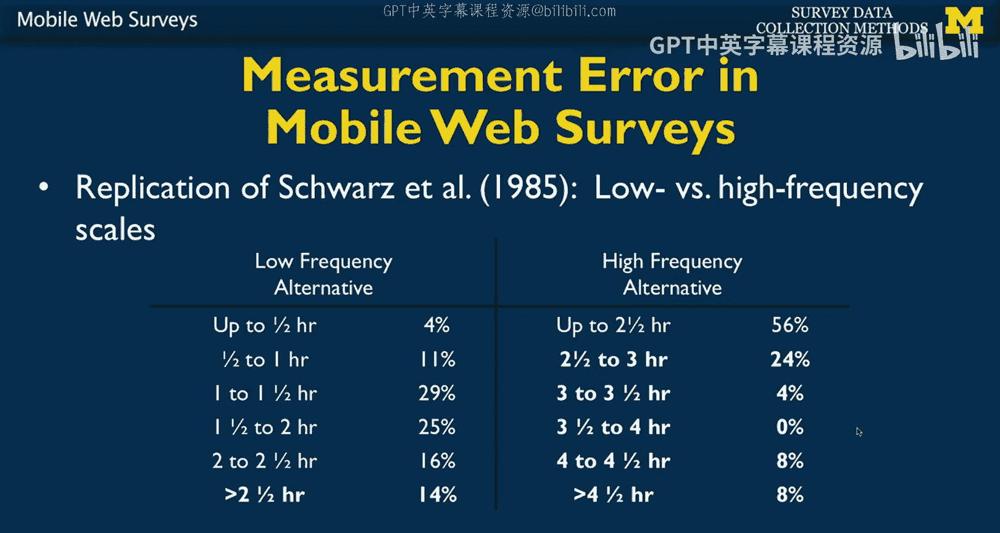

## 时间差异的原因与数据质量

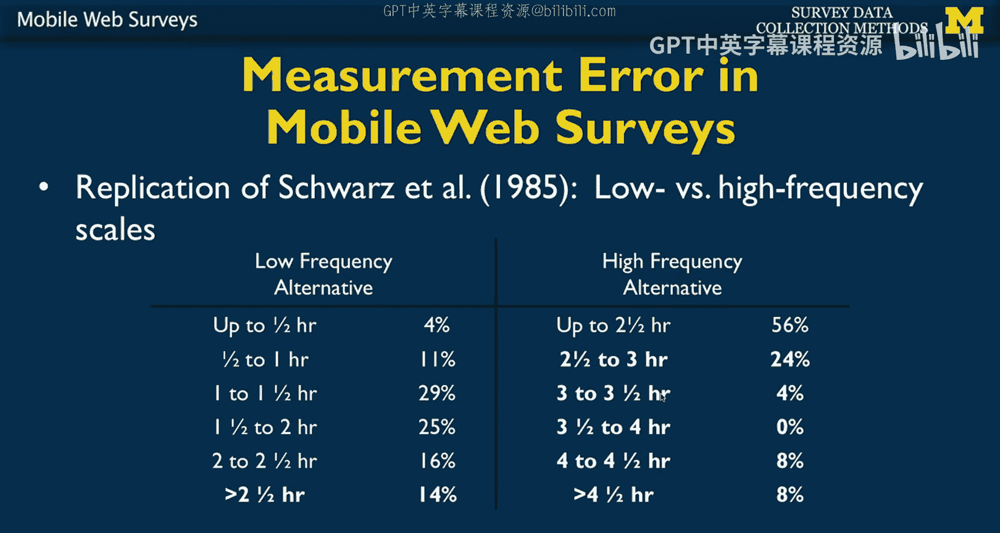

对于滚动设计更快的原因，一种解释是分页设计需要为每个新页面加载数据，受网络连接速度影响，从而增加了总耗时。但重要的是，这种完成时间的差异似乎并未影响回答质量。

以下是相关研究的佐证：
*   Toepoel和Lugtig发现，分页与滚动设计在回答分布上没有差异，也没有证据表明滚动设计导致了“首位效应”（即受访者总是选择第一个看到的选项）。
*   Peytchev和Hill的早期研究也支持这一结论。他们测试了在屏幕上一次只显示3个选项（需滚动查看其余2个）与显示全部5个选项的设计，并未发现对最初可见选项的偏好偏差。

## 响应过程的相似性 🧠

综合多项研究，一个普遍结论是：移动网络调查与传统网络（PC端）调查的响应过程非常相似，甚至与其他调查模式（如电话访问）的已知效应一致。

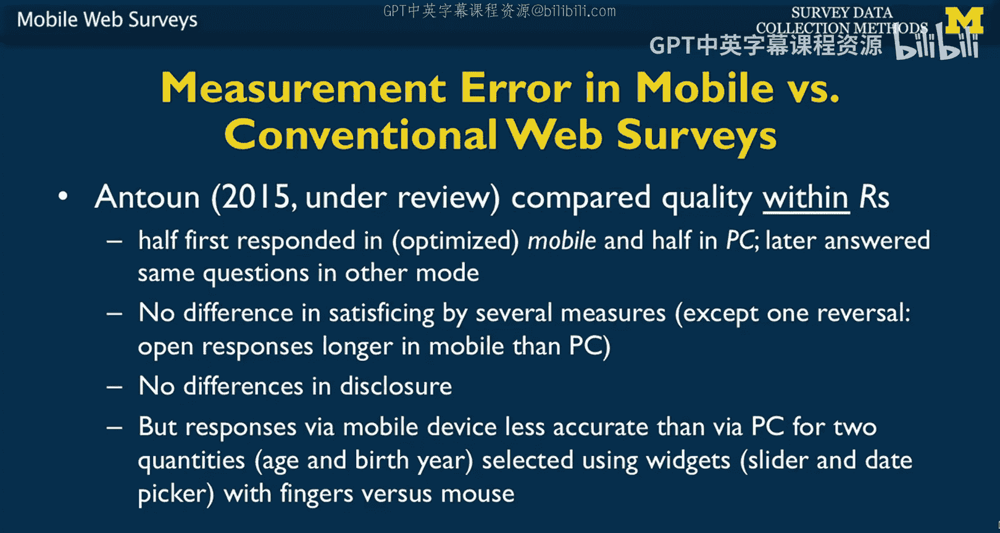

Peytchev和Hill的研究成功复现了其他模式中已知的问卷效应，这支持了响应过程相似的观点。

以下是他们复现的两个经典效应：
1.  **问题顺序效应（互惠规范）**：他们更新了Schuman和Presser的经典研究，发现当先询问“伊朗总统是否应在美国演讲”再问“美国总统是否应在伊朗演讲”时，对后者的支持率（57%）显著低于先问后者时的支持率（84%）。这表明移动设备上同样存在基于问题顺序的推理过程。
2.  **量表范围效应**：他们复现了Schwartz的电视观看时间研究。当使用“低频备选量表”（如从“0.5小时”开始）时，只有14%的人选择“超过2.5小时”；而当使用“高频备选量表”（如从“2.5小时”开始）时，44%的人选择“超过2.5小时”。这表明移动设备受访者同样会依据量表的视觉位置而非具体数值来选择答案。

## 移动设备的独特挑战与证据

尽管基本响应过程相似，但移动设备的某些特性仍可能影响测量质量。Antoun的交叉设计研究（同一受访者先后使用移动设备和PC完成相同问卷）提供了更深入的洞察。

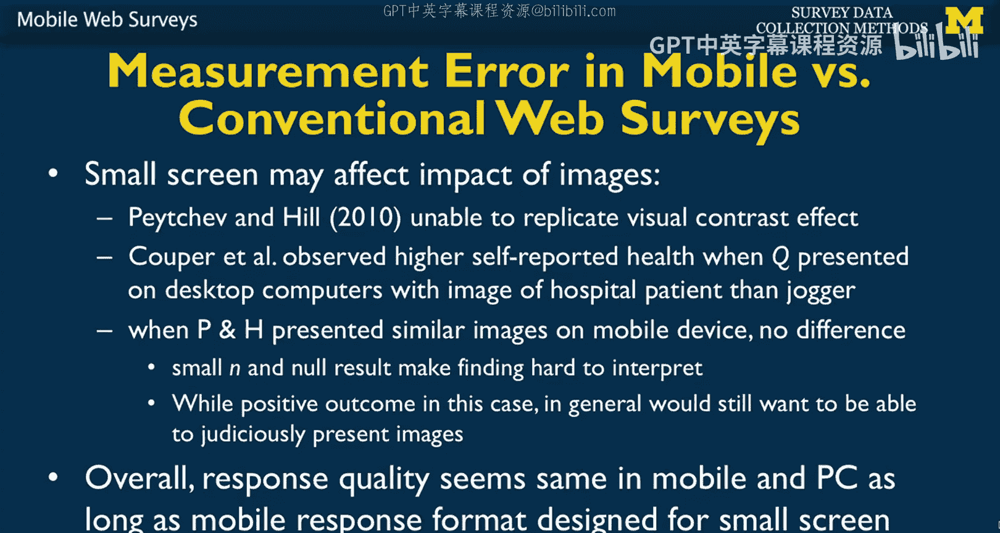

以下是该研究的关键发现：
*   **无差异的方面**：在“满足感”（如直线勾选、对多个问题给出相同答案、首位效应）和敏感信息披露方面，移动设备与PC没有显著差异。这再次证实，即使移动受访者身处更多干扰环境，也并未抑制其诚实回答。
*   **数据质量较低的方面**：在报告年龄和出生年份时，移动设备的数据准确性低于PC。Antoun认为，这可能是由于在移动设备小屏幕上使用滑块和日期选择器等输入控件需要更高的操作精度，从而导致了更多错误。**屏幕尺寸小**似乎是导致此类测量误差的关键因素。

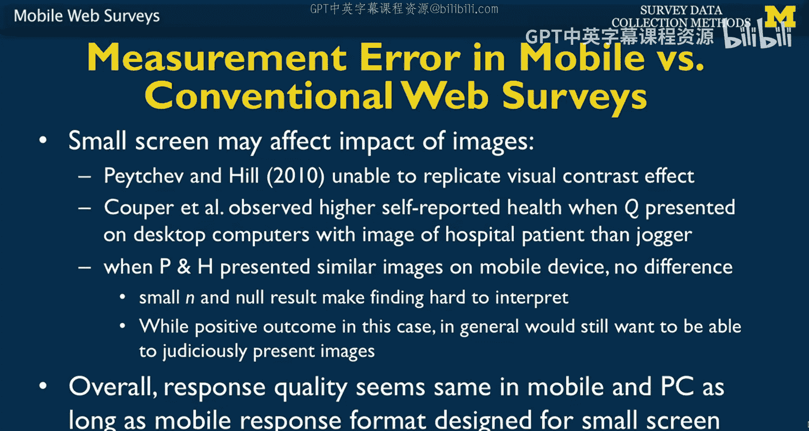

## 早期“非预期”移动受访者

在移动网络调查早期，许多问卷并非为移动设备优化，通过移动设备访问的受访者被视为“非预期的”。

Bosnjak等人的元分析总结了以下关于这类“非预期”移动受访者的特点：
*   平均参与率约为5.8%。
*   更年轻、男性受访者使用移动设备的可能性更高。
*   由于设计未针对小屏幕优化，移动设备的**中断率**高于桌面设备。
*   尽管中断率更高，但移动受访者在中断前完成的页面数反而更多，这可能意味着他们起初有更强的完成动机。

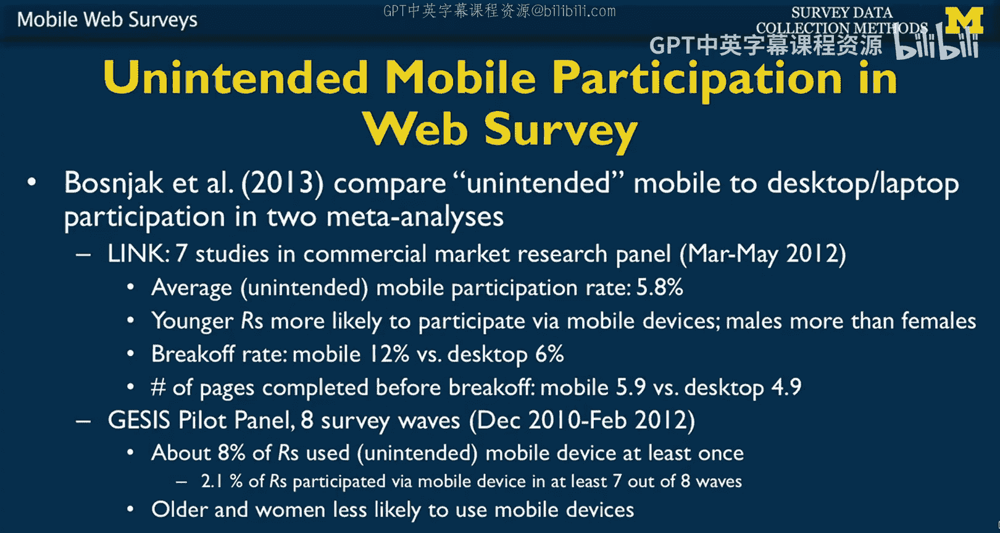

## 总结与展望

本节课中我们一起学习了移动网络调查在测量误差方面的主要研究发现。

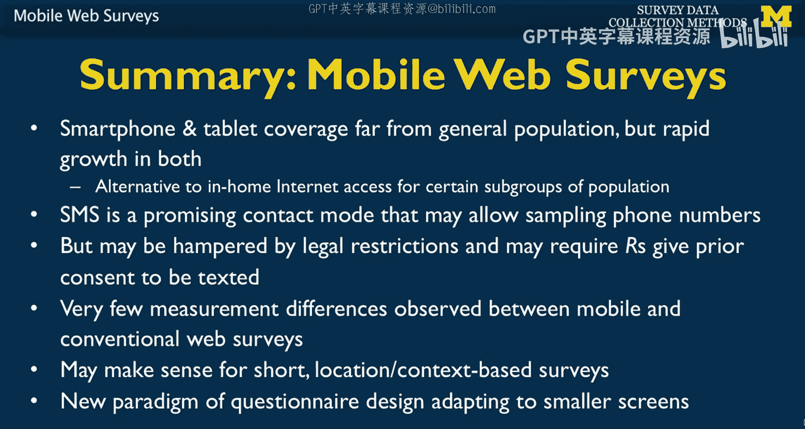

以下是本节的要点总结：
*   **覆盖与接触**：智能手机和平板电脑的覆盖率正在快速增长，对于某些缺乏家庭互联网的群体是重要补充。短信（SMS）作为接触方式前景良好，但可能受法律限制。
*   **测量误差**：总体而言，**没有强有力证据表明移动网络与传统网络调查在个体回答质量（测量误差）上存在系统性差异**。基本响应过程是相似的。
*   **设计关键**：核心设计挑战在于创建**同时适用于小屏幕和大屏幕**的问卷与测量项目。小屏幕可能对某些输入方式（如滑块）的准确性构成挑战。
*   **适用场景**：移动网络可能更适用于**简短、基于位置或情境**的调查，而非传统的长篇问卷。

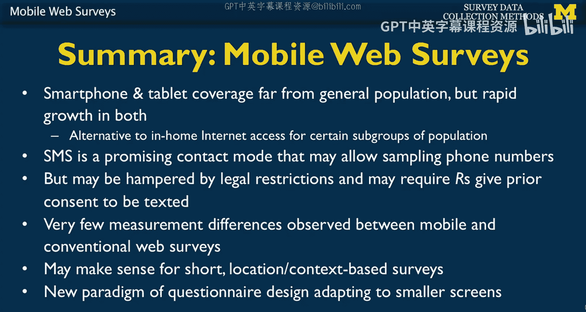

下一节，我们将转向讨论**短信（SMS）作为一种独立的数据收集或访谈模式**，而不仅仅是接触工具。