#  033：短信调查 📱

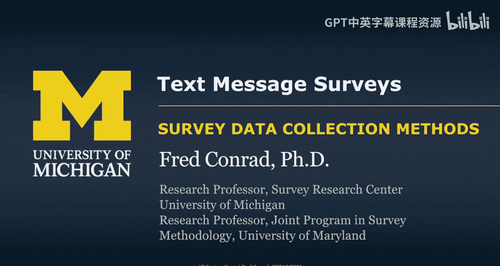

在本节课程中，我们将探讨使用短信（SMS）作为数据收集模式的方法。我们将了解短信调查的基本概念、其与语音通信的关键区别、潜在的覆盖误差，以及关于其测量质量的初步证据。

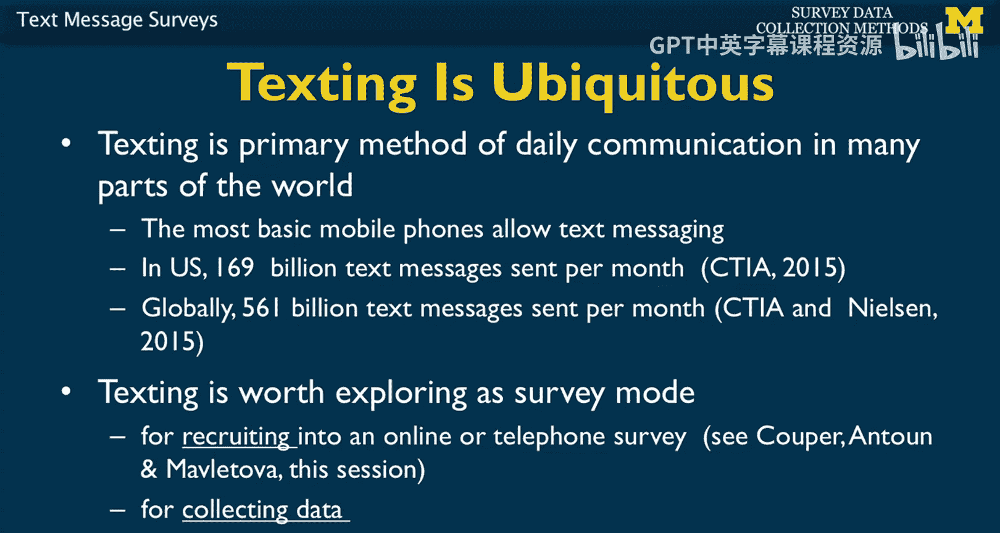

---

上一节我们讨论了移动网络调查，本节中我们来看看另一种移动数据收集方式：短信调查。短信调查是指使用短信或SMS来直接收集数据，而不仅仅是用于邀请或联系参与者。

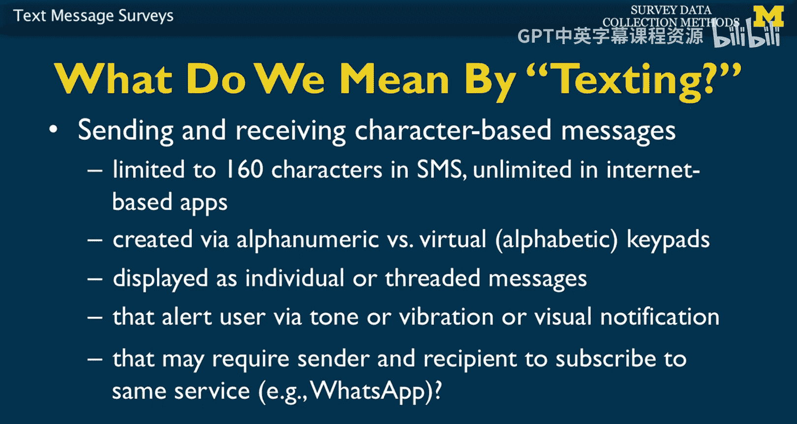

首先需要明确的是，短信无处不在。它是全球许多地区日常沟通的主要方式，即使是最基本的手机也支持短信功能。在美国，每月有数十亿条短信被发送，全球范围内则更多。因此，将其作为一种调查模式进行探索是值得的。

## 什么是短信调查？

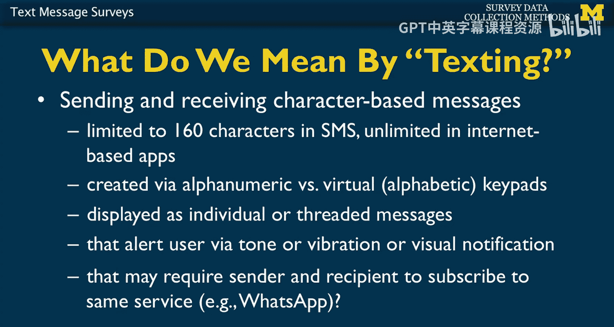

“短信”一词可能有不同的解释。它可以是基于字符的消息，在**SMS（短消息服务）**中限制为160个字符，也可以是基于互联网应用程序的消息，字符数不受限制。这两种形式都在我们当前的讨论范围内。

以下是短信创建和接收的一些关键特征：
*   **输入方式**：短信可以通过字母数字键盘或按键创建（通常需要多次按同一个键来输入不同字母），也可以通过智能手机上更常见的虚拟全字母键盘创建。
*   **显示方式**：消息可以单独显示，在智能手机上则通常以对话线程的形式显示，使整个交流历史可见。
*   **通知机制**：消息到达时，通常会通过声音、振动或视觉通知提醒用户，这能吸引他们的注意力。这是短信用于调查数据收集的一个潜在优势。
*   **服务要求**：某些短信服务（如WhatsApp）可能需要收发双方订阅，但由于短信功能内置于几乎每部手机中，许多短信通信可以在不涉及任何订阅服务的情况下进行。

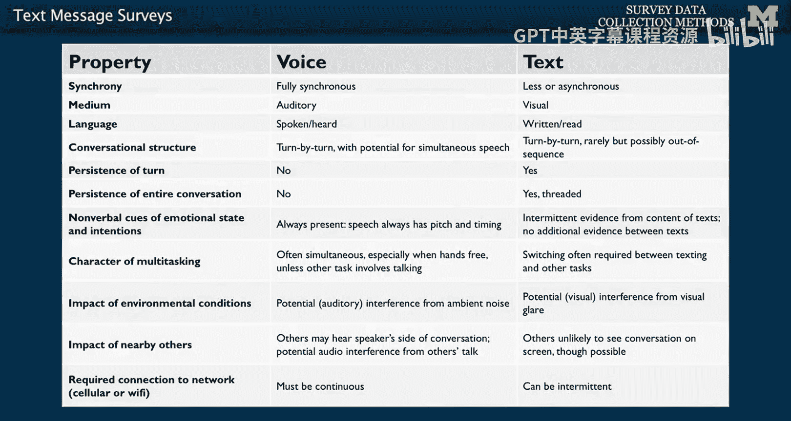

## 短信与语音通信的属性对比

为了更好地理解短信作为调查模式的特点，我们将其与语音通信（如电话调查）进行对比。下表概括了它们的主要属性：

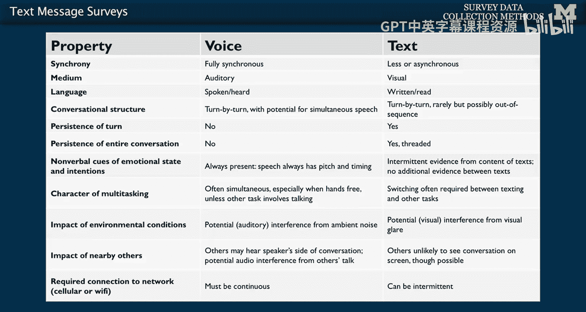

| 属性 | 语音通信 | 短信 |
| :--- | :--- | :--- |
| **同步性** | **完全同步**。说话者提出问题后，期望听者几乎立即（通常在几秒内）回应。 | **异步性更强**。虽然可以快速来回交流，但回复通常在用户方便时发送，没有对即时回复的同等期望。 |
| **对话结构** | **轮流进行**。一人说完，另一人接着说。偶尔会出现同时说话的“抢话”错误。 | **也是轮流进行**，每条消息代表一轮。几乎没有“同时发言”的类似情况，尽管消息偶尔可能不按顺序到达。 |
| **持久性** | **短暂易逝**。话一旦说出就消失了，除非被录音，否则没有记录。 | **持久存在**。短信是视觉化的，除非用户删除，否则会保留在手机上。这可能会影响人们提供敏感信息的意愿。 |
| **非语言线索** | **非常丰富**。包含大量的副语言特征，如“嗯”、“啊”等，能传达不确定性、强调等。 | **几乎没有**。除非有意输入（如输入“...”），否则几乎没有副语言特征的类似物。 |
| **多任务处理** | **倾向于同时进行**。例如，可以一边打电话一边做饭，在某种程度上并行处理任务。 | **倾向于任务切换**。在输入短信时不太可能同时做另一件事，但在发送短信后、阅读回复前，完全可以切换到其他任务。生活常态发生在短信之间。 |

这些差异可能导致通过短信和语音收集的数据，特别是数据质量，存在不同。

## 短信调查的覆盖误差

在探讨测量质量之前，我们需要考虑覆盖误差。如果发短信的人与不发短信的人在我们要测量的属性上存在差异，那么我们就会遇到与网络访问类似的问题。

当然，没有手机的人不太可能发短信。但问题在于，在手机用户中，不发短信的人是否与发短信的人在调查关心的属性上有所不同？

Conrad及其同事在一篇重要章节中报告了对此的首次调查。他们分析了皮尤组织的一项电话调查数据，该调查询问受访者是否是手机用户，以及是否发短信，同时收集了人口统计数据。

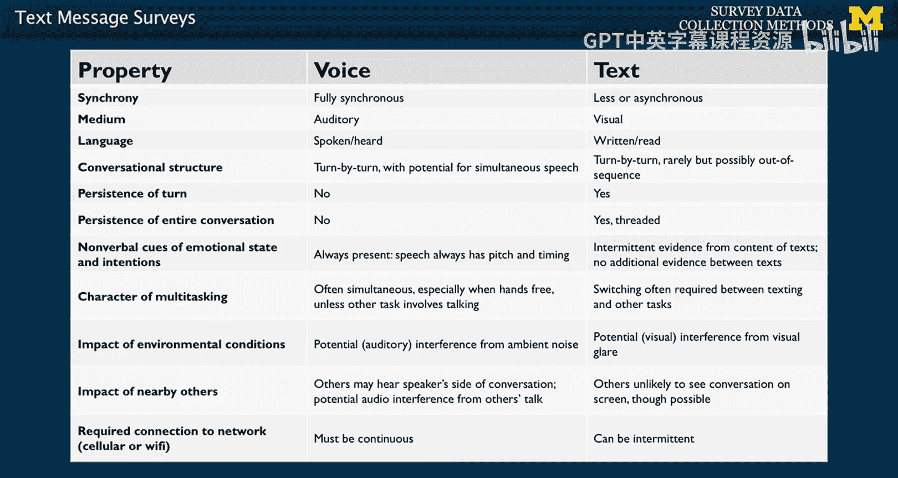

数据显示，在手机用户中，发短信者与不发短信者在**年龄**和**教育程度**上存在一些差异：
*   **发短信者更年轻**（34岁以上的比例更低）。
*   **发短信者中大学毕业生比例略高**。

但在性别、种族、民族和收入等其他属性上没有差异。问题是，这两个差异是否会影响通过短信收集的答案。此外，手机用户中发短信的比例正在上升且持续增长。随着这一比例接近全覆盖，发短信与不发短信的手机用户之间的差异可能会消失，从而减少潜在的偏差。

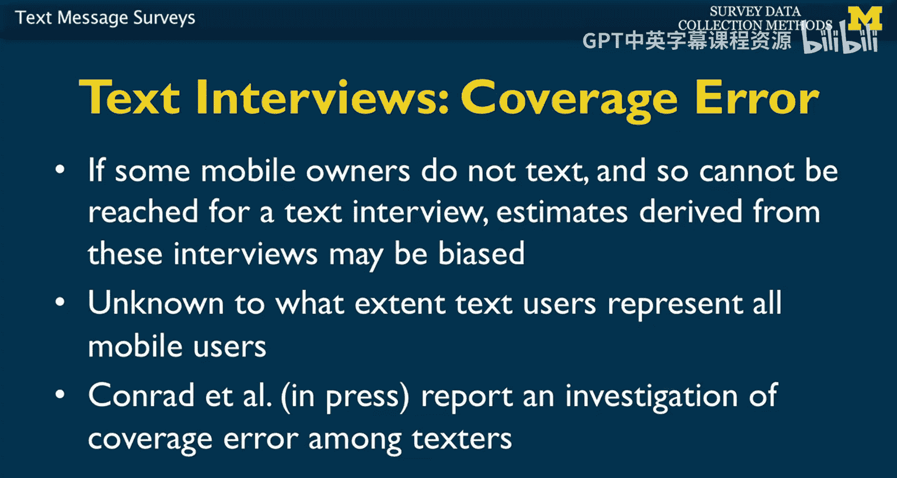

## 短信调查的测量质量

现在，我们转向对短信调查测量质量的讨论，重点介绍一项比较短信和语音数据收集的实验室实验。

（*注：原讲义此处未提供实验的具体细节和结论，因此本教程在此处结束对短信调查核心概念的介绍。*）

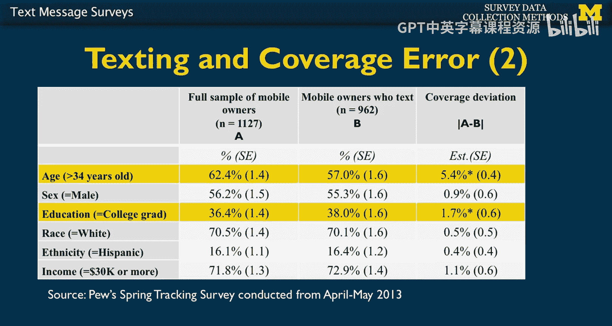

---

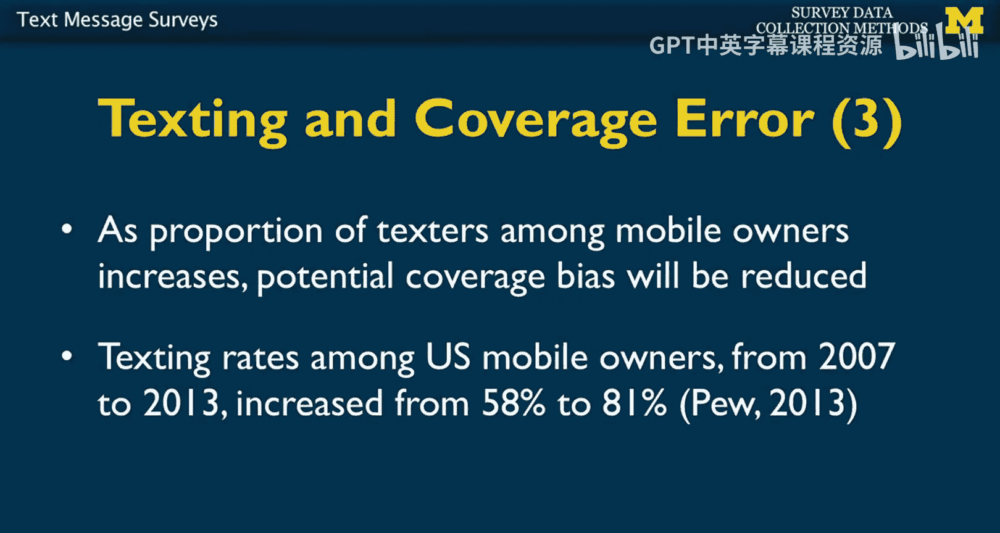

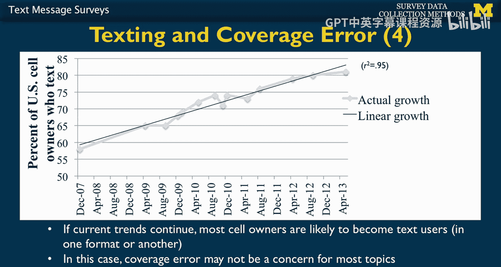

本节课中，我们一起学习了短信调查作为一种数据收集模式的基本概念。我们了解了短信的定义和特征，对比了其与语音通信在同步性、持久性、非语言线索和多任务处理等方面的关键区别。我们还探讨了短信调查可能存在的覆盖误差，即发短信者与非发短信者在人口统计学特征上的差异，并注意到这种差异随着短信普及正在缩小。这些知识为我们评估和设计短信调查提供了重要的基础框架。