#  034：文本与语音访谈对比 📱🎤

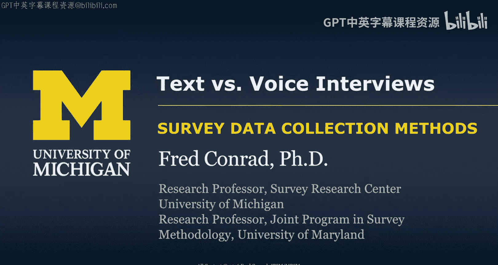

在本节中，我们将探讨文本（短信）作为一种访谈和数据收集模式，并与传统的语音访谈进行对比。我们将重点关注一项关键研究，该研究比较了这两种模式在响应率、数据质量和效率等方面的表现。

---

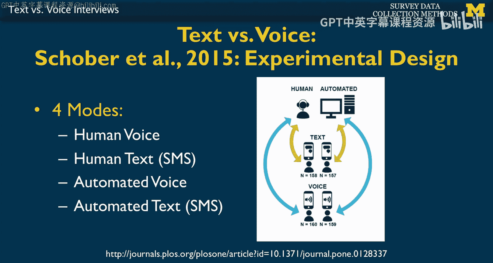

## 概述

上一节我们介绍了移动数据收集的背景。本节中，我们将深入探讨文本（SMS）访谈模式，并将其与语音访谈进行系统比较。我们将基于一项实证研究，分析两种模式在多个维度的优劣。

---

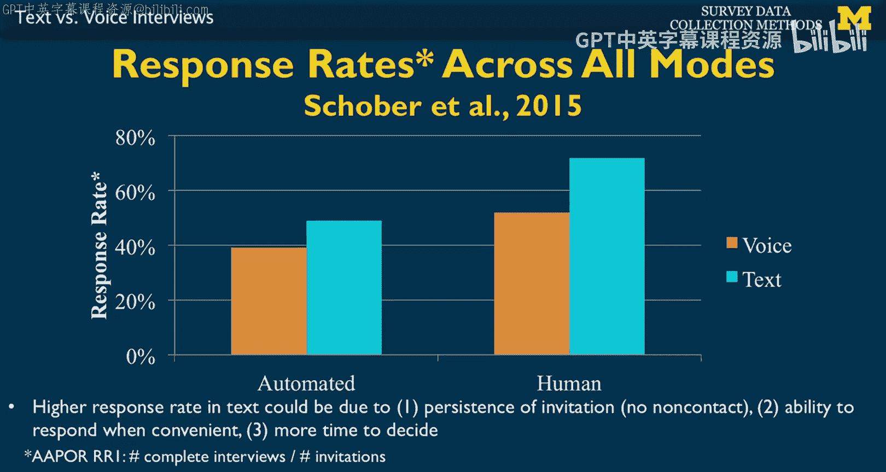

## 研究背景与方法

有一项由 Schchoer 等人进行的研究，在文献中直接比较了文本与语音访谈。该研究实际上考察了四种数据收集模式：
*   两种涉及语音。
*   两种涉及短信（SMS）。

以下是四种具体模式：
1.  **人工语音访谈**：由真人访员通过电话进行。
2.  **自动语音访谈**：由自动化系统播报问题并识别语音答案。
3.  **人工文本访谈**：由真人访员通过短信发送问题，受访者通过短信回复答案。
4.  **自动文本访谈**：由自动化系统通过短信发送问题并接收文本答案。

在该研究中，所有参与者均使用 iPhone，确保了设备平台的一致性。参与者通过网络渠道招募并经过筛选，他们知道自己将参与研究，但不知道具体会通过哪种模式进行访谈。

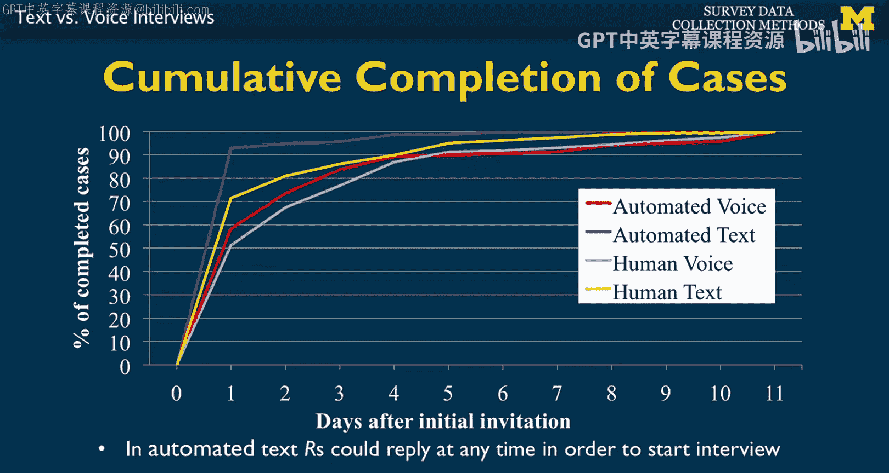

---

## 响应率与完成速度

尽管参与者是经过筛选的，总体响应率已经较高，但数据显示，**文本模式的响应率显著且稳定地高于语音模式**。

以下是可能的原因：
*   **信息的持久性**：短信邀请会保留在手机上，调查组织可以确信信息已送达，几乎没有“未接触”的情况。
*   **参与的便利性**：文本模式允许受访者在方便时回复，而语音访谈通常要求即时参与，可能不够便利。
*   **决策时间更充裕**：收到文本邀请后，样本成员有更多时间考虑是否参与，不像语音访谈那样被“当场要求”做决定。

关于完成速度，研究结果同样明显。下图展示了在发出邀请后一天内完成的访谈比例：
*   **自动文本模式**：超过 **90%** 的访谈在一天内完成。
*   **人工文本模式**：超过 **70%** 的访谈在一天内完成。
*   **两种语音模式**：分别只有约 **60%** 和 **50%** 的案例在一天内完成。

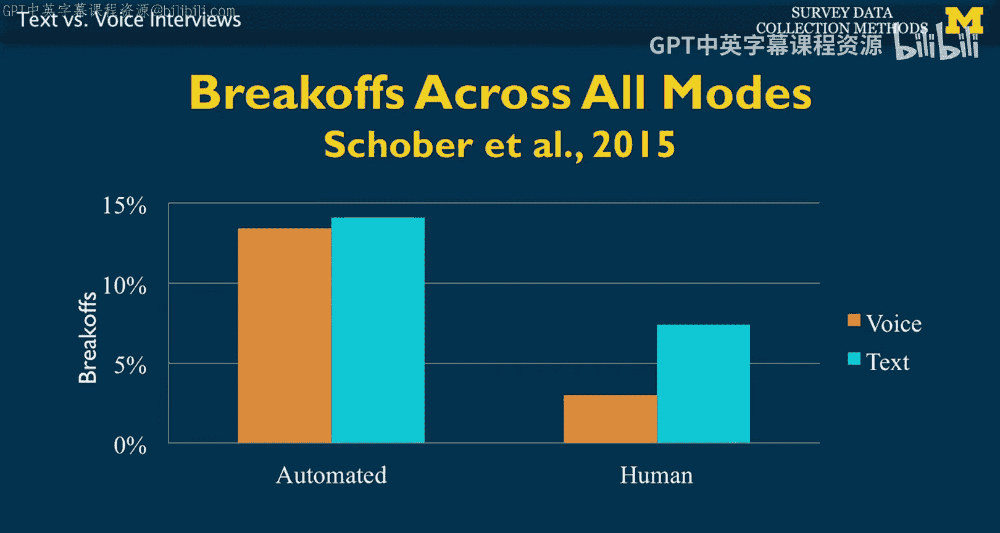

这表明，**文本访谈的样本完成速度远快于语音访谈**。

---

## 中断率

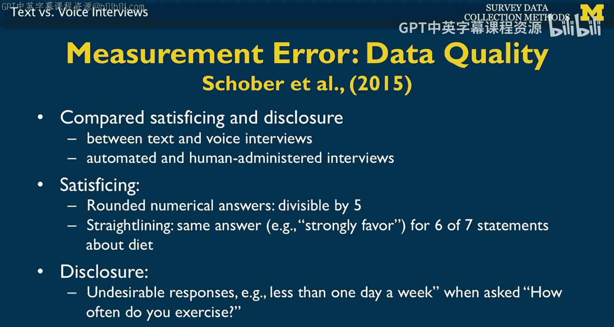

尽管文本模式的响应率更高、完成更快，但其**中断率也高于语音模式**。中断指的是在调查期结束时，案例未能完成。

中断率较高的可能原因包括：
*   **社交临场感较低**：文本交流缺乏语音，受访者感知不到交流另一端的“代理人”，可能更随意地停止回答。
*   **异步特性**：受访者无需立即回复，这种缺乏时间压力的状态可能导致他们无限期拖延，实质上等同于中断。
*   **缺乏人工引导**：特别是在自动模式中，没有真人访员来维持受访者的参与度和连接感。

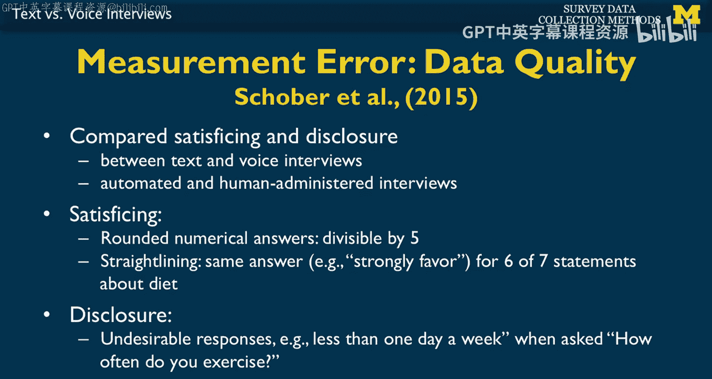

此外，研究还发现：
*   自动模式的中断率高于人工模式。
*   文本模式的中断率高于语音模式。
*   中断的受访者与完成问卷的受访者在人口统计学特征上没有显著差异（除女性中断率略高外），这表明中断不太可能引入人口结构偏差。

---

## 数据质量测量

在同一研究中，作者比较了文本和语音模式在数据质量上的几个指标：

**1. 敷衍作答**
研究者使用了两种衡量敷衍作答的方法：
*   **取整数值答案的频率**：对于需要数字答案的问题，回答值能被5整除（如100、95）被视为一种“心理捷径”，可能意味着答案不够精确。公式可表示为：`答案 % 5 == 0`。
*   **直线式作答**：受访者对一系列使用相同量表（如从“强烈赞成”到“强烈反对”）的问题，全部给出相同的答案。研究中，对7个问题中的6个给出相同答案即被视为直线式作答。

**2. 敏感信息披露**
通过统计“不良回答”的频率来衡量。例如，当被问及“你多久锻炼一次？”时，回答“少于一天”被视为不良回答。在某一模式下此类回答更多，可能表明受访者更坦诚，数据质量更高。

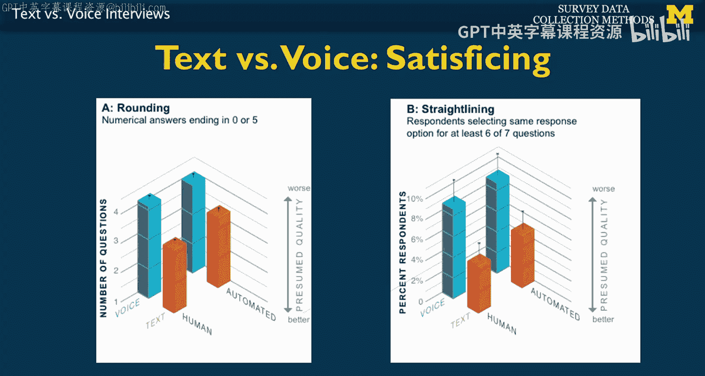

---

## 数据质量结果

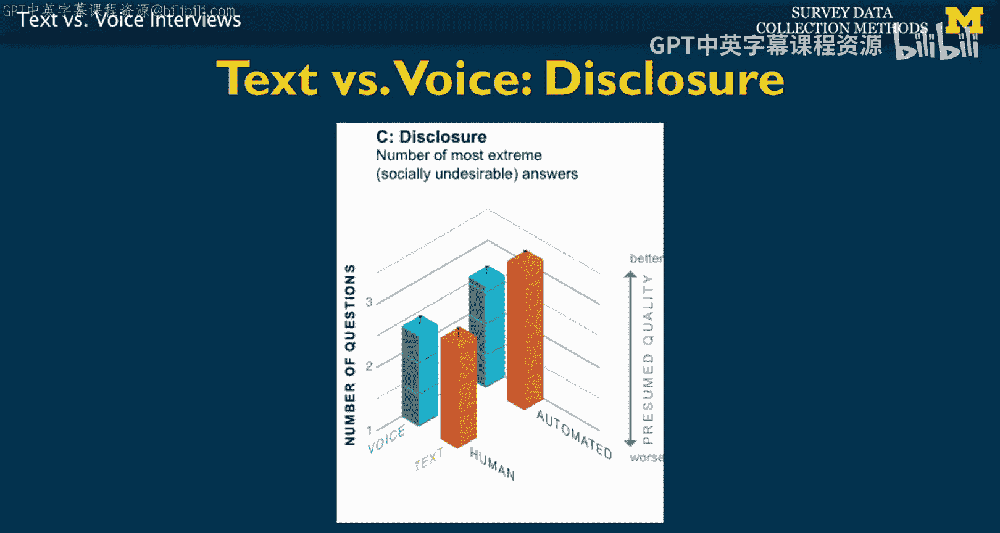

那么，实际结果如何呢？

首先看敷衍作答：
*   文本模式下的敷衍作答**少于**语音模式。
*   具体表现为：文本回答中结尾为0或5的取整数值更少，直线式作答的比例也更低。
*   这表明，**文本模式产生了更高质量的数据**。

关于敏感信息披露：
*   文本模式下的披露**多于**语音模式。
*   同时，自动模式下的披露也多于人工模式，这与计算机辅助自填访谈的优势类似，因为缺乏访员在场可能减少对坦诚回答的抑制。

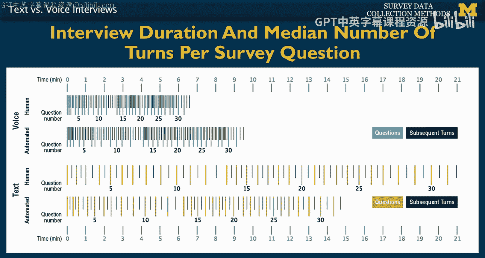

综上所述，**文本访谈在减少敷衍作答和增加敏感信息披露方面都表现更好**，这对其作为访谈模式是积极的信号。

---

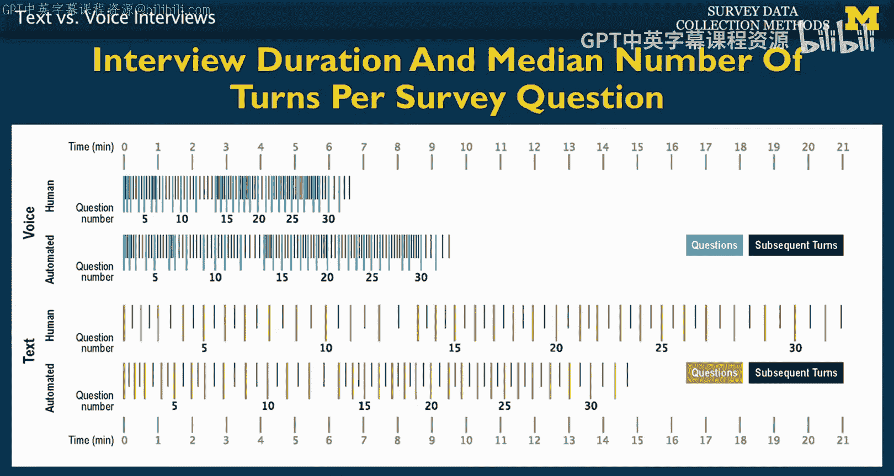

## 访谈效率与特性

在评估文本访谈模式时，还需考虑其一些特性：

**1. 访谈耗时更长**
文本访谈的总耗时通常比语音访谈长。这是因为文本交流是异步的，受访者可能在问题之间花费更多时间思考，从而导致了更高质量的答案，但也拉长了整体进程。

**2. 交互模式不同**
*   **文本访谈**：模式通常是严格的“问答-问答”形式，效率高，交互简洁。
*   **语音访谈**：包含更多非答案性的言语互动和对话轮次，虽然总时长可能更短，但效率相对较低。

---

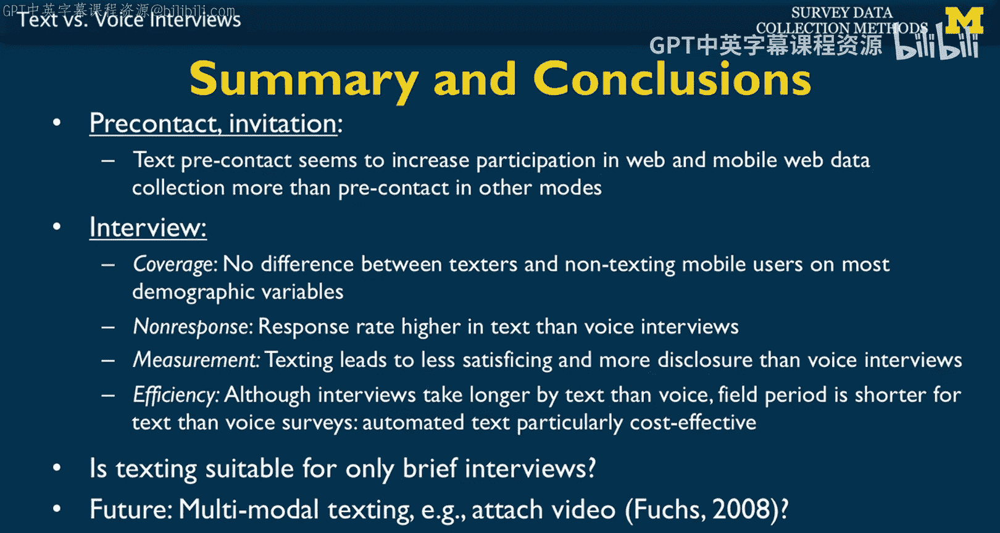

## 总结与展望

本节课中，我们一起学习了文本作为访谈和接触模式的优缺点。

**主要结论总结如下：**

1.  **覆盖误差**：文本模式的覆盖误差很小，仅存在年龄和教育程度的轻微差异，且随着手机用户和短信使用者的增长，这些差异未来可能消失。
2.  **无应答**：文本模式的响应率高于语音，但中断率也更高。
3.  **测量质量**：多项指标表明，文本模式的数据质量高于语音访谈，包括更少的敷衍作答和更多的敏感信息披露。
4.  **效率**：虽然单个文本访谈耗时更长，但调查周期更短，样本完成速度更快，尤其是自动文本模式。

**关于文本访谈的思考：**
*   **适用性**：它是否只适合简短的访谈？在研究情境下，参与者有补偿且经过筛选，但普通受访者能否忍受冗长的文本访谈？另一方面，由于其便利性，他们可能比我们想象的更能接受较多问题。
*   **未来发展**：文本访谈模式如何演变？例如，现在可以轻松在短信中附加多种媒体（如图片、视频），或使用语音转文本功能。有人曾提议在接触阶段附加真人访员的邀请视频。文本作为调查模式的未来充满可能性，初步证据显示其前景广阔。

本节对移动数据收集（包括移动网络和短信）的讨论到此结束。在接下来的最终主题中，我们将探讨不依赖于自我报告（如回答调查问题）的替代数据来源，例如行政记录或社交媒体数据。