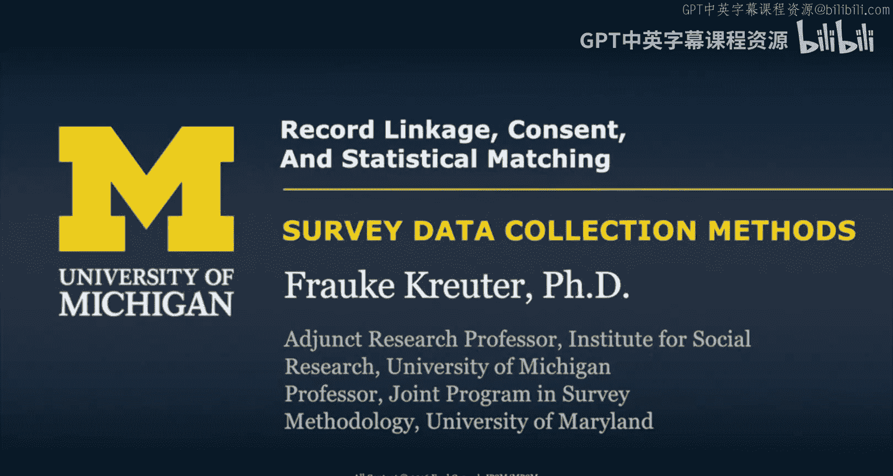
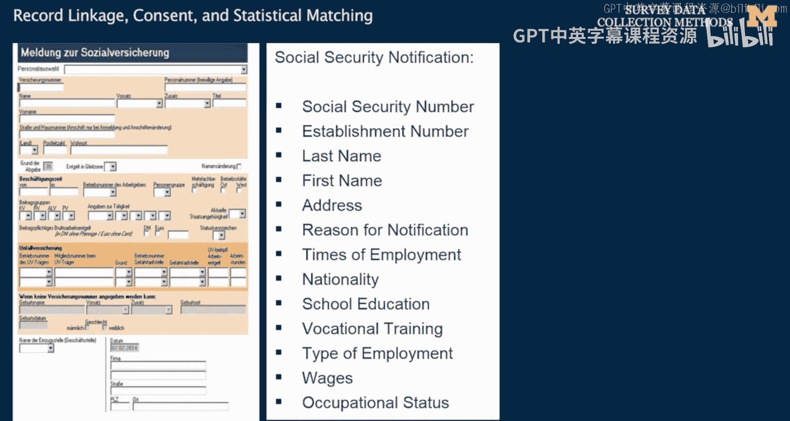
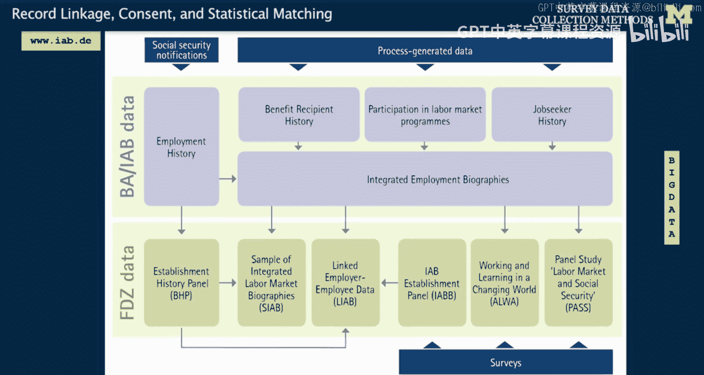
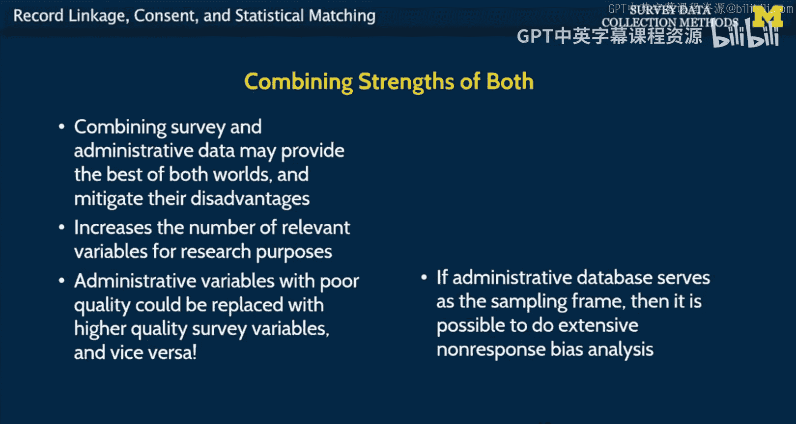

#  035：记录链接统计问题

## 概述
在本节课程中，我们将学习记录链接与统计匹配。我们将探讨为何需要链接不同数据源，并重点介绍行政数据与调查数据的区别、各自的优缺点，以及将它们结合使用的价值。

---

大家好，我是弗罗卡·克罗塔。我是马里兰大学的教授，同时也隶属于密歇根大学。我将为大家讲解关于记录链接同意和统计匹配的内容。

本节材料部分借鉴了德国联邦银行的斯蒂芬·宾达、就业研究所的曼弗雷德·安东尼和亚历山德拉·施默，以及曾在该所、现就职于曼彻斯特大学的乔·萨卡的研究。德国及许多欧洲国家，尤其是北欧国家，在记录链接领域投入很深，因此有很多研究成果可以分享。

本段内容将首先介绍我们试图链接什么以及为什么链接。具体来说，第一部分将涉及行政数据与调查数据的差异，并讨论其优缺点。下一部分将介绍链接技术，并讨论知情同意，这对许多链接工作至关重要。

---

## 为何不只用调查数据？
既然在收集数据，为何要考虑使用其他数据源？调查数据的优势在于，它们是专门为你的研究目的设计的，并且经过了本专项课程中介绍的整体调查误差框架的严格审查。

调查数据在获取关于行为、态度等的主观信息方面尤其具有优势，目前在这方面没有太多替代方案。然而，对于行为的客观信息（例如追踪某人的运动情况），情况则不同。这已经揭示了调查数据的一个缺点：受访者往往难以准确报告过去发生的事情，难以记住某些行为。这些记忆和回忆误差将在问卷设计课程中详细讨论。

调查数据的另一个缺点可能是无应答，这在本课程中已详细讨论过。无应答可能发生在单元层面，也可能发生在项目层面。在固定样本调查中，我们称之为样本损耗。

此外，调查的时长有限，你不可能进行一次六小时的访谈来了解受访者过去发生的所有事情（例如一位年长者的整个劳动力市场历史）。通常，收集额外信息会带来高昂成本。

因此，我们的想法是，如果你简化地考虑不同的数据源（这里只展示了三种：调查数据、实验数据和行政数据），那么就有强烈的动机去思考如何链接这些数据源，以获取最理想的信息量。

---

## 什么是行政数据？
接下来我们讨论行政数据。实验数据想必大家都很熟悉，我们将重点关注行政数据，因为其链接应用已变得非常突出。

**行政数据**是指在执行某些行政目的过程中收集的数据。你可以认为这些数据是由公共和私营部门的政府机构生成的。它们记录了所提供的服务和处理的任何事务。

例如：
*   社会保障记录
*   通过积极劳动力市场计划或福利计划产生的失业记录
*   课堂学生记录
*   税收和收入记录
*   出生和死亡证明信息

所有这些数据之所以能以数字形式获得，仅仅是因为某项服务或其他行政流程已经发生。目前，特别是在美国，也包括其他国家，都在大力推动更多地利用这些数据、获取访问权限，并在需要时将其与调查数据链接。

这是一张社会保障表格的截图，雇主在有人入职时必须填写。当然，这也在考验你的德语水平。你在这里看到的字段包括姓名、地址信息、通知来源、少量教育背景信息，以及明显的就业类型和工资信息。

现在，花点时间看看这些变量，思考一下：如果我管理社会保障计划，哪些变量真正重要？你可能很快会意识到，工资信息以及雇佣期的开始和结束日期对于日后计算你能获得多少养老金或失业保险金非常重要。

稍后我会再回到这部分内容。

---

## 行政数据示例：德国就业研究所
我刚才展示的这些特定行政数据，是德国就业研究所（简称IAB，左上角有其网站信息）收集的更大数据系统的一部分。他们利用所有这些信息（社会保障通知以及其他流程生成的数据）创建了所谓的“综合就业履历”。因此，那里正在进行大量的行政数据源链接工作。

此外，IAB还进行了一系列调查，这两部分都可以链接在一起。所以，如果你想了解更多关于那里可用的大型数据源，或者你从事劳动力市场研究，这可能是一个有趣的资源。

---

## 行政数据的特点
从这个例子转向更一般的讨论，行政数据的主要用途并非研究。这是行政数据与调查数据之间一个非常重要的区别，你应该牢记。

行政数据通常也是为某个总体收集的，但这个总体可能不同于传统的调查总体。例如，如果你获得德国的社会保障通知行政数据，其中就不会包含任何自雇者。假设你从某个医疗服务提供者或健康保险组织获得健康记录，他们将只包含加入该特定组织的人员。或者，通过癌症登记处获得被诊断患有特定疾病的人员信息，这很好，你拥有所有患者的数据，但没有未患病者的数据。

因此，虽然这些是总体数据，并且有其用途，但它可能与你研究问题所需的数据不同。

你应该记住的另一点是，你无法像在调查中那样，向行政数据添加特定的测量指标。在调查中，你可以决定加入或排除某些内容，但对于行政数据则不行。不过，对于它们已有的数据，通常是纵向可用的。

---

## 使用行政数据的优势
使用这些数据的优势在于，获取和使用它们相对容易且成本较低。当然，前期也存在成本（稍后会讨论），但调查数据同样有前期成本。因此，你可以节省数据收集的资源，这也是我们将此内容纳入本课程的原因。

有时，特别是涉及行为记录时，它们可能比调查数据更准确，并且减少了记忆问题和社会期望偏差（这在问卷设计课程中讨论过）。如前所述，长期信息可能是可用的。

另一个优点是，它们通常包含非常大的样本量，这在调查中实现成本会过高。正因为如此，你可以深入研究到感兴趣的人口子集，这确实可以增强你所做研究的深度。

如果幸运的话，这些数据库会定期更新，有时甚至是持续更新，并且有质量控制检查，因为这是管理特定计划所必需的。

同样，对于计划所关注的人群，覆盖率接近100%，但当然不一定符合你的研究问题需求，正如我们之前讨论的。不过，它确实包含了可能不回应调查的个体，因此结合这些数据源有助于缓解无应答问题。

---

## 使用行政数据的劣势
使用行政数据的劣势在于，它们通常不足以回答所有的研究问题。概念可能不同，参考日期可能不同，并且你无法控制其中的所有内容，因此可能需要额外信息，这也是我们主张链接数据源的原因。

此外，这些数据本身并非完美。它们在非计划相关变量上的质量可能很差。回想一下几分钟前我说过，收入和失业信息的开始日期可能相当准确。但是，例如在德国社会保障记录中，教育变量就不是很准确，它们没有更新，与计划无关。

此外，变量定义可能随时间变化。例如，某些疾病的定义或职业分类的代码可能会改变。由于关于数据收集过程的背景元数据和描述通常有限，你可能知道也可能不知道这些变化。

再加上数据规模大、处理成本高（稍后会讨论），以及严格的数据保护法律通常要求获得受访者的知情同意，使用这些数据并非没有挑战。特别是最后两点，我们将在接下来的两节中详细介绍，以便你更多地了解计划使用此类数据时可能面临的情况。

---

## 结合两种数据源的优势
让我以倡导结合两种数据源的优势来结束本节。

结合调查数据和行政数据可以为你提供两全其美的方案。你拥有调查数据在定义总体和变量方面的优势，同时在另一边，你拥有通常更准确、更精细的测量信息，覆盖了无应答者和更广泛的总体。

你可以根据你认为哪个数据源的变量质量更高来分别利用它们。当然，你还可以利用整个数据集进行方法论研究，以检验一个或另一个数据源中的弱点。

---

## 总结
本节课我们一起学习了记录链接的基本概念。我们探讨了为何需要超越单一的调查数据，引入了行政数据作为重要的补充数据源。我们详细比较了调查数据与行政数据在目的、总体、内容控制、准确性、成本和覆盖范围等方面的优缺点。最后，我们强调了将两者结合使用可以取长补短，为研究提供更丰富、更准确的信息基础，并可用于方法学检验。在接下来的章节中，我们将深入探讨具体的链接技术和关键的知情同意问题。