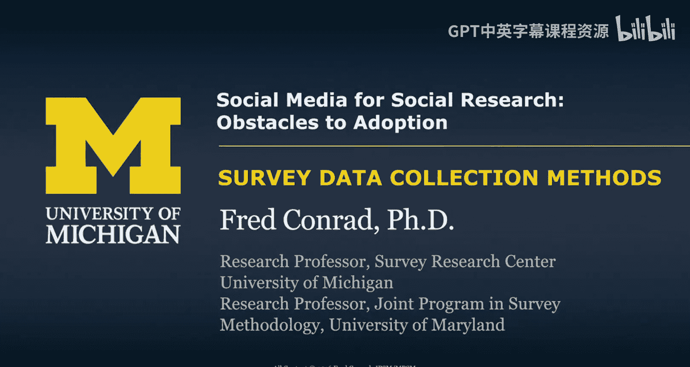
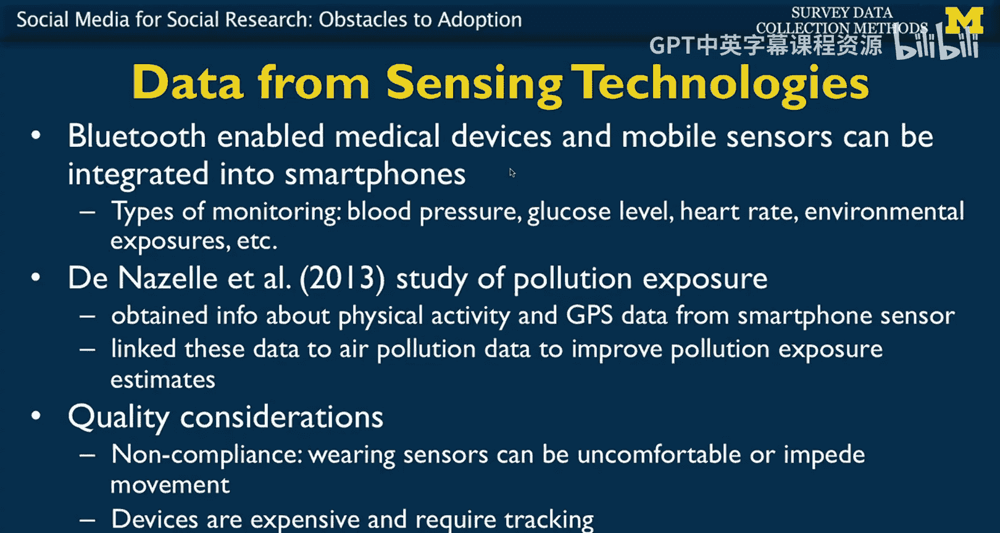
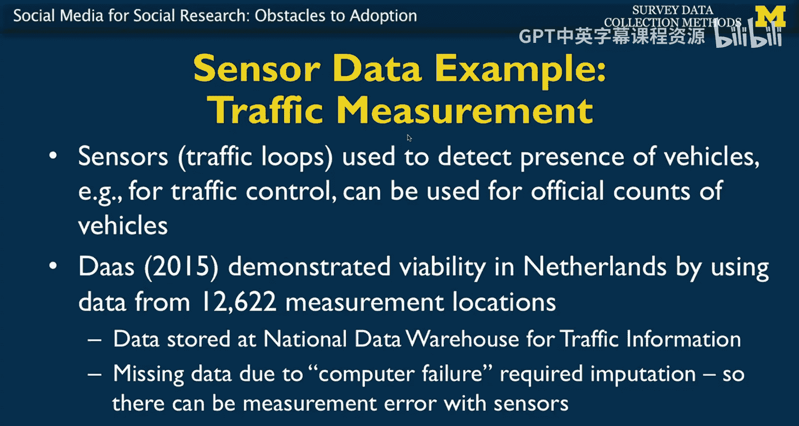
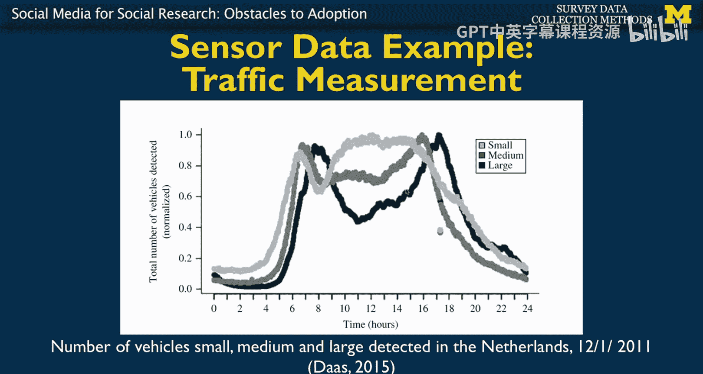
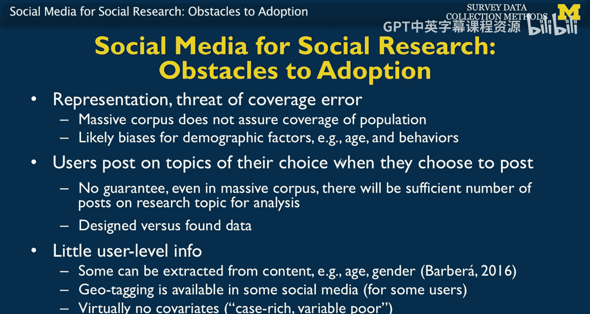
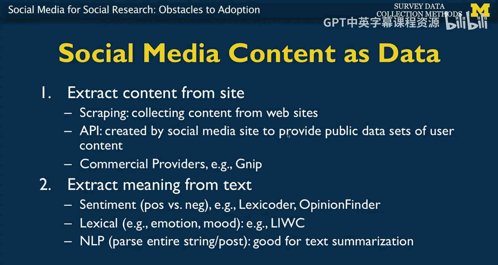

#  038：大数据传感技术的应用：社交媒体数据 📊

在本节课中，我们将探讨传统调查数据之外的替代数据源，特别是“大数据”中的传感数据和社交媒体数据。我们将了解它们的潜在用途、面临的挑战以及实际应用案例。

上一节我们介绍了行政数据作为调查数据的替代方案。本节中，我们将目光转向更广泛的“大数据”领域，特别是传感数据和社交媒体数据。

## 什么是大数据及其用途？ 🤔

根据美国民意研究协会（APOR）大数据工作组的报告，大数据具有一些潜在用途，但也存在不推荐的应用场景。APOR支持将大数据用于**获取定性洞察**和**监测随时间变化的趋势**，但不建议将其用于**精确的定量估计**。然而，现实中已有尝试将传感数据和社交媒体数据用于定量估计，我们将审视这些尝试的成功程度。

## 传感数据的应用 🚗

传感数据，特别是来自移动设备的被动收集数据，为研究提供了新途径。用户无需主动操作，设备便能自动收集信息。

以下是传感数据的一些应用实例：
*   **健康与环境监测**：集成蓝牙的医疗设备可以测量心率和活动量，智能手机的GPS数据可用于研究污染暴露情况，从而改进测量。
*   **交通使用调查**：荷兰统计局（Statistics Netherlands）的Pete Doos进行了一项演示，利用全国超过12,000个交通感应线圈（用于交通控制，如感知车辆以改变信号灯）收集的数据，替代传统的车辆使用调查。

然而，使用传感数据也面临质量挑战：
*   **依从性问题**：如果要求被调查者佩戴传感器，可能造成不适、影响其行为，从而导致测量误差，或者他们可能直接不配合。
*   **设备成本与追踪**：设备可能昂贵，且需要持续追踪。
*   **数据缺失与测量误差**：即使自动传感也存在数据缺失和测量误差。在上述交通研究中，研究者使用了**插补法**来处理缺失数据。

尽管存在挑战，传感数据在替代特定调查问题方面前景广阔。**成功替代的关键在于，调查问题与传感数据产出的一两个变量之间必须有紧密的对应关系**。缺乏这种对应关系，传感数据替代现有调查数据的能力就会受到限制。

## 社交媒体数据作为替代数据源 💬

接下来，我们讨论另一种替代数据源：社交媒体数据。它与传感数据截然不同，本质上是用户的**自我报告数据**，是用户自愿发布的关于自身、观点或他人可能感兴趣的内容的文字信息。

考虑将社交媒体数据用于测量目的，是基于这样一个事实：约四分之三的美国人口以及更高比例的其他国家人口正在使用社交媒体，且这一比例可能仍在增长。

### 社交媒体数据的潜力 ✨

社交媒体数据用于社会测量主要有两个目的：
1.  **实现难以通过调查完成的定量描述**：描绘某些社会现象，这些现象用传统调查方法难以捕捉。
2.  **尝试复制调查结果**：如果可行，用社交媒体数据替代调查中的部分问题，从而以更低成本、更快速度提供准确估计，甚至可能用于官方统计或纵向调查中的某些轮次。

其优势包括：
*   **低成本**：相对于尤其是需要访员的调查数据收集，成本较低。
*   **及时性**：对事件敏感，能实时反映动态（即“即时预测”）。
*   **连续性**：跨海量用户群体，数据流几乎是连续的。
*   **零负担**：数据提供者（社交媒体用户）通常意识不到其数据被用于研究。

### 社交媒体数据面临的障碍 ⚠️

然而，采用社交媒体数据也面临诸多障碍：
*   **缺乏代表性（覆盖误差）**：并非所有人都是社交媒体用户。非用户群体在研究者关注的议题上可能与用户存在差异，导致结果无法代表总体，尤其存在**年龄**等人口统计因素的偏差。
*   **话题自发性**：用户自主选择发布内容和时间。研究者无法保证在庞大的语料库中，有足够多关于特定研究主题的帖子可供分析。这与调查中研究者自主设计问题形成对比，体现了 **“设计型数据”**（如调查）与 **“发现型数据”**（如社交媒体）的重要区别。
*   **用户信息匮乏**：帖子内容本身包含的用户人口学信息（如年龄、性别）很少，需要额外工作来提取或关联。地理标签也并非所有用户都启用。这导致数据**案例丰富但变量贫乏**，缺乏有助于解释变量的协变量信息。
*   **文本分析工具的局限性**：情感分析等工具对代词、否定、隐喻、反讽、俚语等处理不够细致。数据挖掘和机器学习方法通常是**缺乏理论驱动的**，可能导致模型仅在特定时间点的特定语料库上有效，缺乏随时间推移的稳定性。
*   **虚假相关性**：在庞大的数据集中，许多事物之间或与外部事件之间很可能出现高相关性，但其中很多可能是虚假的，缺乏理论依据。

尽管存在诸多顾虑，社交媒体数据仍具有巨大潜力。目前研究界尚未完全确定其适用场景，但探索兴趣浓厚。

## 如何使用社交媒体数据？ 🔧

使用社交媒体数据通常涉及两个高层步骤：
1.  **从网站提取内容**：通过爬取公开网页、使用应用程序编程接口（API）或从商业数据提供商处购买等方式获取帖子文本数据。
2.  **从文本中提取意义**：将庞大的数据集转化为可量化的信息。常用方法包括：
    *   **情感分析**：判断帖子中的词语是积极还是消极，并与**词典**比对进行分类计数。
    *   **更丰富的语义分析工具**：例如LIWC（语言查询与词频统计）工具，它包含多个词语类别（如情绪、认知过程），能进行更细致的分类。
    *   **完整的自然语言处理（NLP）工具**：解析整个帖子字符串并赋予解释，更能处理否定、反讽等复杂语义，适用于文本摘要。

## 总结 📝

本节课我们一起学习了大数据中两种重要的替代数据源：传感数据和社交媒体数据。我们探讨了传感数据在健康、交通等领域的应用及其质量挑战，并强调了其替代调查需满足变量对应关系。对于社交媒体数据，我们分析了其在社会测量中的潜力（低成本、及时性）和主要障碍（缺乏代表性、话题自发性、信息匮乏、分析工具局限等），并概述了从数据获取到意义提取的基本使用流程。

下一节，我们将通过具体案例，看看社交媒体数据在哪些应用中取得了成功，在哪些尝试中未能复制调查结果，并探讨其原因。