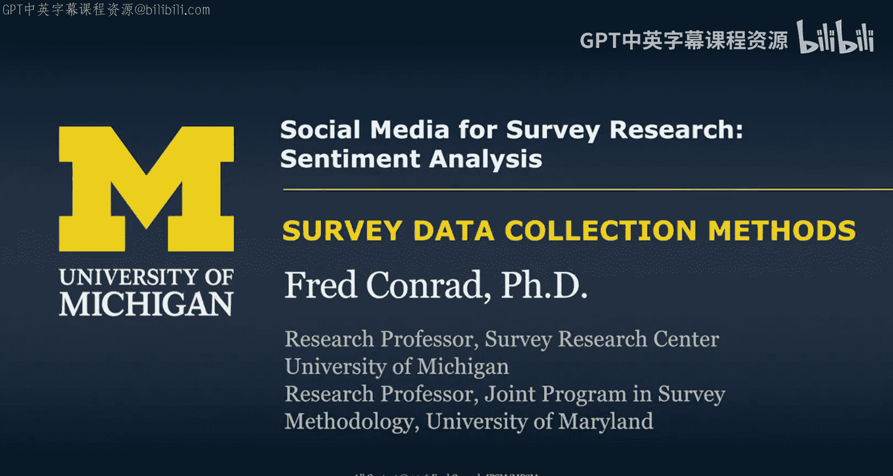
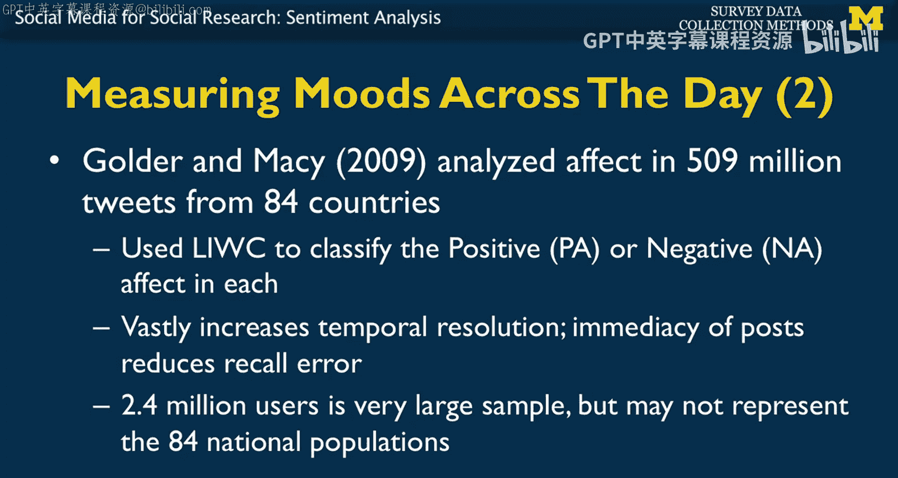
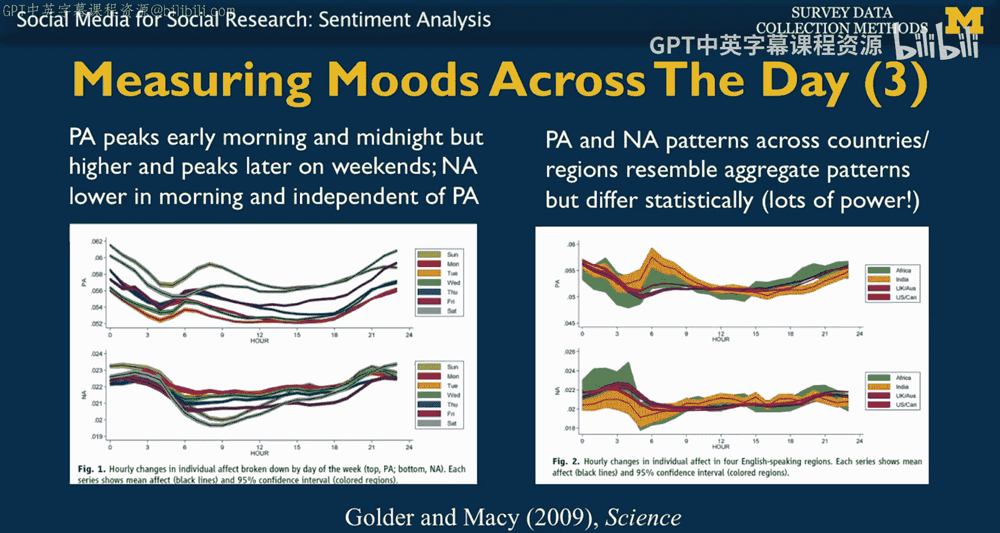
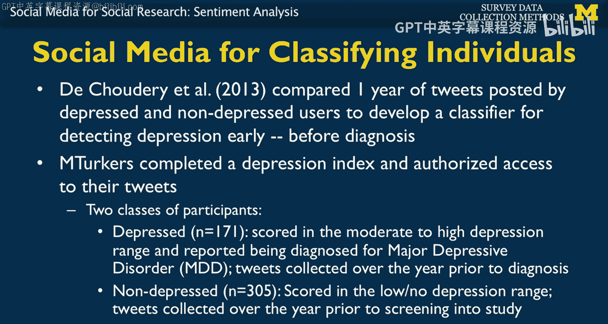
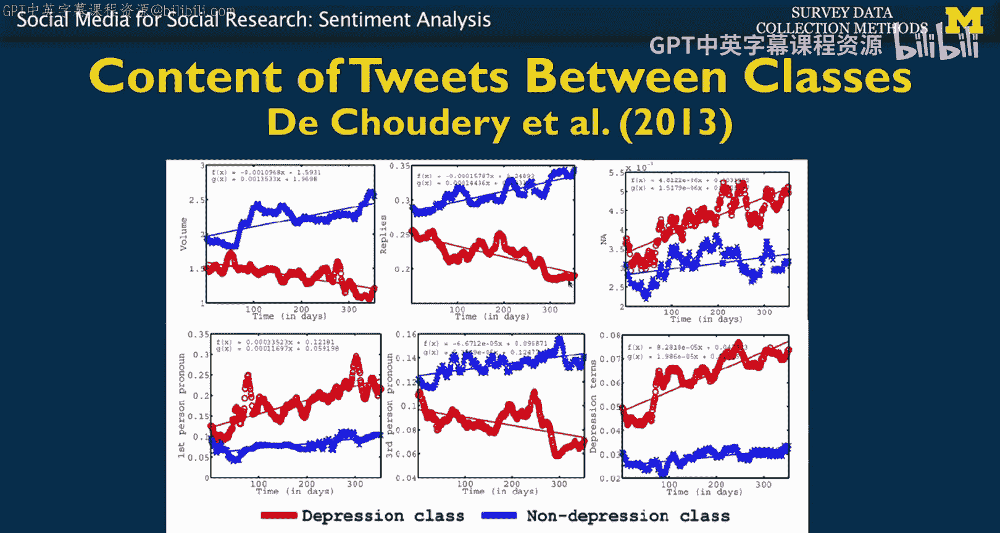
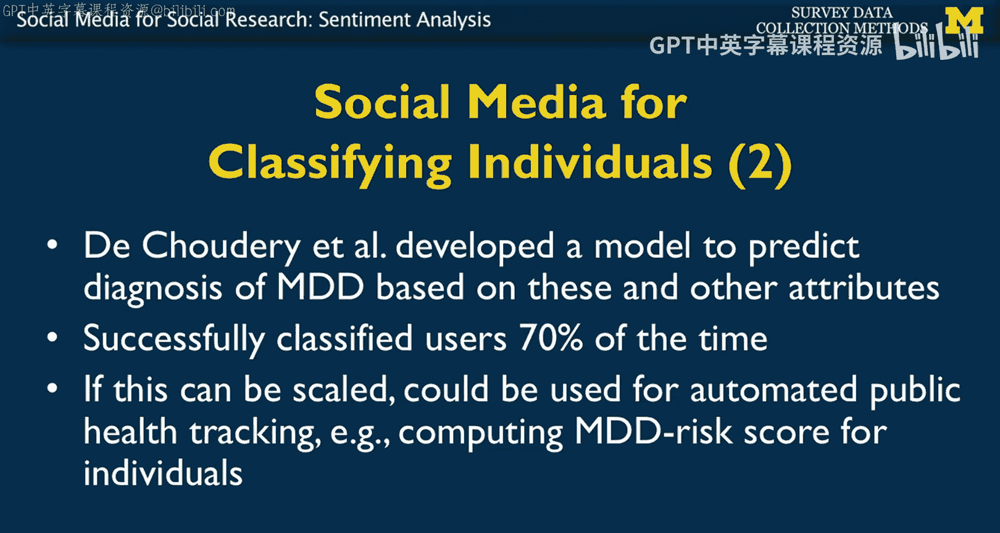

#  039：社交媒体应用：情绪与抑郁测量 📊

在本节课中，我们将探讨如何利用社交媒体数据来完成一些传统问卷调查难以胜任的测量任务。我们将通过两个具体案例——情绪测量与抑郁预测——来了解社交媒体数据在提升测量时效性、连续性以及预测能力方面的潜力。

上一节我们讨论了社交媒体数据作为替代数据源的一般概念，本节中我们来看看它在具体研究问题上的应用。

## 情绪测量：超越回顾性自评

传统上，对情绪或情感的研究多依赖于回顾性自我报告。受访者（通常是大学生）在实验室环境中回忆过去24小时或一周内的情绪。这种方法存在样本局限性（方便样本）、非实时性以及潜在的回忆误差。

针对这些问题，Goldder和Macy于2009年在《科学》杂志上发表了一项研究。他们分析了来自84个国家、总计5.09亿条推文在一天内的情感内容。他们使用LIWC（我们在前面章节提到过的文本分析工具）将每条推文的情感分类为**积极情感**或**消极情感**。

这种方法的优势在于：
*   **极高的时间分辨率**：推文每秒都在产生，使得研究者能够描绘出情绪在全天近乎连续的变化图景。
*   **避免回忆误差**：人们在发布推文的瞬间表达情感，只要推文包含情感内容，它反映的就是当前的情感。

当然，尽管样本量巨大（240万用户），但它可能无法完全代表所有国家或地区的全体人口。关键问题在于：推特用户与非推特用户在一天内的情绪变化模式是否不同？

## 情绪模式的分析结果

他们的分析揭示了情绪在一天内的变化模式。下图展示了积极情感（左上）和消极情感（左下）在一周内不同日子的变化曲线。

分析发现：
*   **积极情感**在午夜时分最高，随着人们入睡而下降，醒来时回升（人们倾向于快乐地醒来），然后在白天逐渐减少，晚上再次回升，到午夜达到最高。周六和周日的积极情感回升时间点右移，表明人们睡得更晚，但醒来时依然快乐。
*   **消极情感**呈现互补但独立的模式，在周末普遍较低。在工作日醒来后，消极情感会有所上升。

当按世界不同地区（如非洲、印度、英国、澳大利亚、美国、加拿大）划分时（右图），情绪变化的基本模式保持一致。这些发现具有表面效度，且是传统问卷调查难以在如此大规模、细粒度（按星期和地区划分）下实现的。

## 社交媒体在抑郁预测中的应用

另一个案例来自De Choowy及其同事的研究，他们利用推特数据来区分用户是否患有抑郁症。

以下是他们的研究方法：
1.  他们通过亚马逊 Mechanical Turk 平台招募参与者。
2.  参与者完成一份生成**抑郁指数**的问卷，并授权研究者访问其推特数据。
3.  根据抑郁指数分数和是否报告有**重度抑郁障碍**的临床诊断，将参与者分为“抑郁”组和“非抑郁”组。
4.  收集两组用户在诊断前（抑郁组）或研究筛选前（非抑郁组）一年的推文。

通过比较，他们发现了两组用户在推特内容上的显著差异模式：

以下是几个关键的比较维度：
*   **推文数量**：非抑郁组的推文量更高且随时间增加；抑郁组的推文量更低且在诊断前一年内持续减少。
*   **互动行为**（如回复推文）：非抑郁组的互动量更高且增加；抑郁组的互动量更低且减少，表明其与他人互动减少。
*   **消极情感**：抑郁组推文中的消极情感内容起点更高，并在一年内持续增加。
*   **第一人称单数使用频率**（如“我”）：抑郁组的使用频率更高且差异随时间扩大，这可能表明其更关注自我。
*   **第三人称代词使用频率**：抑郁组的使用频率更低且持续下降，进一步支持其与他人互动减少的结论。
*   **抑郁相关词汇**：抑郁组推文中包含抑郁相关术语的频率更高，且随时间增加。

## 构建预测模型

基于从推特中提取的这些特征变量，研究者构建了一个统计模型来预测MDD诊断。该模型能够以**70%** 的准确率对参与者进行分类，这是一个相当不错的成功率。

因此，研究者得出结论：如果这种方法能够适当扩展规模，或可用于自动化公共卫生抑郁追踪，例如为推特用户计算**MDD风险评分**，这具有潜在的应用价值。

本节课中我们一起学习了如何利用社交媒体数据执行情绪测量和抑郁预测这两项传统调查方法面临挑战的任务。社交媒体数据提供了更高的时效性、连续性和预测潜力。然而，我们也必须考虑其样本代表性问题。

在下一节中，我们将转向探讨社交媒体数据在那些问卷调查本身已很擅长的任务中的应用，核心问题是：我们能否有效地用这些替代数据源替代或补充调查数据。