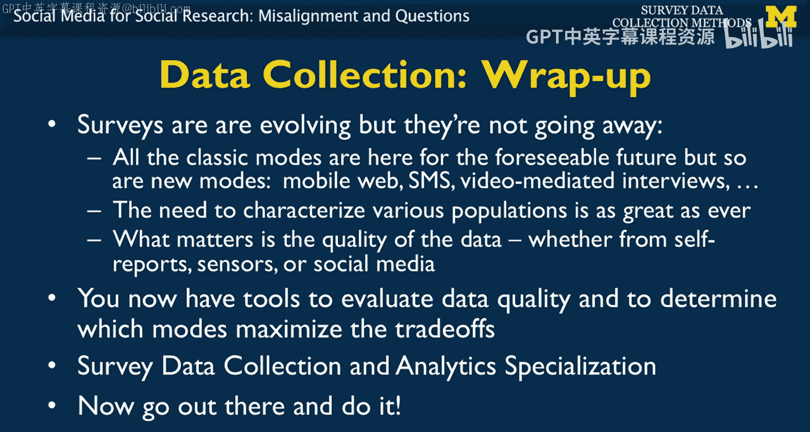

#  041：社交媒体数据与调查数据的协同与分歧 📊

在本节课中，我们将探讨利用社交媒体数据来复制或替代传统调查数据的研究尝试。我们将分析此类尝试有时成功、有时失败的原因，并讨论影响两者数据一致性的关键因素。

在上一节中，我们介绍了一些成功利用社交媒体内容复制调查数据的案例。本节中，我们来看看一些不那么成功的尝试，并深入探讨为何社交媒体数据与调查数据有时能保持一致，有时却不能。

## 不一致的研究案例

以下是几个未能成功复制调查结果的社交媒体研究案例。

*   **奥康纳研究的局限性**：奥康纳发现，包含“工作”一词的推文数据与盖洛普调查数据有较高的相关性。然而，推文数据与密歇根消费者信心指数的相关性则较低。因此，奥康纳本人也认为其论文结果是混合的。
*   **容哈尔的重新分析**：容哈尔及其同事重新分析了塔姆扬等人曾用于成功预测德国大选结果的推文集。他们将被塔姆扬团队剔除的、提及小型政党“海盗党”的推文重新纳入分析。结果，基于推特内容预测选举结果的能力被大幅削弱。这表明最初的发现相当脆弱。
*   **文件抽屉问题**：一个更可能存在的普遍问题是“文件抽屉问题”或发表偏倚。即只有成功的研究（无论是针对此特定问题还是广义的科学）被发表，而那些未产生显著结果的“不成功”研究则不被发表。我们可能永远不知道后者，而它们的数量可能远超已发表的成功研究。在利用社交媒体内容复制调查数据这一领域，情况很可能就是如此。
*   **时间局限性**：发表偏倚的一种变体是，社交媒体内容与调查数据可能在某一时间段内高度一致，这个“成功故事”得以传播；但到了下一时间段，这种关系可能瓦解或减弱，而我们可能永远无从知晓。

因此，评估社交媒体数据能在多大程度上用于传统调查的用途，是一件有些棘手的事情。

## 数据不一致的可能原因

那么，为何社交媒体内容有时与调查结果一致，有时又不一致呢？以下是几种可能性。

*   **用户代表性差异的抵消**：尽管社交媒体用户群体与总体人口必然存在差异（存在覆盖不足），但用户所发帖文中的情绪和经历，可能与总体人口中的情绪和经历成比例。因此，即使发推的是不同类型的人，他们谈论的经历也可能与普通大众相似。当数据一致时，情况必然如此。
*   **社交媒体的“社交”属性**：社交媒体本质上是社交性的。用户发帖时，不一定只是为了表达自我，也可能是为了他人。他们会发布认为他人感兴趣、可能被转发或点赞的内容，并且可能提炼出他们在环境中察觉到的更广泛对话。从这个意义上说，我们在社交媒体上看到的特征可能与调查中看到的相似。
*   **内容提取工具的差异**：用于从社交媒体提取内容的特定工具可能影响结果。例如，使用两种不同的情感分析工具可能得出不同结果；或者一项研究使用情感分析工具，另一项使用我们讨论过的LDA等语义分析工具，这也可能导致不同结果。同样，所使用的特定机器学习算法的细微差别也可能导致不同结果。研究及其复现之间的许多变量都可能影响这两种数据源讲述相同故事的程度。
*   **调查问题类型的差异**：在这些研究中，我们试图与社交媒体数据匹配的特定调查问题本身可能造成重大差异。例如，有些调查问题询问受访者自身情况，有些则询问关于更大群体（如国家整体）的看法。这种区别可能很重要，因为某一类问题可能比另一类更类似于产生社交媒体帖子的过程。调查问题之间可能还存在许多其他区别。

## 问题类型的影响：个体 vs. 集体

让我们具体探讨询问个体（受访者自身）和询问集体（更大群体）的问题之间的区别。以下是来自消费者信心指数的两个真实问题示例：

*   **关于个体的问题**：“展望未来，你认为从现在起一年后，你和你的家庭在经济上会比现在更好、更差，还是差不多？” **公式/代码表示**：`Survey_Question_Self = "你和你的家庭未来经济状况"`
*   **关于集体的问题**：“那么对于国家整体的经济状况，你认为未来12个月内，我们会经历经济上的好时期、坏时期，还是其他？” **公式/代码表示**：`Survey_Question_Collective = "国家整体未来经济状况"`

那么，寻求社交媒体数据（特别是推特）与上述每类问题的一致性，可能会产生什么后果呢？

下图提供了2008年至2011年底期间的一些启示。黑线代表推特情感比率（使用名为Lexxipro的情感分析工具处理包含“工作”一词的推文）。红线代表来自上述**个体问题**的调查数据情感。蓝线代表来自上述**集体问题**的调查数据情感。

总体而言，推特内容与**集体问题**之间的相关性，是推特内容与**个体问题**之间相关性的两倍多。这表明，在研究这种数据一致性时，调查问题的类型可能很重要。

然而，这里存在一个问题：在上述四年整体数据中，集体问题的优势是明显的，但如果我们观察单个月份或其他更小的时间段，并非在所有时间段都能看到这种关系。实际上，在逐月观察时，集体问题相对于个体问题的优势仅在约一半的月份中显现。

这意味着，如果我们考虑用社交媒体数据替代例如每月一次的调查，鉴于这些数据和问题，这可能不是一个好主意。

## 未解之谜与未来方向

关于如何用社交媒体内容替代调查，仍存在许多未解之谜。我们讨论过社交媒体在其他方面补充调查数据或在难以进行调查的场景中的应用。但对于“复制调查结果”这一目的，我们确实需要知道何时能找到一致性、何时不能。我们在此提出了一些可能的解释，但这仍是非常初步和提示性的。

我们还需要知道在何种**时间分辨率**（年度、月度、周度）上存在一致性。因为在刚才的例子中，在四年期存在一致性，但在月度增量上则不然。那么，我们可以依赖哪种时间周期来确保这种一致性呢？

谈到可靠性，我们何时需要以调查数据为基准来校准社交媒体趋势，何时社交媒体数据可以独立使用？目前，我们总是将调查数据作为“黄金标准”，或者仍然需要某种黄金标准来评估社交媒体内容。当社交媒体内容有充分的理论基础，或者我们对它的解释有充分的理论依据，以至于我们可以不参照黄金标准就相信数据时，我们才能更好地将其纳入目前使用调查进行的各种估计过程中。

## 课程总结与展望 🎓

本节课是我们关于移动数据收集与替代模式的最后一节，也是我们整个课程的结束。

有一点应该显而易见，但我想强调：随着这些替代模式的兴起，**调查并不会消失**。它们正在演变，但对调查的需求一如既往地强烈。我们在第一课中讨论的所有经典模式仍在广泛使用，并在可预见的未来将继续存在。新的模式，如移动网络、短信、视频介导访谈等，也是如此。

这是因为，描述各种人群特征的需求从未如此巨大，而且还在增长。十年前，我们还没有从移动设备应用上收集调查数据。但随着社会变化，我们持续需要监测人们的经历和态度。

没有这类信息，我们作为一个社会就无法做出好的决策。随着我们自身的变化，我们需要调整测量过程以适应这些变化。真正重要的是**数据质量**，无论它来自调查中的自我报告，还是来自传感器或社交媒体。

现在，你们已经掌握了评估数据质量、并确定哪种数据收集模式能最大化权衡利弊的工具。

但我鼓励你们通过学习调查数据收集与分析专项课程的其他部分，来补充这些技能和工具。这些技能组合在一起将形成一个宝贵的工具箱，使你们能够真正解决社会研究中的诸多问题。

因此，我敦促你们走出去，运用这些知识并讨论它。通过论坛告诉我们你们的进展，彼此交流。希望你们在整个课程中一直在相互交流。请将这些技能和新知识付诸实践。

制作这些视频让我非常愉快，在过去的许多个月里一直致力于此，这对我很有益。我真诚地希望它对你们有价值，并且在未来继续有价值。我期待在论坛上听到你们的成功消息，并祝愿你们前程似锦。

谢谢。

