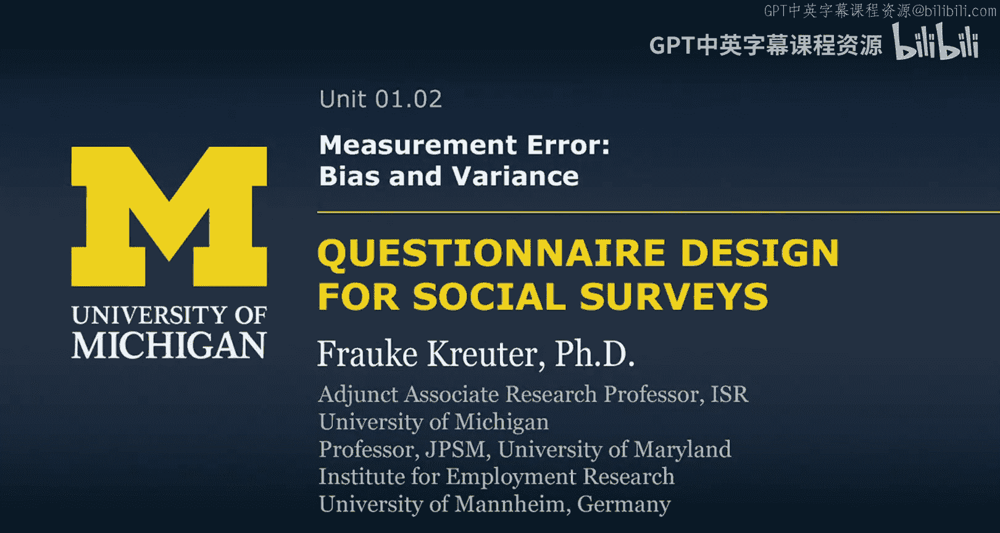
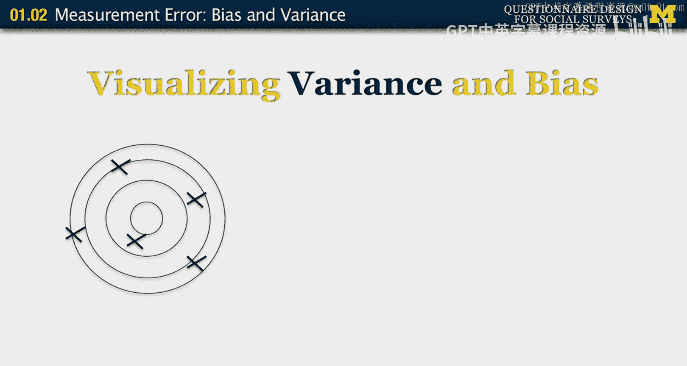
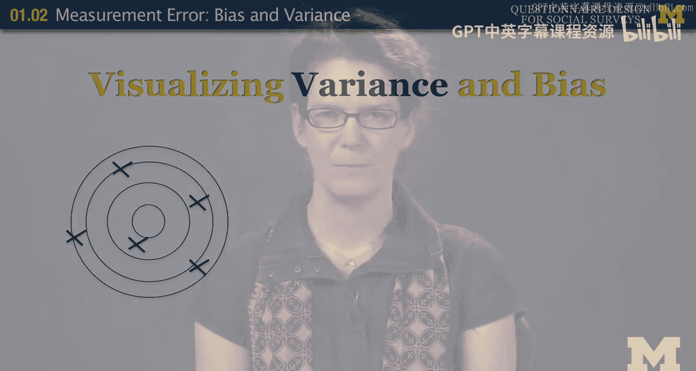
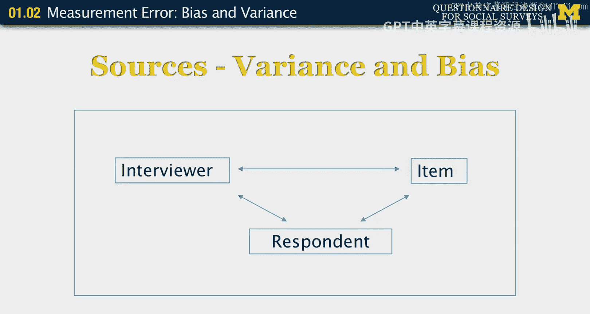

#  045：测量误差：偏倚与方差 📊

在本节课中，我们将要学习测量误差的两个核心概念：偏倚与方差。理解这两个概念对于设计高质量的调查问卷至关重要，因为它们直接影响我们测量结果的准确性和可靠性。

## 概述：什么是偏倚与方差？

上一节我们介绍了调查设计的基本框架，本节中我们来看看测量过程中可能出现的两种主要误差。偏倚与方差是评估测量质量的关键维度。简单来说，**方差**衡量的是测量结果的分散程度，而**偏倚**衡量的是测量结果与真实值之间的系统性偏离。

为了帮助理解，我们可以想象一个飞镖靶。我们的目标是让所有测量结果（飞镖）都命中靶心（真实值）。

## 理解方差 🎯

如果飞镖分散在靶子的各个位置，但平均来看仍围绕靶心，这种情况就代表了**高方差**。这意味着测量结果不一致、波动大，但没有系统性错误。

以下是方差产生的原因：
*   **问题的模糊性**：受访者对问题的理解不一致。
*   **定义的多样性**：受访者对问题中关键概念（如“犯罪”、“受害者”）的个人理解不同。
*   **回答的随机波动**：受访者的回答因各种偶然因素而偏离。

在统计上，高方差会导致更大的标准误。但一个好消息是，通过**增加样本量**，可以在一定程度上克服方差带来的问题。当然，作为问卷设计者，我们的首要目标仍然是**减少模糊性**，让所有“飞镖”都更靠近靶心。

## 理解偏倚 🎯

如果所有飞镖都系统地偏离靶心，落在同一个错误区域，这种情况就代表了**偏倚**。这意味着测量结果存在一致性的、方向性的错误。

偏倚的问题更为严重，因为：
*   **系统性错误**：所有受访者都以相同的方式误解或误报。
*   **无法用样本量修正**：即使增加调查样本量，所有结果依然偏离真实值，平均值也是错误的。不存在简单的统计技巧来纠正偏倚。

因此，问卷设计的核心挑战之一就是**识别并最小化偏倚**。

## 实例分析：方差 vs. 偏倚

让我们通过两个具体问题来区分方差和偏倚。

**1. 可能引起方差的问题示例：**
> “上周你是否是犯罪的受害者？”

这个问题在多个方面可能引发受访者的不同理解，从而导致回答的分散（方差）。

以下是该问题可能产生方差的原因：
*   **时间框架模糊**：“上周”可能指“今天之前的7天”，也可能指“上一个日历周”。不同文化背景下，一周的起始日（周日或周一）也不同。
*   **核心概念定义模糊**：“受害者”的定义可能因人而异。有人可能只将严重伤害视为受害，而忽略轻微事件。
*   **行为定义模糊**：对“犯罪”的理解。例如，家庭暴力在某些受访者看来可能不属于“犯罪”，但调查者却希望将其包含在内。

**2. 可能引起偏倚的问题示例：**
> “《布雷迪法案》能将枪支从已定罪的杀手手中夺走。你支持《布雷迪法案》吗？”

这个问题通过**引导性陈述**和**不平衡的选项**，可能系统地引导受访者给出支持的回答，从而产生偏倚。

一个更中立的问法应该是：
> “《布雷迪法案》旨在对枪支购买实施背景调查。你是支持还是反对这项法案？”

修改后的版本去掉了情绪化表述，并提供了平衡的选项（支持/反对），有助于减少偏倚。

## 误差的三大来源

在我们讨论的例子中，误差可能来自多个环节。在整门课程中，你应始终关注以下三个可能产生方差和偏倚的要素：

1.  **受访者**：受访者对问题的理解、记忆能力、社会期望以及是否愿意透露真实信息，都可能引入误差。
2.  **问卷项目**：这是设计者最能控制的环节。问题的措辞、选项的设置、问题的顺序等设计要素，直接影响误差的大小。
3.  **访问员**：在非自填式调查中，访问员扮演关键角色。

访问员提问的方式、语气、是否进行解释以及其个人特征，都可能影响受访者对问题的感知和最终答案的选择。因此，控制访问员的影响至关重要。

## 总结与预告

本节课中我们一起学习了测量误差的两个基本概念：**方差**和**偏倚**。方差是测量的分散程度，偏倚是测量的系统性偏差。减少方差有助于提高估计的精确度，而减少偏倚是保证测量准确性的根本。

我们了解到，误差主要来源于**受访者**、**问卷项目**和**访问员**三个方面。作为设计者，我们应专注于优化问卷项目，并规范访问员的行为。

正因为访问员是重要的误差来源之一，在接下来的章节中，我们将首先探讨**标准化访谈**，随后介绍**交谈式访谈**，以帮助你理解访问员与受访者之间的互动如何影响数据质量，以及我们如何通过规范这种互动来提升调查的效度。