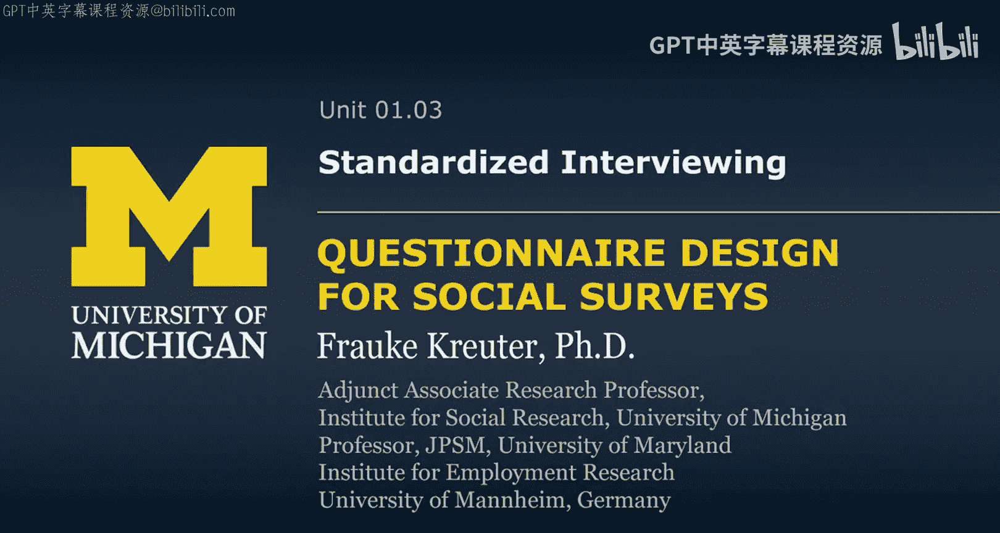
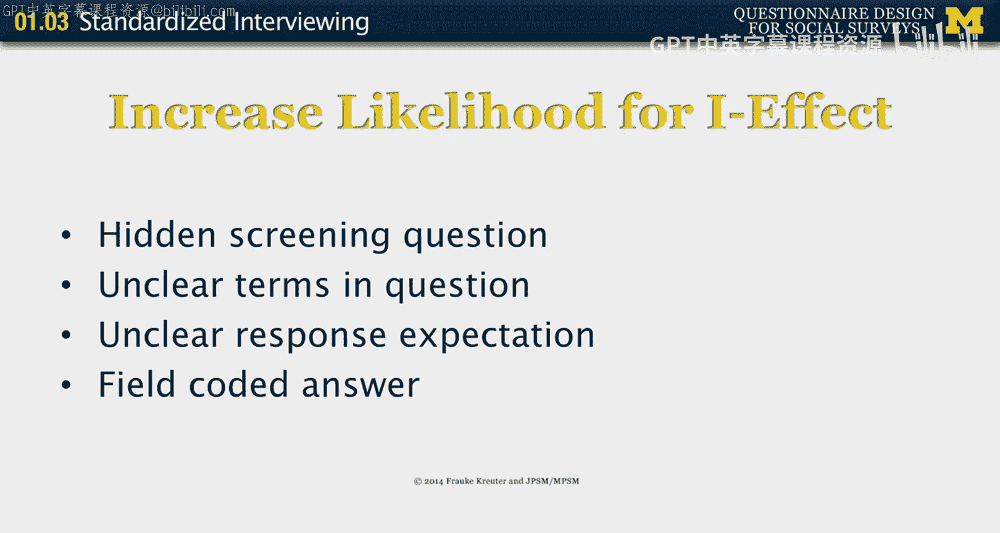

#  046：标准化访谈 📝

在本节课中，我们将学习标准化访谈技术。我们将了解其核心理念、具体操作指南，并通过一个实际研究案例，深入探讨访谈员如何影响调查数据的质量。

在上一节中，我们讨论了调查中的偏差与方差，并提到访谈员可能对两者都有贡献。因此，在本节中，我们将更详细地解释其原因和发生机制。为了理解访谈过程中的关键问题，回顾标准化访谈技术会很有帮助。在下一节，我们将讨论更偏向对话式的访谈技术。

## 标准化访谈的目标与假设 🎯

在研究中，目标通常是实现标准化，以确保每位受访者都经历相同的提问过程，并且答案的记录方式也相同。这样，两位给出相同答案的受访者，其答案应以相同的方式被记录。

正如杰克·福勒和曼乔尼在其著作《标准化访谈》中所指出的，如果实现了这一点，那么答案之间的差异就可以被正确地解释为反映了受访者之间的差异，而非产生这些答案的过程之间的差异。这是标准化访谈的核心精神，并且自那时起，在美国及其他地方的许多调查中都得到了很好的实施。

然而，这背后的假设是访谈员能充分履行其职责。他们必须经过仔细培训，并理解这是收集答案时应遵循的流程。同时，也假设每个问题的措辞都是一个完整且充分的脚本，足以让听到或读到问题的受访者做好充分回答的准备。

## 标准化访谈的核心指南 📋

以下是标准化访谈的一些重要指导原则：

*   **严格按原文朗读**：问题应完全按照写好的措辞来朗读。
*   **非引导性追问**：追问只能以非引导性的方式进行。在标准化访谈中，常见的情况是受访者向访谈员提问，而访谈员的标准回应是“这对您来说意味着什么？”这虽然可能让受访者有些沮丧，但确实是一种不影响受访者的回应方式。
*   **标准化回应策略**：常见的策略包括访谈员重新朗读问题或答案选项，或者确保受访者确实从提供的选项中选择一个答案。
*   **准确记录答案**：访谈员记录的答案应准确反映受访者所说的内容。
*   **避免透露个人信息**：访谈员不应提供任何可能暗示其对调查主题有特定价值观或偏好的个人信息。
*   **避免给予反馈**：最后，不应向受访者提供任何反馈。

## 访谈实例分析 🎧

让我们听一段标准化问卷的对话实例：

> **访谈员**：现在我想问您一些关于您饮食的具体问题。在接下来的这组问题中，我会问您对进行某些行为的支持或反对程度。在我说完行为后，请从以下选项中选择一个回答：强烈支持、有些支持、既不支持也不反对、有些反对、强烈反对。第一个行为是：避免吃快餐。
>
> **受访者**：避免什么？不好意思。
>
> **访谈员**：避免吃快餐。
>
> **受访者**：避免吃快餐？是的，有些（支持）。
>
> **访谈员**：有些（支持），谢谢。稍等，让我澄清一下，选项是：强烈支持、有些支持、既不支持也不反对、有些反对、强烈反对。
>
> **受访者**：嗯，我有些支持避免快餐。谢谢你的澄清。
>
> **受访者**：我不是强烈反对想吃快餐……但我经常吃快餐，对吗？还是说“这对您来说意味着什么”？
>
> **访谈员**：我的意思是，我只是想澄清一下我使用的语言定义。您刚才说的是“有些支持”，对吗？
>
> **受访者**：我有些支持快餐？不，是支持避免快餐。是的，是的，谢谢，谢谢。是的，我知道那里好像有个否定词，所以我支持（避免）。谢谢。

这些音频片段让您对标准化访谈有了直观感受，同时也展示了一些对话过程中的中断。例如，受访者请求澄清，而访谈员也并非完全按脚本朗读，我们在这些音频文件中注意到了这些情况。

## 案例分析：犯罪恐惧感调查 🔍

这是一个在受害情况调查中常被问到的典型问题，在测量普遍犯罪恐惧感的调查（如综合社会调查）中也能找到：

> “在您家附近一英里范围内，是否有任何区域是您晚上不敢独自走动的？”

这是一个很难回答的问题。您可以想象，受访者脑海中不一定有现成答案。他们可能无法具体想象一英里内的区域，或者他们晚上根本不去那里走动，因此他们真的知道自己晚上在那里走动时会多害怕吗？但这个问题触及了犯罪与受害调查的核心精神。这类犯罪受害调查中有许多类似性质的问题，它们可能很敏感（受访者可能不愿向访谈员诚实回答），也可能很模糊（我们在之前的章节中已经讨论过一些可能产生问题的词汇）。

## 访谈员效应研究设计 📊

正是由于上述原因，我们进行了一项调查来测量访谈员对受访者的影响。需要说明的是，本节内容比我们通常看到的更具统计性，但为了让大家理解这些访谈效应的本质，这是重要的背景信息。

在这项于2001年在德国启动的研究中，我们能够由五个独立的研究机构，在相同的抽样点（即相同的地理区域，可能是小村庄或几个城市街区）进行四次随机概率抽样调查和一次季度调查。这四次调查中，两次是面对面调查，一次是电话调查，一次是邮寄调查。我们共有160个这样的抽样点，每个抽样点内的地址被随机分配到上述四种调查中。

这项研究在设计上为何对此问题有意义？对于之前提到的犯罪恐惧感问题，人们预计会看到抽样点本身的影响，即住在同一地理区域、同一社区的人可能会给出非常相似的答案。毕竟，如果这是一个“危险社区”，我们会预期人们对此有所反应。调查中的其他问题也与社区直接相关，例如到最近火车站的距离或其他社区指标。

一般来说，在调查研究中我们知道，住在同一抽样点的人，其回答彼此之间的相似度，高于从整个人口中随机抽取的人。我们称之为调查中的**设计效应**或**聚类效应**。它有一个不幸的副作用，即会降低你的有效样本量。试想，如果你选取的两个人回答完全一样，其信息量等同于只问了一个人。出于经济原因（访谈员无法在全美国到处跑），以及许多国家没有现成的名单可以轻松抽取随机样本，这些聚类效应通常是不可避免的。

在大多数调查中，如果你处于聚类样本的背景下，并且有这些抽样点，那么访谈员在同一区域工作。对于普通的面对面调查来说，很难区分访谈员对受访者答案的影响与社区本身的影响。这就是我们进行这项研究的原因。

在这项研究中，因为我们有四次调查，特别是在每个抽样点内进行了两次面对面调查，我们得以区分访谈员对受访者答案的同质化影响与抽样点本身的影响。

如果我们将其写出来，我们观察到的关于问题的总方差包含三个部分：抽样点（地理区域）方差、访谈员方差，它们共同构成了研究中观察到的聚类方差，然后是受访者自身的方差（所有受访者个体差异的部分）。这项调查的目标就是为我们提供一个机会，来区分区域效应和访谈员效应，并了解在面对面调查中访谈员效应对方差成分的影响程度。

## 方差成分与设计效应 📈

通过这些方差成分，我们可以计算所谓的 **ρ（rho）**，即**组内相关系数**。其公式如下：

`ρ = 聚类方差 / (聚类方差 + 受访者方差)`

这个组内相关系数 ρ 会代入以下公式，构成设计效应的度量：

`设计效应 = 1 + ρ × (w - 1)`

其中，w 是聚类规模（理想情况下各聚类规模相似）。当聚类规模不同时，计算会变得更复杂，本课程不深入讨论。我个人喜欢使用设计效应的平方根作为度量，因为它更直观，与置信区间的膨胀直接相关。但两种方式都可以。

作为一个经验法则，如果设计效应为2，意味着你的方差膨胀了相应的量，这转化为约1.4的设计效应平方根值。

## 研究结果分析 📉

现在让我们看看这项调查的结果。我们发现设计效应度量值在1到3之间（3非常大，1很小，1意味着没有效应，没有膨胀）。图中的每个点代表一个调查项目（该调查约有110个项目，我们计算了每个项目的设计效应）。

更关键的是，我们查看了访谈员方差占总体设计效应的比例。比例值为1意味着这里看到的全部设计效应都归因于访谈员，而为0则意味着只看到了区域效应。结果有些令人担忧，因为在本调查中，大多数项目都位于图的上半部分。

如果我们使用相同的度量，观察访谈员方差占总聚类方差的比例，并按项目的敏感性（是否为事实性问题、是否为封闭式问题、是否难以回答）来分类项目，我们会发现：在敏感问题上，访谈员方差比例略高；在事实性与非事实性问题之间没有明显差异；但在开放式问题上比例较高；在容易与困难回答的问题之间也没有明显差异。已有许多论文试图分类并找出哪些问题类型会产生更大的访谈员效应，但结论并不完全一致。

然而，如果我们将所有这些特性（非事实性、敏感性、开放性、难以回答）都视为有害的项目属性，并按这些有害属性的数量对项目进行分组，那么我们会看到，随着有害属性的增加，访谈员效应对聚类方差的贡献比例确实在上升。

## 与邮寄调查的对比 📬

我之前提到，这项研究中也包含了邮寄调查。下图将每个项目在邮寄调查中的设计效应（Y轴）与在面对面调查中的设计效应（X轴）进行对比。尽管邮寄调查的聚类程度与面对面调查相同，但您可以看到，与邮寄调查相比，两项面对面调查的设计效应都更大，因此点都位于对角线的右侧。这为我们在面对面调查中存在显著的访谈员效应（叠加在抽样点效应之上）提供了强有力的论据和实证证据。

## 访谈员效应的其他原因 🤔

导致访谈员效应的其他原因还包括：隐藏的筛选问题、术语不清晰（访谈员对这些术语的解释方式不同）、回答期望不明确，或者访谈员临时引述的答案等。

但特别是术语不清晰、追问方式以及如何正确理解问题，这些因素都可能促成访谈员效应。这也是为什么在学术界经常讨论另一种访谈技术——对话式访谈——的原因之一。

本节课中，我们一起学习了标准化访谈技术的目标与操作指南，并通过一项精心设计的研究，深入探讨了访谈员如何影响调查数据的方差。我们发现，在面对面调查中，访谈员效应是真实存在且不可忽视的，尤其是在处理敏感、开放式等问题时。这为我们理解数据收集过程中的潜在误差来源，以及思考如何改进访谈技术（如下一节将介绍的对话式访谈）提供了重要基础。