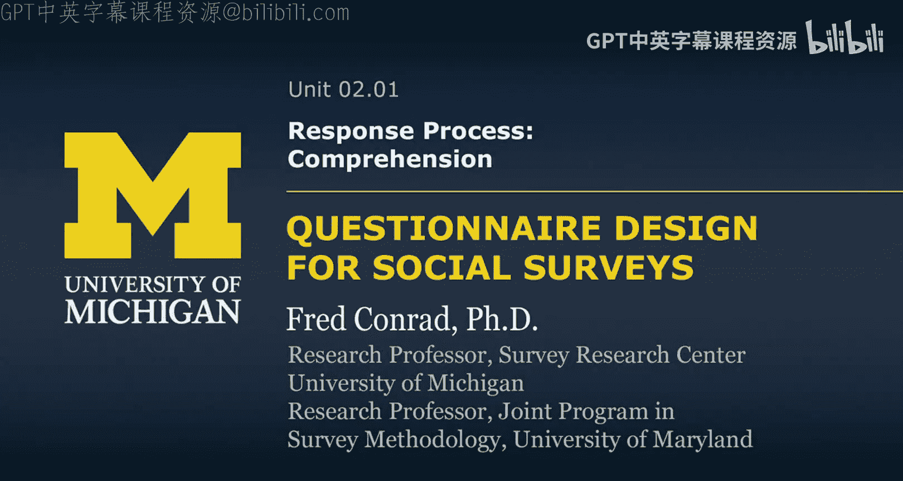
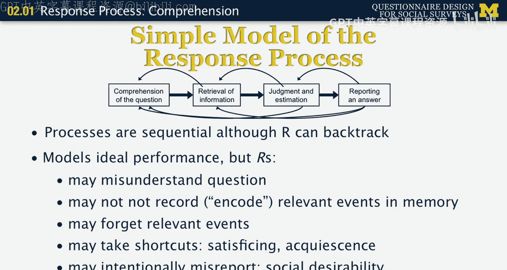
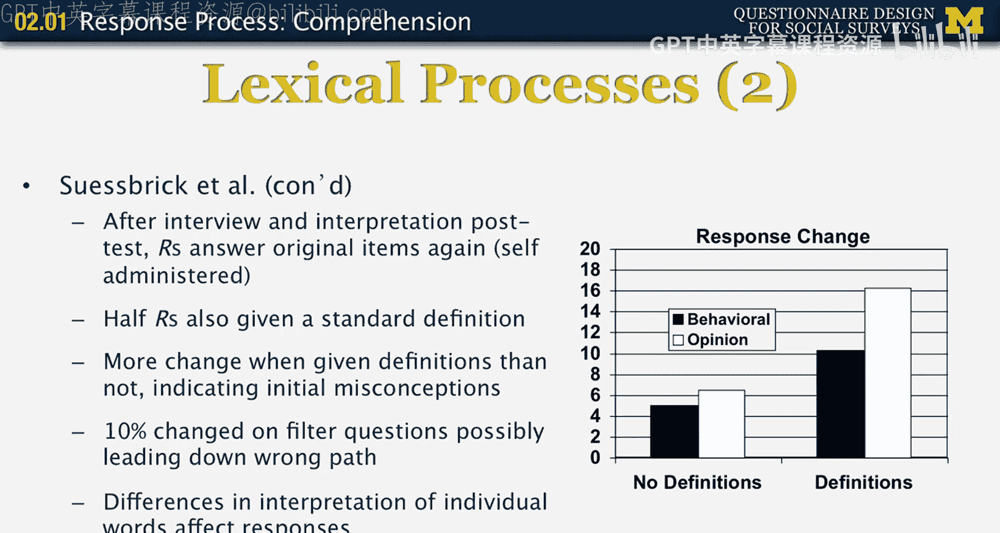
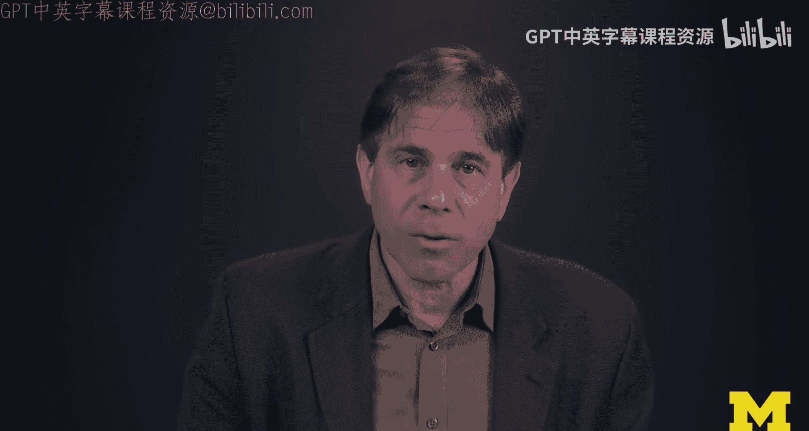
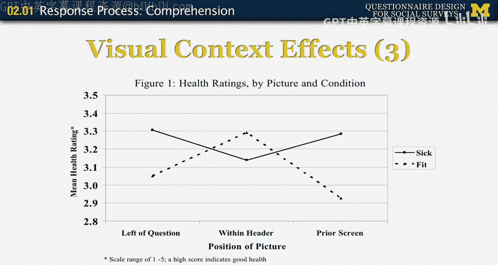
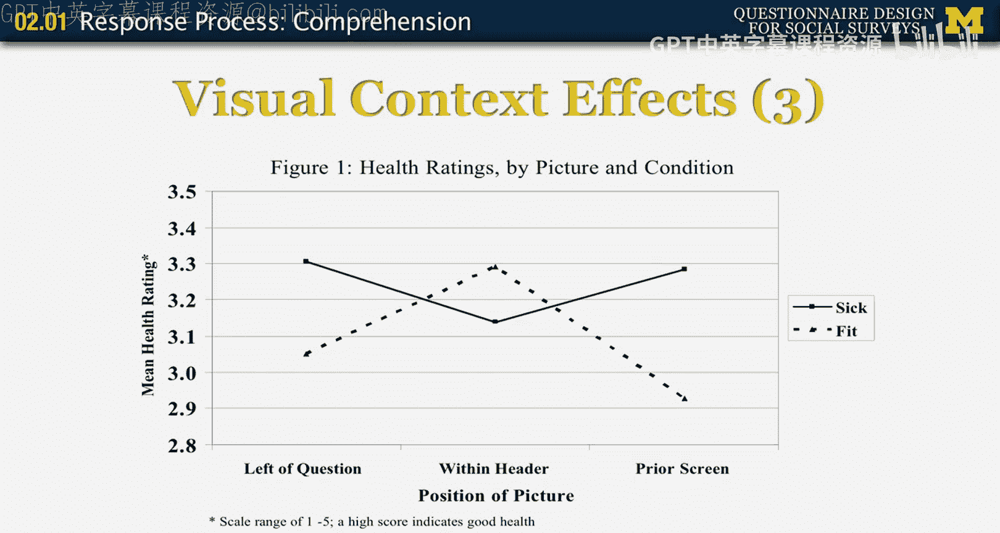
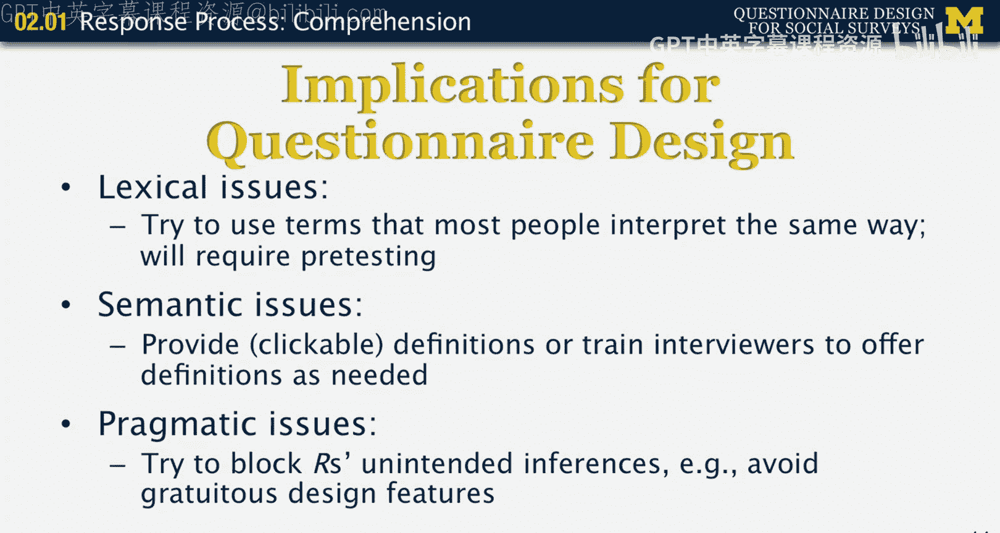

#  049：应答过程：理解阶段 🧠

在本节课中，我们将要学习调查应答过程中的第一个关键阶段：理解阶段。受访者需要准确理解问卷问题的含义，才能提供有效的回答。我们将探讨理解过程中可能出现的三类问题，并了解它们如何影响数据质量。

---

上一节我们介绍了调查应答过程的整体模型，本节中我们来看看其中的第一个阶段——理解阶段。受访者必须首先理解他们被要求做什么。这个阶段被称为理解阶段。

理想情况下，受访者能毫无问题地完成这个阶段。但我们关注的焦点往往是他们可能遇到的问题。他们可能在理解阶段误解问题，实际上回答了一个与问卷设计者意图不同的问题。

理解调查问题的问题至少有三类：
*   一些与词语及其含义有关，这被称为**词汇问题**。
*   另一些出现在单个词语组合成整个句子（即问题）时，这涉及到问题的**字面意义**。
*   还有一类是受访者通过**语用推理**过程来理解说话者（即问卷）的真实意图，这常常与字面意义形成对比。

---

## 词汇问题与词语含义

词汇处理是指理解问题中单个词语的含义。问题在于，同一个词对不同的人可能意味着不同的事物。

以下是一个关于词汇处理及其可能引发问题的例子。

在Suusbririck及其同事的一项研究中，他们询问受访者的烟草使用情况。在访谈后，他们进行了一项后测，以了解受访者如何解释问题中的短语。例如，对于问题“**在你的一生中，你是否吸过至少100支香烟？**”，他们提供了对短语“吸一支烟”的三种可能解释：
1.  即使只吸一口。
2.  吸完整支或大部分。
3.  吸了至少几口。

结果显示，虽然超过一半的受访者认同第一种解释（即使只吸一口），但其余受访者大致平均地分布在另外两种解释之间。这表明，同一个短语可能被不同的人以截然不同的方式解读。

这会影响受访者提供答案的质量。Suusbririck和她的同事在访谈和解释后测之后，重新询问了原始问题，并给一半的受访者提供了词语的定义。他们发现，**提供定义**导致受访者在第一次和第二次回答之间发生更多改变。这意味着受访者最初对问题的理解可能与设计者的意图不同，因此在获得定义后改变了答案。

事实上，误解可能引发超出特定问题本身的问题。他们发现，10%的受访者改变了他们在筛选问题上的答案。筛选问题决定了后续问题序列的内容。总体而言，受访者对单个词语理解的差异会影响他们给出的答案及其准确性。

---

## 语境的影响

在解释问题中的词语时，受访者会受到这些词语出现**语境**的影响。

一种语境是**问题语境**或**问卷语境**。具体来说，受访者用于回答同一问卷中先前问题的信息，会影响他们解读当前被问到的问题的方式。

以下是Schwartz及其同事研究中的一个例子。他们发现，如果先询问受访者关于婚姻满意度的问题，再问整体生活满意度，那么这两个问题的答案高度相关，就好像受访者在回答更一般的整体生活满意度问题时，仍在思考婚姻满意度。如果颠倒问题的顺序，先问更一般的问题，这种相关性则大幅下降。这是因为当被问及整体生活满意度时，你可能会想到生活满意度的任何维度，因此当婚姻满意度问题紧随其后时，你就不太可能专门思考它。

另一种语境是**视觉语境**。这在网络调查中尤为常见，因为经常使用图像。Cooper及其同事的研究表明，视觉语境会影响受访者的答案，特别是他们评估自身健康的方式。他们在要求受访者评价自身健康的问题旁，展示了要么是明显健康、体格健壮的人，要么是生病、不太健康的人的图像。

他们发现，如果问题旁是健康人的图像，受访者对自身健康的评分会**低于**旁边是病患图像的情况。其原理是，受访者将自己的健康与图像中描绘的健康进行比较。如果图像描绘了一个非常健康的人，他们可能会想“我没那么健康”，从而给出较低的评分；反之，如果图像描绘了明显不健康的人，他们会想“我比那好”，从而给出较高的评分。当图像出现在问题左侧或前一页时，会观察到这种模式。然而，当图像以横幅形式呈现在页面顶部中央时，这种模式似乎会逆转甚至消失。这被称为“横幅盲区”，其理念是受访者和一般网络用户不会完全处理呈现在页面顶部中央的信息。

---

## 语义与语用问题

上一节我们讨论了词汇和语境，本节中我们来看看语义和语用过程。

**语义过程**涉及将单个词语的含义组合成整个问题或句子的意义。以下是一个语义过程中可能出现问题的例子，即受访者不太清楚如何将自己的情况映射到问题所涉及的概念上。

例如，问题：“**您是否购买过或有家庭家具的开销？**”受访者回答：“我买了一个落地灯。这算家庭家具吗？”这里的问题是，受访者能很好地解释单个词语，但他们不知道“家庭家具”这个概念是否应该包括“购买落地灯”这个具体事项。在标准化访谈中，访员无法为受访者澄清这一点；而在对话式访谈中，访员可以告知受访者本次调查适用的定义。数据显示，在这种被称为“复杂映射”的情况下，当访员能够澄清含义时（对话式访谈），回答的准确性比不能澄清时（标准化访谈）有显著提高。

我们将讨论的第三组过程称为**语用过程**或**语用推理**。我们对它们的理解主要源于Grice提出的“合作原则”。这是一种听众通过推断说话者的真实意图来理解其话语的方式。

Grice将合作原则阐述为四个子原则或“准则”：
*   **量的准则**：所说的话应包含交谈目的所需的信息，不应包含超出需要的信息。
*   **质的准则**：不说自知是虚假的话。
*   **关系准则**：说话要有关联。
*   **方式准则**：避免晦涩和歧义。

其理念是，通过牢记这些原则，人们可以在话语字面意思不通时理解说话者的意图。例如，如果说话者问我“你能把盐递给我吗？”，我可能不会将其理解为关于我递盐能力的问题（尽管字面上是），而是会做出几乎是自动的推断：她是在请求我递盐，并且我可能会照做。与此相关的是，说话者不会说无意告知我的话，因此我会在解读她其余话语时考虑到这一点。

那么，语用推理如何在回答调查问题中发挥作用呢？Schwartz及其同事的这项研究是一个很好的例子。他们问受访者：“**你会说你的人生有多成功？**”并要求他们在“一点也不成功”到“极其成功”的量表上回答。对于一半的受访者，“一点也不成功”旁边标有“-5”，“极其成功”旁边标有“+5”。对于另一半受访者，“一点也不成功”旁边标有“0”，“极其成功”旁边标有“10”。

结果如何？在0到10量表的组中，有34%的受访者选择了量表的低半部分（即0到5，代表较不成功的部分）。而在-5到+5量表的组中，只有13%的受访者选择了量表的低半部分。因此，当“一点也不成功”与一个负数相关联时，受访者更不愿意将自己定位在量表的不成功部分。作者认为，当“0”与标签相关联时，受访者将其解释为“没有成功”；而当负数与“一点也不成功”相关联时，他们将其解释为“存在失败”。这是一个受访者超越字面意义，利用这些数字来解释文字标签的例子，而这可能并非问卷设计者的本意。

---

## 对问卷设计的启示

以上我们讨论了理解过程中的各类问题和机制，那么它们对问卷设计有何启示呢？以下是一些可能的建议：

关于词汇问题：
*   尝试使用大多数人理解一致的术语。这可能非常困难，需要通过预测试来确认你所选的术语能被一致理解，但努力寻找这样的术语无疑是一个值得追求的设计目标。

关于语义问题：
*   提供定义（例如在网络问卷中可供点击查看，或通过培训访员在需要时提供）应有助于解决我们之前讨论的、在尝试将个人情况映射到调查概念时出现的模糊性问题。

关于语用问题：
*   一个好的目标是尝试阻止受访者做出非预期的推理，例如，避免使用不必要的设计特征。

---

本节课中我们一起学习了调查应答过程中的理解阶段。我们了解到，受访者对问题的理解会受到词汇歧义、问卷语境、视觉元素以及语用推理的深刻影响，这些都可能引入误差。为了获得高质量的数据，问卷设计必须仔细考虑并尽量减少这些理解上的挑战。下一节课，我们将继续探讨应答过程中的下一个关键阶段：记忆与回忆。