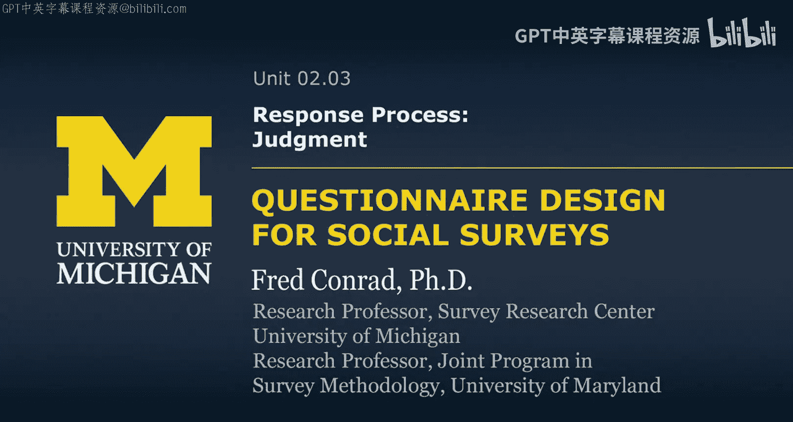
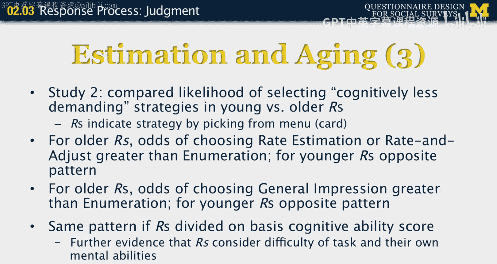

#  051：应答过程：判断形成

## 📘 概述

在本节中，我们将继续探讨应答过程。我们已经讨论了理解问题（应答过程的第一阶段）以及为回答问题而进行信息检索的关键过程。现在，我们将进入**判断与估计阶段**。这个阶段涉及一系列心理过程，用于弥补受访者记忆中的不精确或不完整信息。

## 🔍 判断与估计阶段

上一节我们介绍了信息检索，本节中我们来看看当记忆不完整或难以精确回忆时，受访者如何进行判断和估计。这个阶段的核心是使用心理策略来弥补记忆的不足。我们将通过两个现象来说明这一点：**可得性启发法**和**频率估计**。

### 可得性启发法

可得性启发法是一个非常有影响力的概念，由卡尼曼和特沃斯基提出。它指的是人们会根据回忆某类事件的**难易程度**，来推断该类事件发生的频率或概率。

以下是几个说明可得性启发法的例子：

*   **字母R的位置**：在一项研究中，受访者被问及是首字母为R的单词多，还是第三个字母为R的单词多。由于回忆首字母为R的单词更容易，参与者判断这类单词更常见。然而事实上，第三个字母为R的单词更多。
*   **名人名字列表**：在另一项演示中，研究者向受访者展示一个包含男性和女性名字的列表，并改变名单中名人的知名度。当女性名人比男性名人更出名时，参与者会判断列表中女性名字更多，尽管男女名字数量实际相等。这是因为回忆著名名字比回忆非著名名字更容易。
*   **调查场景中的应用**：施瓦茨及其同事进行了一项研究。他们要求受访者列出6个或12个自己表现得果断的情境，然后让他们评价自己的果断程度。结果，列出6个情境的受访者比列出12个情境的受访者认为自己更果断。这可能是因为列出12个情境更加困难，这种回忆的困难性导致受访者认为自己总体上并不那么果断。

### 频率估计

当精确回忆不可能或需要付出过多努力时，受访者会转向频率估计。

考虑以下问题：“在过去两年中，你献过多少次血？”对于一个每八周在固定地点献血的人来说，每次献血经历区别不大，因此很难逐一回忆并计数。

为了弥补记忆，受访者可能基于以下策略进行估计：

1.  **基于频率的估计**：例如，“我每次有献血活动都去，大概每八周一次，也就是两个月一次。那么两年就是12次。”
2.  **基于定性印象的估计**：例如，“我经常做这件事，所以去年大概有10次。”

如果能够回忆并计数事件，则无需估计。以下是三种主要的策略，每种都会导致不同类型的误差：

*   **回忆与情景枚举**：倾向于导致**低估**。原因是人们更容易忘记事件，而非虚构事件。由于遗忘，他们报告的事件数量会少于实际发生数量。
*   **基于频率的估计**：倾向于导致**高估**。原因是虽然频率本身可能很准确，但如果受访者未能考虑到例外情况（如某次未进行该行为），那么基于频率的报告就会成为高估。
*   **基于印象的估计**：倾向于导致**高估**，但原因与基于频率的估计不同。原因在于，将一个模糊的定性印象转化为数字，本质上需要将其映射到从0到无穷大的数轴上。这意味着他们的估计在低端有界（不能低于0），但在高端是无界的，这总体上导致了高估。

## 📊 策略选择的实证研究

康拉德、布朗和卡什曼进行了一项研究，他们要求电话受访者回答频率问题。对于每个问题，受访者还需报告他们是如何得出答案的，这些报告后来被编码为他们所使用的策略证据。此外，受访者还评估了事件发生的规律性和相似性。

以下是研究结果表格的核心解读：

*   **枚举策略（情景回忆）**：当事件的规律性和相似性较低时，受访者更倾向于使用枚举策略。此时报告的平均频率也较低，这表明受访者判断频率足够低，他们愿意并能够回忆被问及的各种事件。
*   **频率检索策略**：当事件的规律性和相似性较高时，受访者更倾向于使用基于频率的策略。此时报告的平均频率较高，这可能反映了相同的判断：实际频率太高，无法回忆和计数，因此使用基于频率的策略更具吸引力。
*   **总体印象策略**：当事件的规律性和相似性处于中等水平时，既不适用于枚举，也不适用于频率检索。此时报告的平均频率很高（平均12.3次）。这似乎表明受访者判断事件太多，无法全部回忆和计数，且无法获得准确的频率，因此最好的解决方案是利用总体印象进行估计。

## 👵 认知能力与策略选择

索尼娅·萨尔的一项研究探讨了记忆能力下降（如因衰老）如何影响估计策略的选择。

*   **对先前数据的再分析**：她根据年龄分析了康拉德等人的数据，发现**年长受访者使用枚举策略的比例更低**，而更多地依赖频率检索和总体印象策略。这可能表明年长受访者认识到自己的记忆局限，判断自己无法很好地完成基于回忆的任务。
*   **实验室研究**：在她的实验室研究中，年轻和年长的受访者从菜单中选择了他们使用的策略。研究发现：
    *   对于年长受访者，选择频率估计和“频率并调整”策略的几率高于枚举策略；而年轻受访者则呈现相反模式。
    *   对于年长受访者，选择总体印象（一种几乎不依赖记忆的策略）的几率高于枚举策略；年轻受访者再次呈现相反模式。
*   **认知能力的影响**：当受访者根据认知能力得分（而非年龄）进行分组时，也观察到了相同的模式。这进一步证明，受访者在选择估计策略时，会考虑任务的难度和自身的心理能力。

## 🎯 总结

本节课中，我们一起学习了应答过程的第三阶段——判断与估计。我们了解到，当记忆不精确或不完整时，受访者会使用**可得性启发法**和**频率估计**等策略来形成答案。不同的估计策略（如枚举、基于频率、基于印象）会引入不同类型的误差（低估或高估）。研究还表明，受访者会根据**事件的特征**（如规律性、相似性）和**自身的认知能力**，来判断并选择最合适的应答策略。

在下一节中，我们将讨论应答过程的第四阶段，即最后阶段——**应答映射**或**应答格式化**。这个阶段涉及受访者在封闭式问题中选择已提供的选项，我们将探讨选择应答选项时的一些考虑因素以及可能引入的误差来源。