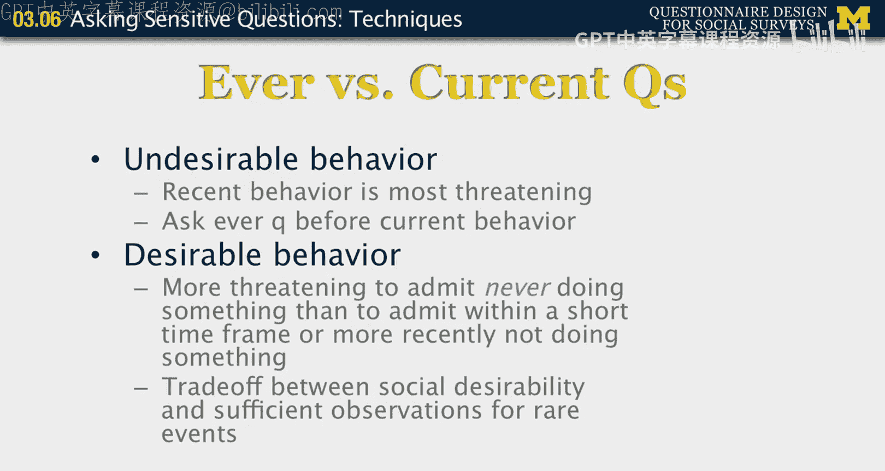

#  058：敏感问题提问技巧

在本节中，我们将学习如何在问卷调查中设计关于敏感话题的问题。直接询问敏感信息可能导致受访者因社会期许偏差而给出不真实的答案。因此，我们将介绍一系列技巧，通过调整问题语境、措辞和结构，来鼓励更诚实、准确的回答。

---

### **利用问题语境**

上一节我们提到了社会期许偏差的挑战，本节中我们来看看如何通过设置问题语境来缓解它。问题的回答选项和其所在的一系列相关问题，共同为敏感问题提供了语境。将敏感问题置于一组相关的问题中是个好方法。理想情况下，可以营造一种氛围，暗示所询问的行为是可接受的，从而尽可能消除社会期许带来的压力。

以下是利用前置问题设置语境的例子。根据你询问的是不良行为还是良好行为，你可以提供一种“许可性”或“限制性”的语境。

一个文献中的经典例子是关于饮酒行为的提问顺序：

1.  首先询问：“总体而言，你会说你比朋友喝得多、喝得少，还是差不多？”
2.  接着问：“你朋友中喝得最多的那位，通常喝多少？”
3.  最后才明确问：“你自己通常喝多少？”

你可能只对第三个问题的答案感兴趣，但通过前两个问题，受访者已经间接透露了一些信息，并将其行为置于朋友行为的语境中，从而能更轻松、诚实地回答关于自己的问题。这有助于受访者逐步进入状态。

---

### **使用熟悉的措辞**

另一种帮助受访者放松的方法是使用他们熟悉的词语。在标准化问卷中，虽然每位受访者接收的刺激（问题）是相同的，但可以尽量使用贴近日常对话的、自然的措辞。例如，在询问性行为时，需注意不同亚文化群体使用的语言可能不同。真实的措辞选择会以不同方式影响测量结果，正如本课程早期讨论过的访员变异效应，在这里可能体现得更明显。

---

### **简化回答要求**

简化任务也能让受访者更轻松。例如，询问收入时，或许不需要精确的连续数字。你可以使用分类选项或响应量表。

**示例（收入分类）：**
*   低于3万元
*   3万-8万元
*   8万-15万元
*   15万元以上

另一种方法是使用“展开式分档”提问：“您的收入高于还是低于X元？”这能引导受访者逐步给出答案类型。

---

### **使用代理报告**

有时，可以不直接询问受访者本人，而是请其他知情者（代理报告人）来报告该行为。当然，这存在权衡：信息质量可能下降，因为他人可能了解不足；并且，根据代理人与目标对象的关系，测量误差也会不同。因此，如有可能应避免使用，但需知一些调查在无法联系到目标对象时，会常规使用代理受访者。

---

### **刻意引导**

此技巧可用于根据语境减少过高或过低的报告率。具体做法是在问题开头加入一个前提或引用权威。

**示例（减少低报）：**
“近期研究发现，适量饮用红酒对健康有益。您过去一周是否饮用过红酒？”

通过引用“研究”和“有益”，为问题增加了权威性和正面语境，使报告该行为变得更容易。

另一种方式是将敏感话题嵌入威胁性较低的话题中，以降低其显要性，让受访者更自在。

**示例（假设行为普遍化）：**
“即使最冷静的父母有时也会对孩子生气。在过去七天里，您的孩子做过让您生气的事情吗？”

这个问题预先假设该行为是正常的，希望促使父母透露实情。

你也可以在问题中假设某种行为以特定频率发生。

**示例（假设行为存在）：**
不问“您吸烟吗？”，然后接着问“每天吸多少支？”，而是直接问：“您平均每天吸多少支烟？”

这暗示吸烟是普遍现象，使吸烟者更容易回答。

对于期望发生的行为（如投票），可以为其未发生提供理由。

**示例（为未发生行为提供理由）：**
“很多人因为太忙而没时间投票。您在上次选举中投票了吗？”

---

### **调整时间框架**

请注意，询问与不良行为相关的问题时，近期行为比过去行为更具威胁性。许多政客可能不介意透露大学早期使用过非法药物，但如果这是当前或上个月的行为，问题就严重得多。

因此，可以先问“您是否曾经……”，再问当前行为。因为如果已经承认“曾经做过一次”，那么承认“目前仍在做”会相对容易。

同理，对于良好行为，承认“从未做过”比承认“最近一次没做”更具威胁性。以投票为例，如果说“我通常都投票，只是上次选举碰巧没投”，会比直接问“您在上次选举中投票了吗？”（而无法表明自己通常投票）更容易，也更能减少因社会期许而谎报的压力。事实上，当问卷未包含“通常”选项时，受访者常会主动补充说明，以抵消社会期许的影响。

在所有技巧中，你都需要在社会期许偏差与获取足够多的稀有事件观测值之间进行权衡。

---

### **总结与预告**

本节课中，我们一起学习了多种直接询问敏感问题的技巧，包括：**利用问题语境**、**使用熟悉措辞**、**简化回答要求**、考虑**代理报告**、进行**刻意引导**以及**调整时间框架**。这些方法的核心是通过设计降低受访者的心理威胁感，鼓励更诚实的回答。

下一节，我们将探讨其他更为间接的提问技术，例如**随机化回答**。这类技术通常只能提供总体层面的估计值，且有些实施起来较为复杂。我们还将讨论如何通过不同的调查设置来提供更多隐私感，增强回答敏感问题时的保密性。