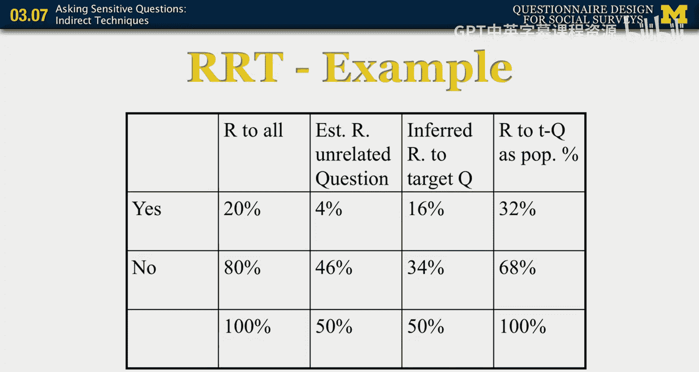
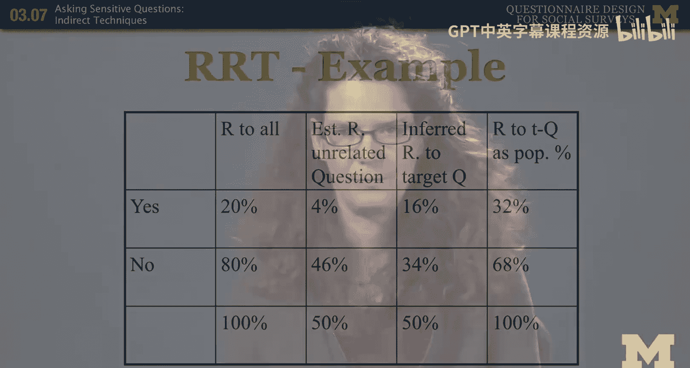

#  059：敏感问题间接技术

在本节课中，我们将学习一种用于收集敏感问题数据的特殊方法——随机化应答技术。这种方法的核心是保护受访者的隐私，从而鼓励他们提供更诚实的答案。

上一节我们讨论了直接询问敏感问题可能面临的挑战。本节中，我们来看看如何通过间接技术来克服这些挑战。

## 随机化应答技术原理

随机化应答技术的核心思想是：受访者会给出一个答案，但作为研究者的你，无法知道这个答案具体对应的是哪个问题。这是如何实现的呢？

以下是实现该技术的关键步骤：

1.  **配对问题**：将一个敏感问题（例如，“你上个月收到过停车罚单吗？”）与一个中性问题（例如，“你母亲的生日在六月吗？”）配对。这个中性问题的答案分布必须是已知的。例如，我们可以假设大约有1/12的受访者母亲生日在六月。

2.  **使用随机化设备**：你需要一个概率已知的随机化设备，例如一枚公平的硬币。你知道它出现正面和反面的概率各为50%。

3.  **回答流程**：你要求受访者使用随机化设备（如抛硬币）。根据结果（例如，正面回答敏感问题，反面回答中性问题），受访者只需回答“是”或“否”，而无需告知研究者他们回答的是哪个问题。

## 数据分析与推断

现在，我们只得到一组总的回答结果。假设在我们的调查中，总共有20%的人回答“是”，80%的人回答“否”。

因为我们知道，在所有被问到“母亲生日在六月”这个问题的人中，理论上应有约1/12（约8.33%）的人会回答“是”。在我们的设计中，有50%的受访者（因为硬币反面概率为50%）会被问到这个问题。因此，这50%的受访者中，预计有约4.17%（即50% * 8.33%）的人会因母亲生日在六月而回答“是”。

由此，我们可以推断出对目标敏感问题的回答：
*   总“是”的回答比例为20%。
*   其中，约4.17%来自回答中性问题（母亲生日在六月）的“是”。
*   因此，剩下的约15.83%（20% - 4.17%）的“是”，才是真正对敏感问题（收到停车罚单）的肯定回答。

由于只有50%的受访者（硬币正面组）被问到了敏感问题，所以这15.83%的“是”只代表了样本中一半人的情况。要估算总体中真正有敏感行为（收到罚单）的比例，需要进行换算。公式如下：

**估算的敏感行为比例 = (观察到的“是”的总比例 - 中性问题导致的预期“是”的比例) / 被分配到敏感问题的概率**

代入我们的假设数据：
`(0.20 - 0.0417) / 0.5 ≈ 0.3166`

这意味着，如果我们直接询问所有人，我们可能会推断出大约有31.66%的人口在上个月收到过停车罚单。

## 成功实施的关键

这个方法一旦理清逻辑就相当简单。但成功实施的关键在于**受访者信任这个过程**。他们必须相信：
*   研究者确实无法知道他们的具体答案。
*   过程中没有诡计或让他们感到尴尬的环节。
*   这确实是他们匿名透露答案的一种安全方式。

确保匿名性也可以通过其他方式实现，我们将在下一节中讨论。

本节课中，我们一起学习了随机化应答技术。这是一种通过巧妙的问卷设计和概率计算，在保护受访者隐私的前提下，有效收集敏感问题数据的间接技术。其核心在于使用随机化设备配对已知分布的中性问题，并通过总体回答比例来反推敏感行为的真实发生率。