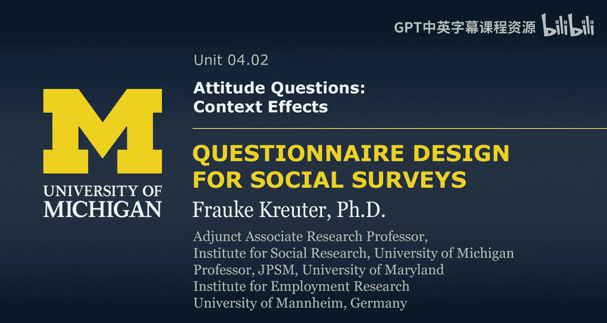
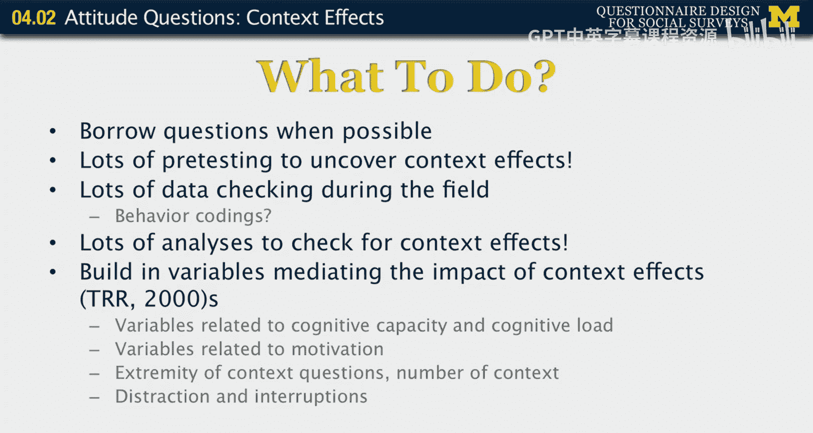

#  062：态度问题中的语境效应 📊

在本节课中，我们将学习语境如何影响受访者对态度问题的回答。语境效应可能出现在回答过程的任何阶段，从而最终改变回答结果。理解这些效应对于设计有效的调查问卷至关重要。

## 什么是语境效应？

语境通常会在受访者理解问题、形成判断和评价时，影响其考虑因素，从而影响回答。请回想我们之前讨论的回答过程模型，语境效应可以出现在这些阶段的任何一处，并最终改变回答。

重要的是，我们需要以非常广泛的视角来思考语境效应。调查的许多方面都可以构成语境，例如问卷的主题、访问员、访问环境、问卷或访问员给出的指示、问题附带的图片、问题的措辞、回答选项，甚至是问题本身的顺序。我们将在本节中看到一些例子，后续在讨论问卷布局和调查模式时，我们还会回到这些语境效应。

## 语境如何影响理解？

语境效应首先可以出现在理解阶段。以下是两种主要的影响方式。

### 同化效应

同化效应指受访者将先前问题纳入对当前项目的解释和理解中。

以下是一个来自Trenja和Razinski（1988）论文的例子：
> 你是否赞成通过《蒙特雷控制法案》？
> *   当此问题跟在关于通货膨胀的问题之后时，27.5%的受访者表示“赞成”。
> *   当此问题跟在一个中性问题之后时，12.5%的受访者表示“赞成”。

由于《蒙特雷控制法案》与反通货膨胀相关，这个语境改变了对此特定问题持赞成态度的回答比例。

### 对比效应

对比效应指受访者在解释和理解当前项目时，排除了先前问题的影响。

我们稍后会展示一个例子，当问题涉及非常具体与非常一般的内容，且与幸福感和婚姻相关时，就会出现这种语境效应。当我们讲到那个例子时，请记住这种对比效应。

这两种效应对问卷设计者都有启示。正如我们最初所说，应避免使用模糊和含糊的术语，并且要尽可能具体地描述你想要谈论的态度对象。

## 语境如何影响信息提取与判断？

上一节我们介绍了语境在理解阶段的影响，本节中我们来看看语境在信息提取和判断阶段的作用。

### 在提取阶段

语境会提示某些考虑因素的易得性或提取。这既可以表现为同化（纳入考虑），也可以表现为对比（排除某些考虑的提取）。

### 在判断阶段

这与“纳入-排除”模型有关。Schwartz和Bless在1992年的论文中讨论了这一点。它在一定程度上取决于目标与标准的构建。信息的提取和应用与记忆中的易得性有关：有些信息是长期易得的，有些则是暂时易得的，依赖于语境。

让我用一个具体陈述来解释：
*   **目标的表征**：信息被语境激活，并被纳入目标的表征中，这会产生**同化效应**。
*   **信息的排除**：信息主要被语境激活，但被排除在目标的表征之外，这会产生**减法式对比效应**。
*   **标准的纳入**：如果被语境激活的信息被纳入标准的表征中，则会出现**比较式对比效应**。

因此，存在**同化效应**、**减法式对比效应**和**比较式对比效应**。

让我举一个例子。假设语境是关于理查德·尼克松的可信度（通过前面的问题或给出的信息提及），由于当时的丑闻，他的评分通常很低。
*   如果**目标**问题是“政治家的可信度”，那么由于同化效应（尼克松被纳入了政治家的表征中），政治家的评分会**偏低**。
*   如果**目标**问题是“另一位受好评的特定政治家的可信度”（例如纽特·金里奇），那么由于对比效应（尼克松被纳入了标准的表征中，从而降低了基准），该政治家的评分会**偏高**。

以下是这种效应的一个实例。一项关于政治家总体和特定政治家的问题研究，Y轴是B insurance（2010）论文中使用的可信度量表。如果丑闻被提及（黑色条形），对特定政治家的评分远高于丑闻未被提及时。但这种差异在询问“政治家总体”和询问“特定政治家”之间尤为明显。

## 语境如何影响报告与映射？

语境效应同样可以进入报告和映射阶段。
*   **同化效应**意味着对分组在一起的问题会得到一致的回答。
*   **对比效应**则会导致相反的结果。

例如，如果尼克松被映射为“最不可信”的锚点，那么这种锚定效应会改变你对后续问题的评分或选择的量表点。

## 总结与对问卷设计的启示

本节课中我们一起学习了态度问题中的各种语境效应。现在让我们来总结一下。

语境效应可以：
1.  **进入理解阶段**：因为前面问题的内容可能影响受访者对后面问题的解释。
2.  **进入提取阶段**：影响信息的易得性。
3.  **进入判断阶段**：用于回答前面问题的信息在记忆中变得更易得，并被用于构建目标或标准的表征。
4.  **引起报告问题**：例如对分组问题的一致性报告，以及评定量表的锚定。

这对问卷设计者产生影响：
*   首先，它对我们数据的解释和发现（无论是实质性的还是方法论的）的普适性构成威胁。
*   例如，在趋势分析中（如在综合社会调查或其他综合类调查中反复询问相同问题），可能难以长期保持相同的语境。即使能保持，问题的含义也可能随时间改变。
*   此外，可能与人口亚组的 demographic 特征产生交互作用。
*   请注意，虽然我们在例子中主要讨论了前面问题的语境，但请记住，访问环境或历史背景也可能产生这些效应。

因此，在设计问卷时，理解并逐一审视回答形成的各个阶段（理解、提取、判断和回答形成）非常重要。要思考：在这个设置、这次访问、这个语境中，是否有东西可能影响某个特定阶段？

## 应对策略

以下是一些应对语境效应的策略：
*   **借用问题**：在可能的情况下，借用其他调查中使用过的问题，前提是这些问题在其他地方有效，且时间没有过去太久，语境也类似。
*   **预测试**：需要进行大量预测试来发现语境效应。
*   **实地数据检查**：在实地调查期间进行数据检查，可能包括行为编码。
*   **事后定量分析**：如果可能，进行大量分析以定量检查语境效应。
*   **实验设计**：理想情况下，最好能设计一些实验，例如A/B测试或分票实验。
*   **引入中介变量**：可以引入一些可能调节语境效应影响的变量，例如与认知能力或认知负荷相关的变量、与动机相关的变量。
*   **保持警觉**：在设计问卷和整个调查工具时，要对任何类型的语境干扰、中断保持认知。

在下一节中，我将回到我们之前谈到态度效应时提及的“具体评价与一般评价”的例子。