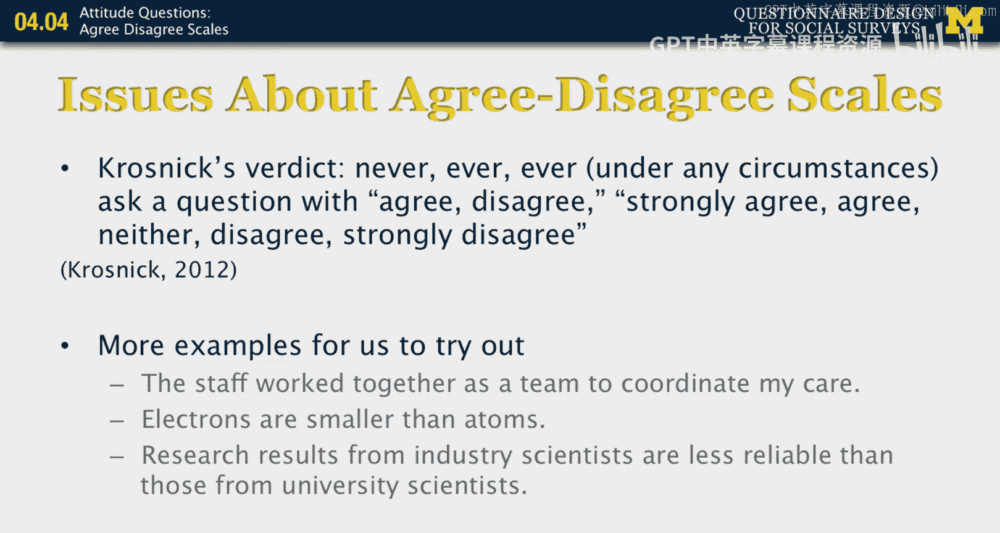

#  064：态度问题：同意-反对量表 📊

在本节课中，我们将要学习一种特定的态度问题类型——同意-反对量表。这种量表非常流行，但也存在一些需要注意的问题。

## 概述

同意-反对量表是一种常见的问卷格式，用于测量受访者对特定陈述的态度。然而，尽管它易于使用，研究者也需要了解其潜在的缺陷。

## 同意-反对量表示例

以下是一个典型的同意-反对量表问题示例：

> 您在多大程度上同意或不同意以下陈述？
> 1.  堕胎应该合法化。
> 2.  我对堕胎的看法非常确定。

每个陈述都对应一个五点量表，其端点标记为“非常同意”和“非常不同意”，中间点则完全标记为“同意”、“既不同意也不反对”、“不同意”。

这是一种非常常见的问题类型。

## 优点与缺点

这种格式的优势在于易于实施。受访者熟悉这种格式，他们以前见过。根据Krosnick在2012年的论文，受访者回答此类问题的速度比其他格式快约三分之二，我们得到的“不知道”答案也更少，并且受访者实际上喜欢这种量表。

然而，这里也有一些我们应该提到的缺点，早期的文献已经指出过，并在引用的Krosnick论文中进行了总结。

以下是主要缺点：

1.  **默许偏差**：受访者倾向于以礼貌和顺从的方式回答。在其他情境中，默许偏差意味着受访者更可能对问题回答“是”。受访者处于顺从的一方，但也可能遵从更高地位者并采取默许策略，所有这些都导致更多的顺从或“是的，当然”的回答。
2.  **双重含义**：它们通常以双重含义的方式呈现。这是一个例子：“美国已经偏离真正的美国生活方式太远，可能需要用武力来恢复它。”这是一个你可以在调查中找到的陈述，询问你是否同意或不同意这个陈述很容易，但在这里你必须对两件不同的事情表示同意或不同意。一是美国正在偏离真正的美国，二是人们可能对同意或不同意有不同的看法。
3.  **歧义性**：“不同意”选项可能含义模糊。以这个项目为例：“我很少感到沮丧。”那么“不同意”对这个项目到底意味着什么？你从未感到沮丧，还是你一直感到沮丧？这可能是两个不同的立场，不清楚是什么。不同意这些项目中的任何一个意味着什么？

## 替代方案

因此，Krosnick认为，文献中你可以考虑用其他方式来问同样的问题。

在此表的左侧，您可以看到针对特定问题的同意-反对格式，这可能应该避免。在右侧，您看到推荐使用的、针对具体结构设计的回答选项。

对于“堕胎应该合法化”这个项目，您在右侧再次看到五点量表。同样的问题被重新表述为：“有些人认为堕胎应该合法化，但其他人认为堕胎不应该合法化。哪一种最接近您的观点？”这将是避免我们刚才讨论的一些问题的一种提问方式。

“我对堕胎的看法非常确定”在这里与重新表述配对：“您对堕胎看法的确定程度如何？”选项为“非常确定”、“有些确定”、“不太确定”、“一点也不确定”。这也将是针对同一问题的替代表述。

如果您阅读John Krosnick的论文，特别是我们在此引用的那篇，他的结论是：**在任何情况下，永远、永远、永远不要使用同意-反对或非常同意到非常反对的量表来提问。**

## 练习与思考

让我们尝试下面列出的更多例子。

1.  工作人员团队合作协调了我的护理。（这可能是一个针对医院患者的问题。）
2.  电子比原子小。
3.  工业科学家的研究结果不如大学科学家的可靠。

您认为哪些问题可以使用同意-反对量表？您更倾向于对哪些问题使用替代表述？

我们在此提供了一份表格，供您为那些您更倾向于使用替代方案的问题输入您的替代表述。

## 总结

本节课中，我们一起学习了同意-反对量表这种态度问题的测量方法。我们了解了它的基本格式、主要优点，并重点探讨了其存在的三个主要问题：默许偏差、双重含义和歧义性。最后，我们学习了如何通过使用针对具体结构设计的回答选项来重新表述问题，以规避这些缺陷。记住，在设计问卷时，清晰、无歧义地测量态度至关重要。

在下一节中，我们将讨论“不知道”选项的处理。