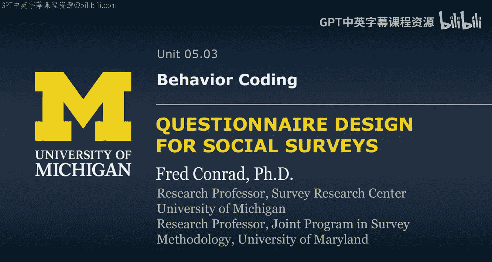
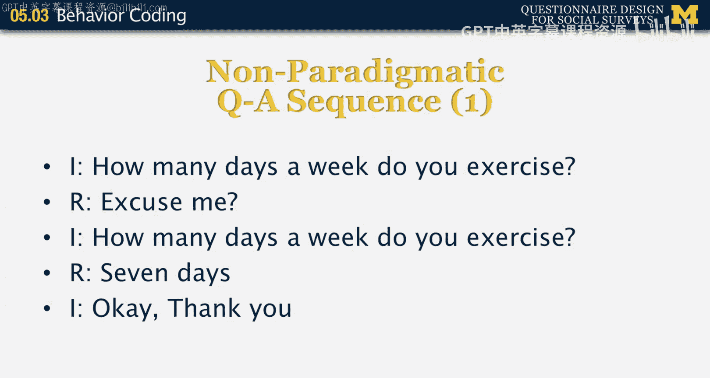
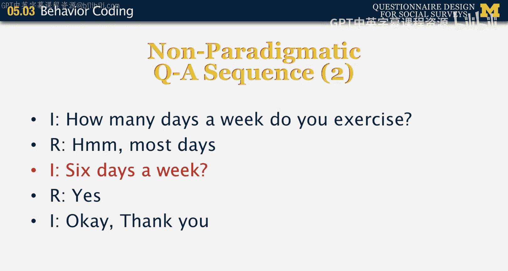
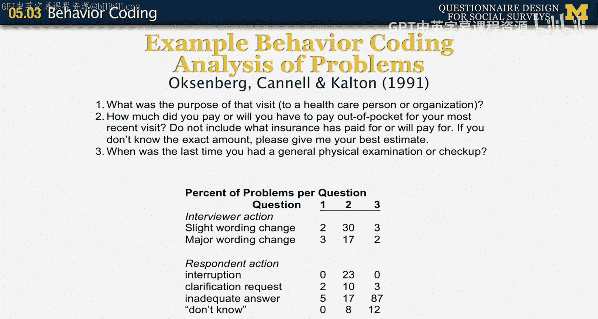
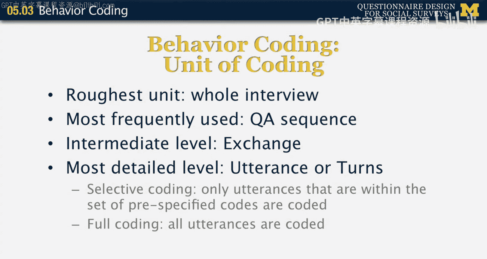
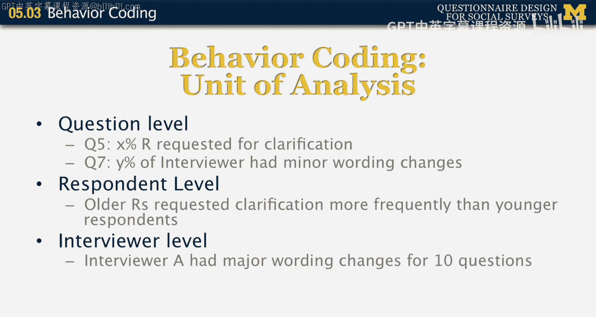
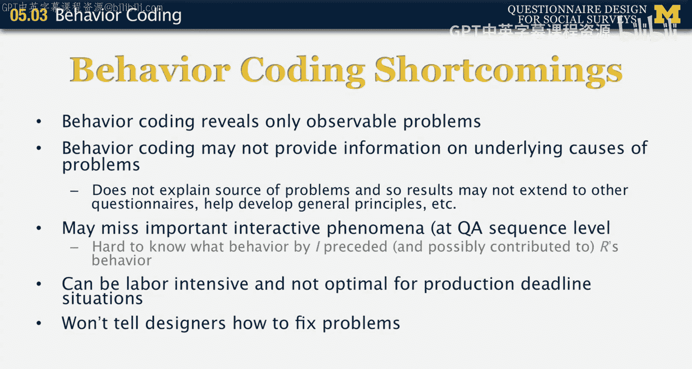
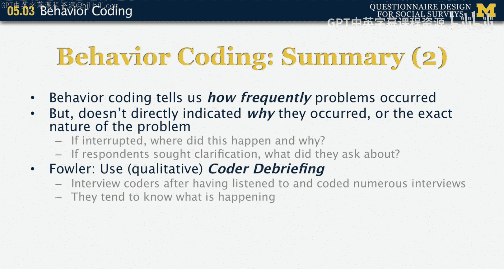

#  070：行为编码 📝

在本节课中，我们将学习一种用于测试调查问题的定性技术：行为编码。我们将了解其定义、用途、编码方案、分析单元、优势与局限性，以及如何解读其结果。

---

## 概述

行为编码是对访谈员和受访者行为的一套系统性观察方法，通常基于录音访谈。它能客观地衡量调查问题中存在的问题，具有系统性、可复制性和可靠性。本节将详细介绍行为编码的核心概念与应用。

---

## 什么是行为编码？🔍

行为编码是一套对访谈员和受访者行为进行系统性观察的方法，这些观察通常基于录音访谈。它提供了关于问题存在的客观衡量标准。

行为编码的过程是：编码员通过现场聆听或回放录音，观察访谈员与受访者之间的互动。编码员会为观察到的“问题”分配一个分类代码。这种编码会在多位访谈员进行的多次访谈中进行，有助于我们理解问答过程，特别是识别与理想问答序列的偏差——我们正是通过这些偏差来定义问题。

最终，行为编码会生成一份量化总结报告，其中包含用于识别问题性问题的代码。

---

## 行为编码的用途 🎯

行为编码可以在调查过程的不同阶段以不同方式使用。
*   **数据收集前**：用于预测试问题，这是其主要用途。也可用于预测试数据收集程序。
*   **数据收集中**：用于监控访谈过程。
*   **数据收集后**：用于评估已收集数据的质量，并探究特定行为的原因和影响。

---

## 理想问答序列与偏差

梅纳德和谢弗提出了一个“范式问答序列”或“理想问答序列”的例子。在这个序列中：
1.  访谈员**完全按照措辞**读出问题。
2.  受访者提供一个**充分的**或**可接受的**答案。
3.  访谈员**确认**该答案，然后继续下一个问题。

行为编码的目的正是检测**偏离**此类范式序列的情况。

以下是一个偏差不明显的例子（在典型的整体问答序列层面，行为编码可能不会标记）：
> **访谈员**：你每周锻炼几天？
> **受访者**：不好意思，你说什么？
> **访谈员**：你每周锻炼几天？
> **受访者**：7天。
> **访谈员**：好的，谢谢。

这里除了受访者最初没听清问题外，并没有明显问题。是否编码此类情况取决于分析单元的定义。

然而，以下序列则是一个更明显的偏差，表明存在问题：
> **访谈员**：你每周锻炼几天？
> **受访者**：大多数日子。
> **访谈员**：一周六天吗？
> **受访者**：是的。
> **访谈员**：好的，谢谢。

这里，访谈员明显进行了所谓的“指令性干预”或“指令性追问”，为受访者提供了一个对方并未给出的答案。在大多数行为编码方案中，这几乎肯定会被标记为问题。

---

## 行为编码方案

以下是一套知名的编码方案，由格罗夫斯等人报告，但实际源自密歇根大学的查理·坎内尔及其同事的工作。它包括一组访谈员代码和一组受访者代码。

**访谈员代码包括**：
*   `I1`：访谈员完全按照措辞读出问题。
*   `I2`：访谈员以轻微改动的方式读出问题。
*   `I3`：访谈员以改变原意的方式读出问题。

**受访者代码包括**：
*   `R1`：受访者在访谈员读题时打断。
*   `R2`：受访者要求澄清。
*   `R3`：受访者给出充分答案。
*   `R4`：受访者给出有条件/限定的答案。
*   `R5`：受访者给出不充分答案。
*   `R6`：受访者回答“不知道”。
*   `R7`：受访者拒绝回答。

---

## 行为编码示例

使用上述编码系统，奥克斯伯格、坎内尔和卡尔顿展示了该方法的有效性。以下是三个问题及其对应的代码使用频率：

| 问题 | 访谈员轻微措辞改变 (`I2`) | 访谈员重大措辞改变 (`I3`) | 受访者打断 (`R1`) | 受访者答案不充分 (`R5`) |
| :--- | :---: | :---: | :---: | :---: |
| 1. 那次去看医护人员或机构的目的是什么？ | 2% | 1% | 1% | 2% |
| 2. 你为最近一次就诊自付了或将要自付多少钱？（不包括保险支付部分）如果你不知道确切金额，请给出你最好的估计。 | **15%** | **8%** | **12%** | 3% |
| 3. 你上次做全面体检是什么时候？ | 3% | 2% | 2% | **10%** |

观察表格中的数据，可以发现：
*   对于**问题2**，访谈员的“轻微措辞改变”和“重大措辞改变”代码频率显著较高。同时，受访者的“打断”行为频率也突出。这可能是因为问题2包含多个组成部分，访谈员可能在措辞上出错并重新表述，而由于其长度，受访者可能在问题读完前就开始回答。
*   对于**问题3**，受访者的“答案不充分”代码频率突出。这是因为该问题没有提供明确的时间范围或答案格式要求，如果问题需要“月/日”而受访者只回答了“月”，则会被标记。

行为编码使这些问题变得显而易见，而这些问题在设计者测试前可能并不明显。

---

## 诊断性代码与优势

当行为编码用于预测试时，某些代码尤其具有诊断性。

**特别能指示问题的受访者代码包括**：要求澄清、要求重复问题、给出有条件答案、不充分答案、“不知道”或拒绝回答。

**特别能指示问题的访谈员代码包括**：改变问题措辞（无论是轻微还是重大改变）。当某种改变频繁出现时，识别被改变的确切词语就很重要，因为这些词语可能需要被更好的措辞替换。

**行为编码的优势在于**：
1.  **可靠性高**：容易在多位编码员之间达成高度一致。
2.  **量化结果**：能够快速地将定性观察转化为可计量的定量数据。

---

## 分析单元

行为编码可以在多个不同的分析层面或使用不同的分析单元进行。
*   **最粗略的单元是整场访谈**：这很少使用，因为它对指出需要修改的具体问题帮助不大。
*   **最常用的方法是问答序列**：即对我们一直看到的例子进行编码，对访谈员的提问和受访者的回答进行整体编码。
*   **更详细的分析**：可以着眼于话语对，或者最详细的分析在**话语层面**或**话轮层面**。

不同层面的分析能告诉我们不同的信息：
*   **问题层面**：例如，在问题5中，有 X% 的受访者要求澄清；在问题7中，有 Y% 的访谈员出现了轻微措辞改变。
*   **受访者层面**：例如，年长受访者比年轻受访者更频繁地要求澄清。
*   **访谈员层面**：例如，访谈员A在10个问题上出现了重大措辞改变。

话轮层面的分析比问答序列层面的分析更详细，能提供在更整体层面无法获得的额外信息。话轮分析有时被称为**序列分析**，例如，它可以分析当受访者的答案不在预设选项内时，访谈员是否重新读了问题（即多个话轮之间存在序列关系）。这有助于解释不同访谈技巧是否有效。

---

## 行为编码的局限性

尽管行为编码能提供有益的见解，但该技术也存在一些缺点：
1.  **仅揭示可观察的问题**：可能无法提供问题根本原因的信息。
2.  **不解释问题根源**：因此结果可能无法推广到其他问卷，也无助于形成通用原则。
3.  **可能遗漏重要的互动现象**：当编码在问答序列层面进行时，很难知道访谈员的何种行为先发生并可能导致了受访者的行为（如果未明确编码这种序列关系）。
4.  **劳动密集型**：对生产截止日期紧迫的情况并非最优选择。
5.  **不提供解决方案**：不会告诉设计者如何修复问题。

---

## 总结与补充方法

行为编码通常使用一套可分为**面向访谈员的代码**和**面向受访者的代码**。
*   **典型的访谈员代码**：包括读题错误、追问行为及其他涉及追问的错误。
*   **典型的受访者代码**：包括要求重复问题、要求澄清、提供无法编码或不可接受的回答、打断访谈员读题、以及表示不确定的迹象。

行为编码告诉我们问题发生的频率，但**不直接告诉我们它们为何发生或问题的确切性质**。例如，如果受访者打断访谈员，是在哪里发生的？为什么？如果受访者寻求澄清，他们具体问了什么？

为了弥补这些局限性，福勒建议对编码员进行**定性汇报**。在聆听并编码了可能数百次访谈后，编码员非常接近数据，往往知道发生了什么。因此，他们可以为行为代码所捕获的许多问题的根源提供见解。

---

## 课程总结

本节课中，我们一起学习了行为编码这一重要的定性预测试技术。我们了解了它的定义、应用场景、标准编码方案以及如何在不同层面进行分析。同时，我们也认识到行为编码的局限性，并了解了通过编码员汇报进行补充的方法。在下一节中，我们将转向介绍测试调查问题的定量技术。